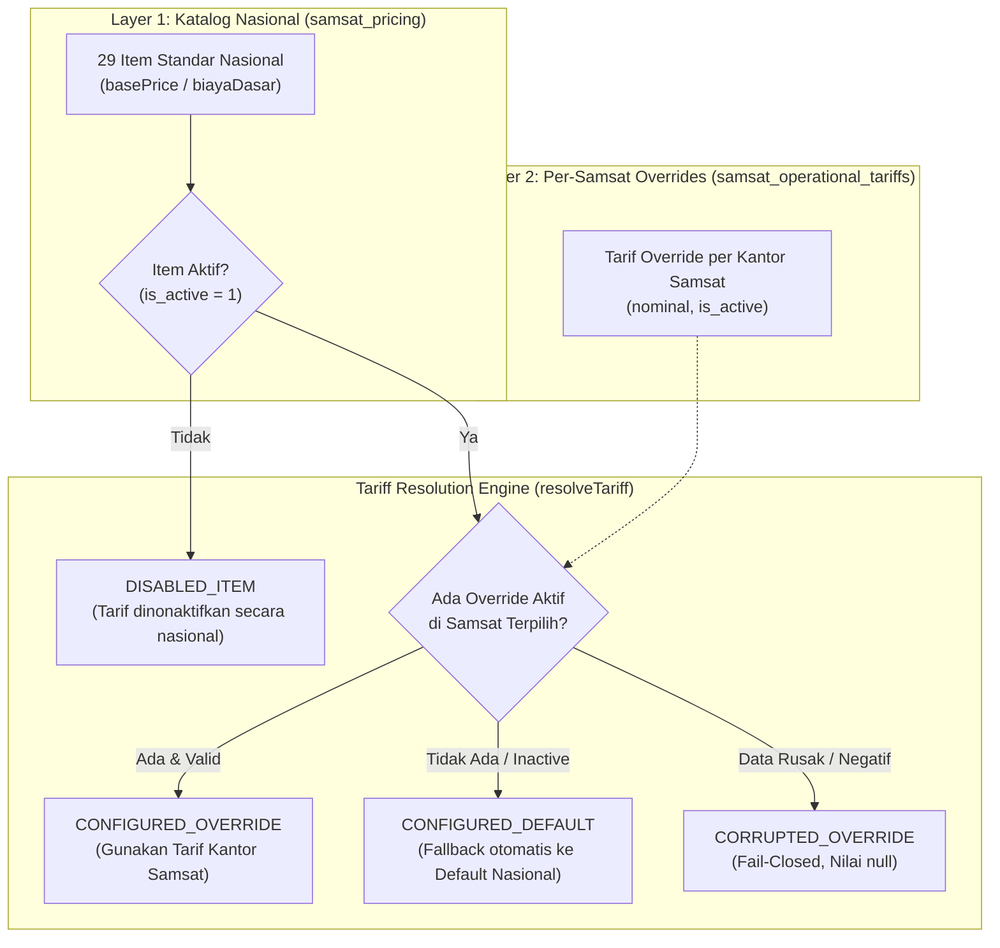

# ARSITEKTUR BASIS DATA PENETAPAN TARIF & BIAYA (PRICING DATABASE ARCHITECTURE)
## SUNBiroJasa / Admin SUN89 — Biro Jasa Management System

Dokumen ini mendefinisikan arsitektur kanonis, skema database, pemisahan tabel aktif vs legacy, mekanisme penanganan konkurensi, serta hierarki resolusi tarif pada sistem penetapan harga SUNBiroJasa.

---

## 1. IKHTISAR TABEL: AKTIF (CANONICAL) VS LEGACY

Dalam evolusi arsitektur database SUNBiroJasa, penetapan tarif telah dimigrasikan dari skema sederhana berbasis baris statis menuju arsitektur berlapis (National Catalog + Per-Samsat Overrides + Per-Service Configs).

| Status | Nama Tabel | Peran & Deskripsi | Sumber Data / Konsumen Utama |
|---|---|---|---|
| **CANONICAL ACTIVE** | `service_pricing_configs` | Menyimpan konfigurasi biaya jasa, biaya antar jemput, dan rincian breakdown biaya layanan per kantor Samsat (PK: `serviceId:samsatId`). | Tab Biaya Layanan, Engine Kalkulator Order, API `/api/pricing/service-configs` |
| **CANONICAL ACTIVE** | `samsat_pricing` | Master Katalog Nasional Samsat (29 item biaya dasar standar kepolisian & Samsat seluruh Indonesia). | Tab Harga Dasar Samsat (Katalog Nasional), API `/api/pricing/samsat-items` |
| **CANONICAL ACTIVE** | `samsat_operational_tariffs` | Tarif override operasional per kantor Samsat (relasi 1-to-many ke `samsat_offices` dan `samsat_pricing`). | Tab Harga Dasar Samsat (Per-Samsat Overrides), Order Pricing Resolver |
| **CANONICAL ACTIVE** | `estimation_templates` | Template dan aturan penyesuaian formula estimasi biaya per layanan. | Modul Estimasi Biaya & Perhitungan PKB |
| **DEPRECATED / LEGACY** | `biaya_layanan` | Skema lama biaya layanan flat per layanan. **DILARANG DIGUNAKAN UNTUK OPERASIONAL BARU**. | Dipertahankan untuk kompatibilitas data awal & initial database seed. |
| **DEPRECATED / LEGACY** | `harga_dasar_samsat` | Skema lama harga dasar Samsat flat. **DILARANG DIGUNAKAN UNTUK OPERASIONAL BARU**. | Dipertahankan untuk kompatibilitas data awal & initial database seed. |

> [!IMPORTANT]
> **Kebijakan Deprecasi (Strict DO NOT DROP Policy):**
> Tabel `biaya_layanan` dan `harga_dasar_samsat` **TIDAK BOLEH DIHAPUS (DO NOT DROP)** dari skema produksi karena masih direferensikan pada script seeding inisial dan fallback historis. Seluruh modul frontend, backend services, controller, dan audit log baru **HANYA BERINTERAKSI** dengan tabel kanonis aktif.

---

## 2. ARSITEKTUR DUAL-LAYER PENETAPAN TARIF SAMSAT

Tarif komponen Samsat (seperti Cetak STNK, Cetak Plat TNKB, Cek Fisik, PNBP BPKB, Fiskal Antar Samsat, dll.) diatur dalam 2 lapisan hierarki:



### Logika Resolusi (Two-Stage Gate):
1. **Master Catalog Gate (`samsat_pricing`)**:
   - Jika item dinonaktifkan di katalog nasional (`is_active = 0`), item tersebut otomatis dinonaktifkan di seluruh Samsat di Indonesia, mengabaikan konfigurasi lokal manapun (`DISABLED_ITEM`).
2. **Tariff Gate (`samsat_operational_tariffs`)**:
   - Jika terdapat override lokal aktif dengan nominal valid ($\ge 0$), sistem menggunakan `overridePrice` (`CONFIGURED_OVERRIDE`).
   - Jika kantor Samsat tidak memiliki override atau override berstatus nonaktif, sistem melakukan **fallback otomatis tanpa henti** ke `nationalDefaultPrice` dari `samsat_pricing` (`CONFIGURED_DEFAULT`).
   - Jika nominal override tidak valid (negatif, NaN, non-integer), sistem menerapkan prinsip keamanan *fail-closed* (`CORRUPTED_OVERRIDE`), memblokir penggunaan harga yang salah.

---

## 3. SKEMA DAN STRUKTUR TABEL AKTIF

### 3.1 `service_pricing_configs`
Menyimpan konfigurasi biaya per kombinasi layanan dan kantor Samsat.

```sql
CREATE TABLE IF NOT EXISTS service_pricing_configs (
  id TEXT PRIMARY KEY,               -- Composite PK: '${service_id}:${samsat_id}'
  service_id TEXT NOT NULL,          -- ID Layanan (e.g. 'svc-perp-1th')
  service_name TEXT NOT NULL,        -- Nama Layanan Resmi
  samsat_id TEXT NOT NULL,           -- ID Samsat (e.g. 'samsat-jakarta-timur')
  wilayah TEXT NOT NULL,             -- Nama Wilayah Samsat
  biaya_jasa REAL NOT NULL DEFAULT 0,-- Biaya Jasa Utama
  biaya_antar_jemput REAL NOT NULL DEFAULT 50000, -- Biaya Antar Jemput
  data_json TEXT NOT NULL,           -- Rincian komponen biaya lengkap & opsi tambahan
  updated_at TEXT NOT NULL DEFAULT (datetime('now'))
);

CREATE INDEX IF NOT EXISTS idx_service_pricing_service ON service_pricing_configs(service_id);
CREATE INDEX IF NOT EXISTS idx_service_pricing_samsat ON service_pricing_configs(samsat_id);
```

#### Struktur Kolom `data_json`:
Kolom `data_json` menyimpan struktur fleksibel untuk komponen biaya yang dapat dikustomisasi:
- `biayaJasaLengkap`: Nominal jasa reguler lengkap.
- `biayaJasaNembak`: Nominal jasa tanpa KTP pemilik asli.
- `pengurusanKhususEnabled`: Status aktif pengurusan khusus.
- `biayaAntarJemput`: Nominal pengantaran berkas.
- `biayaLainnya`: Array komponen tambahan fleksibel `[{ id, label, nominal, enabled, includesInTotal }]`.
- `components`: Objek boolean pemetaan komponen aktif `{ cekFisik: true, cetakStnk: true, ... }`.

### 3.2 `samsat_pricing`
Katalog Nasional untuk 29 item tarif dasar Samsat se-Indonesia.

```sql
CREATE TABLE IF NOT EXISTS samsat_pricing (
  id TEXT PRIMARY KEY,               -- ID Item (e.g. 'cetak-stnk-roda-4')
  nama_item TEXT NOT NULL,           -- Nama Komponen
  kategori TEXT NOT NULL,            -- Kategori (Pajak, PNBP, Jasa Raharja, Administrasi)
  tipe_kendaraan TEXT NOT NULL,      -- Roda 2 / Roda 4
  biaya_dasar REAL NOT NULL DEFAULT 0, -- Tarif Standar Nasional
  deskripsi TEXT,                    -- Keterangan regulasi / dasar hukum
  is_active INTEGER NOT NULL DEFAULT 1 CHECK(is_active IN (0, 1)),
  is_configured INTEGER NOT NULL DEFAULT 0 CHECK(is_configured IN (0, 1)),
  data_json TEXT NOT NULL,
  created_at TEXT NOT NULL DEFAULT (datetime('now')),
  updated_at TEXT NOT NULL DEFAULT (datetime('now'))
);
```

### 3.3 `samsat_operational_tariffs`
Tarif spesifik per kantor Samsat yang menimpa (override) tarif standar nasional.

```sql
CREATE TABLE IF NOT EXISTS samsat_operational_tariffs (
  id TEXT PRIMARY KEY,               -- UUID Tarif
  samsat_id TEXT NOT NULL,           -- Foreign Key -> samsat_offices(id)
  pricing_item_id TEXT NOT NULL,     -- Foreign Key -> samsat_pricing(id)
  nominal INTEGER NOT NULL CHECK(nominal >= 0),
  is_active INTEGER NOT NULL DEFAULT 1 CHECK(is_active IN (0, 1)),
  created_by_employee_id TEXT,      -- Audit Actor ID
  updated_by_employee_id TEXT,      -- Audit Actor ID
  created_at TEXT NOT NULL DEFAULT (datetime('now')),
  updated_at TEXT NOT NULL DEFAULT (datetime('now')),
  FOREIGN KEY (samsat_id) REFERENCES samsat_offices(id) ON DELETE RESTRICT,
  FOREIGN KEY (pricing_item_id) REFERENCES samsat_pricing(id) ON DELETE RESTRICT,
  UNIQUE(samsat_id, pricing_item_id)
);
```

---

## 4. JAMINAN ISOLASI DATA & KEAMANAN KONKURENSI

### 4.1 Row-Level Isolation (Composite Primary Key)
Setiap rekaman dalam `service_pricing_configs` diidentifikasi secara unik dengan Primary Key komposit berformat:
$$\text{id} = \text{serviceId} + \text{":"} + \text{samsatId}$$
Contoh: `svc-perp-1th:samsat-jakarta-timur`.

**Jaminan Isolasi Lintas Wilayah:**
Pembaruan konfigurasi tarif untuk Samsat Jakarta Timur dieksekusi dengan query berparameter:
```sql
INSERT INTO service_pricing_configs (id, service_id, service_name, samsat_id, ...)
VALUES (?, ?, ?, ?, ...)
ON CONFLICT(id) DO UPDATE SET ... WHERE id = excluded.id;
```
Karena klausul `ON CONFLICT(id)` hanya menyentuh kunci `id` spesifik tersebut, modifikasi pada satu Samsat **100% terisolasi** dan secara matematis mustahil menimpa data Samsat wilayah lain (seperti Bandung atau Surabaya).

### 4.2 Concurrency Safeguards & Transaction Boundaries
1. **Single Statement Upsert**: Pembaruan satuan per wilayah dieksekusi secara atomik menggunakan instruksi `ON CONFLICT DO UPDATE` bawaan mesin SQLite WAL (Write-Ahead Logging).
2. **Batch Replications in Atomic Transactions**: Replikasi tarif massal ke 515 Samsat dieksekusi dalam satu transaksi atomik terproteksi:
   ```ts
   db.exec("BEGIN;");
   try {
     // Batch processing with PRESERVE_EXISTING_CUSTOM policies
     db.exec("COMMIT;");
   } catch (err) {
     db.exec("ROLLBACK;");
     throw err;
   }
   ```
   Jika terjadi interupsi, koneksi terputus, atau kegagalan pada kantor ke-50, seluruh transaksi di-rollback tanpa meninggalkan status inkonsistensi sebagian (half-applied state).
3. **Immutability of Historical Order Snapshots**:
   Perubahan tarif di `service_pricing_configs` atau `samsat_operational_tariffs` **TIDAK PERNAH** memodifikasi transaksi yang sudah dibuat. Setiap order yang tersimpan di tabel `orders` membekukan rincian harga pada saat pembuatan ke dalam kolom `cost_breakdown_json` / `costSnapshot`.

---

## 5. AUDIT TRAIL LOGGING SPECIFICATION

Setiap mutasi (CREATE, UPDATE, DELETE, DEACTIVATE) pada modul Master Data wajib menghasilkan jejak audit terverifikasi pada tabel `audit_logs`:

1. **Actor Verification**: Mengambil identitas aktual dari JWT payload (`req.user.userId`, `req.user.nama`, `req.user.role`).
2. **State Capture**:
   - `oldData`: Keadaan rekaman sebelum mutasi.
   - `newData`: Keadaan rekaman sesudah mutasi.
3. **No Sensitive Data**: Dilarang merekam password hash, token otentikasi, atau kunci rahasia API ke dalam `metadata_json`.
4. **No False Positives**: Pencatatan audit dieksekusi **SETELAH** operasi database berhasil. Jika terjadi error (validasi, duplikasi, constraint violation), audit log dibatalkan dan tidak mencatat keberhasilan fiktif.
