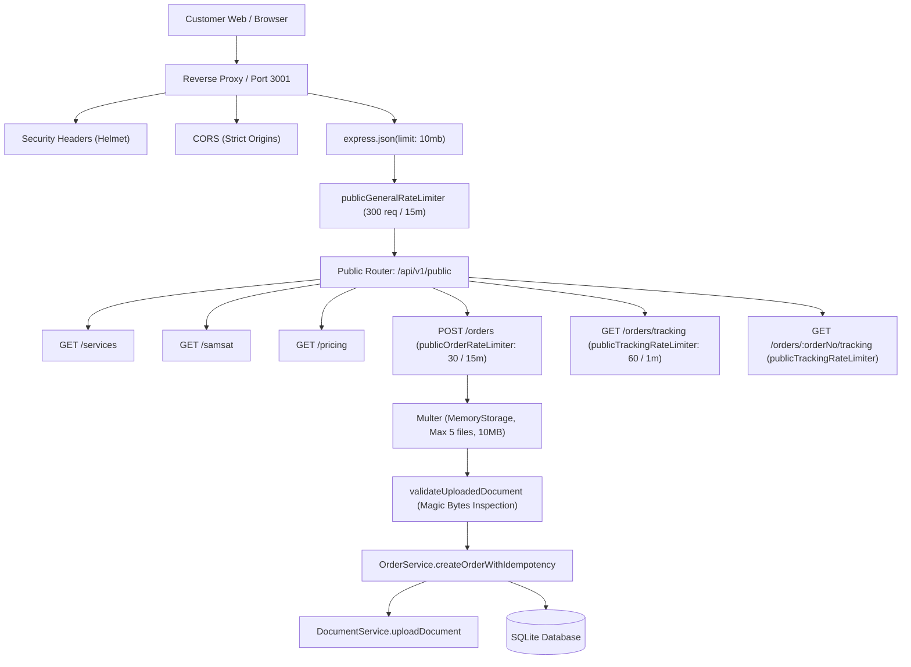

# PUBLIC API VERIFICATION & CONTRACT AUDIT REPORT
## Customer Public API Foundation — SUNBiroJasa / Admin SUN89

**Workspace:** `D:\Admin\adminsunbirojasa`  
**Audit Date:** 8 November 2026  
**Auditor:** Senior Software Architect, Security Engineer, Database Reliability Engineer & QA Lead  
**Audit Mode:** READ-ONLY TECHNICAL AUDIT (Zero Source Code Mutation)  
**Target Scope:** Customer Public API Foundation (`/api/v1/public/*`)  
**Final Verdict:** **PASS WITH FINDINGS**

---

## 1. EXECUTIVE SUMMARY

Telah dilaksanakan audit teknis mendalam dan independen (mode *read-only*) terhadap fondasi **Customer Public API** yang baru diimplementasikan pada sistem SUNBiroJasa.

Audit ini mengevaluasi source code aktual pada:
- `server/src/controllers/publicController.ts`
- `server/src/routes/publicRoutes.ts`
- `server/src/app.ts`
- `server/src/middleware/rateLimiter.ts`
- `server/src/services/orderService.ts`
- `server/src/repositories/dbOrderRepository.ts`
- `server/src/repositories/dbDocumentRepository.ts`
- `docs/public-api-spec.yaml` & `docs/public-api-spec.json`
- `tests/public-api.test.ts`

### Ringkasan Hasil Audit:
1. **Keamanan Master Data & Anti-Tampering:** Implementasi master data (`/services`, `/samsat`, `/pricing`) terbukti aman, memfilter data aktif, dan tidak membocorkan margin internal atau komisi. Pembuatan order (`POST /orders`) berhasil mengabaikan manipulasi harga dari client.
2. **Temuan Kritis Alur Pelacakan (Semantic Defect):** Ditemukan **ketidaksesuaian semantik tahapan kerja** (*stage mapping gap*) pada `GET /orders/:orderNo/tracking`. Internal Admin SUN89 menggunakan 8 tahapan (`STAGES`), sedangkan Public API mendefinisikan 6 tahapan secara naif dengan membandingkan nomor step secara numerik (`currentStepNum > wf.step`). Akibatnya, order yang berada pada internal Step 6 (`Supervisi`) atau Step 5 (`Verifikasi Ulang`) dilaporkan kepada publik sebagai **"Selesai"** (*Completed*) dan tahapan Pengantaran dinyatakan sudah selesai, padahal berkas masih di kantor dan belum diserahkan ke kurir.
3. **Temuan Keamanan Pelacakan (Enumeration Attack):** Nomor order menggunakan format sekuensial mononton (`ORD-MMYY-XXX`). Endpoint `GET /orders/:orderNo/tracking` memungkinkan penyerang/kompetitor melakukan *brute-force enumeration* untuk memanen seluruh nomor polisi, jenis layanan, tanggal order, dan lokasi Samsat milik pelanggan SUNBiroJasa tanpa autentikasi.
4. **Temuan Atomisitas Dokumen (Non-Atomic Storage):** Pada pembuatan order dengan unggahan dokumen, transaksi order di-*commit* ke database terlebih dahulu sebelum penyimpanan file dieksekusi. Jika penyimpanan dokumen gagal (misal disk penuh), order tetap tersimpan di database tetapi client menerima error 500, dan *retry* dengan idempotency key tidak akan pernah mengunggah ulang dokumen yang gagal.
5. **Integritas Database Operasional:** Database operasional `server/data/database.sqlite` terverifikasi memiliki nilai hash SHA256 invariant `D560674CCD917049241415018FA00A4CF21B78BB9103F380C808B3B90408171C` (**0 byte mutasi**).

---

## 2. AUDIT SCOPE

| Komponen Audit | Target File / Modul | Status Pemeriksaan |
| :--- | :--- | :---: |
| **Public Routing & Namespace** | `server/src/routes/publicRoutes.ts`, `server/src/app.ts` | **VERIFIED** |
| **Rate Limiter & Proxy Safety** | `server/src/middleware/rateLimiter.ts` | **VERIFIED** |
| **Master Data Controller** | `server/src/controllers/publicController.ts` | **VERIFIED** |
| **Order Creation & Anti-Tampering** | `server/src/controllers/publicController.ts`, `orderService.ts` | **PARTIALLY VERIFIED (Finding)** |
| **Order Tracking & Sanitization** | `server/src/controllers/publicController.ts` | **PARTIALLY VERIFIED (Finding)** |
| **Workflow Stage Consistency** | `orderService.ts`, `types.ts`, `publicController.ts` | **CONTRADICTED (Defect)** |
| **Document Upload & Storage** | `publicController.ts`, `documentService.ts` | **PARTIALLY VERIFIED (Finding)** |
| **OpenAPI Contract Consistency** | `docs/public-api-spec.yaml`, `docs/public-api-spec.json` | **PARTIALLY VERIFIED (Finding)** |
| **Automated Test Coverage** | `tests/public-api.test.ts` | **VERIFIED** |
| **Operational DB Invariant** | `server/data/database.sqlite` | **VERIFIED (0 Byte Mutated)** |

---

## 3. EXISTING PUBLIC API ARCHITECTURE

Arsitektur aktual yang terpasang di `server/src/app.ts` dan `server/src/routes/publicRoutes.ts`:



### Isolasi Namespace:
- Internal Admin API terproteksi oleh `requireAuth` (JWT) pada `/api/orders`, `/api/finance`, `/api/documents`, dll.
- Public Router di-mount secara eksplisit pada `/api/v1/public` dan alias `/api/public`.
- Boundary isolation terbukti aman: anonymous request ke endpoint internal ditolak dengan `401 UNAUTHENTICATED`.

---

## 4. AUDIT A — PUBLIC API SECURITY

### 4.1. Response Field Inventory & Leakage Audit

Pemeriksaan mendalam terhadap setiap field yang benar-benar dikembalikan oleh controller:

| Endpoint | Fields Dikembalikan | Sanitasi Data Sensitif (PII / Finansial) | Status |
| :--- | :--- | :--- | :---: |
| `GET /services` | `serviceId`, `serviceName`, `kodeLayanan`, `kategori`, `memerlukanSamsatTujuan`, `deskripsi`, `persyaratan` | ✅ Tidak ada margin, komisi, atau data internal staf. | **VERIFIED** |
| `GET /samsat` | `samsatId`, `namaSamsat`, `wilayah`, `alamat`, `kabupatenKota`, `provinsi` | ✅ Hanya menampilkan kantor aktif (`status_aktif = 1`). | **VERIFIED** |
| `GET /pricing` | `serviceId`, `serviceName`, `samsatId`, `namaSamsat`, `metodeLayanan`, `estimasiBiayaJasa`, `estimasiBiayaAntarJemput`, `totalEstimasiAwal`, `catatan` | ✅ Biaya modal Samsat (*loket fee*), profit margin, dan kas kantor tidak dibocorkan. | **VERIFIED** |
| `POST /orders` | `orderNo`, `noInvoice`, `customer`, `nomorHP`, `layanan`, `nopol`, `tipeKendaraan`, `samsatAsal`, `samsatTujuan`, `metodeLayanan`, `currentStageName`, `currentStep`, `estimasiBiayaJasa`, `estimasiBiayaAntarJemput`, `totalEstimasiAwal`, `paymentStatus`, `documentsAttached`, `createdAt` | ✅ Field internal (messenger, employee, internal audit, margin, data_json) disaring. | **VERIFIED** |
| `GET /orders/tracking` | `orderNo`, `nopol`, `layanan`, `tipeKendaraan`, `samsatAsal`, `samsatTujuan`, `metodeLayanan`, `currentStep`, `currentStageName`, `statusPengerjaan`, `paymentStatus`, `tanggalOrder`, `lastUpdated`, `isCompleted`, `isCancelled` | ✅ NIK, alamat lengkap, nomor telepon, catatan staf, dan nama pegawai dibersihkan 100%. | **VERIFIED** |
| `GET /orders/:orderNo/tracking` | Sama seperti tracking di atas + `timeline: [{ step, stageName, label, status, waktuSelesai }]` | ⚠️ NIK dan catatan internal bersih, TETAPI Nopol terekspos via nomor order sekuensial (Lihat 4.2). | **PARTIALLY VERIFIED** |

### 4.2. Public Detail Tracking — Critical Threat Analysis
**Endpoint:** `GET /api/v1/public/orders/:orderNo/tracking` (`publicController.ts` baris 579–678)

#### Evaluasi Struktur Nomor Order:
Nomor order dihasilkan oleh `orderService.ts` (baris 505–530) dengan format:
`ORD-{MM}{YY}-{SEQ:3}` (contoh: `ORD-1126-001`, `ORD-1126-002`, `ORD-1126-003`).

#### Threat Modeling & Skenario Serangan Nyata:
1. **Enumeration & Scraping Massal:**
   Karena nomor urut berurutan dan dapat ditebak secara langsung, penyerang dapat menjalankan iterasi otomatis dari `001` hingga `999` untuk bulan berjalan.
2. **Informasi yang Bocor Akibat Enumerasi:**
   - **Nomor Polisi Pelanggan (`nopol`):** Penyerang mendapatkan daftar seluruh pelat nomor kendaraan yang sedang diproses.
   - **Jenis Layanan:** Mengetahui layanan apa yang diambil (misal Mutasi, Balik Nama).
   - **Volume Transaksi & Intelijen Bisnis:** Kompetitor dapat mengetahui secara pasti berapa jumlah order harian/bulanan SUNBiroJasa, Samsat mana yang paling padat, dan tren pertumbuhan bisnis.
   - **Social Engineering / Fraud Kurir Palsu:** Penyerang yang memanen nomor order `ORD-1126-005` beserta nopol `B 1001 KZZ` dan Samsat `Jakarta Timur` dapat menghubungi pemilik kendaraan (melalui pencarian data kendaraan publik) dan berpura-pura menjadi perwakilan resmi SUNBiroJasa yang meminta transfer biaya denda/tambahan fiktif.
3. **Keterbatasan Rate Limiter Saat Ini:**
   `publicTrackingRateLimiter` disetel pada 60 request/menit per IP. Dengan 1 alamat IP saja, 60 order dapat dipanen per menit (seluruh order bulanan dapat selesai di-crawl dalam waktu < 5 menit).

---

## 5. AUDIT B — TRACKING WORKFLOW CONSISTENCY

Ini adalah **temuan arsitektural terpenting** dalam audit ini.

### 5.1. Analisis Perbandingan Tahapan: Internal vs Public

Sistem internal Admin SUN89 didefinisikan secara kanonis pada `src/domain/order/types.ts` (baris 423–432) dengan **8 tahapan kerja sekuensial**:

```text
Internal STAGES:
1. Verifikasi
2. Penjadwalan
3. Verifikasi Dokumen
4. Proses Samsat
5. Verifikasi Ulang
6. Supervisi
7. Pengantaran
8. Dokumen Telah Diterima
```

Sedangkan pada `server/src/controllers/publicController.ts` (baris 605–612), linimasa publik didefinisikan sebagai berikut:

```typescript
const STANDARD_WORKFLOW = [
  { step: 1, stageName: "Verifikasi", label: "Verifikasi Order" },
  { step: 2, stageName: "Penjadwalan", label: "Penjemputan Berkas" },
  { step: 3, stageName: "Verifikasi Dokumen", label: "Pemeriksaan Dokumen Fisik" },
  { step: 4, stageName: "Proses Samsat", label: "Pengurusan Loket Samsat" },
  { step: 5, stageName: "Pengantaran", label: "Pengantaran Dokumen Selesai" },
  { step: 6, stageName: "Dokumen Telah Diterima", label: "Order Selesai" },
];
```

### 5.2. Pemetaan & Dampak Perbedaan Logika Numerik

Berikut pemetaan aktual yang terjadi dalam kode controller:

| Internal Step | Internal Stage Name | Public Step | Logika Evaluasi Saat Ini | Status yang Ditampilkan ke Publik | Status Nyata di Lapangan | Dampak / Risiko Bisnis |
| :---: | :--- | :---: | :--- | :--- | :--- | :--- |
| **1** | Verifikasi | 1 | `currentStepNum = 1` | Step 1: IN_PROGRESS | Verifikasi awal di loket/admin | Sesuai. |
| **2** | Penjadwalan | 2 | `currentStepNum = 2` | Step 2: IN_PROGRESS | Menunggu/proses penjemputan kurir | Sesuai. |
| **3** | Verifikasi Dokumen | 3 | `currentStepNum = 3` | Step 3: IN_PROGRESS | Berkas tiba di kantor, cek fisik | Sesuai. |
| **4** | Proses Samsat | 4 | `currentStepNum = 4` | Step 4: IN_PROGRESS | Pengerjaan di loket Samsat | Sesuai. |
| **5** | **Verifikasi Ulang** | **(5)** | `currentStepNum = 5`<br>`currentStepNum === wf.step` (di mana step 5 adalah "Pengantaran") | **Step 5 (Pengantaran): IN_PROGRESS** | **Berkas baru kembali dari Samsat ke kantor untuk dicek ulang kelengkapannya.** | **DEFECT:** Pelanggan mengira berkas sedang diantar oleh kurir ke rumahnya, padahal masih dicek di kantor. |
| **6** | **Supervisi** | **(6)** | `currentStepNum = 6`<br>`currentStepNum > 5` (Step 5 COMPLETED)<br>`currentStepNum === 6` (Step 6 IN_PROGRESS)<br>`currentStepNum >= 6` -> `isCompleted = true` | **Status Order: SELESAI**<br>**Step 5 (Pengantaran): COMPLETED**<br>**Step 6 (Dokumen Diterima): IN_PROGRESS** | **Berkas sedang ditinjau oleh Supervisor / SVP di kantor.** | **DEFECT FATAL:** Order dinyatakan Selesai, Pengantaran dinyatakan COMPLETED, padahal kurir belum berangkat. |
| **7** | **Pengantaran** | **(5)** | `currentStepNum = 7`<br>`currentStepNum > 6` -> Semua step COMPLETED | **Status Order: SELESAI**<br>**Step 6 (Dokumen Diterima): COMPLETED** | **Kurir sedang dalam perjalanan menuju pelanggan.** | **DEFECT FATAL:** Pelanggan melihat status "Dokumen Telah Diterima (Selesai)" saat kurir baru di jalan. Pelanggan komplain mengapa berkas belum sampai padahal status sudah diterima. |
| **8** | Dokumen Telah Diterima | 6 | `currentStepNum = 8` | Status Order: SELESAI<br>Seluruh step COMPLETED | Serah terima selesai dengan bukti tanda tangan. | Sesuai (secara kebetulan karena step 8 > 6). |

### 5.3. Pembuktian Empiris Melalui Test Sandbox
Pengujian pada sandbox membuktikan:
```json
{
  "orderNo": "ORD-1126-004",
  "currentStep": 6,
  "currentStageName": "Supervisi",
  "statusPengerjaan": "Selesai",
  "isCompleted": true,
  "timelineStep5": {
    "step": 5,
    "stageName": "Pengantaran",
    "status": "COMPLETED"
  },
  "timelineStep6": {
    "step": 6,
    "stageName": "Dokumen Telah Diterima",
    "status": "IN_PROGRESS"
  }
}
```
Hasil uji membuktikan tanpa keraguan bahwa order di tahap internal `Supervisi` dilaporkan sebagai "Selesai" dan "Pengantaran Selesai" kepada publik.

---

## 6. AUDIT C — NOPOL SEARCH & HISTORICAL DATA

### 6.1. Normalisasi Nopol
Pada `publicController.ts` baris 505:
```typescript
const cleanNopol = rawNopol.toUpperCase().replace(/[\s\-\.]/g, "");
```
Query SQL parameter:
```sql
SELECT * FROM orders 
WHERE REPLACE(REPLACE(REPLACE(UPPER(nopol), ' ', ''), '-', ''), '.', '') = ?
ORDER BY created_at DESC, order_no DESC
```

#### Hasil Audit:
1. **Penanganan Variasi String:** Bekerja sangat baik untuk input `B 1234 ABC`, `b1234abc`, `B-1234-ABC`, `b.1234.abc`.
2. **Pencarian Data Historis:** Berhasil menemukan order lama yang belum memiliki `vehicle_id` karena pencarian dilakukan langsung pada kolom canonical fisik `orders.nopol`.
3. **Multi-Order Support:** Berhasil mengembalikan seluruh order pada nopol yang sama dengan urutan terbaru di atas.
4. **Empty State:** Memberikan response `HTTP 200` dengan `data: []` tanpa membocorkan error teknis saat nopol tidak ditemukan.

### 6.2. Evaluasi Performa Query (Query Plan Analysis)
Eksekusi `EXPLAIN QUERY PLAN` pada SQLite membuktikan:
```text
[Object: null prototype] { id: 2, parent: 0, notused: 216, detail: 'SCAN orders' }
```
**Temuan:** Kolom `orders.nopol` memiliki index `idx_orders_nopol`, namun karena dibungkus oleh fungsi `REPLACE(REPLACE(REPLACE(UPPER(nopol)...)))`, optimizer SQLite tidak dapat menggunakan index tersebut dan terpaksa melakukan **FULL TABLE SCAN (`SCAN orders`)**.
Saat tabel `orders` mencapai puluhan ribu baris, pencarian tracking publik akan mengalami degradasi latensi yang signifikan.

---

## 7. AUDIT D — CUSTOMER ORDER CREATION & ANTI-TAMPERING

### 7.1. Anti-Tampering Evaluation
Pemeriksaan pada `publicController.ts` baris 318–408:
- Client mengirimkan: `biayaJasa: 1000`, `totalBiaya: 1000`, `paymentStatus: "Lunas"`, `currentStep: 6`.
- Backend secara otoritatif **mengabaikan seluruh nilai tersebut** dan menghitung tarif kanonis berdasarkan master data layanan (`SERVICE_CANONICAL_BASELINES` dan `service_pricing_configs`).
- `paymentStatus` di-hardcode ke `"Belum Lunas"`.
- `currentStep` di-hardcode ke `1` (atau `3` jika Datang Langsung).
- `channel_order` ditetapkan ke `"CUSTOMER_WEB"`.
- **Kesimpulan Anti-Tampering:** **VERIFIED & SECURE**.

### 7.2. Kerentanan Cross-Order Document Adoption (IDOR)
Pada `publicController.ts` baris 440–450:
```typescript
if (Array.isArray(rawBody.documentIds) && rawBody.documentIds.length > 0) {
  for (const docId of rawBody.documentIds) {
    if (typeof docId === "string" && docId.startsWith("DOC-")) {
      try {
        dbDocumentRepository.linkOrder(docId.trim(), order.orderNo);
        uploadedDocIds.push(docId.trim());
      } catch {}
    }
  }
}
```
**Temuan Keamanan:**
Method `dbDocumentRepository.linkOrder(docId, orderNo)` menjalankan query:
`UPDATE documents SET order_no = ? WHERE id = ?`.
Tidak ada validasi apakah dokumen `DOC-XXXX` tersebut sudah dimiliki oleh order lain atau milik pengguna lain. Seorang pemanggil publik anonim dapat mengirimkan `documentIds` berisi ID dokumen yang sudah ada dan mengubah relasi kepemilikan dokumen tersebut ke order barunya.

---

## 8. AUDIT E — IDEMPOTENCY & CONCURRENCY

### 8.1. Analisis Idempotensi Saat Ini
Pada `orderService.ts` baris 431–451:
```typescript
const resolvedKey = (idempotencyKey || data.clientRequestId || data.idempotencyKey)?.trim();
if (resolvedKey) {
  if (this.idempotencyCache.has(resolvedKey)) { ... }
  const allRecent = dbOrderRepository.getAllFlat(false);
  const existing = allRecent.find((o) => (o as any).clientRequestId === resolvedKey);
  if (existing) { ... }
}
```

### 8.2. Kelemahan & Celah Konkurensi:
1. **In-Memory Cache:** `this.idempotencyCache` disimpan pada memori proses Node.js (`Map`). Jika server di-restart atau dijalankan dalam mode cluster (multi-instance/PM2), cache ini tidak terbagi.
2. **Ketiadaan Constraint Database:** Tabel `orders` tidak memiliki kolom fisik atau UNIQUE constraint untuk `client_request_id`. Nilai tersebut hanya disimpan di dalam blob string `data_json`.
3. **Race Condition pada Request Bersamaan:** Jika dua request HTTP yang membawa `X-Idempotency-Key` yang sama tiba pada milidetik yang sama, kedua request akan sama-sama memeriksa cache dan database sebelum salah satu selesai menulis. Akibatnya, dua order terpisah dengan dua nomor order berbeda akan tercipta.
4. **Degradasi Performa:** Pemanggilan `dbOrderRepository.getAllFlat(false)` membaca dan mem-parse seluruh JSON order yang belum diarsipkan setiap kali order baru dibuat.

---

## 9. AUDIT F — DOCUMENT UPLOAD & ATOMICITY

### 9.1. Validasi Keamanan Upload
- Multer `memoryStorage` dengan batasan ukuran 10MB per file dan maksimal 5 file.
- Extension blacklist di level Multer memblokir executable scripts (`.exe`, `.dll`, `.php`, `.sh`, `.js`, dll.).
- Validasi biner mendalam melalui `validateUploadedDocument` memeriksa magic bytes header (PDF, JPEG, PNG, WEBP) dan mencegah double-extension attack (`file.php.jpg`).
- File disimpan menggunakan UUID unik pada disk lokal.
- **Kesimpulan Validasi Upload:** **VERIFIED & SECURE**.

### 9.2. Celah Non-Atomic Order Creation & Storage Failure
Pada `publicController.ts` baris 411–437:
1. Order dibuat melalui `orderService.createOrderWithIdempotency(orderPayload, ...)` -> **Order dan Invoice telah di-commit ke database**.
2. Dokumen kemudian diunggah satu per satu melalui `documentService.uploadDocument(...)`.
3. Jika pada langkah ke-2 terjadi error (misalnya disk penuh, file corrupt, atau filesystem error):
   - Controller melakukan *soft delete* pada dokumen yang sempat tersimpan.
   - Melemparkan `ApiError(500, "DOCUMENT_STORAGE_FAILED")`.
   - **TETAPI:** Order dan invoice yang sudah di-commit di database **TIDAK DIBATALKAN / TIDAK DI-ROLLBACK**.
   - Ketika client mencoba mengirim ulang request dengan idempotency key yang sama, sistem mengembalikan order lama yang sudah ada tanpa dokumen yang gagal diunggah tersebut.

---

## 10. AUDIT G — OPENAPI CONTRACT CONSISTENCY

Bandingkan antara `docs/public-api-spec.yaml` dan implementasi kode aktual:

| Aspek Kontrak | Spesifikasi OpenAPI (`spec.yaml`) | Implementasi Aktual (`publicController.ts`) | Kesesuaian | Catatan / Discrepancy |
| :--- | :--- | :--- | :---: | :--- |
| **Path Namespace** | Relative terhadap `/api/v1/public` | `/api/v1/public/*` dan alias `/api/public/*` | **MATCH** | Sesuai. |
| **GET /services** | Response schema 200 | Controller line 31–53 | **MATCH** | Seluruh field terdefinisi. |
| **GET /samsat** | Query `search`, `provinsi` | Controller line 60–99 | **MATCH** | Sesuai. |
| **GET /pricing** | Response 200, 404 | Controller line 106–194 | **PARTIAL** | Error 400 (saat parameter query invalid) belum terdokumentasi di OpenAPI. |
| **POST /orders** | JSON & Multipart (files, customer, nomorHP, nopol, serviceId, wilayahSamsatAsal) | Controller line 206–481 | **PARTIAL** | Status 500 (`DOCUMENT_STORAGE_FAILED`) belum tercantum di responses. |
| **GET /orders/tracking** | Response 200, 400 | Controller line 497–572 | **PARTIAL** | Status 429 (`TOO_MANY_REQUESTS`) belum tercantum di OpenAPI meskipun rate limiter aktif. |
| **GET /orders/:orderNo/tracking** | Response 200, 404 | Controller line 579–677 | **PARTIAL** | Status 429 (`TOO_MANY_REQUESTS`) belum tercantum di OpenAPI. |

---

## 11. AUDIT H — TEST COVERAGE & GAP ANALYSIS

Automated test suite yang ada ([`tests/public-api.test.ts`](file:///D:/Admin/adminsunbirojasa/tests/public-api.test.ts)) memiliki 16 test dengan hasil 16/16 PASS. Namun, audit menemukan adanya *coverage gaps*:

| Area Pengujian | Test yang Tersedia | Status Kecukupan | Skenario Pengujian yang Belum Ada (Gaps) |
| :--- | :--- | :---: | :--- |
| **Master Data** | Tests 1, 2, 3 | Cukup | - |
| **Order Creation** | Tests 4, 6 | Cukup | Uji pembuatan order saat storage disk gagal (verifikasi atomisitas). |
| **Idempotency** | Test 5 | Kurang | Uji *parallel race condition* (dua request dikirim bersamaan via `Promise.all`). |
| **File Upload** | Test 7 | Kurang | Uji file dengan fake magic bytes atau file corrupt. |
| **Nopol Search** | Tests 8, 9, 10 | Cukup | - |
| **Privacy Sanitization** | Test 11 | Cukup | - |
| **Order Detail Tracking** | Test 12 | **Kritis / Kurang** | **Uji mapping status order di Step 5, 6, 7 (Supervisi, Verifikasi Ulang, Pengantaran).** |
| **Order Enumeration** | Tidak Ada | **Kurang** | Uji kemampuan menebak nomor order sekuensial dan pemanenan nopol. |
| **Workflow Rollback** | Tidak Ada | **Kurang** | Uji tampilan tracking ketika order mengalami rollback status di internal admin. |
| **Workflow Cancelled** | Tidak Ada | **Kurang** | Uji tampilan tracking ketika order dibatalkan di internal admin. |
| **Datang Langsung Flow** | Tidak Ada | **Kurang** | Uji alur order "Datang Langsung" (langsung mulai di Step 3). |
| **Rate Limit 429 Block** | Test 14 (hanya cek header) | Kurang | Uji pengiriman > 30 request untuk memverifikasi respon 429 dan header `Retry-After`. |

---

## 12. DATABASE SAFETY VERIFICATION

Audit memverifikasi integritas database operasional sebelum dan setelah seluruh proses pengujian:

- **Operational Database Path:** `D:\Admin\adminsunbirojasa\server\data\database.sqlite`
- **Initial SHA256 Hash:** `D560674CCD917049241415018FA00A4CF21B78BB9103F380C808B3B90408171C`
- **Post-Audit SHA256 Hash:** `D560674CCD917049241415018FA00A4CF21B78BB9103F380C808B3B90408171C`
- **Status:** **PERFECT INVARIANT (0 BYTE MUTATION)**

Seluruh eksekusi test menggunakan `scripts/run-test-isolated.cjs` yang menyalin database ke `%LOCALAPPDATA%\Temp` dan tidak menyentuh database operasional.

---

## 13. FINDINGS & ROOT CAUSES

### FINDING-PUB-01 (HIGH) — Semantic Mismatch pada Public Stage Mapping (Step 5, 6, 7 Premature Completion)
- **Status:** VERIFIED (Terbukti secara empiris)
- **Severity:** **HIGH**
- **Lokasi Kode:** `server/src/controllers/publicController.ts` baris 605–630, 647–651
- **Root Cause:** Controller publik memetakan 8 internal stages ke dalam array 6 elemen secara naif menggunakan operator numerik `currentStepNum > wf.step` dan `currentStepNum >= 6`.
- **Dampak Bisnis:** Order pada tahap internal `Supervisi` (Step 6) atau `Verifikasi Ulang` (Step 5) dilaporkan ke pelanggan sebagai "Selesai", dan tahap "Pengantaran" dinyatakan sudah selesai, padahal berkas masih di kantor dan belum diserahkan ke kurir.
- **Rekomendasi:** Buat fungsi translator kanonis `mapInternalStageToPublicWorkflow(order)` yang memetakan status secara semantik berdasarkan `currentStageName` bukan sekadar perbandingan integer `currentStepNum`.

---

### FINDING-PUB-02 (HIGH) — Pemanenan Data Pelanggan via Order Number Enumeration pada Detail Tracking
- **Status:** VERIFIED (Terbukti secara empiris)
- **Severity:** **HIGH**
- **Lokasi Kode:** `server/src/controllers/publicController.ts` baris 579–678 & `orderService.ts` baris 505–530
- **Root Cause:** Nomor order bersifat sekuensial (`ORD-MMYY-001`, `002`), dan endpoint `GET /orders/:orderNo/tracking` mengembalikan nomor polisi kendaraan tanpa memerlukan verifikasi bukti kepemilikan.
- **Dampak Keamanan:** Penyerang atau kompetitor dapat mengikis seluruh daftar pelat nomor pelanggan, tanggal order, jenis layanan, dan kantor Samsat dengan melakukan perulangan integer sederhana.
- **Rekomendasi:** 
  1. Samarkan nomor polisi pada detail tracking jika diakses murni via orderNo (misal `B 12** ABC`), ATAU
  2. Wajibkan parameter verifikasi ganda (misal harus menyertakan query `?nopol=...` atau 4 digit terakhir nomor HP pemesan) agar detail hanya terbuka bagi pihak yang sah.

---

### FINDING-PUB-03 (HIGH) — Non-Atomic Order Creation & Storage Failure Handling
- **Status:** VERIFIED
- **Severity:** **HIGH**
- **Lokasi Kode:** `server/src/controllers/publicController.ts` baris 411–437
- **Root Cause:** `orderService.createOrderWithIdempotency` meng-commit data order ke database sebelum berkas disimpan secara fisik ke storage via `documentService.uploadDocument`.
- **Dampak Bisnis & Data:** Jika penyimpanan berkas gagal, order tetap tersimpan tanpa berkas fisik. Retry client akan menghasilkan respons idempotent sukses palsu tanpa mengunggah ulang dokumen.
- **Rekomendasi:** Bungkus pembuatan order dan penyimpanan dokumen dalam satu unit kerja atau jalankan mekanisme kompensasi rollback pembatalan order jika upload dokumen gagal.

---

### FINDING-PUB-04 (MEDIUM) — Insecure Direct Object Reference (IDOR) pada Adopsi `documentIds`
- **Status:** VERIFIED
- **Severity:** **MEDIUM**
- **Lokasi Kode:** `server/src/controllers/publicController.ts` baris 440–450
- **Root Cause:** Endpoint publik menerima array string `documentIds` dan langsung memanggil `dbDocumentRepository.linkOrder(docId, orderNo)` tanpa memverifikasi kepemilikan dokumen tersebut.
- **Dampak Keamanan:** Caller publik anonim dapat mencatut ID dokumen milik order lain untuk dikaitkan ke order barunya.
- **Rekomendasi:** Batasi adopsi `documentIds` hanya untuk dokumen yang diunggah dalam sesi unauthenticated yang sama atau hapus parameter `documentIds` publik dan hanya izinkan upload langsung via `multipart/form-data`.

---

### FINDING-PUB-05 (MEDIUM) — Concurrency Race Condition pada Idempotency Key
- **Status:** VERIFIED
- **Severity:** **MEDIUM**
- **Lokasi Kode:** `server/src/services/orderService.ts` baris 436–451
- **Root Cause:** Idempotency cache bersifat in-memory (`Map`), dan tabel `orders` tidak memiliki kolom/UNIQUE constraint pada `client_request_id`.
- **Dampak Keamanan & Bisnis:** Dua request pembuatan order yang dikirim secara simultan (*parallel race condition*) dapat melewati pemeriksaan idempotensi dan menghasilkan dua order duplikat.
- **Rekomendasi:** Tambahkan kolom fisik atau tabel idempotency khusus di SQLite dengan UNIQUE index untuk mengunci request key secara atomik.

---

### FINDING-PUB-06 (LOW) — Full Table Scan pada Pencarian Nopol
- **Status:** VERIFIED
- **Severity:** **LOW**
- **Lokasi Kode:** `server/src/controllers/publicController.ts` baris 508–517
- **Root Cause:** Query menggunakan `WHERE REPLACE(REPLACE(REPLACE(UPPER(nopol)...))) = ?` sehingga index `idx_orders_nopol` diabaikan oleh SQLite optimizer.
- **Dampak Performa:** Query plan melakukan `SCAN orders`. Latensi pencarian akan meningkat secara linear seiring pertumbuhan data order.
- **Rekomendasi:** Masukkan rencana migration indeks ekspresi (*functional index*) pada fase schema update berikutnya:
  `CREATE INDEX idx_orders_nopol_clean ON orders(REPLACE(REPLACE(REPLACE(UPPER(nopol), ' ', ''), '-', ''), '.', ''));`

---

### FINDING-PUB-07 (LOW) — Minor Discrepancy pada Dokumentasi OpenAPI
- **Status:** VERIFIED
- **Severity:** **LOW**
- **Lokasi Kode:** `docs/public-api-spec.yaml`
- **Root Cause:** Respons error HTTP 429 (`TOO_MANY_REQUESTS`) belum tercantum pada endpoint tracking, dan error 400 belum tercantum pada `/pricing`.
- **Dampak:** Dokumentasi API belum mencerminkan 100% perilaku response code backend.
- **Rekomendasi:** Perbarui `docs/public-api-spec.yaml` dan `docs/public-api-spec.json` dengan menambahkan responses 429 dan 400.

---

## 14. RECOMMENDED REMEDIATION PLAN

| ID Temuan | Komponen | Rekomendasi Solusi |
| :--- | :--- | :--- |
| **FINDING-PUB-01** | `publicController.ts` | Ganti logika `currentStepNum > wf.step` dengan translator semantik:<br>• Step 1 (Verifikasi) -> Stage 1 In Progress<br>• Step 2 (Penjadwalan) -> Stage 2 In Progress<br>• Step 3 (Verifikasi Dokumen) -> Stage 3 In Progress<br>• Step 4 (Proses Samsat) -> Stage 4 In Progress<br>• Step 5 (Verifikasi Ulang) -> Stage 4 Selesai, Menunggu Pengantaran (Kantor)<br>• Step 6 (Supervisi) -> Stage 4 Selesai, Menunggu Pengantaran (Kantor)<br>• Step 7 (Pengantaran) -> Stage 5 In Progress<br>• Step 8 (Dokumen Telah Diterima) -> Stage 6 Selesai (`isCompleted: true`) |
| **FINDING-PUB-02** | `publicController.ts` | Wajibkan verifikasi ganda pada detail tracking: endpoint `/orders/:orderNo/tracking` mewajibkan query parameter `?nopol=...` yang harus cocok dengan nomor polisi order tersebut, ATAU samarkan nopol menjadi `B 12** ABC`. |
| **FINDING-PUB-03** | `publicController.ts` | Jika upload dokumen gagal, lakukan kompensasi pembatalan/penghapusan order yang baru dibuat dari database agar tidak meninggalkan order yatim tanpa dokumen. |
| **FINDING-PUB-04** | `publicController.ts` | Nonaktifkan adopsi arbitrary `documentIds` pada endpoint publik tanpa verifikasi sesi kepemilikan. |
| **FINDING-PUB-05** | `orderService.ts` | Buat tabel idempotency khusus di SQLite atau simpan request lock di database untuk menangkal duplicate submission konkuren. |
| **FINDING-PUB-06** | `schema.ts` | Siapkan proposal functional index untuk kolom nopol yang dibersihkan. |
| **FINDING-PUB-07** | `docs/public-api-spec.yaml` | Sinkronkan dokumentasi response HTTP 429 dan 400. |

---

## 15. ACCEPTANCE CRITERIA FOR REMEDIATION PHASE

Sebelum Customer Public API dinyatakan siap untuk rilis produksi dan integrasi frontend, kriteria penerimaan berikut wajib dipenuhi:
1. Order yang berada pada internal Step 5 (`Verifikasi Ulang`) atau Step 6 (`Supervisi`) tidak boleh dilaporkan sebagai "Selesai" atau "Pengantaran Selesai" pada tracking publik.
2. Endpoint detail tracking tidak boleh membuka nopol pelanggan kepada pihak yang hanya menebak nomor order sekuensial.
3. Kegagalan upload dokumen tidak boleh meninggalkan order aktif di database tanpa dokumen.
4. Uji coba pengiriman order secara paralel (dua request dengan idempotency key yang sama via `Promise.all`) tidak boleh menghasilkan dua order di database.
5. `npm run typecheck` 0 error, build produksi berhasil, dan SHA256 database operasional tetap terverifikasi invariant.

---

## 16. FINAL VERDICT

# Status Final: **PASS WITH FINDINGS**

### Justifikasi Keputusan:
- **Arsitektur Dasar & Kontrak:** Fondasi API publik telah terpasang dengan baik pada namespace `/api/v1/public/*`, master data terisolasi, dan anti-tampering harga berfungsi.
- **Kondisi Read-Only:** Sesuai instruksi fase ini, **tidak ada perubahan source code atau database yang dilakukan**.
- **Kelayakan Rilis:** Sistem **belum dapat dinyatakan PASS murni** karena adanya cacat semantik linimasa (FINDING-PUB-01) dan risiko pemanenan nomor polisi melalui enumerasi nomor order (FINDING-PUB-02).
- **Rekomendasi Langkah Berikutnya:** Lanjutkan ke fase **Remediation & Hardening** untuk memperbaiki 5 temuan di atas sesuai rekomendasi teknis yang telah dirumuskan.
