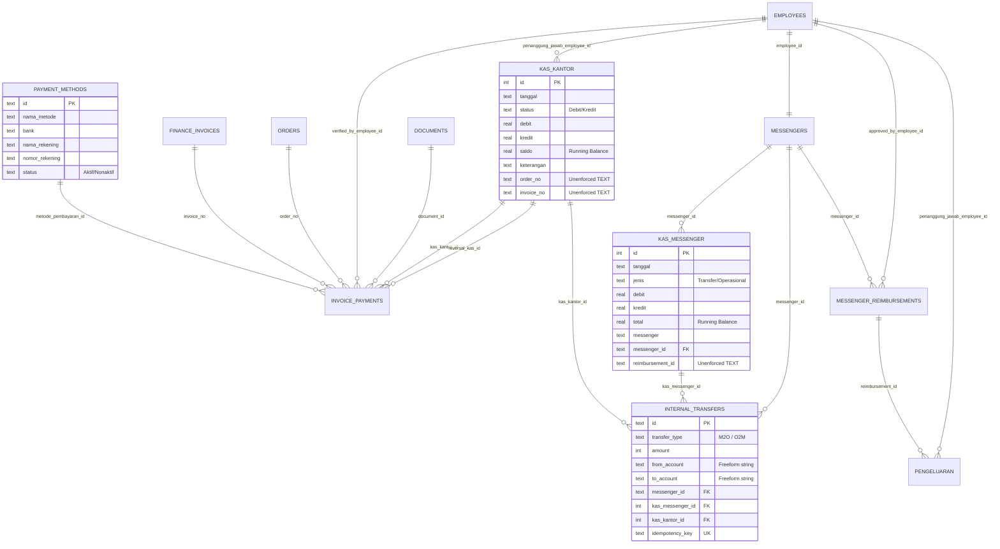

# ANTIGRAVITY READ-ONLY AUDIT REPORT
# KAS MESSENGER, KAS KANTOR & PAYMENT METHODS INTEGRATION

**Project:** SUN89 / SUNBiroJasa Admin Platform  
**Scope:** Kas Messenger, Kas Kantor, Payment Methods, and Inter-Module Financial Flows  
**Mode:** STRICT READ-ONLY AUDIT  
**Audit Date:** 2026-11-10  
**Execution Owner:** Antigravity exclusively  
**Authorization:** User-approved audit instruction

---

## 1. Executive Summary

This read-only audit provides a comprehensive forensic analysis of the current architecture, database schema, entity relationships, backend logic, and frontend presentation for **Kas Kantor**, **Kas Messenger**, and their integration with the **`payment_methods`** master table.

### Key Audit Findings Overview
1. **Critical FE-BE Reimbursement Payout Discrepancy:** The frontend presents reimbursement payout as a deduction from **Kas Messenger**, calls local store logic deducting from `kasMessenger`, and displays UI confirmations for "Pencairan Kas Messenger". However, the backend service (`messengerService.payReimbursement`) explicitly treats reimbursement payouts as cash outlays from **Kas Kantor** (`addKasKantor` Kredit), creating contradictory accounting between client-side state and database reality.
2. **Critical Financial Data Erasure Risks:** The backend exposes unmanaged HTTP `DELETE` endpoints (`/kas-kantor/:id`, `/kas-messenger/:id`, and `/pengeluaran/:id`). While `kas_kantor` and `kas_messenger` repositories execute compensating reversal rows rather than physical SQL deletes, the frontend optimistically removes the row (`splice`), leading to UI desynchronization and phantom rows on page refresh. For `pengeluaran`, the backend executes a physical `DELETE FROM pengeluaran WHERE id = ?`, destroying audit trails without compensating entries.
3. **Absence of Relational Payment Method Binding:** Neither `kas_kantor`, `kas_messenger`, nor `internal_transfers` has a foreign key to `payment_methods(id)`. All bank transfers and physical cash receipts are commingled into a single undifferentiated ledger in `kas_kantor`.
4. **Frontend Inverted Running Balance Bug:** In `apiFinanceProvider.ts`, optimistic running balance calculation reads `this.kasKantor[this.kasKantor.length - 1]`. Because the backend returns entries ordered by `id DESC` (newest first), the frontend mistakenly bases new balances on the *oldest* historical row (row #1, saldo Rp 0) rather than the most recent balance.
5. **Hardcoded Dummy Accounts in Frontend Store:** `paymentMethodStore.ts` contains hardcoded mock accounts (e.g., fictional BCA, BRI, Mandiri, and QRIS accounts) that do not match the operational database's active master accounts (CIMB Niaga, BCA, Muamalat, and Tunai).

---

## 2. Database & ERD Audit

### 2.1 Actual Tables and Schemas

#### 1. `kas_kantor` (Rows: 2)
The general office cash ledger.
```sql
CREATE TABLE kas_kantor (
  id INTEGER PRIMARY KEY AUTOINCREMENT,
  tanggal TEXT NOT NULL,
  keterangan TEXT NOT NULL,
  status TEXT NOT NULL,
  debit REAL NOT NULL DEFAULT 0,
  kredit REAL NOT NULL DEFAULT 0,
  saldo REAL NOT NULL DEFAULT 0,
  created_at TEXT NOT NULL DEFAULT (datetime('now')),
  penanggung_jawab TEXT,
  order_no TEXT,
  invoice_no TEXT,
  kategori TEXT,
  penanggung_jawab_employee_id TEXT REFERENCES employees(id)
);
```
- **Indexes:** `idx_kas_kantor_order ON kas_kantor(order_no)`, `idx_kas_kantor_penanggung_jawab ON kas_kantor(penanggung_jawab_employee_id)`.
- **Foreign Keys:** `penanggung_jawab_employee_id -> employees(id)`.
- **Missing Foreign Keys:** No `payment_method_id`, no `invoice_no` FK, no `order_no` FK.
- **Data Rows (Operational):**
  - Row 1: `id=1, tanggal='2026-11-04', keterangan='Saldo Awal Kas Kantor Operasional Siklus Baru Disetujui Owner', status='DEBIT', debit=0, kredit=0, saldo=0, kategori='MODAL_AWAL'`.
  - Row 2: `id=2, tanggal='2026-11-04T14:46:40.982Z', keterangan='Pembayaran: INV-1126-001 - Mahesa Alghifari S.Kom (B 1234 V / BCA)', status='Debit', debit=563000, kredit=0, saldo=563000, order_no='ORD-1126-001', invoice_no='INV-1126-001'`.

#### 2. `kas_messenger` (Rows: 0)
The field courier petty cash / operational advance ledger.
```sql
CREATE TABLE kas_messenger (
  id INTEGER PRIMARY KEY AUTOINCREMENT,
  tanggal TEXT NOT NULL,
  jenis TEXT NOT NULL,
  messenger TEXT NOT NULL,
  keterangan TEXT NOT NULL,
  debit REAL NOT NULL DEFAULT 0,
  kredit REAL NOT NULL DEFAULT 0,
  total REAL NOT NULL DEFAULT 0,
  penanggung_jawab TEXT,
  order_no TEXT,
  created_at TEXT NOT NULL DEFAULT (datetime('now')),
  reimbursement_id TEXT,
  receipt_url TEXT,
  kategori TEXT,
  messenger_id TEXT REFERENCES messengers(id)
);
```
- **Indexes:** `idx_kas_messenger_messenger`, `idx_kas_messenger_tanggal`, `idx_kas_messenger_reimb`, `idx_kas_messenger_messenger_id`.
- **Foreign Keys:** `messenger_id -> messengers(id)`.
- **Missing Foreign Keys:** No `payment_method_id`, no `reimbursement_id` FK, no `order_no` FK.

#### 3. `internal_transfers` (Rows: 0)
Inter-ledger transfer registry between Kas Kantor and Kas Messenger.
```sql
CREATE TABLE internal_transfers (
  id TEXT PRIMARY KEY,
  transfer_date TEXT NOT NULL,
  transfer_type TEXT NOT NULL,
  from_account TEXT NOT NULL,
  to_account TEXT NOT NULL,
  amount INTEGER NOT NULL CHECK(amount > 0 AND amount <= 9007199254740991),
  messenger_id TEXT NOT NULL REFERENCES messengers(id),
  messenger_name TEXT NOT NULL,
  kas_messenger_id INTEGER NOT NULL REFERENCES kas_messenger(id),
  kas_kantor_id INTEGER NOT NULL REFERENCES kas_kantor(id),
  status TEXT NOT NULL DEFAULT 'COMPLETED' CHECK(status IN ('COMPLETED', 'REVERSED')),
  idempotency_key TEXT UNIQUE NOT NULL,
  reversal_ref_id TEXT,
  notes TEXT,
  created_by TEXT NOT NULL,
  created_at TEXT NOT NULL DEFAULT (datetime('now'))
);
```
- **Foreign Keys:** `kas_kantor_id -> kas_kantor(id)`, `kas_messenger_id -> kas_messenger(id)`, `messenger_id -> messengers(id)`.
- **Account Identification:** `from_account` and `to_account` are free-form strings (`'KAS_KANTOR'`, `'KAS_MESSENGER'`).

#### 4. `payment_methods` (Rows: 4)
Existing master table for payment and fund channels.
```sql
CREATE TABLE "payment_methods" (
  id TEXT PRIMARY KEY,
  nama_metode TEXT NOT NULL,
  bank TEXT NOT NULL DEFAULT '',
  nama_rekening TEXT DEFAULT '',
  nomor_rekening TEXT DEFAULT '',
  status TEXT NOT NULL DEFAULT 'Aktif',
  created_at TEXT NOT NULL DEFAULT (datetime('now')),
  updated_at TEXT NOT NULL DEFAULT (datetime('now'))
);
```
- **Operational Data (4 Active Records):**
  1. `pm-cash`: Tunai / Cash (Bank: Tunai, Rekening: `""`)
  2. `pm-1793943310357-9gmfz`: Transfer Bank CIMB NIAGA (Rek: `707751492800`, a/n ANISA SUSANTI)
  3. `pm-1793943329508-s6ykx`: Transfer Bank BCA (Rek: `7175095764`, a/n ANISA SUSANTI)
  4. `pm-1793943359922-z6f4i`: Transfer Bank MUAMALAT (Rek: `1210090566`, a/n SUN DELAPAN SEMBILAN CV)

#### 5. `invoice_payments` (Rows: 7)
Relational payment registry for customer invoices.
```sql
CREATE TABLE invoice_payments (
  id INTEGER PRIMARY KEY AUTOINCREMENT,
  invoice_no TEXT NOT NULL REFERENCES finance_invoices(invoice_no) ON DELETE CASCADE,
  order_no TEXT NOT NULL REFERENCES orders(order_no) ON DELETE RESTRICT,
  nominal REAL NOT NULL CHECK(nominal > 0),
  metode_pembayaran TEXT NOT NULL,
  nama_bank TEXT,
  nomor_rekening TEXT,
  tanggal_bayar TEXT NOT NULL,
  document_id TEXT REFERENCES documents(id) ON DELETE SET NULL,
  kas_kantor_id INTEGER REFERENCES kas_kantor(id) ON DELETE SET NULL,
  status_verifikasi TEXT NOT NULL DEFAULT 'TERVERIFIKASI',
  idempotency_key TEXT UNIQUE,
  verified_by TEXT,
  verified_at TEXT,
  catatan TEXT,
  created_at TEXT NOT NULL DEFAULT (datetime('now')),
  metode_pembayaran_id TEXT REFERENCES payment_methods(id),
  verified_by_employee_id TEXT REFERENCES employees(id),
  is_void INTEGER NOT NULL DEFAULT 0,
  void_reason TEXT,
  voided_by TEXT,
  voided_at TEXT,
  reversal_kas_id INTEGER REFERENCES kas_kantor(id),
  payment_id TEXT
);
```
- **Historical Analysis (Rows #1–#7):**
  - Rows 1–7 all have `metode_pembayaran_id = NULL`.
  - Row 1 is linked to `kas_kantor_id = 2`.
  - Rows 2–7 have `kas_kantor_id = NULL`.
  - `nama_bank` stores descriptive text (`"Transfer Bank BCA"`, `"BCA"`, `"Cash"`, `"Tunai"`, `"CIMB NIAGA"`).

#### 6. `messenger_reimbursements` (Rows: 0)
Courier reimbursement requests.
```sql
CREATE TABLE messenger_reimbursements (
  id TEXT PRIMARY KEY,
  employee_id TEXT NOT NULL,
  messenger_name TEXT NOT NULL,
  order_no TEXT,
  category TEXT NOT NULL,
  amount REAL NOT NULL DEFAULT 0,
  approved_amount REAL DEFAULT 0,
  rejected_amount REAL DEFAULT 0,
  date TEXT NOT NULL,
  note TEXT,
  receipt_url TEXT,
  receipt_name TEXT,
  status TEXT NOT NULL DEFAULT 'Diajukan',
  items_json TEXT,
  submitted_at TEXT NOT NULL DEFAULT (datetime('now')),
  reviewed_at TEXT,
  reviewed_by TEXT,
  review_notes TEXT,
  paid_at TEXT,
  paid_by TEXT,
  payment_method TEXT,
  transaction_ref TEXT,
  pengeluaran_id INTEGER,
  created_at TEXT NOT NULL DEFAULT (datetime('now')),
  updated_at TEXT NOT NULL DEFAULT (datetime('now')),
  kas_messenger_id INTEGER,
  channel TEXT,
  messenger_id TEXT REFERENCES messengers(id),
  approved_by_employee_id TEXT REFERENCES employees(id)
);
```

#### 7. `pengeluaran` (Rows: 0)
General operating expenditures ledger.
```sql
CREATE TABLE pengeluaran (
  id INTEGER PRIMARY KEY AUTOINCREMENT,
  tanggal TEXT NOT NULL,
  keterangan TEXT NOT NULL,
  nominal REAL NOT NULL DEFAULT 0,
  penanggung_jawab TEXT,
  created_at TEXT NOT NULL DEFAULT (datetime('now')),
  order_no TEXT,
  invoice_no TEXT,
  kategori TEXT,
  reimbursement_id TEXT REFERENCES messenger_reimbursements(id),
  penanggung_jawab_employee_id TEXT REFERENCES employees(id)
);
```

---

### 2.2 Actual Entity Relationship Diagram (ERD)



---

## 3. Backend Workflow & Architectural Audit

### 3.1 Cash Posting & Balance Rules

#### 1. Kas Kantor
- **Balance Calculation:** Running balance is computed on INSERT using:
  `SELECT COALESCE(SUM(debit), 0) - COALESCE(SUM(kredit), 0) AS balance FROM kas_kantor`.
- **Negative Balance Guard:** When an outflow (`status === "Kredit"` or `"Pengeluaran"`) is recorded, `financeService.addKasKantor` validates that the current office balance is $\ge$ requested credit amount. If not, it throws `400 INSUFFICIENT_OFFICE_BALANCE`.
- **Inflow Sources:**
  - Customer invoice payment verification (`verifyInvoicePayment` in `financeService.ts#L627`).
  - Courier fund return (`transferMessengerToOffice` in `financeService.ts#L2086`).
  - Owner / investor initial capital (`MODAL_AWAL`, restricted to `admin` / `supervisor`).
- **Outflow Sources:**
  - Courier operational advance (`transferOfficeToMessenger` in `financeService.ts#L2208`).
  - Courier reimbursement payout (`messengerService.payReimbursement` in `messengerService.ts#L680`).
  - Customer cashback / refund payout (`payoutCashback` in `financeService.ts#L1107`).

#### 2. Kas Messenger
- **Balance Calculation:** Isolated per courier via:
  `SELECT total FROM kas_messenger WHERE messenger_id = ? ORDER BY id DESC LIMIT 1`.
- **Balance Vulnerability:** In `dbFinanceRepository.addKasMessenger` (`dbFinanceRepository.ts#L1189`), the code states:
  `const newTotal = item.total !== undefined ? Number(item.total) : (lastTotal + debit - kredit);`
  If a caller passes a client-calculated `total`, the backend blindly accepts it, bypassing the true running balance.
- **Inflow Sources:**
  - Advance from office (`transferOfficeToMessenger` in `financeService.ts#L2219`).
  - Manual entry via `POST /kas-messenger` (bypassing internal transfers).
- **Outflow Sources:**
  - Return to office (`transferMessengerToOffice` in `financeService.ts#L2073`).
  - Manual entry via `POST /kas-messenger`.

#### 3. Internal Transfers
- **Endpoints:**
  - `POST /api/finance/transfer/office-to-messenger`: Disburses advance from office to courier. Decrements Kas Kantor (Kredit), increments Kas Messenger (Debit), records in `internal_transfers`.
  - `POST /api/finance/transfer/messenger-to-office`: Courier returns unspent advance. Decrements Kas Messenger (Kredit), increments Kas Kantor (Debit), records in `internal_transfers`.
- **Transaction Safety:** Both methods execute inside `runInTransaction`, check courier canonical identity (`messengers` joined with `employees`), require integer amounts, and validate idempotency keys against `internal_transfers.idempotency_key`.

---

## 4. Frontend Audit & FE-BE Contract Matrix

### 4.1 Frontend Components Breakdown
1. **`FinanceContent.tsx`:**
   - Contains Sub-Tabs: "Buku Kas Kantor", "Buku Kas Messenger", and "Pengajuan Reimbursement".
   - Reimbursement Review & Payout: Displays approval and payout modal.
   - Payout modal hardcodes:
     - `Kanal Pembukuan`: Disabled input with `"Kas Messenger (Pengeluaran Operasional Kurir)"`.
     - `Metode Pembayaran`: Dropdown with `"Kas Messenger (Tunai Lapangan)"`, `"Transfer Rekening BCA"`, `"Transfer Bank Lain"`.
   - On payout submit: Calls `financeStore.payReimbursement()`, shows toast `"berhasil dicatat di Kas Messenger"`.
2. **`FinanceAddPage.tsx`:**
   - Form for order creation.
   - Blends internal cash channels (`Kas Kantor`, `Kas Messenger`) into "Bank / Sumber Kas Keluar" dropdowns (`bankKeluarOptions = Array.from(new Set([...activeBankNames, "Kas Kantor", "Kas Messenger", "Lainnya"]))`).
3. **`paymentMethodStore.ts`:**
   - In-memory store initialized with fictional static accounts (`DEFAULT_PAYMENT_METHODS`) before API tokens are read.

### 4.2 FE-BE Contract Matrix

| Feature / Action | Frontend Expectation / Call | Backend Contract & Behavior | Status / Discrepancy |
| :--- | :--- | :--- | :--- |
| **Reimbursement Payout** | Calls `POST /messenger/reimbursements/:id/pay` with `{ channel: "Kas Messenger", paymentMethod: "Kas Messenger (Tunai)" }`. Updates local store `kasMessenger`. | Disburses from **`kas_kantor`** (Kredit Rp X). Does **NOT** mutate `kas_messenger`. Ignores frontend channel parameter. | **CRITICAL MISMATCH:** FE claims payout from Kas Messenger; BE records payout in Kas Kantor. |
| **Kas Kantor Delete** | Calls `DELETE /api/finance/kas-kantor/:id`. Optimistically removes item from array (`splice(idx, 1)`). | Inserts compensating row `[VOID] Reversal Kas Kantor #${id}`. Does **NOT** delete original row. | **HIGH MISMATCH:** UI hides item, but DB creates reversal row. Reappears on reload. |
| **Kas Messenger Delete** | Calls `DELETE /api/finance/kas-messenger/:id`. Optimistically removes item (`splice(idx, 1)`). | Inserts compensating row `[VOID] Reversal Kas Messenger #${id}`. | **HIGH MISMATCH:** UI hides item; DB creates reversal row. |
| **Pengeluaran Delete** | Calls `DELETE /api/finance/pengeluaran/:id`. Optimistically removes item. | Executes `DELETE FROM pengeluaran WHERE id = ?`. Physically destroys row. | **HIGH AUDIT DEFECT:** Physical DML erase without compensating entry or soft-delete. |
| **Payment Method List** | Uses `paymentMethodStore.getAll()`. Falls back to `DEFAULT_PAYMENT_METHODS`. | `GET /api/payment-methods` returns 4 operational DB rows (BCA, CIMB, Muamalat, Tunai). | **MEDIUM:** Fictional accounts briefly visible or selectable if store load lags. |
| **Running Saldo Display** | Calculates running total using `this.kasKantor[length - 1].total`. | Query returns `ORDER BY id DESC`. Index `length - 1` is the oldest row (Rp 0). | **HIGH BUG:** Client-side saldo displays incorrect historical baseline. |

---

## 5. Audit of Existing `payment_methods` Master

### 5.1 Verification of Master Table Schema
The table `payment_methods` has the exact schema expected:
- `id` (TEXT PK, e.g., `'pm-cash'`, `'pm-1793943310357-9gmfz'`)
- `nama_metode` (TEXT NOT NULL, e.g., `'Tunai'`, `'Transfer Bank'`)
- `bank` (TEXT NOT NULL, e.g., `'Tunai'`, `'CIMB NIAGA'`, `'BCA'`, `'MUAMALAT'`)
- `nama_rekening` (TEXT, e.g., `'ANISA SUSANTI'`, `'SUN DELAPAN SEMBILAN CV'`)
- `nomor_rekening` (TEXT, e.g., `'707751492800'`, `'7175095764'`, `'1210090566'`)
- `status` (TEXT NOT NULL DEFAULT `'Aktif'`)
- `created_at`, `updated_at` (TEXT)

### 5.2 Current Usage in Transactions
- **In `invoice_payments`:**
  - Column `metode_pembayaran_id REFERENCES payment_methods(id)` exists, but all 7 historical rows have `NULL`.
  - Historical data recorded payment channels as unstructured strings in `metode_pembayaran` and `nama_bank`.
- **In `kas_kantor`:** Zero reference to `payment_methods`. Commingles all accounts into one single cash balance.
- **In `kas_messenger`:** Zero reference to `payment_methods`.
- **In `internal_transfers`:** Accounts are stored as `'KAS_KANTOR'` and `'KAS_MESSENGER'` string literals.

---

## 6. Integrity & Risk Analysis

### Findings Categorized by Severity

```
CRITICAL (2)  ───► Disbursing Channel Conflict | Direct Financial Erasure (DELETE DML)
HIGH (3)      ───► Missing Payment Method FKs | Inverted FE Balance Bug | Soft vs Hard Delete Desync
MEDIUM (2)    ───► Unconstrained POST /kas-messenger | Hardcoded Mock Accounts in FE
LOW (1)       ───► Case Inconsistency in Status Enums
```

---

### Finding 1: [CRITICAL] Contradictory Reimbursement Payout Disbursing Channel
- **Files & Locations:**
  - `src/app/components/FinanceContent.tsx` (lines 2266-2283, 2834-2895)
  - `src/app/data/financeStore.ts` (lines 4194-4215)
  - `server/src/services/messengerService.ts` (lines 678-689)
- **Current Behavior:**
  - When finance clicks "Cairkan Reimbursement", Frontend UI opens "Konfirmasi Pencairan Kas Messenger", claims money comes from courier cash, and updates client `kasMessenger`.
  - Backend executes `addKasKantor(...)` with `status: "Kredit"` (paying out of office cash).
- **Expected Behavior:**
  - Out-of-pocket reimbursements are company expenses paid back to the courier from office funds (`Kas Kantor`). They must never deduct from courier advance (`Kas Messenger`).
  - Frontend UI, toasts, confirmation dialogs, and local store must reflect that payout originates from `Kas Kantor`.
- **Risk to Historical Data:**
  - Zero historical reimbursement rows currently exist in the database (`messenger_reimbursements` row count: 0). However, testing or mock runs in client memory mislead operators about courier cash balances.
- **Recommended Remediation:**
  - Align Frontend dialog, copy, and store actions to show that payout disburses from `Kas Kantor` (Cash or Bank Transfer).

---

### Finding 2: [CRITICAL] Unmanaged Financial Record Erasure via Direct HTTP DELETE
- **Files & Locations:**
  - `server/src/routes/financeRoutes.ts` (lines 163-168, 187-192, 209-214)
  - `server/src/repositories/dbFinanceRepository.ts` (lines 1120-1124)
- **Current Behavior:**
  - `DELETE /api/finance/pengeluaran/:id` runs `DELETE FROM pengeluaran WHERE id = ?`, physically deleting expense history without audit reversal.
  - `DELETE /api/finance/kas-kantor/:id` and `DELETE /api/finance/kas-messenger/:id` insert reversal entries, but because the endpoint is an HTTP `DELETE`, client caches and providers treat it as a deletion, causing data flickering.
- **Expected Behavior:**
  - Financial records must be immutable. Physical deletion of ledgers is forbidden.
  - Endpoints should be standardized as `POST .../void` requiring explicit `reason`, `idempotencyKey`, and `expectedVersion`.
- **Risk to Historical Data:**
  - Any authorized user can accidentally or maliciously delete historical expenses.
- **Recommended Remediation:**
  - Deprecate or remove physical `DELETE FROM pengeluaran`.
  - Require formal voiding workflows across all financial sub-ledgers.

---

### Finding 3: [HIGH] Commingled Ledger Accounts Lacking Payment Method Foreign Keys
- **Files & Locations:**
  - `server/src/database/schema.ts` (`kas_kantor`, `kas_messenger`, `internal_transfers`)
- **Current Behavior:**
  - `kas_kantor` represents both physical cash in office and multiple bank accounts (BCA, CIMB, Muamalat) in a single number (`saldo`).
  - Incoming customer payments received via Bank BCA or CIMB Niaga are posted to `kas_kantor` without recording which bank received them.
- **Expected Behavior:**
  - Transaction entries must explicitly reference `payment_method_id` from `payment_methods` when transactions involve external accounts.
- **Risk to Historical Data:**
  - Rows #1 and #2 in `kas_kantor` have no payment method ID. Retroactively mutating row #1 or #2 would violate database baseline rules.
- **Recommended Remediation:**
  - Make `payment_method_id TEXT REFERENCES payment_methods(id)` nullable in `kas_kantor`.
  - Preserve historical rows with `NULL`, while requiring valid references on newly created transactions.

---

### Finding 4: [HIGH] Inverted Running Balance Calculation in Frontend Provider
- **Files & Locations:**
  - `src/data/api/apiFinanceProvider.ts` (lines 599-600, 727-728)
- **Current Behavior:**
  - Provider takes `this.kasKantor[this.kasKantor.length - 1]` as the last balance.
  - Since rows are returned `ORDER BY id DESC`, index `length - 1` is the oldest row (initial balance Rp 0).
- **Expected Behavior:**
  - Take `this.kasKantor[0]` if ordered DESC, or rely strictly on backend response.
- **Risk to Historical Data:**
  - None to database (in-memory UI display glitch only).
- **Recommended Remediation:**
  - Fix index reading in `apiFinanceProvider.ts`.

---

### Finding 5: [MEDIUM] Direct Posting to `kas_messenger` Bypassing Internal Transfer Governance
- **Files & Locations:**
  - `server/src/routes/financeRoutes.ts` (lines 202-207)
  - `server/src/services/financeService.ts` (lines 1897-1965)
- **Current Behavior:**
  - `POST /kas-messenger` allows creating money in courier cash without an equal deduction from office cash.
- **Expected Behavior:**
  - Courier cash inflows must only occur through authorized `transferOfficeToMessenger`.
- **Risk to Historical Data:**
  - None currently (`kas_messenger` has 0 rows).
- **Recommended Remediation:**
  - Restrict `addKasMessenger` to system-internal invocations from transfer and reimbursement services.

---

### Finding 6: [MEDIUM] Hardcoded Mock Accounts in `paymentMethodStore.ts`
- **Files & Locations:**
  - `src/app/data/paymentMethodStore.ts` (lines 20-61)
- **Current Behavior:**
  - Initialized with mock accounts for BCA, BRI, Mandiri, and QRIS.
- **Expected Behavior:**
  - Must initialize empty and populate solely from `GET /payment-methods`.
- **Risk to Historical Data:**
  - Users could select non-existent accounts if network fails.
- **Recommended Remediation:**
  - Remove fictional `DEFAULT_PAYMENT_METHODS`.

---

### Finding 7: [LOW] Unchecked Case Variations in Status Fields
- **Files & Locations:**
  - Database `kas_kantor` (Row 1: `"DEBIT"`, Row 2: `"Debit"`)
- **Current Behavior:**
  - Code relies on loose string matching (`status === "Pemasukan" || status === "Debit"`).
- **Expected Behavior:**
  - Standardize on canonical uppercase (`DEBIT`, `KREDIT`).
- **Risk to Historical Data:**
  - Existing rows must not be mutated without migration authorization.
- **Recommended Remediation:**
  - Normalize on input while supporting case-insensitive reading for historical rows.

---

## 7. Proposed Implementation Roadmap & Design Decisions

> [!WARNING]
> **READ-ONLY AUDIT ONLY:** The following roadmap is a design proposal for future implementation. **NO IMPLEMENTATION IS TO BE PERFORMED UNDER THIS TASK.**

### Phase 1: Database Relationships & Schema Integrity
1. Add optional `payment_method_id TEXT REFERENCES payment_methods(id)` to `kas_kantor`.
2. Ensure historical rows #1–#2 retain `payment_method_id = NULL`.
3. Add optional `payment_method_id TEXT REFERENCES payment_methods(id)` to `internal_transfers`.

### Phase 2: Backend Transaction Contracts & Authorization
1. Update `addKasKantor` to accept and validate `paymentMethodId` against active payment methods.
2. In `verifyInvoicePayment`, forward the verified payment method ID into `kas_kantor`.
3. Deprecate `DELETE /api/finance/pengeluaran/:id` in favor of an explicit voiding endpoint.
4. Gate `POST /kas-messenger` so courier advances are strictly created via `transferOfficeToMessenger`.

### Phase 3: Backend Saldo Posting & Idempotency Safeguards
1. Disallow client-provided `total` in `addKasMessenger`; compute strictly via aggregation or delta.
2. Enforce idempotency keys on all cash mutations.
3. Correct reimbursement payout accounting so out-of-pocket reimbursements are recorded as `Kas Kantor` Kredit without touching `Kas Messenger`.

### Phase 4: Frontend Alignment & Master Data Binding
1. Remove `DEFAULT_PAYMENT_METHODS` mock accounts from `paymentMethodStore.ts`.
2. Fix `apiFinanceProvider.ts` balance indexing (read index 0 instead of `length - 1`).
3. Correct `FinanceContent.tsx` reimbursement payout modal to clearly state payout is from `Kas Kantor`.
4. Separate bank methods from internal cash funds in `FinanceAddPage.tsx`.

### Phase 5: Isolated Test Verification & Regression
1. Author comprehensive isolated unit and integration tests covering:
   - Courier advance (Office $\to$ Messenger).
   - Courier refund/return (Messenger $\to$ Office).
   - Reimbursement payout from office funds.
   - Idempotency and negative balance protection.
2. Run full regression suite across all 132 existing tests.

---

## 8. Design Decisions Requiring User Approval

Before any future implementation task is authorized, user alignment is required on the following architectural decisions:

1. **Reimbursement Payout Accounting SSoT:**
   - *Option A (Recommended):* Courier reimbursements represent personal out-of-pocket expenses and are reimbursed from **Kas Kantor** (Cash or Bank Transfer). They do not affect **Kas Messenger** balance.
   - *Option B:* Courier reimbursements must be deducted from courier cash advance (**Kas Messenger**). (Requires couriers to always be pre-funded before incurring expenses).
2. **Account commingling in `kas_kantor`:**
   - *Option A (Recommended):* Retain `kas_kantor` as unified general cash ledger, but attach `payment_method_id` to each transaction to track whether money entered physical cash or a specific bank account.
   - *Option B:* Split `kas_kantor` into separate bank ledgers (complex schema refactoring, higher regression risk).
3. **Deprecation of `DELETE` Endpoints:**
   - Confirm approval to eliminate physical SQL deletion for `pengeluaran` and replace with non-destructive voiding/reversals.

---

## 9. Forensic Integrity Verification

Read-only integrity verification was executed against the operational database and uploads directory:

```
=== FORENSIC READ-ONLY INTEGRITY AUDIT ===
1. Operational DB SHA-256: A8A4B1F77FCAB6EE0A9503B778DE7A7A7929100D9AD6F965EF707503609E379C
   Expected baseline:      A8A4B1F77FCAB6EE0A9503B778DE7A7A7929100D9AD6F965EF707503609E379C
   Match: YES (100% Bit-for-Bit)
   PRAGMA integrity_check: ok
2. User Table Count: 41
   Total Rows across all tables: 1,314
3. Historical Payment Rows #1-#7:
   Row #1: nominal=563000, status=TERVERIFIKASI, payment_id=null, kas_kantor_id=2
   Row #2: nominal=563000, status=MENUNGGU_VERIFIKASI, payment_id=null, kas_kantor_id=null
   Row #3: nominal=563000, status=TERVERIFIKASI, payment_id=null, kas_kantor_id=null
   Row #4: nominal=59028000, status=MENUNGGU_BUKTI, payment_id=null, kas_kantor_id=null
   Row #5: nominal=59028000, status=MENUNGGU_BUKTI, payment_id=null, kas_kantor_id=null
   Row #6: nominal=1258000, status=MENUNGGU_VERIFIKASI, payment_id=null, kas_kantor_id=null
   Row #7: nominal=1258000, status=TERVERIFIKASI, payment_id=null, kas_kantor_id=null
   All 7 historical rows retain payment_id = NULL: YES
4. Uploads Verification Output:
   Total files found: 51 | Total size: 1,525,984 bytes
   Computed Canonical SHA-256: 4FD418787BCC18CBA3A55E78E02D87BDCA0372EBAA3BD8C696DB9C5B8C8242E5
   Approved Baseline Hash:     4FD418787BCC18CBA3A55E78E02D87BDCA0372EBAA3BD8C696DB9C5B8C8242E5
   STATUS: EXACT 100% MATCH - ALL 51 FILES VERIFIED INTACT
```

---

## 10. Mandatory Stop

Antigravity has strictly fulfilled the read-only audit mandate:
- **Zero production code, schema, frontend, or tests were modified.**
- **Zero migrations, seeds, or backfills were executed.**
- **Operational database and uploads remain 100% bit-for-bit intact.**
- **Step E has NOT been started.**

**Antigravity halts all operations immediately and awaits review from the user and ChatGPT.**
