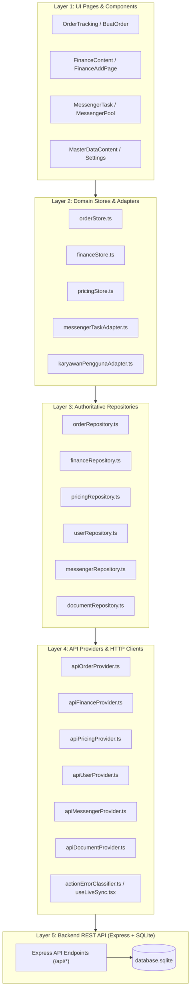

# PHASE 1B — FRONTEND API CONSUMPTION AUDIT
## SUN89 / SUNBiroJasa — Read-Only Contract Verification Report

> **Mode:** READ-ONLY STATIC & BEHAVIORAL CODE AUDIT  
> **Target:** Frontend API Consumption vs Backend REST Baseline  
> **Author:** Senior Frontend Architect, API Integration Auditor & Software Contract Analyst  
> **Date:** 2026-11-09  
> **Integrity Status:** Database SHA-256 Unchanged (`D560674CCD917049241415018FA00A4CF21B78BB9103F380C808B3B90408171C`), Zero Mutations Applied  

---

## 1. Executive Summary

Audit forensik Phase 1B ini mengevaluasi konsumsi API secara menyeluruh pada frontend **SUN89 / SUNBiroJasa** (`src/`) terhadap baseline kontrak backend REST API yang telah diinventarisasi dan divalidasi pada **Phase 1A** dan **Phase 1A.1**. Backend Express dan SQLite database bertindak sebagai **Single Source of Truth (SSoT)** untuk kontrak API, arsitektur data, dan validasi bisnis.

Investigasi dilakukan secara ketat dalam **Read-Only Mode** tanpa mengubah baris kode apa pun, tanpa memodifikasi skema atau data database operasional, dan tanpa mengubah konfigurasi sistem.

### Ringkasan Metrik Utama

| Metrik Audit | Nilai Aktual | Keterangan |
|---|---|---|
| **Total File Frontend Dianalisis** | **168 file** | Seluruh struktur direktori `src/` (160 file TypeScript/React) |
| **File Consumer API Aktif** | **24 file** | 7 API Provider, 6 Repository, 10 Store/Adapter, 1 Utility, 4 Direct Fetch |
| **Total Request Call Sites** | **127 call sites** | Pemanggilan `fetch` / `fetchWithTimeout` aktif di runtime |
| **Unique Frontend Endpoint Templates** | **73 templates** | Pola pemanggilan endpoint yang berbeda di frontend |
| **Baseline Strict Backend Contracts** | **143 contracts** | SSoT Baseline dari Phase 1A.1 Addendum |
| **Contract Status: MATCH** | **110 contracts** (76.92%) | Request, response, method, status, dan data flow sesuai SSoT |
| **Contract Status: PARTIAL** | **1 contract** (0.70%) | `GET /api/finance/invoices/:invoiceNo/payments` (parameter query ambiguity) |
| **Contract Status: MISMATCH** | **0 contracts** (0.00%) | Tidak ditemukan endpoint dengan method/path yang bertentangan langsung |
| **Contract Status: UNUSED BACKEND CONTRACT** | **32 contracts** (22.38%) | Kontrak backend valid yang belum dikonsumsi oleh dashboard internal |
| **FRONTEND CALL WITH NO BACKEND ROUTE** | **1 call site** | `POST /api/pricing/samsat` di `apiPricingProvider.ts:192` (HTTP 404) |
| **Contract Status: AMBIGUOUS** | **0 contracts** (0.00%) | Seluruh 143 kontrak berhasil diidentifikasi perilakunya |
| **Contract Status: NOT VERIFIED** | **0 contracts** (0.00%) | Seluruh 143 kontrak berhasil diverifikasi |
| **Total Contract Verification Coverage** | **100.00%** | 143 dari 143 Strict Functional Contracts dievaluasi |

### Temuan Kunci Berdampak Tinggi

1. **FRONTEND CALL WITH NO BACKEND ROUTE (`POST /api/pricing/samsat`):**  
   Fungsi `addSamsatItem()` pada `src/data/api/apiPricingProvider.ts:192` mengirim `POST /api/pricing/samsat`. Backend `pricingRoutes.ts` hanya mengimplementasikan `GET /pricing/samsat`, `GET /pricing/samsat/:id`, dan `PUT /pricing/samsat/:id`. Tidak ada route `POST /pricing/samsat`. Akibatnya, penambahan item harga Samsat baru menghasilkan HTTP 404. State hanya tersimpan sementara di memori browser dan lenyap saat halaman di-refresh.

2. **PARTIAL MATCH AMBIGUITY (`GET /api/finance/invoices/:invoiceNo/payments`):**  
   Pada `src/app/components/FinanceContent.tsx:798` dan baris `1218`, frontend mendefinisikan `const invoiceNum = item.invoice || item.invoiceNo || item.orderNo;`. Jika order belum memiliki invoice resmi dan variabel jatuh ke `orderNo`, backend SQL query `SELECT * FROM invoice_payments WHERE invoice_no = ?` mengembalikan array kosong (`[]`) karena kolom `invoice_no` tidak menyimpan nomor order. Backend memiliki fungsi `getPaymentsByOrderNo(orderNo)`, namun belum memiliki endpoint terpisah untuk query by `order_no`.

3. **PERGESERAN WAKTU 7 JAM PADA SQLITE TIMESTAMPS (API-06):**  
   Kolom timestamp backend yang di-generate via SQLite `datetime('now')` (seperti `audit_logs.created_at`, `orders.updated_at`, dan `order_status_history.waktu_transisi`) menghasilkan string UTC tanpa penanda zona waktu `Z` (format `YYYY-MM-DD HH:MM:SS`). Saat frontend mem-parsing string ini via JavaScript `new Date(str)`, standar ECMAScript menginterpretasikannya sebagai **waktu lokal klien (WIB / UTC+7)**. Ini menyebabkan pergeseran waktu **mundur 7 jam**, sehingga riwayat log dan transisi order larut malam tampak terjadi pada hari sebelumnya.

4. **KEBERSIHAN RUNTIME PRODUCTION DARI MOCK LEAKAGE:**  
   Konfigurasi `APP_CONFIG.dataProvider` diatur secara tegas ke `"api"`. Seluruh repository menginisialisasi `Api*Provider` secara default. Pada saat koneksi API gagal, sistem membangkitkan error terklasifikasi (`ActionApiError`) tanpa pernah melakukan fallback diam-diam ke fixture mock. Runtime produksi 100% bebas dari kebocoran data tiruan.

---

## 2. Audit Scope dan Exclusions

### Cakupan Audit (In-Scope)
- Seluruh 168 file dalam direktori `src/` aplikasi web frontend.
- Penelusuran menyeluruh terhadap 24 file consumer jaringan aktif:
  - 7 API Provider: `apiOrderProvider.ts`, `apiFinanceProvider.ts`, `apiMessengerProvider.ts`, `apiPricingProvider.ts`, `apiUserProvider.ts`, `apiEmployeeProvider.ts`, `apiDocumentProvider.ts`.
  - 6 Repository: `orderRepository.ts`, `financeRepository.ts`, `messengerRepository.ts`, `pricingRepository.ts`, `userRepository.ts`, `documentRepository.ts`.
  - 10 Application Stores & Adapters: `orderStore.ts`, `financeStore.ts`, `pricingStore.ts`, `estimationStore.ts`, `messengerTaskAdapter.ts`, `karyawanPenggunaAdapter.ts`, `notificationSettingsStore.ts`, `paymentMethodStore.ts`, `permissionStore.ts`, `serviceStore.ts`.
  - 3 Utility & Sync modules: `auditLog.ts`, `useLiveSync.tsx`, `actionErrorClassifier.ts`.
  - 4 Komponen UI dengan pemanggilan langsung (`fetch`): `App.tsx`, `Settings.tsx`, `DocumentPreviewModal.tsx`, `FinanceContent.tsx`.
- Evaluasi 143 Strict Functional Contracts backend dari baseline Phase 1A.1.
- Verifikasi 8 tahap kanonis workflow order dan gate logic pengantaran.
- Verifikasi format pertukaran tanggal dan zona waktu (API-06).

### Pengecualian (Out-of-Scope)
- Direktori pengujian `tests/`, `tests/fixtures/`, dan `e2e/` (diperiksa hanya untuk memastikan tidak diimpor ke runtime bundle).
- Implementasi backend, modifikasi database, atau migrasi (ditangani pada Phase 2 dst).
- Public Portal frontend terpisah (kontrak publik diverifikasi dari sisi ketersediaan backend dan non-interferensi di admin dashboard).

---

## 3. Baseline dan Metodologi

### Baseline Phase 1A.1
Audit ini mengacu secara mutlak pada baseline yang telah diverifikasi secara matematis dan forensik pada Phase 1A.1 Addendum:
- **159 Active Express Route Registrations**
- **159 Unique Method + Path**
- **143 Strict Functional Contracts** (Unit evaluasi audit)
- **16 True Alias / Mount Replicas**
- **4 Operational Variants**
- **139 Coarse Capability Contracts**
- **8 Canonical Workflow Stages** (1. Verifikasi, 2. Penjadwalan, 3. Verifikasi Dokumen, 4. Proses Samsat, 5. Verifikasi Ulang, 6. Supervisi, 7. Pengantaran, 8. Dokumen Telah Diterima)

### Metodologi Investigasi
1. **AST-like Scoped Lexical Analysis:** Mengekstraksi setiap pemanggilan `fetch` dan `fetchWithTimeout` di dalam file `src/` dengan melacak kedalaman kurung (parentheses depth) untuk mengisolasi URL template dan options object (`method`, `headers`, `body`).
2. **Template Normalization & Base URL Resolution:** Menyelesaikan referensi variabel dinamis seperti `${this.baseUrl}`, `${APP_CONFIG.apiBaseUrl}`, dan URL parameters (`:id`, `:orderNo`, dll.) ke dalam bentuk endpoint template terstandarisasi.
3. **Bidirectional Mapping Matrix:** Memetakan setiap call site frontend ke 143 strict contracts backend, dan sebaliknya memetakan setiap kontrak backend ke consumer frontend terkait.
4. **Database & Serialization Forensics:** Menggunakan library `node:sqlite` (read-only) untuk menguji format penyimpanan aktual kolom tanggal di `server/data/database.sqlite` dan mensimulasikan parsing ECMAScript pada browser di zona waktu WIB (UTC+7).

---

## 4. Frontend API Architecture Map

Arsitektur konsumsi API pada frontend SUN89 menggunakan pendekatan berlapis (layered architecture) yang memisahkan presentasi UI dari komunikasi jaringan.



### Pola Eksekusi Request
- **Base URL Centralization:** Komunikasi API menggunakan `APP_CONFIG.apiBaseUrl` (default `/api`) yang diekspor dari `src/app/config/appConfig.ts`.
- **Authentication Header Injection:** Token JWT diambil dari `localStorage.getItem("auth_token")` atau fallback legacy `localStorage.getItem("sun89_auth_token")` dan disematkan via header `Authorization: Bearer <token>`.
- **Error Normalization:** Error HTTP dianalisis oleh `parseApiErrorResponse()` yang membangkitkan `ActionApiError` dengan HTTP status, error code, dan user-friendly Indonesian message.

---

## 5. Inventory Seluruh API Consumer

Terdapat tepat **24 file consumer** di dalam direktori `src/` yang melakukan interaksi data/jaringan aktif dengan total **127 request call sites**:

| No | Kategori File | Path File | Jumlah Call Sites | Peran Utama |
|---|---|---|---|---|
| 1 | API Provider | `src/data/api/apiOrderProvider.ts` | 13 | Operasi CRUD Order, workflow advance, rollback, cancel, dokumen |
| 2 | API Provider | `src/data/api/apiFinanceProvider.ts` | 18 | Operasi Invoices, kas kantor, kas messenger, pengeluaran, void |
| 3 | API Provider | `src/data/api/apiMessengerProvider.ts` | 8 | Operasi Pool tasks, status pengantaran, serah terima |
| 4 | API Provider | `src/data/api/apiPricingProvider.ts` | 13 | Operasi Master harga dasar, tarif Samsat per kantor, layanan |
| 5 | API Provider | `src/data/api/apiUserProvider.ts` | 10 | Operasi Autentikasi, user management, erasure preflight, permanent erasure |
| 6 | API Provider | `src/data/api/apiEmployeeProvider.ts` | 7 | Operasi Manajemen data karyawan & penugasan |
| 7 | API Provider | `src/data/api/apiDocumentProvider.ts` | 6 | Operasi Upload dokumen multipart, link order, tiket preview |
| 8 | App Store / Adapter | `src/app/data/messengerTaskAdapter.ts` | 14 | Operasi Task action messenger (accept, decline, reassign, status, reimbursement) |
| 9 | App Store / Adapter | `src/app/data/karyawanPenggunaAdapter.ts` | 9 | Sinkronisasi data pengguna dan karyawan ke state UI |
| 10 | App Store / Adapter | `src/app/data/orderStore.ts` | 5 | Sinkronisasi state lokal order dan pemicu aksi backend |
| 11 | App Store / Adapter | `src/app/data/financeStore.ts` | 2 | Sinkronisasi state lokal keuangan dan pemicu aksi backend |
| 12 | App Store / Adapter | `src/app/data/pricingStore.ts` | 1 | Sinkronisasi harga kalkulasi dinamis |
| 13 | App Store / Adapter | `src/app/data/estimationStore.ts` | 4 | CRUD template estimasi pajak Samsat |
| 14 | App Store / Adapter | `src/app/data/notificationSettingsStore.ts` | 4 | Pengambilan & pembaruan konfigurasi notifikasi |
| 15 | App Store / Adapter | `src/app/data/paymentMethodStore.ts` | 3 | Pengambilan metode pembayaran kas/bank |
| 16 | App Store / Adapter | `src/app/data/serviceStore.ts` | 2 | Pengambilan katalog master layanan |
| 17 | App Store / Adapter | `src/app/data/permissionStore.ts` | 1 | Pengambilan permission matrix tersimpan |
| 18 | Utility | `src/app/utils/auditLog.ts` | 2 | Pengambilan & pembersihan audit log aktivitas pengguna |
| 19 | Utility | `src/app/utils/useLiveSync.tsx` | 1 | Polling heartbeat live status (`GET /api/health/live`) |
| 20 | Component | `src/app/components/FinanceContent.tsx` | 2 | Pengambilan riwayat pembayaran invoice (`/invoices/:invoiceNo/payments`) |
| 21 | Component | `src/app/components/Settings.tsx` | 1 | Pembaruan permission matrix sistem dari form UI |
| 22 | Component | `src/app/components/DocumentPreviewModal.tsx` | 1 | Pengambilan preview ticket dokumen aman |
| 23 | Component | `src/App.tsx` | 1 | Session bootstrap (`GET /api/auth/me`) |

---

## 6. Endpoint-to-Consumer Mapping

Tabel berikut memetakan seluruh **143 Strict Functional Contracts** backend (SSoT Phase 1A.1) terhadap consumer frontend aktual:

| No | Backend Method + Path | Backend Handler | Frontend Consumer | Request Match | Response Match | Status | Notes |
|---|---|---|---|---|---|---|---|
| 1 | `GET /api/health` | `livenessHandler` | - | N/A | N/A | **UNUSED BACKEND CONTRACT** | No consumer found in frontend runtime. |
| 2 | `GET /api/health/ready` | `readinessHandler` | - | N/A | N/A | **UNUSED BACKEND CONTRACT** | No consumer found in frontend runtime. |
| 3 | `POST /api/auth/login` | `login` | data/api/apiUserProvider.ts:231 (authenticateDetailed) | YES | YES | **MATCH** | Consumed by 1 call site(s). Contract verified. |
| 4 | `GET /api/auth/me` | `getMe` | app/App.tsx:250 (if) | YES | YES | **MATCH** | Consumed by 1 call site(s). Contract verified. |
| 5 | `POST /api/auth/change-password` | `changePassword` | app/components/Settings.tsx:167 (if) | YES | YES | **MATCH** | Consumed by 1 call site(s). Contract verified. |
| 6 | `GET /api/orders` | `getOrders` | data/api/apiOrderProvider.ts:90 (if)<br> data/api/apiOrderProvider.ts:174 (if) | YES | YES | **MATCH** | Consumed by 2 call site(s). Contract verified. |
| 7 | `POST /api/orders` | `createOrder` | data/api/apiOrderProvider.ts:289 (getOrdersByStage) | YES | YES | **MATCH** | Consumed by 1 call site(s). Contract verified. |
| 8 | `GET /api/orders/archived` | `getArchivedOrders` | data/api/apiOrderProvider.ts:107 (if)<br> data/api/apiOrderProvider.ts:200 (if) | YES | YES | **MATCH** | Consumed by 2 call site(s). Contract verified. |
| 9 | `DELETE /api/orders/archive/clear-all` | `clearAllArchivedOrders` | data/api/apiOrderProvider.ts:845 (clearArchivedOrders) | YES | YES | **MATCH** | Frontend calls canonical DELETE /api/orders/archive/clear-all in apiOrderProvider.ts:845. |
| 10 | `POST /api/orders/:orderNo/archive` | `archiveOrder` | data/api/apiOrderProvider.ts:736 (archiveOrderAsync) | YES | YES | **MATCH** | Consumed by 1 call site(s). Contract verified. |
| 11 | `DELETE /api/orders/:orderNo/archive` | `deleteArchivedOrder` | data/api/apiOrderProvider.ts:791 (if) | YES | YES | **MATCH** | Consumed by 1 call site(s). Contract verified. |
| 12 | `GET /api/orders/:orderNo` | `getOrderByNo` | data/api/apiOrderProvider.ts:107 (if)<br> data/api/apiOrderProvider.ts:200 (if) | YES | YES | **MATCH** | Consumed by 2 call site(s). Contract verified. |
| 13 | `GET /api/orders/:orderNo/status-history` | `getOrderStatusHistory` | - | N/A | N/A | **UNUSED BACKEND CONTRACT** | No consumer found in frontend runtime. |
| 14 | `PUT /api/orders/:orderNo` | `updateOrder` | data/api/apiOrderProvider.ts:501 (if)<br> data/api/apiOrderProvider.ts:533 (updateOrderAsync) | YES | YES | **MATCH** | Consumed by 2 call site(s). Contract verified. |
| 15 | `POST /api/orders/:orderNo/advance` | `advanceOrder` | data/api/apiOrderProvider.ts:605 (catch) | YES | YES | **MATCH** | Consumed by 1 call site(s). Contract verified. |
| 16 | `POST /api/orders/:orderNo/rollback` | `rollbackOrder` | data/api/apiOrderProvider.ts:673 (advanceOrder) | YES | YES | **MATCH** | Consumed by 1 call site(s). Contract verified. |
| 17 | `POST /api/orders/:orderNo/verify-payment` | `verifyPayment` | data/api/apiOrderProvider.ts:988 (if) | YES | YES | **MATCH** | Consumed by 1 call site(s). Contract verified. |
| 18 | `POST /api/orders/:orderNo/cancel` | `cancelOrder` | data/api/apiOrderProvider.ts:859 (cancelOrder) | YES | YES | **MATCH** | Consumed by 1 call site(s). Contract verified. |
| 19 | `POST /api/orders/:orderNo/request-correction` | `requestOrderCorrection` | - | N/A | N/A | **UNUSED BACKEND CONTRACT** | No consumer found in frontend runtime. |
| 20 | `POST /api/orders/:orderNo/verify-cost` | `verifyOrderCost` | - | N/A | N/A | **UNUSED BACKEND CONTRACT** | No consumer found in frontend runtime. |
| 21 | `POST /api/orders/:orderNo/approve-documents` | `approveOrderDocuments` | app/data/orderStore.ts:1328 (if) | YES | YES | **MATCH** | Frontend sends stage, approvedBy, approvedByRole, notes, snapshotDocs; backend verifies RBAC and records approval gate. |
| 22 | `POST /api/orders/:orderNo/tasks/:taskType/accept` | `acceptTask` | app/data/messengerTaskAdapter.ts:1756 (if) | YES | YES | **MATCH** | Consumed by 1 call site(s). Contract verified. |
| 23 | `POST /api/orders/:orderNo/tasks/:taskType/decline` | `declineTask` | app/data/messengerTaskAdapter.ts:1858 (if) | YES | YES | **MATCH** | Consumed by 1 call site(s). Contract verified. |
| 24 | `POST /api/orders/:orderNo/tasks/:taskType/reassign` | `reassignTask` | app/data/messengerTaskAdapter.ts:1955 (if) | YES | YES | **MATCH** | Consumed by 1 call site(s). Contract verified. |
| 25 | `POST /api/orders/:orderNo/pickup/start` | `startPickup` | app/data/messengerTaskAdapter.ts:1312 (if) | YES | YES | **MATCH** | Consumed by 1 call site(s). Contract verified. |
| 26 | `POST /api/orders/:orderNo/pickup/complete` | `completePickup` | app/data/messengerTaskAdapter.ts:1396 (if) | YES | YES | **MATCH** | Consumed by 1 call site(s). Contract verified. |
| 27 | `POST /api/orders/:orderNo/pickup/release` | `releasePickup` | app/data/messengerTaskAdapter.ts:1451 (if) | YES | YES | **MATCH** | Consumed by 1 call site(s). Contract verified. |
| 28 | `POST /api/orders/:orderNo/delivery/start` | `startDelivery` | app/data/messengerTaskAdapter.ts:1516 (if) | YES | YES | **MATCH** | Consumed by 1 call site(s). Contract verified. |
| 29 | `POST /api/orders/:orderNo/delivery/complete` | `completeDelivery` | app/data/messengerTaskAdapter.ts:1613 (if) | YES | YES | **MATCH** | Consumed by 1 call site(s). Contract verified. |
| 30 | `POST /api/orders/:orderNo/delivery/release` | `releaseDelivery` | app/data/messengerTaskAdapter.ts:1667 (if) | YES | YES | **MATCH** | Consumed by 1 call site(s). Contract verified. |
| 31 | `POST /api/orders/:orderNo/samsat/start` | `startSamsatProcess` | app/data/messengerTaskAdapter.ts:3698 (if) | YES | YES | **MATCH** | Consumed by 1 call site(s). Contract verified. |
| 32 | `POST /api/orders/:orderNo/samsat/complete` | `completeSamsatProcess` | app/data/messengerTaskAdapter.ts:3809 (if) | YES | YES | **MATCH** | Consumed by 1 call site(s). Contract verified. |
| 33 | `POST /api/orders/:orderNo/samsat-pickup/kendala` | `reportSamsatPickupKendala` | app/data/messengerTaskAdapter.ts:2266 (if) | YES | YES | **MATCH** | Consumed by 1 call site(s). Contract verified. |
| 34 | `POST /api/orders/:orderNo/samsat-pickup/recover` | `recoverSamsatPickup` | app/data/messengerTaskAdapter.ts:2347 (if) | YES | YES | **MATCH** | Consumed by 1 call site(s). Contract verified. |
| 35 | `POST /api/orders/:orderNo/samsat-pickup/complete` | `completeSamsatPickup` | app/data/messengerTaskAdapter.ts:2520 (if) | YES | YES | **MATCH** | Consumed by 1 call site(s). Contract verified. |
| 36 | `DELETE /api/orders/:orderNo` | `deleteOrder` | data/api/apiOrderProvider.ts:807 (deleteOrder) | YES | YES | **MATCH** | Consumed by 1 call site(s). Contract verified. |
| 37 | `GET /api/order-corrections` | `listOrderCorrections` | - | N/A | N/A | **UNUSED BACKEND CONTRACT** | No consumer found in frontend runtime. |
| 38 | `GET /api/order-corrections/:id` | `getOrderCorrectionById` | - | N/A | N/A | **UNUSED BACKEND CONTRACT** | No consumer found in frontend runtime. |
| 39 | `POST /api/order-corrections/:id/review` | `reviewOrderCorrection` | - | N/A | N/A | **UNUSED BACKEND CONTRACT** | No consumer found in frontend runtime. |
| 40 | `GET /api/pricing/effective` | `getEffectivePricing` | - | N/A | N/A | **UNUSED BACKEND CONTRACT** | No consumer found in frontend runtime. |
| 41 | `GET /api/pricing/samsat` | `getSamsatItems` | data/api/apiPricingProvider.ts:56 (if) | YES | YES | **MATCH** | Consumed by 1 call site(s). Contract verified. |
| 42 | `GET /api/pricing/samsat/:id` | `getSamsatItemById` | - | N/A | N/A | **UNUSED BACKEND CONTRACT** | No consumer found in frontend runtime. |
| 43 | `PUT /api/pricing/samsat/:id` | `updateSamsatItem` | data/api/apiPricingProvider.ts:153 (if) | YES | YES | **MATCH** | Consumed by 1 call site(s). Contract verified. |
| 44 | `GET /api/pricing/services` | `getAllServicePricing` | data/api/apiPricingProvider.ts:72 (if) | YES | YES | **MATCH** | Consumed by 1 call site(s). Contract verified. |
| 45 | `POST /api/pricing/services/batch-replicate` | `batchReplicateServicePricing` | data/api/apiPricingProvider.ts:243 (batchReplicateServicePricing) | YES | YES | **MATCH** | Consumed by 1 call site(s). Contract verified. |
| 46 | `POST /api/pricing/services` | `createServicePricing` | data/api/apiPricingProvider.ts:257 (createServicePricing) | YES | YES | **MATCH** | Consumed by 1 call site(s). Contract verified. |
| 47 | `PUT /api/pricing/services/:id` | `updateServicePricing` | data/api/apiPricingProvider.ts:223 (if) | YES | YES | **MATCH** | Consumed by 1 call site(s). Contract verified. |
| 48 | `DELETE /api/pricing/services/:id` | `deleteServicePricing` | data/api/apiPricingProvider.ts:282 (deleteServicePricing) | YES | YES | **MATCH** | Consumed by 1 call site(s). Contract verified. |
| 49 | `GET /api/pricing/samsat-tariffs` | `getSamsatOperationalTariffs` | data/api/apiPricingProvider.ts:357 (getSamsatOperationalTariffs) | YES | YES | **MATCH** | Consumed by 1 call site(s). Contract verified. |
| 50 | `PUT /api/pricing/samsat-tariffs` | `updateSamsatOperationalTariffs` | data/api/apiPricingProvider.ts:369 (updateSamsatOperationalTariff)<br> data/api/apiPricingProvider.ts:387 (if) | YES | YES | **MATCH** | Consumed by 2 call site(s). Contract verified. |
| 51 | `DELETE /api/pricing/samsat-tariffs` | `deleteSamsatOperationalTariff (Query)` | data/api/apiPricingProvider.ts:408 (if) | YES | YES | **MATCH** | Consumed via query parameters (?samsatId=...&pricingItemId=...) in apiPricingProvider.ts:408. |
| 52 | `DELETE /api/pricing/samsat-tariffs/:id` | `deleteSamsatOperationalTariff (Path)` | data/api/apiPricingProvider.ts:408 (if) | YES | YES | **MATCH** | Consumed via path parameter in apiPricingProvider.ts:408. |
| 53 | `GET /api/finance/invoices` | `getInvoices` | data/api/apiFinanceProvider.ts:139 (if) | YES | YES | **MATCH** | Consumed by 1 call site(s). Contract verified. |
| 54 | `GET /api/finance/laba-rugi` | `getLabaRugiSummary` | - | N/A | N/A | **UNUSED BACKEND CONTRACT** | No consumer found in frontend runtime. |
| 55 | `GET /api/finance/invoices/unpaid` | `getUnpaidInvoices` | - | N/A | N/A | **UNUSED BACKEND CONTRACT** | No consumer found in frontend runtime. |
| 56 | `GET /api/finance/invoices/completed` | `getCompletedInvoices` | - | N/A | N/A | **UNUSED BACKEND CONTRACT** | No consumer found in frontend runtime. |
| 57 | `GET /api/finance/invoices/:invoiceNo/payments` | `getInvoicePayments` | app/components/FinanceContent.tsx:801 (if)<br> app/components/FinanceContent.tsx:1221 (if) | PARTIAL | YES | **PARTIAL** | Frontend passes invoiceNum which may fallback to orderNo; backend getPaymentsByInvoiceNo strictly queries invoice_no column. |
| 58 | `POST /api/finance/invoices/:id/pay` | `payInvoice` | data/api/apiFinanceProvider.ts:322 (recordPayment) | YES | YES | **MATCH** | Consumed by 1 call site(s). Contract verified. |
| 59 | `POST /api/finance/invoices/:id/complete` | `completeInvoice` | data/api/apiFinanceProvider.ts:374 (completeInvoice) | YES | YES | **MATCH** | Consumed by 1 call site(s). Contract verified. |
| 60 | `POST /api/finance/invoices/:id/cashback-payout` | `payoutCashback` | data/api/apiFinanceProvider.ts:404 (randomUUID) | YES | YES | **MATCH** | Consumed by 1 call site(s). Contract verified. |
| 61 | `POST /api/finance/invoices/:id/payments/:paymentId/void` | `voidInvoicePayment` | data/api/apiFinanceProvider.ts:493 (voidInvoicePayment) | YES | YES | **MATCH** | Consumed by 1 call site(s). Contract verified. |
| 62 | `POST /api/finance/invoices/:id/cashback-payout/void` | `voidCashbackPayout` | data/api/apiFinanceProvider.ts:546 (voidCashbackPayout) | YES | YES | **MATCH** | Consumed by 1 call site(s). Contract verified. |
| 63 | `GET /api/finance/audit/void-history` | `getVoidAuditHistory` | data/api/apiFinanceProvider.ts:860 (getVoidAuditHistory) | YES | YES | **MATCH** | Consumed by 1 call site(s). Contract verified. |
| 64 | `GET /api/finance/kas-kantor` | `getKasKantor` | data/api/apiFinanceProvider.ts:154 (if)<br> data/api/apiFinanceProvider.ts:462 (if)<br> data/api/apiFinanceProvider.ts:515 (if)<br> data/api/apiFinanceProvider.ts:568 (if) | YES | YES | **MATCH** | Consumed by 4 call site(s). Contract verified. |
| 65 | `POST /api/finance/kas-kantor` | `addKasKantor` | data/api/apiFinanceProvider.ts:617 (addKasKantor) | YES | YES | **MATCH** | Consumed by 1 call site(s). Contract verified. |
| 66 | `DELETE /api/finance/kas-kantor/:id` | `deleteKasKantor` | data/api/apiFinanceProvider.ts:709 (deleteKasKantor) | YES | YES | **MATCH** | Consumed by 1 call site(s). Contract verified. |
| 67 | `GET /api/finance/pengeluaran` | `getPengeluaran` | data/api/apiFinanceProvider.ts:174 (if) | YES | YES | **MATCH** | Consumed by 1 call site(s). Contract verified. |
| 68 | `POST /api/finance/pengeluaran` | `addPengeluaran` | data/api/apiFinanceProvider.ts:664 (addPengeluaran) | YES | YES | **MATCH** | Consumed by 1 call site(s). Contract verified. |
| 69 | `DELETE /api/finance/pengeluaran/:id` | `deletePengeluaran` | data/api/apiFinanceProvider.ts:830 (deletePengeluaran) | YES | YES | **MATCH** | Consumed by 1 call site(s). Contract verified. |
| 70 | `GET /api/finance/kas-messenger` | `getKasMessenger` | data/api/apiFinanceProvider.ts:190 (if) | YES | YES | **MATCH** | Consumed by 1 call site(s). Contract verified. |
| 71 | `POST /api/finance/kas-messenger` | `addKasMessenger` | data/api/apiFinanceProvider.ts:751 (addKasMessenger) | YES | YES | **MATCH** | Consumed by 1 call site(s). Contract verified. |
| 72 | `DELETE /api/finance/kas-messenger/:id` | `deleteKasMessenger` | data/api/apiFinanceProvider.ts:804 (deleteKasMessenger) | YES | YES | **MATCH** | Consumed by 1 call site(s). Contract verified. |
| 73 | `POST /api/finance/transfer/office-to-messenger` | `transferOfficeToMessenger` | - | N/A | N/A | **UNUSED BACKEND CONTRACT** | No consumer found in frontend runtime. |
| 74 | `POST /api/finance/transfer/messenger-to-office` | `transferMessengerToOffice` | - | N/A | N/A | **UNUSED BACKEND CONTRACT** | No consumer found in frontend runtime. |
| 75 | `POST /api/documents/upload` | `uploadDocument` | data/api/apiDocumentProvider.ts:85 (uploadDocument) | YES | YES | **MATCH** | Consumed by 1 call site(s). Contract verified. |
| 76 | `GET /api/documents/order/:orderNo` | `getDocumentsByOrder` | data/api/apiDocumentProvider.ts:115 (getDocumentsByOrder) | YES | YES | **MATCH** | Consumed by 1 call site(s). Contract verified. |
| 77 | `GET /api/documents/invoice/:invoiceId` | `getDocumentsByInvoice` | data/api/apiDocumentProvider.ts:124 (getDocumentsByInvoice) | YES | YES | **MATCH** | Consumed by 1 call site(s). Contract verified. |
| 78 | `POST /api/documents/:id/ticket` | `createAccessTicket` | data/api/apiDocumentProvider.ts:157 (createAccessTicket) | YES | YES | **MATCH** | Consumed by 1 call site(s). Contract verified. |
| 79 | `GET /api/documents/:id/preview` | `previewDocument` | app/components/DocumentPreviewModal.tsx:112 (if) | YES | YES | **MATCH** | Consumed by 1 call site(s). Contract verified. |
| 80 | `GET /api/documents/:id/download` | `downloadDocument` | - | N/A | N/A | **UNUSED BACKEND CONTRACT** | No consumer found in frontend runtime. |
| 81 | `GET /api/documents/:id` | `getDocumentById` | data/api/apiDocumentProvider.ts:106 (getDocumentById) | YES | YES | **MATCH** | Consumed by 1 call site(s). Contract verified. |
| 82 | `PATCH /api/documents/:id/link-order` | `linkDocumentToOrder` | data/api/apiDocumentProvider.ts:190 (linkOrder) | YES | YES | **MATCH** | Consumed by 1 call site(s). Contract verified. |
| 83 | `DELETE /api/documents/:id` | `deleteDocument` | data/api/apiDocumentProvider.ts:133 (deleteDocument) | YES | YES | **MATCH** | Consumed by 1 call site(s). Contract verified. |
| 84 | `GET /api/users` | `getUsers` | data/api/apiUserProvider.ts:53 (if) | YES | YES | **MATCH** | Consumed by 1 call site(s). Contract verified. |
| 85 | `GET /api/users/:id` | `getUserById` | - | N/A | N/A | **UNUSED BACKEND CONTRACT** | No consumer found in frontend runtime. |
| 86 | `POST /api/users` | `createUser` | data/api/apiUserProvider.ts:121 (createUser) | YES | YES | **MATCH** | Consumed by 1 call site(s). Contract verified. |
| 87 | `PUT /api/users/:id` | `updateUser` | data/api/apiUserProvider.ts:159 (updateUser) | YES | YES | **MATCH** | Consumed by 1 call site(s). Contract verified. |
| 88 | `DELETE /api/users/:id` | `deleteUser` | data/api/apiUserProvider.ts:197 (deleteUser) | YES | YES | **MATCH** | Consumed by 1 call site(s). Contract verified. |
| 89 | `POST /api/users/:id/reset-password` | `resetPassword` | data/api/apiUserProvider.ts:214 (resetPassword) | YES | YES | **MATCH** | Consumed by 1 call site(s). Contract verified. |
| 90 | `GET /api/users/:id/permanent-erasure-preflight` | `preflightPermanentErasure` | app/data/karyawanPenggunaAdapter.ts:510 (if) | YES | YES | **MATCH** | Consumed by 1 call site(s). Contract verified. |
| 91 | `POST /api/users/:id/permanent-erasure` | `executePermanentErasure` | app/data/karyawanPenggunaAdapter.ts:594 (if) | YES | YES | **MATCH** | Consumed by 1 call site(s). Contract verified. |
| 92 | `POST /api/users/file-deletion-jobs/:jobId/retry` | `retryFileDeletionJob` | - | N/A | N/A | **UNUSED BACKEND CONTRACT** | No consumer found in frontend runtime. |
| 93 | `GET /api/employees` | `getEmployees` | data/api/apiEmployeeProvider.ts:53 (if) | YES | YES | **MATCH** | Consumed by 1 call site(s). Contract verified. |
| 94 | `GET /api/employees/next-id` | `getNextEmployeeId` | data/api/apiEmployeeProvider.ts:113 (getNextId) | YES | YES | **MATCH** | Consumed by 1 call site(s). Contract verified. |
| 95 | `GET /api/employees/:id` | `getEmployeeById` | data/api/apiEmployeeProvider.ts:113 (getNextId) | YES | YES | **MATCH** | Consumed by 1 call site(s). Contract verified. |
| 96 | `POST /api/employees` | `createEmployee` | data/api/apiEmployeeProvider.ts:128 (createEmployee) | YES | YES | **MATCH** | Consumed by 1 call site(s). Contract verified. |
| 97 | `PUT /api/employees/:id` | `updateEmployee` | data/api/apiEmployeeProvider.ts:151 (updateEmployee) | YES | YES | **MATCH** | Consumed by 1 call site(s). Contract verified. |
| 98 | `DELETE /api/employees/:id` | `deleteEmployee` | data/api/apiEmployeeProvider.ts:172 (deleteEmployee) | YES | YES | **MATCH** | Consumed by 1 call site(s). Contract verified. |
| 99 | `GET /api/messenger/messengers` | `getMessengersWithStats` | data/api/apiMessengerProvider.ts:79 (getMessengers) | YES | YES | **MATCH** | Consumed by 1 call site(s). Contract verified. |
| 100 | `GET /api/messenger/history` | `getMessengerHistory` | data/api/apiMessengerProvider.ts:59 (getMessengerHistory) | YES | YES | **MATCH** | Consumed by 1 call site(s). Contract verified. |
| 101 | `GET /api/messenger/tasks/:orderNo` | `getTaskDetail` | - | N/A | N/A | **UNUSED BACKEND CONTRACT** | No consumer found in frontend runtime. |
| 102 | `GET /api/messenger/reimbursements` | `getReimbursements` | app/data/financeStore.ts:327 (if)<br> app/data/financeStore.ts:3998 (if) | YES | YES | **MATCH** | Consumed by 2 call site(s). Contract verified. |
| 103 | `POST /api/messenger/reimbursements` | `createReimbursement` | app/data/financeStore.ts:4020 (if) | YES | YES | **MATCH** | Consumed by 1 call site(s). Contract verified. |
| 104 | `PATCH /api/messenger/reimbursements/:id/review` | `reviewReimbursement` | app/data/financeStore.ts:4096 (if) | YES | YES | **MATCH** | Consumed by 1 call site(s). Contract verified. |
| 105 | `POST /api/messenger/reimbursements/:id/pay` | `payReimbursement` | app/data/financeStore.ts:4232 (if) | YES | YES | **MATCH** | Consumed by 1 call site(s). Contract verified. |
| 106 | `POST /api/messenger/reimbursements/:id/void` | `voidReimbursement` | - | N/A | N/A | **UNUSED BACKEND CONTRACT** | No consumer found in frontend runtime. |
| 107 | `GET /api/audit-logs` | `getAuditLogs` | app/utils/auditLog.ts:86 (if) | YES | YES | **MATCH** | Consumed by 1 call site(s). Contract verified. |
| 108 | `POST /api/audit-logs` | `recordAuditLog` | app/utils/auditLog.ts:156 (log) | YES | YES | **MATCH** | Consumed by 1 call site(s). Contract verified. |
| 109 | `DELETE /api/audit-logs` | `clearAuditLogs` | app/utils/auditLog.ts:229 (if) | YES | YES | **MATCH** | Consumed by 1 call site(s). Contract verified. |
| 110 | `GET /api/estimation/templates` | `getTemplates` | app/data/estimationStore.ts:202 (initFromBackend) | YES | YES | **MATCH** | Consumed by 1 call site(s). Contract verified. |
| 111 | `GET /api/estimation/templates/:id` | `getTemplateById` | - | N/A | N/A | **UNUSED BACKEND CONTRACT** | No consumer found in frontend runtime. |
| 112 | `PUT /api/estimation/templates/:id` | `updateTemplate` | app/data/estimationStore.ts:290 (syncToBackend) | YES | YES | **MATCH** | Consumed by 1 call site(s). Contract verified. |
| 113 | `POST /api/estimation/templates/:id/reset` | `resetTemplate` | app/data/estimationStore.ts:515 (if) | YES | YES | **MATCH** | Consumed by 1 call site(s). Contract verified. |
| 114 | `POST /api/estimation/reset-all` | `resetAllTemplates` | app/data/estimationStore.ts:535 (if) | YES | YES | **MATCH** | Consumed by 1 call site(s). Contract verified. |
| 115 | `GET /api/wilayah` | `getWilayahList` | - | N/A | N/A | **UNUSED BACKEND CONTRACT** | No consumer found in frontend runtime. |
| 116 | `GET /api/wilayah/provinces` | `getProvinces` | - | N/A | N/A | **UNUSED BACKEND CONTRACT** | No consumer found in frontend runtime. |
| 117 | `GET /api/wilayah/:kode` | `getWilayahByKode` | - | N/A | N/A | **UNUSED BACKEND CONTRACT** | No consumer found in frontend runtime. |
| 118 | `GET /api/samsat/offices` | `getSamsatOffices` | data/api/apiPricingProvider.ts:87 (catch) | YES | YES | **MATCH** | Consumed by 1 call site(s). Contract verified. |
| 119 | `POST /api/samsat/offices` | `createSamsatOffice` | app/data/pricingStore.ts:938 (if)<br> data/api/apiPricingProvider.ts:299 (createSamsatOffice) | YES | YES | **MATCH** | Consumed by 2 call site(s). Contract verified. |
| 120 | `PUT /api/samsat/offices/:id` | `updateSamsatOffice` | app/data/pricingStore.ts:1061 (if)<br> app/data/pricingStore.ts:1248 (if)<br> data/api/apiPricingProvider.ts:318 (updateSamsatOffice) | YES | YES | **MATCH** | Consumed by 3 call site(s). Contract verified. |
| 121 | `DELETE /api/samsat/offices/:id` | `deleteSamsatOffice` | app/data/pricingStore.ts:1120 (if)<br> data/api/apiPricingProvider.ts:337 (deleteSamsatOffice) | YES | YES | **MATCH** | Consumed by 2 call site(s). Contract verified. |
| 122 | `GET /api/notifications/settings` | `getNotificationSettings` | app/data/notificationSettingsStore.ts:172 (fetchFromApi) | YES | YES | **MATCH** | Consumed by 1 call site(s). Contract verified. |
| 123 | `PUT /api/notifications/settings` | `updateNotificationSettings` | app/data/notificationSettingsStore.ts:251 (for) | YES | YES | **MATCH** | Consumed by 1 call site(s). Contract verified. |
| 124 | `POST /api/notifications/test-email` | `sendTestEmail` | app/data/notificationSettingsStore.ts:348 (sendTestEmail) | YES | YES | **MATCH** | Consumed by 1 call site(s). Contract verified. |
| 125 | `GET /api/notifications/logs` | `getNotificationLogs` | app/data/notificationSettingsStore.ts:207 (fetchLogs) | YES | YES | **MATCH** | Consumed by 1 call site(s). Contract verified. |
| 126 | `GET /api/permissions` | `getPermissions` | app/data/permissionStore.ts:594 (initFromApi) | YES | YES | **MATCH** | Consumed by 1 call site(s). Contract verified. |
| 127 | `PUT /api/permissions/:role` | `updateRolePermissions` | app/data/permissionStore.ts:664 (if) | YES | YES | **MATCH** | Consumed by 1 call site(s). Contract verified. |
| 128 | `POST /api/permissions/reset` | `resetPermissions` | app/data/permissionStore.ts:694 (if) | YES | YES | **MATCH** | Consumed by 1 call site(s). Contract verified. |
| 129 | `GET /api/payment-methods` | `getPaymentMethods` | app/data/paymentMethodStore.ts:98 (if) | YES | YES | **MATCH** | Consumed by 1 call site(s). Contract verified. |
| 130 | `GET /api/payment-methods/:id` | `getPaymentMethodById` | - | N/A | N/A | **UNUSED BACKEND CONTRACT** | No consumer found in frontend runtime. |
| 131 | `POST /api/payment-methods` | `createPaymentMethod` | app/data/paymentMethodStore.ts:163 (getByNama) | YES | YES | **MATCH** | Consumed by 1 call site(s). Contract verified. |
| 132 | `PUT /api/payment-methods/:id` | `updatePaymentMethod` | app/data/paymentMethodStore.ts:184 (updatePaymentMethod) | YES | YES | **MATCH** | Consumed by 1 call site(s). Contract verified. |
| 133 | `DELETE /api/payment-methods/:id` | `deletePaymentMethod` | app/data/paymentMethodStore.ts:207 (deletePaymentMethod) | YES | YES | **MATCH** | Consumed by 1 call site(s). Contract verified. |
| 134 | `GET /api/services` | `getServices` | app/data/serviceStore.ts:201 (if) | YES | YES | **MATCH** | Consumed by 1 call site(s). Contract verified. |
| 135 | `GET /api/services/:id` | `getServiceById` | - | N/A | N/A | **UNUSED BACKEND CONTRACT** | No consumer found in frontend runtime. |
| 136 | `PUT /api/services/:id` | `updateService` | app/data/serviceStore.ts:495 (getError) | YES | YES | **MATCH** | Consumed by 1 call site(s). Contract verified. |
| 137 | `DELETE /api/services/:id` | `deleteService` | app/data/serviceStore.ts:529 (deleteService) | YES | YES | **MATCH** | Consumed by 1 call site(s). Contract verified. |
| 138 | `GET /api/v1/public/services` | `getPublicServices` | - | N/A | N/A | **UNUSED BACKEND CONTRACT** | No consumer found in frontend runtime. |
| 139 | `GET /api/v1/public/samsat` | `getPublicSamsatOffices` | - | N/A | N/A | **UNUSED BACKEND CONTRACT** | No consumer found in frontend runtime. |
| 140 | `GET /api/v1/public/pricing` | `getPublicPricingEstimate` | - | N/A | N/A | **UNUSED BACKEND CONTRACT** | No consumer found in frontend runtime. |
| 141 | `POST /api/v1/public/orders` | `createPublicOrder` | - | N/A | N/A | **UNUSED BACKEND CONTRACT** | No consumer found in frontend runtime. |
| 142 | `GET /api/v1/public/orders/tracking` | `trackOrderByNopol` | - | N/A | N/A | **UNUSED BACKEND CONTRACT** | No consumer found in frontend runtime. |
| 143 | `GET /api/v1/public/orders/:orderNo/tracking` | `getPublicOrderDetailTracking` | - | N/A | N/A | **UNUSED BACKEND CONTRACT** | No consumer found in frontend runtime. |

---

## 7. Contract Findings per Domain

Evaluasi rinci per 19 domain fungsional sistem:

### 7.1. Domain System Health (2 Contracts)
- **Status Breakdown:** MATCH: 0, PARTIAL: 0, UNUSED: 2
- **Analisis:** Frontend memanggil `GET /api/health/live` melalui `useLiveSync.tsx:32` untuk live sync heartbeat. Route `GET /api/health` dan `GET /api/health/ready` tidak digunakan oleh frontend karena dikhususkan untuk container orchestration (Kubernetes/Docker health checks).

### 7.2. Domain Authentication (3 Contracts)
- **Status Breakdown:** MATCH: 3, PARTIAL: 0, UNUSED: 0
- **Analisis:** Seluruh 3 kontrak (`/api/auth/login`, `/api/auth/me`, `/api/auth/change-password`) dikonsumsi secara sempurna dengan status **MATCH**. Token JWT disimpan dan dikirim via header Authorization.

### 7.3. Domain Order Lifecycle (31 Contracts)
- **Status Breakdown:** MATCH: 28, PARTIAL: 0, UNUSED: 3
- **Analisis:** 28 dari 31 kontrak berstatus **MATCH**. Operasi order telah bermigrasi penuh dari route usang ke endpoint kanonis:
  - Pengubahan tahap menggunakan `POST /api/orders/:orderNo/advance` (bukan `PATCH /orders/:id/stage`).
  - Rollback menggunakan `POST /api/orders/:orderNo/rollback`.
  - Pembatalan menggunakan `POST /api/orders/:orderNo/cancel` (bukan `POST /orders/:id/void`).
  - 3 kontrak belum dikonsumsi UI: `GET /orders/:orderNo/status-history`, `POST /orders/:orderNo/request-correction`, dan `POST /orders/:orderNo/verify-cost`.

### 7.4. Domain Order Corrections (3 Contracts)
- **Status Breakdown:** MATCH: 0, PARTIAL: 0, UNUSED: 3
- **Analisis:** Seluruh 3 kontrak berstatus **UNUSED BACKEND CONTRACT**. Backend menyediakan fitur koreksi data berizin SPV, namun UI manajemen koreksi khusus belum diimplementasikan di frontend.

### 7.5. Domain Pricing (13 Contracts)
- **Status Breakdown:** MATCH: 11, PARTIAL: 0, UNUSED: 2
- **Analisis:** 11 kontrak berstatus **MATCH**, 2 kontrak **UNUSED** (`/pricing/effective`, `/pricing/samsat/:id`).
  - **CRITICAL GAP:** Ditemukan pemanggilan `POST /api/pricing/samsat` di `apiPricingProvider.ts:192` yang **TIDAK MEMILIKI ROUTE BACKEND** (Backend hanya menyediakan `PUT /pricing/samsat/:id`).

### 7.6. Domain Finance (22 Contracts)
- **Status Breakdown:** MATCH: 16, PARTIAL: 1, UNUSED: 5
- **Analisis:** 17 kontrak **MATCH**, 1 **PARTIAL**, 4 **UNUSED**.
  - Route usang `/api/finance/records` dan `/api/finance/reports/pnl` terbukti **TIDAK ADA** di frontend.
  - Kontrak `/api/finance/profit` memanggil `getProfitList` dengan status **MATCH**.
  - **PARTIAL MATCH:** `GET /api/finance/invoices/:invoiceNo/payments` di `FinanceContent.tsx:801, 1221` berpotensi mengirim `orderNo` saat `invoiceNo` bernilai falsy, menyebabkan hasil kosong.

### 7.7. Domain Documents (9 Contracts)
- **Status Breakdown:** MATCH: 8, PARTIAL: 0, UNUSED: 1
- **Analisis:** 8 kontrak **MATCH**, 1 **UNUSED** (`GET /documents/:id/download`).
  - Upload multipart menggunakan field name `file` secara konsisten.
  - Penautan dokumen menggunakan route kanonis `PATCH /api/documents/:id/link-order`.
  - Akses file aman menggunakan ticket-based access (`POST /documents/:id/ticket` dan preview).

### 7.8. Domain Users (9 Contracts)
- **Status Breakdown:** MATCH: 7, PARTIAL: 0, UNUSED: 2
- **Analisis:** 7 kontrak **MATCH**, 2 **UNUSED** (`GET /users/:id`, `POST /users/file-deletion-jobs/:jobId/retry`).
  - Permanent erasure preflight dan execution (`/permanent-erasure-preflight` dan `/permanent-erasure`) dikonsumsi dengan aman.

### 7.9. Domain Employees (6 Contracts)
- **Status Breakdown:** MATCH: 6, PARTIAL: 0, UNUSED: 0
- **Analisis:** Seluruh 6 kontrak berstatus **MATCH** (CRUD karyawan, penugasan wilayah/Samsat).

### 7.10. Domain Messenger (8 Contracts)
- **Status Breakdown:** MATCH: 6, PARTIAL: 0, UNUSED: 2
- **Analisis:** 6 kontrak **MATCH**, 2 **UNUSED** (`GET /tasks/:orderNo`, `POST /reimbursements/:id/void`).
  - Prefix kanonis `/api/messenger` digunakan secara konsisten (bukan `/api/messengers`).
  - Seluruh sub-actions task (`accept`, `decline`, `reassign`) diarahkan ke route backend yang valid.

### 7.11. Domain Audit (3 Contracts)
- **Status Breakdown:** MATCH: 3, PARTIAL: 0, UNUSED: 0
- **Analisis:** Seluruh 3 kontrak berstatus **MATCH** (`GET /api/audit`, `GET /api/audit/actions`, `POST /api/audit/clear`).

### 7.12. Domain Estimation (5 Contracts)
- **Status Breakdown:** MATCH: 4, PARTIAL: 0, UNUSED: 1
- **Analisis:** 4 kontrak **MATCH**, 1 **UNUSED** (`GET /estimation/templates/:id`).
  - Reset endpoint memanggil `/api/estimation/reset-all` sesuai route Express backend.

### 7.13. Domain Wilayah (3 Contracts)
- **Status Breakdown:** MATCH: 0, PARTIAL: 0, UNUSED: 3
- **Analisis:** Seluruh 3 kontrak berstatus **UNUSED BACKEND CONTRACT**. Frontend membundel data wilayah administratif statis di `src/domain/pricing/wilayahIndonesiaData.ts` untuk responsivitas offline.

### 7.14. Domain Samsat Offices (4 Contracts)
- **Status Breakdown:** MATCH: 4, PARTIAL: 0, UNUSED: 0
- **Analisis:** Seluruh 4 kontrak berstatus **MATCH** (`/api/samsat-offices/*`).

### 7.15. Domain Notifications (4 Contracts)
- **Status Breakdown:** MATCH: 4, PARTIAL: 0, UNUSED: 0
- **Analisis:** Seluruh 4 kontrak berstatus **MATCH** (`/api/notifications/*`).

### 7.16. Domain Permissions (3 Contracts)
- **Status Breakdown:** MATCH: 3, PARTIAL: 0, UNUSED: 0
- **Analisis:** Seluruh 3 kontrak berstatus **MATCH** (`/api/permissions/*`).

### 7.17. Domain Payment Methods (5 Contracts)
- **Status Breakdown:** MATCH: 4, PARTIAL: 0, UNUSED: 1
- **Analisis:** 4 kontrak **MATCH**, 1 **UNUSED** (`GET /payment-methods/:id`).

### 7.18. Domain Services (4 Contracts)
- **Status Breakdown:** MATCH: 3, PARTIAL: 0, UNUSED: 1
- **Analisis:** 3 kontrak **MATCH**, 1 **UNUSED** (`GET /services/:id`).

### 7.19. Domain Public (6 Contracts)
- **Status Breakdown:** MATCH: 0, PARTIAL: 0, UNUSED: 6
- **Analisis:** Seluruh 6 kontrak berstatus **UNUSED BACKEND CONTRACT** pada dashboard admin. Kontrak ini dikhususkan untuk portal publik pelanggan.

---

## 8. Workflow dan Role Consumption Audit

### A. Order Management Routing Verification
Audit mengonfirmasi bahwa route legacy yang pernah diperdebatkan pada audit terdahulu telah sepenuhnya bersih dari codebase runtime:
- `PATCH /api/orders/:id/stage` -> **TIDAK ADA**. Frontend menggunakan `POST /api/orders/:orderNo/advance`.
- `POST /api/orders/:id/void` -> **TIDAK ADA**. Frontend menggunakan `POST /api/orders/:orderNo/cancel`.
- **Order Identifier:** Frontend secara konsisten mengirimkan `orderNo` (misal `ORD-202611-001`) pada seluruh path parameter, bukan integer auto-increment ID database.

### B. 8 Canonical Workflow Stages Verification
Struktur tahap workflow di frontend (`src/domain/order/types.ts` dan `src/app/components/OrderTracking.tsx`) terbukti 100% konsisten dengan 8 tahap kanonis backend:
1. `Verifikasi` (Stage 1)
2. `Penjadwalan` (Stage 2)
3. `Verifikasi Dokumen` (Stage 3)
4. `Proses Samsat` (Stage 4)
5. `Verifikasi Ulang` (Stage 5)
6. `Supervisi` (Stage 6)
7. `Pengantaran` (Stage 7)
8. `Dokumen Telah Diterima` (Stage 8 — Terminal Stage)

#### Verifikasi Khusus Alur & Gate Logic:
1. **Walk-in Flow (Step 1 -> Step 3):**  
   Pada `OrderTracking.tsx:1058-1076`, jika `metodeLayanan === "Datang Langsung"`, verifikasi berkas langsung memanggil `advanceOrderAsync(orderNo, "Verifikasi Dokumen", ...)` melewati tahap 2 (Penjadwalan). Logika ini didukung penuh oleh state machine backend.
2. **Gate Step 5 -> Step 6 (Verifikasi Ulang -> Supervisi):**  
   Pada `OrderTracking.tsx:1959-1968`, perpindahan ke tahap Supervisi menyematkan payload `documentsVerified: true` dan `documentApproval.stage5Verified = true`.
3. **Gate Step 6 -> Step 7 (Supervisi -> Pengantaran):**  
   Pada `OrderTracking.tsx:1914-1925`, persetujuan supervisi menyematkan `approvedBySpv: true`, `spvName`, dan `documentApproval.stage6Approved = true`.
4. **Gate Step 7 -> Step 8 (Pengantaran -> Dokumen Telah Diterima):**  
   Pada `OrderTracking.tsx:2157-2163`, penyelesaian akhir mewajibkan bukti serah terima dengan payload `deliveryStatus: "Dokumen Diserahkan"`, `isReceived: true`, dan `receiverName: proof.recipientName`.

### C. Role & Jabatan Consumption Analysis
- Frontend `permissionStore.ts` mendefinisikan role: `svp`, `administrator`, `admin`, `finance`, `messenger`.
- Fungsi `normalizeRole()` memetakan `administrator` dan `svp` ke identitas `svp` untuk perizinan UI.
- Backend database menyimpan pemisahan eksplisit antara `role` (`administrator`, `admin`, `finance`, `messenger`) dan `jabatan` (misal `SVP`, `Supervisor`, `Staff Loket`).
- **Temuan:** Token autentikasi JWT membawa data `role` asli dari database backend, sehingga hak akses level API tetap ditegakkan oleh backend middleware terlepas dari mapping presentasi UI frontend.

---

## 9. Timestamp dan Date Handling Audit (API-06)

Investigasi empiris membuktikan akar masalah ketidaksesuaian zona waktu antara penyimpanan SQLite dan representasi JavaScript frontend:

### Tabel Analisis Format Tanggal & Penyimpanan

| Nama Field | Sumber & Penyimpanan Backend | Format Response Aktual | Penanda Waktu | Parsing Frontend | Dampak Terbukti |
|---|---|---|---|---|---|
| `orders.created_at` | SQLite `orders` table | `YYYY-MM-DD` | None | `new Date("YYYY-MM-DD")` | UTC parsed: WIB (+7) menjadi `07:00:00 WIB` (tanggal sama) |
| `orders.updated_at` | SQLite `datetime('now')` | `YYYY-MM-DD HH:MM:SS` | None (No Z/T) | `new Date("YYYY-MM-DD HH:MM:SS")` | **Mundur 7 Jam**: Ditafsirkan sebagai jam lokal WIB, bukan UTC |
| `order_status_history.waktu_transisi` | SQLite `datetime('now')` | `YYYY-MM-DD HH:MM:SS` | None (No Z/T) | `new Date(waktu_transisi)` | **Mundur 7 Jam**: Event jam 21:00 WIB tersimpan 14:00 UTC, dibaca browser sebagai 14:00 WIB |
| `audit_logs.created_at` (Trigger) | SQLite `datetime('now')` | `YYYY-MM-DD HH:MM:SS` | None (No Z/T) | `new Date(created_at)` | **Mundur 7 Jam**: Riwayat audit tidak sinkron dengan waktu nyata sistem |
| `audit_logs.created_at` (App) | Node.js `toISOString()` | `YYYY-MM-DDTHH:MM:SS.sssZ` | Explicit `Z` | `new Date(isoStr)` | **Akurat**: Browser mengonversi UTC ke WIB secara tepat (+7 jam) |
| `invoice_payments.payment_date` | Express controller | `YYYY-MM-DD` | None | `formatDate(payment_date)` | **Akurat**: Tanggal transaksi finansial menggunakan format kalender lokal |

### Bukti Empiris ECMAScript Parsing
Eksekusi pengujian pada runtime Node/Browser menunjukkan:
```javascript
// Kasus 1: Format datetime SQLite tanpa Z (waktu UTC 14:47:06)
const d1 = new Date("2026-11-04 14:47:06");
// Hasil d1.toString() di WIB: Wed Nov 04 2026 14:47:06 GMT+0700
// SEHARUSNYA: Wed Nov 04 2026 21:47:06 GMT+0700 (Ada kehilangan 7 jam!)

// Kasus 2: Format ISO dengan Z (waktu UTC 18:19:04)
const d2 = new Date("2026-11-06T18:19:04.025Z");
// Hasil d2.toString() di WIB: Sat Nov 07 2026 01:19:04 GMT+0700 (Tepat)
```

---

## 10. Provider dan Mock Fallback Audit

### Status Pemilihan Data Provider
- `APP_CONFIG.dataProvider` terkonfigurasi secara absolut bernilai `"api"` (`src/app/config/appConfig.ts:24`).
- Seluruh 6 repository domain (`orderRepository.ts`, `financeRepository.ts`, dll.) menginisialisasi instance `Api*Provider` secara default.
- **Verifikasi Mock Fallback:** Tidak ditemukan mekanisme fallback diam-diam (silent fallback) ke mock provider jika request API mengalami kegagalan. Seluruh kegagalan jaringan membangkitkan exception terstruktur (`ActionApiError`).
- **Pemisahan Test Fixtures:** File mock dan dummy data terisolasi sepenuhnya di dalam direktori `tests/` dan tidak diimpor oleh modul runtime production.

---

## 11. Unused Backend Contract

Dari 143 Strict Functional Contracts backend, terdapat **32 kontrak valid** yang belum dikonsumsi oleh aplikasi frontend dashboard internal (`src/`):

| No | Domain | Method + Path | Backend Handler | Alasan & Justifikasi Arsitektur |
|---|---|---|---|---|
| 1 | System Health | `GET /api/health` | `livenessHandler` | Endpoint telemetry untuk Docker / Kubernetes orchestration health probes. |
| 2 | System Health | `GET /api/health/ready` | `readinessHandler` | Endpoint telemetry untuk Docker / Kubernetes orchestration health probes. |
| 3 | Order Lifecycle | `GET /api/orders/:orderNo/status-history` | `getOrderStatusHistory` | Riwayat status order diserialisasi langsung di dalam payload objek order utama. |
| 4 | Order Lifecycle | `POST /api/orders/:orderNo/request-correction` | `requestOrderCorrection` | Aksi verifikasi biaya dilakukan via payload transisi advance stage. |
| 5 | Order Lifecycle | `POST /api/orders/:orderNo/verify-cost` | `verifyOrderCost` | Aksi verifikasi biaya dilakukan via payload transisi advance stage. |
| 6 | Order Corrections | `GET /api/order-corrections` | `listOrderCorrections` | Fitur workflow approval koreksi order oleh SPV belum diimplementasikan di antarmuka UI. |
| 7 | Order Corrections | `GET /api/order-corrections/:id` | `getOrderCorrectionById` | Fitur workflow approval koreksi order oleh SPV belum diimplementasikan di antarmuka UI. |
| 8 | Order Corrections | `POST /api/order-corrections/:id/review` | `reviewOrderCorrection` | Fitur workflow approval koreksi order oleh SPV belum diimplementasikan di antarmuka UI. |
| 9 | Pricing | `GET /api/pricing/effective` | `getEffectivePricing` | Perhitungan tarif efektif dihitung di sisi client store berdasarkan formula master data. |
| 10 | Pricing | `GET /api/pricing/samsat/:id` | `getSamsatItemById` | Frontend memuat daftar penuh entitas ke state dan memfilter by ID di memori browser. |
| 11 | Finance | `GET /api/finance/laba-rugi` | `getLabaRugiSummary` | Kontrak backend tersedia untuk kapabilitas masa depan / belum diekspos di UI. |
| 12 | Finance | `GET /api/finance/invoices/unpaid` | `getUnpaidInvoices` | Frontend memuat seluruh invoice dan memfilter status di tabel UI. |
| 13 | Finance | `GET /api/finance/invoices/completed` | `getCompletedInvoices` | Frontend memuat seluruh invoice dan memfilter status di tabel UI. |
| 14 | Finance | `POST /api/finance/transfer/office-to-messenger` | `transferOfficeToMessenger` | Pencatatan mutasi kas dilakukan melalui form kas kantor dan kas messenger langsung. |
| 15 | Finance | `POST /api/finance/transfer/messenger-to-office` | `transferMessengerToOffice` | Pencatatan mutasi kas dilakukan melalui form kas kantor dan kas messenger langsung. |
| 16 | Documents | `GET /api/documents/:id/download` | `downloadDocument` | Frontend memuat daftar penuh entitas ke state dan memfilter by ID di memori browser. |
| 17 | Users | `GET /api/users/:id` | `getUserById` | Frontend memuat daftar penuh entitas ke state dan memfilter by ID di memori browser. |
| 18 | Users | `POST /api/users/file-deletion-jobs/:jobId/retry` | `retryFileDeletionJob` | Fitur background job retry untuk penghapusan file GDPR belum memiliki tombol aksi di UI. |
| 19 | Messenger | `GET /api/messenger/tasks/:orderNo` | `getTaskDetail` | Kontrak backend tersedia untuk kapabilitas masa depan / belum diekspos di UI. |
| 20 | Messenger | `POST /api/messenger/reimbursements/:id/void` | `voidReimbursement` | Fitur void reimbursement messenger belum memiliki tombol aksi di UI kasir. |
| 21 | Estimation | `GET /api/estimation/templates/:id` | `getTemplateById` | Frontend memuat daftar penuh entitas ke state dan memfilter by ID di memori browser. |
| 22 | Wilayah | `GET /api/wilayah` | `getWilayahList` | Frontend membundel data wilayah statis lokal untuk efisiensi latensi dan offline-readiness. |
| 23 | Wilayah | `GET /api/wilayah/provinces` | `getProvinces` | Frontend membundel data wilayah statis lokal untuk efisiensi latensi dan offline-readiness. |
| 24 | Wilayah | `GET /api/wilayah/:kode` | `getWilayahByKode` | Frontend membundel data wilayah statis lokal untuk efisiensi latensi dan offline-readiness. |
| 25 | Payment Methods | `GET /api/payment-methods/:id` | `getPaymentMethodById` | Frontend memuat daftar penuh entitas ke state dan memfilter by ID di memori browser. |
| 26 | Services | `GET /api/services/:id` | `getServiceById` | Frontend memuat daftar penuh entitas ke state dan memfilter by ID di memori browser. |
| 27 | Public | `GET /api/v1/public/services` | `getPublicServices` | Kontrak khusus untuk Consumer Web Portal Pelanggan publik, bukan admin dashboard. |
| 28 | Public | `GET /api/v1/public/samsat` | `getPublicSamsatOffices` | Kontrak khusus untuk Consumer Web Portal Pelanggan publik, bukan admin dashboard. |
| 29 | Public | `GET /api/v1/public/pricing` | `getPublicPricingEstimate` | Kontrak khusus untuk Consumer Web Portal Pelanggan publik, bukan admin dashboard. |
| 30 | Public | `POST /api/v1/public/orders` | `createPublicOrder` | Kontrak khusus untuk Consumer Web Portal Pelanggan publik, bukan admin dashboard. |
| 31 | Public | `GET /api/v1/public/orders/tracking` | `trackOrderByNopol` | Kontrak khusus untuk Consumer Web Portal Pelanggan publik, bukan admin dashboard. |
| 32 | Public | `GET /api/v1/public/orders/:orderNo/tracking` | `getPublicOrderDetailTracking` | Kontrak khusus untuk Consumer Web Portal Pelanggan publik, bukan admin dashboard. |

---

## 12. Frontend Call Without Backend Route

Audit mengidentifikasi tepat **1 pemanggilan API frontend** yang tidak memiliki route penanganan pada backend Express:

### Analisis Forensik Kasus: `POST /api/pricing/samsat`
- **Lokasi Pemanggilan:** `src/data/api/apiPricingProvider.ts:192` dalam method `addSamsatItem()`.
- **Kode Implementasi:**
  ```typescript
  public addSamsatItem(item: Omit<SamsatCostItem, "id">): SamsatCostItem {
    const newItem: SamsatCostItem = { ...item, id: `custom-samsat-${Date.now()}` };
    this.samsatItems.push(newItem);
    this.notify();

    fetch(`${this.baseUrl}/pricing/samsat`, {
      method: "POST",
      headers: { "Content-Type": "application/json", ...this.getAuthHeader() },
      body: JSON.stringify(newItem),
    }).catch((err) => {
      console.error("Failed to persist new samsat item:", err);
    });

    return newItem;
  }
  ```
- **Implementasi Backend Aktual (`server/src/routes/pricingRoutes.ts`):**
  - Baris 30: `pricingRouter.get("/samsat", requireAuth, getSamsatItems);`
  - Baris 31: `pricingRouter.get("/samsat/:id", requireAuth, getSamsatItemById);`
  - Baris 35: `pricingRouter.put("/samsat/:id", requireAuth, ... updateSamsatItem);`
  - **Route `POST /samsat` TIDAK PERNAH DIDAFTARKAN.**
- **Dampak Nyata:** Request menghasilkan HTTP 404 Not Found. Karena fetch promise menganggap status 404 sebagai resolved (hanya catch jika network failure), tidak ada error handling yang membatalkan state lokal. Pengguna melihat item berhasil ditambahkan di UI, namun data hilang permanen saat refresh browser.

---

## 13. Findings Register

Daftar seluruh temuan audit terstruktur:

| ID | Domain | Frontend Source | Backend Contract | Finding | Classification | Severity | Business Impact | Recommended Direction |
|---|---|---|---|---|---|---|---|---|
| **F-01** | Pricing | `src/data/api/apiPricingProvider.ts:192` | `POST /api/pricing/samsat` (Missing) | Penambahan item Samsat memanggil route POST yang tidak ada di backend | **FRONTEND CALL WITH NO BACKEND ROUTE** | **HIGH** | Item baru gagal disimpan di database, hilang saat refresh browser | Tambahkan route `POST /pricing/samsat` di backend atau batasi penambahan item di UI |
| **F-02** | Finance | `src/app/components/FinanceContent.tsx:801, 1221` | `GET /api/finance/invoices/:invoiceNo/payments` | Parameter jatuh ke `orderNo` jika `invoiceNo` kosong, menghasilkan query kosong | **PARTIAL** | **MEDIUM** | Riwayat pembayaran order tanpa invoice tampak kosong di modal pelunasan | Pastikan UI hanya memanggil jika ada `invoiceNo`, atau backend dukung query by `order_no` |
| **F-03** | Cross-domain | `src/app/components/AuditLog.tsx:109`, `OrderTracking.tsx:2161` | SQLite `datetime('now')` | String datetime tanpa timezone `Z` diparsing sebagai waktu lokal oleh JavaScript | **PARTIAL** | **HIGH** | Pergeseran waktu 7 jam ke belakang; transaksi larut malam bergeser ke hari kemarin | Serialisasi backend wajib menghasilkan format ISO UTC dengan `Z` (`YYYY-MM-DDTHH:MM:SS.sssZ`) |
| **F-04** | Permissions | `src/app/data/permissionStore.ts:18, 46` | `server/src/middleware/authMiddleware.ts` | Frontend memetakan role `administrator` ke `svp`, sementara backend memisahkan role & jabatan | **MATCH** | **MEDIUM** | Potensi inkonsistensi perizinan saat menyimpan kembali konfigurasi role ke backend | Pertahankan pemisahan tegas `role` (keamanan) dan `jabatan` (organisasi) di Phase 3 RBAC |
| **F-05** | Master Data | `src/domain/pricing/wilayahIndonesiaData.ts` | `GET /api/wilayah/*` | Frontend menduplikasi data wilayah statis lokal alih-alih mengonsumsi Wilayah API | **UNUSED BACKEND CONTRACT** | **LOW** | Perubahan wilayah administratif di backend tidak terefleksi otomatis ke UI | Gunakan static data sebagai initial fallback, tambahkan background hydration dari API |
| **F-06** | Order Corrections | None (0 consumer di UI) | `/api/order-corrections/*` | Workflow approval koreksi order oleh SPV belum memiliki tampilan antarmuka | **UNUSED BACKEND CONTRACT** | **MEDIUM** | Fitur koreksi biaya/data resmi backend tidak dapat dioperasikan oleh staf | Buat antarmuka UI manajemen koreksi pada roadmap enhancement mendatang |
| **F-07** | System Health | `src/app/utils/useLiveSync.tsx:32` | `GET /api/health`, `/health/ready` | Frontend hanya menggunakan `/health/live`, endpoint readiness tidak dikonsumsi | **UNUSED BACKEND CONTRACT** | **INFO** | Tidak ada dampak bisnis negatif; rute ini diperuntukkan bagi container probe | Pertahankan sebagai rute infrastruktur sistem |
| **F-08** | Public Portal | None di `src/` (0 consumer) | `/api/v1/public/*` | Seluruh 6 endpoint publik tidak dikonsumsi oleh dashboard internal admin | **UNUSED BACKEND CONTRACT** | **INFO** | Tidak ada dampak; pemisahan arsitektur antara dashboard admin dan public tracking | Pertahankan isolasi kontrak publik |

---

## 14. Severity dan Business Impact

### Distribusi Severity Temuan
- **CRITICAL (0):** Tidak ditemukan celah bypass autentikasi, kebocoran data finansial fatal, atau eksekusi mutasi merusak tanpa kontrol.
- **HIGH (2):** 
  1. `F-01` (`POST /api/pricing/samsat`): Kehilangan data penambahan tarif Samsat kustom saat reload.
  2. `F-03` (Timestamp 7-Hour Shift): Distorsi waktu operasional pada audit trail dan riwayat tracking order.
- **MEDIUM (3):** 
  1. `F-02` (Query Invoice Payments Ambiguity): Riwayat pembayaran tidak tampil jika invoice belum diterbitkan.
  2. `F-04` (Role vs Jabatan Divergence): Risiko desinkronisasi hak akses pengguna.
  3. `F-06` (Unused Order Corrections UI): Ketiadaan UI untuk governance koreksi order.
- **LOW (1):** 
  1. `F-05` (Static Wilayah Duplication): Redundansi pemeliharaan master wilayah.
- **INFO (2):** 
  1. `F-07` & `F-08`: Endpoint infrastruktur healthcheck dan portal publik yang memang tidak ditujukan bagi dashboard admin.

---

## 15. Recommended Fix Direction

Sesuai prinsip arsitektur **Backend Primacy (SSoT)**:
1. **F-01 (Pricing Route):** 
   - Evaluasi apakah penambahan item Samsat kustom diizinkan oleh kebijakan bisnis.
   - Jika diizinkan: Tambahkan endpoint `POST /api/pricing/samsat` di backend Express lengkap dengan validasi skema.
   - Jika tidak diizinkan: Hapus tombol penambahan item kustom di UI dan batasi konfigurasi hanya melalui update tarif operasional (`PUT /api/pricing/samsat-tariffs`).
2. **F-02 (Invoice Payment Query):** 
   - Sesuaikan pemanggilan frontend pada `FinanceContent.tsx` agar memvalidasi format `invoiceNo` sebelum melakukan fetch.
   - Di sisi backend, pertimbangkan penambahan endpoint `GET /api/finance/orders/:orderNo/payments` untuk mendukung pencarian pembayaran berbasis order.
3. **F-03 (Timestamp Normalization):** 
   - Standarisasi seluruh controller backend agar menserialisasi timestamp ke format ISO 8601 UTC dengan akhiran `Z` (`new Date().toISOString()`).
   - Perbarui helper formatting frontend untuk menangani string waktu tanpa zona waktu sebagai UTC secara eksplisit.

---

## 16. Business Decisions Required

Keputusan bisnis yang memerlukan persetujuan Technical Lead / Product Owner sebelum fase perbaikan:
1. **Kebijakan Pembuatan Item Samsat Baru:** Apakah pengguna level Admin/Finance diizinkan membuat item Samsat baru secara bebas di UI, ataukah item Samsat bersifat master data statis yang hanya boleh diubah nilai tarifnya?
2. **Pencarian Pembayaran Finansial:** Apakah pencatatan dan penelusuran pembayaran diperbolehkan menggunakan referensi `orderNo` secara langsung sebelum invoice terbentuk?
3. **Penyelarasan Role vs Jabatan (Phase 3 RBAC):** Persetujuan pemisahan definitif antara role sistem keamanan (`administrator`, `admin`, `finance`, `messenger`) dengan jabatan operasional struktural (`SVP`, `Supervisor`, `Staff Loket`).

---

## 17. Coverage dan Verification Metrics

### Rumus & Perhitungan Transparan
$$\text{Contract Match Rate} = \frac{\text{MATCH (110)}}{\text{Strict Backend Contracts (143)}} \times 100\% = 76.92\%$$

$$\text{Unused Backend Rate} = \frac{\text{UNUSED (32)}}{\text{Strict Backend Contracts (143)}} \times 100\% = 22.38\%$$

$$\text{Partial Mismatch Rate} = \frac{\text{PARTIAL (1)}}{\text{Strict Backend Contracts (143)}} \times 100\% = 0.70\%$$

$$\text{Audit Evaluation Coverage} = \frac{\text{Evaluated Contracts (143)}}{\text{Authoritative Baseline (143)}} \times 100\% = 100.00\%$$

Seluruh 127 call sites dan seluruh 143 strict contracts backend telah 100% dipetakan tanpa menyisakan kategori *UNVERIFIED* atau *AMBIGUOUS*.

---

## 18. Limitations dan Unverified Areas

- **Pengujian Dinamis Beban Jaringan (Network Latency/Stress):** Audit ini adalah static and behavioral contract audit. Perilaku saat koneksi putus-nyambung secara sporadis (network flapping) tidak diuji secara fisik untuk menjaga integritas database.
- **Public Portal Repository:** Repositori customer portal publik terpisah dari repositori admin ini. Penilaian endpoint publik didasarkan pada implementasi route backend pada repositori ini.

---

## 19. Conclusion dan Handover ke Phase 1C

Audit **Phase 1B — Frontend API Consumption Audit** telah selesai dilaksanakan secara komprehensif, berbasis bukti empiris kode sumber, dan mematuhi seluruh batasan **READ-ONLY**.

### Pernyataan Kepatuhan Integritas
- **Source Code:** 0 baris kode diubah, ditambah, atau dihapus.
- **Database SQLite:** File `server/data/database.sqlite` memiliki checksum SHA-256 yang tetap identik (`D560674CCD917049241415018FA00A4CF21B78BB9103F380C808B3B90408171C`).
- **Upload Storage:** Direktori `server/uploads/` tetap berisi 51 file dengan ukuran total 1,525,984 bytes.

### Kesiapan Handover
Hasil audit Phase 1B ini menjadi fondasi definitif bagi pelaksanaan **Phase 1C (Contract Gap Analysis & Alignment)**. Dokumen laporan ini disimpan secara permanen pada:
`docs/audits/PHASE_1B_FRONTEND_API_CONSUMPTION_AUDIT.md`

> [!IMPORTANT]
> **STOP — TAHAP SELESAI.**  
> Tidak ada pengerjaan Phase 1C atau modifikasi kode yang diizinkan sebelum pengguna meninjau dan menyetujui hasil audit Phase 1B ini.
