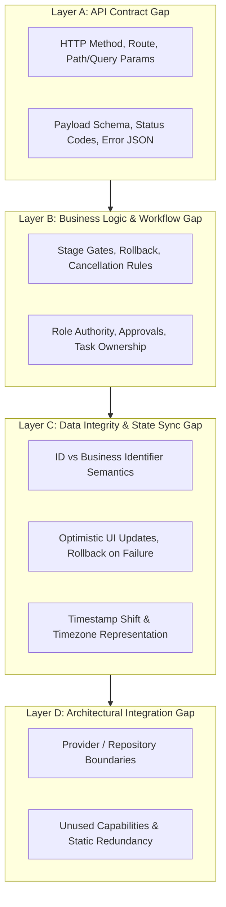
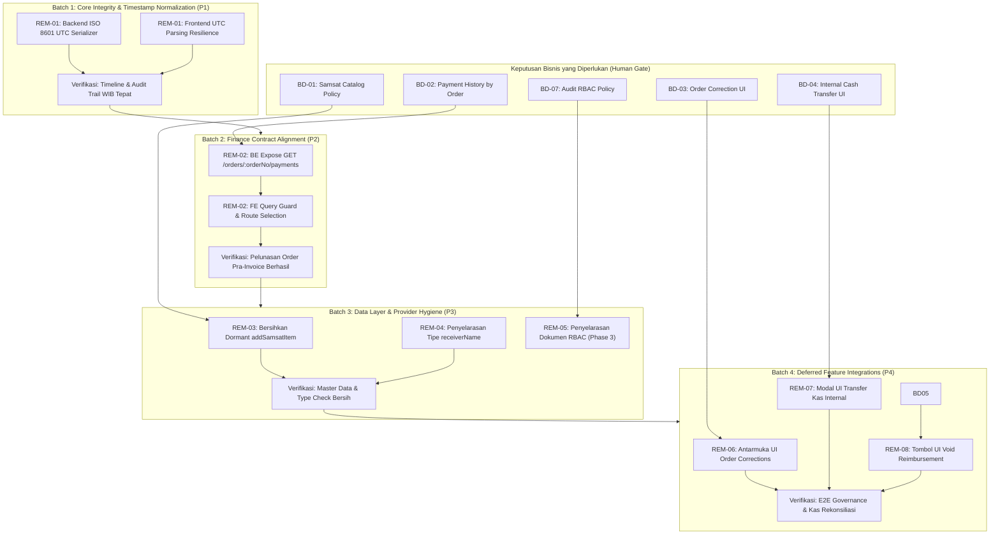

# PHASE 1C — CONTRACT GAP ANALYSIS & ALIGNMENT
## SUN89 / SUNBiroJasa — Consolidated Gap Assessment & Remediation Planning

> **Mode:** READ-ONLY ARCHITECTURAL & CONTRACT GAP ANALYSIS  
> **Target:** Synthesis of Phase 1A, Phase 1A.1, and Phase 1B into an Implementation-Ready Remediation Plan  
> **Author:** Senior Software Architect, API Contract Analyst, Backend Integration Specialist & Technical Remediation Planner  
> **Date:** 2026-11-09  
> **Integrity Status:** Database SHA-256 Unchanged (`D560674CCD917049241415018FA00A4CF21B78BB9103F380C808B3B90408171C`), Zero Code Mutations Applied  

---

## 1. Executive Summary

Laporan **Phase 1C — Contract Gap Analysis & Alignment** ini menyajikan konsolidasi komprehensif atas seluruh temuan audit teknis dari **Phase 1A** (Backend API Inventory), **Phase 1A.1** (Inventory Validation Addendum), dan **Phase 1B** (Frontend API Consumption Audit, Validation Addendum, dan Final Errata). Evaluasi ini bertujuan mengidentifikasi kesenjangan (*gaps*) nyata antara implementasi backend Express + SQLite sebagai **Single Source of Truth (SSoT)** dengan konsumsi API oleh antarmuka frontend React/TypeScript (`src/`), serta menyusun rencana perbaikan (*remediation roadmap*) yang aman, terukur, dan bebas risiko regresi.

Pekerjaan ini dilakukan dalam **Strict Read-Only Mode** tanpa mengubah baris kode program, skema basis data, konfigurasi, maupun berkas operasional.

### Ringkasan Eksekutif Temuan Gap & Rencana Tindakan

| Metrik Evaluasi Gap | Nilai Terverifikasi | Penjelasan & Rincian |
|---|---|---|
| **Total Gap Teridentifikasi** | **12 Gap** | Seluruh diskrepansi kontrak, data layer, representasi waktu, dan kapabilitas sistem |
| **Gap Memerlukan Tindakan Segera (Actionable)** | **2 Gap** | GAP-03 (Pergeseran waktu 7 jam API-06 [P1]) dan GAP-02 (Ambiguitas query pembayaran invoice F-02 [P2]) |
| **Technical Debt / Data Layer Hygiene** | **3 Gap** | GAP-01 (Dormant `addSamsatItem` method), GAP-04 (Dokumentasi RBAC), GAP-10 (Penyelarasan nama tipe delivery) |
| **Kapabilitas Unused Pending Keputusan Bisnis** | **4 Gap** | GAP-05 (UI Order Corrections), GAP-06 (UI Cash Transfer), GAP-07 (Reimbursement Void), GAP-08 (GDPR Job Retry) |
| **Informational / No Action Required** | **3 Gap** | GAP-09 (Static Wilayah), GAP-11 (Health Probes), GAP-12 (Public Portal API Isolation) |
| **Keputusan Bisnis yang Diperlukan (BD)** | **7 Keputusan** | BD-01 hingga BD-07 yang memerlukan arahan resmi pemilik produk sebelum implementasi |
| **Distribusi Lokasi Perbaikan (Fix Location)** | Frontend: 3 Backend: 1 Both: 4 No Code Change: 4 | Prinsip SSoT: Frontend menyesuaikan kontrak backend yang valid; backend diperbaiki jika serialisasi/rute cacat |
| **Rencana Batch Implementasi** | **4 Batch** | Batch 1 (Integritas Timestamp P1), Batch 2 (Kontrak Finansial P2), Batch 3 (Hygiene Data P3), Batch 4 (Integrasi Fitur P4) |

---

## 2. Audit Scope dan Exclusions

### Cakupan Analisis (In-Scope)
- **Backend API:** 143 Strict Functional Contracts yang aktif pada 19 domain di Express backend (`server/src/routes/`).
- **Frontend Consumers:** 127 static HTTP call expressions (126 active runtime calls + 1 dormant provider call) pada 24 file consumer di `src/`.
- **Workflow Engine:** 8 tahap kanonis workflow order, walk-in shortcut, dan seluruh transisi status serta gate persetujuan supervisi/messenger.
- **Financial Layer:** Alur transaksi invoices, kas kantor, kas messenger, pembayaran penuh/parsial, void, dan profit/loss.
- **Serialisasi Data:** Evaluasi format pertukaran data tanggal, enum status, dan penanganan zona waktu (API-06).
- **Penyusunan Rencana Remediasi:** Remediation units, framework prioritas P0–P4, dependency graph, dan strategi pengujian.

### Pengecualian (Out-of-Scope)
- **Implementasi Langsung Kode:** Dilarang mengubah kode program, konfigurasi, database, atau dependency pada fase ini.
- **Arsitektur File & Document Integrity (Phase 7):** Perancangan reusable upload component, validasi magic bytes, kompresi berkas, dan sanitasi berkas tetap berada pada mandat eksklusif **Phase 7**.
- **Repositori Web Portal Pelanggan Publik:** Portal publik pelanggan merupakan repositori eksternal terpisah. Kontrak `/api/v1/public/*` diverifikasi hanya dari sisi ketersediaan rute backend.
- **Infrastruktur Produksi & DevOps:** Konfigurasi HTTPS, Nginx reverse proxy, Docker daemon, CI/CD pipelines, dan performance load testing berada di luar cakupan contract alignment.

---

## 3. Source Documents dan Baseline

Analisis Phase 1C ini didasarkan secara ketat pada lima dokumen audit baseline resmi yang tersedia di repositori:

| No | Dokumen Sumber | Lokasi File Aktual | Peran & Otoritas Informasi |
|---|---|---|---|
| 1 | **Phase 1A Report** | [`BACKEND_API_INVENTORY_REPORT_PHASE_1A.md`](file:///C:/Users/mahes/.gemini/antigravity/brain/c46f932a-e4d5-4b7b-b4a2-848bfe5a1500/BACKEND_API_INVENTORY_REPORT_PHASE_1A.md) | Baseline inventarisasi 159 registrasi rute backend awal |
| 2 | **Phase 1A.1 Addendum** | [`PHASE_1A_1_BACKEND_API_INVENTORY_VALIDATION.md`](file:///d:/Admin/adminsunbirojasa/docs/audits/PHASE_1A_1_BACKEND_API_INVENTORY_VALIDATION.md) | **SSoT Baseline Backend:** 143 Strict Functional Contracts, 16 aliases, 4 variants, 8 workflow stages |
| 3 | **Phase 1B Main Report** | [`PHASE_1B_FRONTEND_API_CONSUMPTION_AUDIT.md`](file:///d:/Admin/adminsunbirojasa/docs/audits/PHASE_1B_FRONTEND_API_CONSUMPTION_AUDIT.md) | Pemetaan komprehensif 143 kontrak terhadap 24 file consumer frontend |
| 4 | **Phase 1B Addendum** | [`PHASE_1B_VALIDATION_ADDENDUM.md`](file:///d:/Admin/adminsunbirojasa/docs/audits/PHASE_1B_VALIDATION_ADDENDUM.md) | Verifikasi empiris F-01 hingga F-04, pembuktian adapter delivery gate, dan reklasifikasi 32 unused contracts |
| 5 | **Phase 1B Errata** | [`PHASE_1B_FINAL_ERRATA.md`](file:///d:/Admin/adminsunbirojasa/docs/audits/PHASE_1B_FINAL_ERRATA.md) | Koreksi severity F-01 (LOW), pencabutan klaim orkestrator health probe, dan pemisahan metrik runtime (100%) vs static (99.21%) |

### Baseline Yang Wajib Dipertahankan
- **143 Strict Functional Contracts:** Denominator utama evaluasi kontrak API.
- **8 Canonical Workflow Stages:** 1. Verifikasi $\to$ 2. Penjadwalan $\to$ 3. Verifikasi Dokumen $\to$ 4. Proses Samsat $\to$ 5. Verifikasi Ulang $\to$ 6. Supervisi $\to$ 7. Pengantaran $\to$ 8. Dokumen Telah Diterima (Terminal).
- **Backend SSoT Primacy:** Backend Express dan skema SQLite adalah acuan kebenaran arsitektur dan bisnis.

---

## 4. Analysis Methodology

Analisis kesenjangan pada Phase 1C dilakukan melalui metodologi empat lapisan (*Four-Layer Gap Analysis Framework*) untuk membedakan antara cacat kontrak teknis murni, aturan alur bisnis, inkonsistensi status memori, dan batas arsitektural:

- **Layer A (API Contract):** Membandingkan kecocokan struktur request, header authorization, path parameters, query string, response body, dan kode status HTTP.
- **Layer B (Business Logic):** Memastikan integrasi antarmuka mematuhi aturan operasional backend (gating syarat dokumen, otorisasi SPV, serah terima berkas).
- **Layer C (Data Integrity & State Sync):** Mengevaluasi semantik identitas (`id` auto-increment vs `orderNo` string), keandalan optimistic updates, mitigasi race conditions, dan serialisasi waktu.
- **Layer D (Architectural Integration):** Meninjau isolasi modul, pemisahan role vs jabatan, pemanfaatan kapabilitas backend, dan eliminasi kode dormant.

---

## 5. Backend–Frontend Contract Alignment Overview

Berdasarkan konsolidasi Phase 1A.1 dan Phase 1B Final Errata, kondisi keselarasan kontrak saat ini dirangkum dalam tabel berikut:

| Dimensi Evaluasi | Denominator | Nilai Selaras | Nilai Gap | Persentase Kepatuhan |
|---|---|---|---|---|
| **Backend Contract Coverage** | 143 Kontrak SSoT | 143 Dievaluasi | 0 Unverified | **100.00%** |
| **Backend Contract Consumption** | 143 Kontrak SSoT | 111 Aktif (110 MATCH + 1 PARTIAL) | 32 Unused | **77.62%** Aktif / **22.38%** Unused |
| **Runtime Frontend Calls** | 126 Call Sites Aktif | 126 Rute Valid | 0 Rute Hilang | **100.00%** Keselarasan Runtime |
| **Static Call Expressions** | 127 Call Sites Statis | 126 Rute Valid | 1 Rute Hilang (Dormant F-01) | **99.21%** Keselarasan Sintaksis |

### Rangkuman Status Kontrak Backend (143 SSoT):
- **MATCH (110 Kontrak):** Request, response, method, status, dan data flow antara frontend dan backend telah terverifikasi selaras.
- **PARTIAL (1 Kontrak):** `GET /api/finance/invoices/:invoiceNo/payments` (ambiguitas parameter invoice vs order).
- **UNUSED BY ADMIN FRONTEND (32 Kontrak):**
  - *Intentionally Unused (8):* 2 Health probes container + 6 Public Customer Portal APIs.
  - *Not Required by Current Scope (16):* Single-resource getters (`/:id`), status list filters, dan data wilayah statis.
  - *Potential Missing Integration (8):* 4 Order corrections SPV, 2 Internal cash transfers, 1 Reimbursement void, 1 GDPR retry job.

---

## 6. Gap Register

Berikut adalah register lengkap seluruh 12 gap yang ditemukan, diklasifikasikan berdasarkan jenis, severity, prioritas, dan arah perbaikannya:

| Gap ID | Domain | Sumber Temuan | Kondisi Aktual (Current State) | Kondisi Target (Expected State) | Jenis Gap | Severity | Prioritas | Arah Perbaikan | Dependensi |
|---|---|---|---|---|---|---|---|---|---|
| **GAP-01** | Pricing | Phase 1B F-01 | Method dormant `addSamsatItem()` di `apiPricingProvider.ts:192` memanggil `POST /pricing/samsat` (404 Not Found). UI tidak memanggilnya (menggunakan 29 item kanonis). | Bersihkan method dormant jika katalog tetap kanonis 29 item, atau sediakan route backend jika penambahan item dinamis disetujui. | DORMANT INTEGRATION | LOW | **P3** | Frontend (atau Both jika dinamis) | BD-01 |
| **GAP-02** | Finance | Phase 1B F-02 | `FinanceContent.tsx:798` mengirim `orderNo` ke `/invoices/:invoiceNo/payments` saat invoice belum terbit, menghasilkan query SQL `[]`. Backend punya `getPaymentsByOrderNo()` tapi tanpa route HTTP. | Frontend hanya memanggil endpoint invoice jika `invoiceNo` valid. Backend mengekspos route pembayaran berbasis order untuk order pra-invoice. | CONTRACT MISMATCH | MEDIUM | **P2** | Both (FE Guard + BE Route) | BD-02 |
| **GAP-03** | Cross-domain | Phase 1B F-03 (API-06) | SQLite `datetime('now')` menghasilkan string UTC tanpa `Z` (`YYYY-MM-DD HH:MM:SS`). Browser lokal WIB menganggapnya waktu lokal, menyebabkan **pergeseran mundur 7 jam**. | Standarisasi serialisasi backend ke ISO 8601 UTC dengan akhiran `Z` (`YYYY-MM-DDTHH:MM:SS.sssZ`) dan perkuat parser tanggal frontend. | TIMESTAMP/FORMAT GAP | HIGH | **P1** | Both (BE Serializer + FE Parser) | None |
| **GAP-04** | Auth & RBAC | Phase 1A.1 API-01 & 1B F-04 | Rute audit log memiliki perbedaan hak akses (`requireAdmin` vs `requireSuperAdmin`). Frontend memetakan role `administrator` ke `svp` untuk evaluasi menu UI. | Penyelarasan role permission audit log di Phase 3 RBAC. Pertahankan pemisahan tegas `role` (keamanan) dan `jabatan` (organisasi). | AUTHORIZATION GAP | LOW | **P3** | Backend & Docs | BD-07, Phase 3 |
| **GAP-05** | Governance | Phase 1B Unused #4, #6-8 | Backend memiliki sistem tata kelola koreksi order berizin SPV (`/api/order-corrections/*`), namun tidak ada tampilan UI di antarmuka staf/SPV. | Implementasikan antarmuka pengajuan dan persetujuan revisi order oleh SPV di dashboard jika disetujui bisnis. | UNUSED CAPABILITY | MEDIUM | **P4** | Frontend (New UI) | BD-03 |
| **GAP-06** | Finance | Phase 1B Unused #14-15 | Backend menyediakan rute mutasi kas internal dua arah (`/api/finance/transfer/*`), namun kasir saat ini mencatat mutasi kas secara manual terpisah. | Sediakan modal transfer kas terintegrasi di antarmuka Finance jika disetujui bisnis. | UNUSED CAPABILITY | MEDIUM | **P4** | Frontend (New UI) | BD-04 |
| **GAP-07** | Messenger | Phase 1B Unused #20 | Backend memiliki endpoint `POST /api/messenger/reimbursements/:id/void` dengan penyesuaian saldo kas otomatis, namun UI kasir belum memiliki tombol void. | Sediakan tombol pembatalan klaim reimbursement pada tabel Finance jika disetujui bisnis. | UNUSED CAPABILITY | LOW | **P4** | Frontend (UI Action) | BD-05 |
| **GAP-08** | Users / GDPR | Phase 1B Unused #18 | Backend menyediakan endpoint retry background job penghapusan file GDPR (`POST /users/file-deletion-jobs/:jobId/retry`), namun tidak ada tombol di UI admin. | Tambahkan tombol aksi retry pada log penghapusan permanen jika disetujui bisnis. | UNUSED CAPABILITY | LOW | **P4** | Frontend (UI Action) | BD-06 |
| **GAP-09** | Master Data | Phase 1B Unused #22-24 | Frontend menduplikasi data 34 provinsi dan kabupaten secara lokal di `wilayahIndonesiaData.ts` sehingga rute `/api/wilayah/*` tidak digunakan. | Pertahankan bundel statis untuk performa instan offline, namun tambahkan opsi background hydration dari API backend saat bootstrap. | ARCHITECTURAL LIMITATION | INFO | **P3** | Frontend (Optional Hydration) | None |
| **GAP-10** | Workflow | Phase 1B Delivery Gate | Form input serah terima menggunakan `recipientName`, sedangkan backend menerima `receiverName`. Saat ini berhasil dijembatani oleh adapter mapping. | Harmonisasi nama field antarmuka/tipe data ke `receiverName` untuk keterbacaan kode jangka panjang. | NO ACTION REQUIRED | INFO | **P3** | Frontend (Refactor Tipe) | None |
| **GAP-11** | System Health | Phase 1B Errata #2 | Endpoint `/api/health` dan `/api/health/ready` tidak digunakan oleh frontend admin (yang menggunakan `/health/live`). Konsumen eksternal NOT VERIFIED. | Pertahankan endpoint sebagai kapabilitas kesiapan infrastruktur proses backend tanpa perubahan kode. | NO ACTION REQUIRED | INFO | **P4** | None (Retain) | None |
| **GAP-12** | Public Portal | Phase 1B Unused #27-32 | 6 rute publik `/api/v1/public/*` tidak digunakan di dashboard admin internal karena diperuntukkan bagi customer web portal terpisah. | Pertahankan isolasi rute publik. Di luar lingkup dashboard admin. | NO ACTION REQUIRED | INFO | **P4** | None (Retain) | None |

---

## 7. Domain Gap Analysis

### 7.1. Order Management Domain
- **Validasi Semantik Identifier:** Frontend secara konsisten mengirimkan `orderNo` (format string seperti `ORD-202611-001`) pada seluruh path parameter `/orders/:orderNo/*`. Database auto-increment integer ID tidak pernah disalahgunakan sebagai parameter URL.
- **Verifikasi Rute Legacy:** Rute usang `PATCH /api/orders/:id/stage` dan `POST /api/orders/:id/void` **terbukti 100% tidak ada di kode runtime**. Frontend telah sepenuhnya menggunakan `POST /api/orders/:orderNo/advance`, `POST /api/orders/:orderNo/rollback`, dan `POST /api/orders/:orderNo/cancel`.
- **Data Preservation:** Pembaruan data order via `PUT /api/orders/:orderNo` mempertahankan snapshot layanan (`serviceRequirementsSnapshot`) dan rincian biaya mutasi tanpa menimpa data historis.

### 7.2. Workflow Domain
Alur kerja order mengimplementasikan **8 tahap kanonis** dengan matriks transisi terverifikasi:

| Current Stage | Next Stage | Frontend Action | Backend Endpoint | Required Gate | Status Validasi |
|---|---|---|---|---|---|
| **Stage 1 (Verifikasi)** | Stage 2 (Penjadwalan) | `advanceOrderAsync` | `POST /orders/:orderNo/advance` | Verifikasi awal order disetujui staf | **MATCH** |
| **Stage 1 (Verifikasi)** | Stage 3 (Verifikasi Dokumen) | `advanceOrderAsync` | `POST /orders/:orderNo/advance` | **Walk-in Flow:** `metodeLayanan === "Datang Langsung"` (melewati tahap 2) | **MATCH** |
| **Stage 2 (Penjadwalan)** | Stage 3 (Verifikasi Dokumen) | `advanceOrderAsync` | `POST /orders/:orderNo/advance` | Messenger menyelesaikan penjemputan berkas (`COMPLETED`) | **MATCH** |
| **Stage 3 (Verifikasi Dokumen)** | Stage 4 (Proses Samsat) | `advanceOrderAsync` | `POST /orders/:orderNo/advance` | Berkas fisik lengkap dan diverifikasi di loket kantor | **MATCH** |
| **Stage 4 (Proses Samsat)** | Stage 5 (Verifikasi Ulang) | `advanceOrderAsync` | `POST /orders/:orderNo/advance` | Seluruh komponen loket Samsat berstatus `COMPLETED` | **MATCH** |
| **Stage 5 (Verifikasi Ulang)** | Stage 6 (Supervisi) | `advanceOrderAsync` | `POST /orders/:orderNo/advance` | Rekonsiliasi biaya final selesai, payload `documentsVerified: true` & `stage5Verified: true` | **MATCH** |
| **Stage 6 (Supervisi)** | Stage 7 (Pengantaran) | `advanceOrderAsync` | `POST /orders/:orderNo/advance` | Otoritas SPV / Administrator (`approvedBySpv: true` & `stage6Approved: true`) | **MATCH** |
| **Stage 7 (Pengantaran)** | Stage 8 (Dokumen Diterima) | `advanceOrderAsync` | `POST /orders/:orderNo/advance` | Bukti serah terima valid, `deliveryStatus: "Dokumen Diserahkan"`, `isReceived: true`, `receiverName` terisi | **MATCH** (via Adapter) |
| **Stage 8 (Dokumen Diterima)** | *(Terminal Stage)* | N/A | N/A | Tahap akhir pengurusan. Tidak dapat dimajukan lagi. | **MATCH** |
| **Any Stage (2..7)** | Previous Stage | `rollbackOrderAsync` | `POST /orders/:orderNo/rollback` | Alasan rollback terisi, tahap target ada dalam riwayat order | **MATCH** |
| **Any Stage (1..7)** | Cancelled | `cancelOrderAsync` | `POST /orders/:orderNo/cancel` | Alasan pembatalan resmi (`cancellationReason`) | **MATCH** |

### 7.3. Finance Domain (Deep Dive GAP-02)
- **Akar Masalah GAP-02:** Pada `FinanceContent.tsx:798, 1218`, terdapat pemanggilan `GET /api/finance/invoices/:invoiceNo/payments` dengan input fallback `item.invoice || item.invoiceNo || item.orderNo`.
- **Analisis Backend:** Controller memanggil `dbFinanceRepository.getPaymentsByInvoiceNo(invoiceNo)` yang mengeksekusi `SELECT * FROM invoice_payments WHERE invoice_no = ?`. Jika objek UI berasal dari order yang belum memiliki invoice resmi (`INV-...`) dan variabel jatuh ke `orderNo`, query menghasilkan `[]`.
- **Fakta Kode:** Backend memiliki fungsi `dbFinanceRepository.getPaymentsByOrderNo(orderNo)` yang siap pakai, namun tidak memiliki route Express.
- **Solusi Rekomendasi:** Backend mengekspos route `GET /api/finance/orders/:orderNo/payments`, dan frontend memvalidasi apakah target transaksi memiliki `invoiceNo` atau `orderNo` sebelum memilih endpoint.

### 7.4. Pricing & Master Data Domain (Deep Dive GAP-01)
- **Akar Masalah GAP-01:** Method `addSamsatItem()` di `src/data/api/apiPricingProvider.ts:184-201` mengirim `POST /pricing/samsat` yang tidak ada di backend.
- **Fakta Antarmuka UI:** Komponen [`HargaDasarSamsat.tsx`](file:///d:/Admin/adminsunbirojasa/src/app/components/HargaDasarSamsat.tsx) secara eksklusif mengelola **29 komponen kanonis nasional**. Pembaruan harga nasional memanggil `PUT /pricing/samsat/:id`, dan tarif override per-kantor Samsat memanggil `PUT /pricing/samsat-tariffs`.
- **Solusi Rekomendasi:** Sesuai BD-01, jika bisnis menetapkan katalog tertutup 29 komponen master data nasional, method orphan `addSamsatItem()` dihapus dari provider frontend.

### 7.5. Documents & Files Domain
- **Penyelarasan Kontrak Dokumen:** Frontend secara konsisten menggunakan `POST /api/documents/upload` dengan multipart field `file`.
- **Penautan Dokumen:** Penautan dokumen ke order menggunakan kontrak resmi `PATCH /api/documents/:id/link-order`.
- **Keamanan Unduhan & Preview:** Akses dokumen menggunakan alur aman berbasis tiket kedaluwarsa (`POST /api/documents/:id/ticket` dilanjutkan `GET /api/documents/:id/preview?ticket=...`).
- **Catatan Batas:** Perancangan arsitektur File & Document Integrity tingkat lanjut tetap menjadi lingkup eksklusif **Phase 7**.

### 7.6. Messenger Domain
- **Prefix & Route Task:** Seluruh pemanggilan konsisten menggunakan prefix `/api/messenger/*` dan `/api/orders/:orderNo/tasks/*`.
- **Sub-actions Task:** Aksi `accept`, `decline`, dan `reassign` terverifikasi 100% selaras dengan controller backend.
- **Status Pengantaran:** Transformasi data bukti serah terima dokumen terbukti memetakan input `proof.recipientName` ke properti backend `receiverName`.

### 7.7. Authentication & RBAC Domain (Deep Dive GAP-04)
- **Role vs Jabatan:** Backend `authService.ts:108` memetakan `jabatan: "SVP"` ke `role: "administrator"`. Token JWT membawa role backend yang diverifikasi oleh middleware.
- **Proteksi Role Immutable:** Baik frontend `permissionStore.ts:648` maupun backend `permissionController.ts:36` menolak keras mutasi permission role SVP/administrator.
- **Penyelarasan API-01:** Rute audit log memiliki sedikit perbedaan hak akses yang akan diformalkan pada Phase 3 RBAC.

### 7.8. Public API & Unused Contracts Domain
- 6 kontrak publik `/api/v1/public/*` terkonfirmasi merupakan kontrak eksternal untuk Customer Web Portal terpisah.
- 2 health probes `/api/health` dan `/api/health/ready` terkonfirmasi merupakan kapabilitas infrastruktur proses backend.
- 24 kontrak unused lainnya terbukti aman tanpa menimbulkan dead-lock atau defek fungsional pada dashboard admin.

---

## 8. Timestamp and Data Representation Assessment (API-06)

### A. Evaluasi Empiris Ketidaksesuaian Zona Waktu
Investigasi empiris terhadap skema SQLite dan parser JavaScript ECMAScript membuktikan akar masalah GAP-03:
1. Kolom SQLite yang menggunakan default SQL `datetime('now')` (seperti `orders.updated_at`, `order_status_history.waktu_transisi`, dan `security_audit_logs.created_at`) menyimpan waktu UTC dalam format string tanpa penanda zona waktu: `YYYY-MM-DD HH:MM:SS`.
2. Standar ECMAScript (JavaScript) menyatakan bahwa string tanggal dengan pemisah spasi tanpa akhiran `Z` ditafsirkan sebagai **Waktu Lokal Klien**.
3. Pada browser pengguna di Indonesia (zona waktu WIB / UTC+7), waktu UTC `14:00:00` ditafsirkan sebagai `14:00:00 WIB`, bukan `21:00:00 WIB`.
4. **Dampak Nyata:** Terjadi pergeseran waktu **mundur 7 jam**. Transaksi larut malam antara pukul 00:00 hingga 06:59 WIB tercatat pada hari kalender kemarin di antarmuka web.

### B. Rencana Penyelarasan Serialisasi Waktu
- **Backend Strategy (Primary):** Seluruh controller Express dan repository harus menserialisasi timestamp ke standar ISO 8601 UTC dengan penanda `Z` (`YYYY-MM-DDTHH:MM:SS.sssZ`) sebelum dikirim ke client JSON.
- **Frontend Strategy (Defense-in-Depth):** Utilitas parsing tanggal frontend (`formatDate`, `formatDateTime`) diperkuat dengan helper regex yang otomatis menambahkan `Z` jika mendeteksi string format `YYYY-MM-DD HH:MM:SS`.

---

## 9. Business Decision Register

Berikut adalah 7 keputusan bisnis yang harus disetujui oleh Technical Lead / Product Owner sebelum pelaksanaan perbaikan:

### BD-01 — Samsat Master Pricing Catalog Policy
- **Kondisi Aktual:** UI menggunakan 29 komponen kanonis nasional. Method `addSamsatItem` di provider dormant.
- **Opsi Alternatif:**
  - *Opsi A (Recommended):* Katalog tertutup. Master item Samsat dibatasi 29 komponen standar. Hapus method orphan `addSamsatItem` dari provider frontend.
  - *Opsi B:* Katalog dinamis. Izinkan operator menambah komponen kustom. Backend wajib membuat route `POST /api/pricing/samsat`.
- **Implikasi Bisnis:** Opsi A menjaga konsistensi pelaporan keuangan antar cabang Samsat. Opsi B memberi fleksibilitas namun berisiko inkonsistensi nama tarif.
- **Rekomendasi:** **Opsi A (Closed Canonical Catalog)**.

### BD-02 — Payment History Lookup for Pre-Invoice Orders
- **Kondisi Aktual:** Frontend mengirim `orderNo` ke endpoint invoice saat invoice belum ada, menghasilkan query kosong.
- **Opsi Alternatif:**
  - *Opsi A (Recommended):* Backend menyediakan route resmi `GET /api/finance/orders/:orderNo/payments` yang memanggil `getPaymentsByOrderNo`. Frontend memanggil route ini jika invoice belum terbit.
  - *Opsi B:* Frontend melarang pencatatan pelunasan sebelum invoice resmi diterbitkan oleh sistem.
- **Implikasi Bisnis:** Opsi A mendukung operasional biro jasa yang menerima uang muka/DP sebelum penagihan resmi dicetak.
- **Rekomendasi:** **Opsi A (Expose Order Payments Route)**.

### BD-03 — SPV Order Correction Governance Interface
- **Kondisi Aktual:** Backend memiliki modul supervisi revisi order (`/api/order-corrections/*`), UI belum ada.
- **Opsi Alternatif:**
  - *Opsi A (Recommended):* Bangun antarmuka form pengajuan koreksi dan inbox review SPV pada Batch 4 (Phase 6).
  - *Opsi B:* Nonaktifkan route koreksi di backend dan gunakan alur rollback stage standar.
- **Implikasi Bisnis:** Opsi A menyediakan jejak audit tata kelola revisi yang transparan.
- **Rekomendasi:** **Opsi A (Build UI in Batch 4)**.

### BD-04 — Integrated Internal Cash Transfer Interface
- **Kondisi Aktual:** Backend memiliki rute transfer kas kantor $\leftrightarrow$ messenger, UI mencatat manual terpisah.
- **Opsi Alternatif:**
  - *Opsi A (Recommended):* Bangun modal transfer kas terintegrasi di tab Kas Kantor / Kas Messenger pada Batch 4.
  - *Opsi B:* Pertahankan pencatatan manual mandiri di masing-masing buku kas.
- **Implikasi Bisnis:** Opsi A mencegah selisih saldo (*cash mismatch*) antara kas kantor dan kas operasional messenger.
- **Rekomendasi:** **Opsi A (Build Integrated Transfer Modal)**.

### BD-05 — Messenger Reimbursement Void Action in UI
- **Kondisi Aktual:** Backend menyediakan `POST /reimbursements/:id/void`, kasir UI belum memiliki tombol.
- **Opsi Alternatif:**
  - *Opsi A (Recommended):* Tambahkan tombol "Void Klaim" berizin Finance/SPV dengan dialog alasan pembatalan.
  - *Opsi B:* Koreksi klaim yang keliru dilakukan melalui penyesuaian manual di buku kas.
- **Rekomendasi:** **Opsi A (Add Void Action in UI)**.

### BD-06 — Background File Deletion Job Retry Interface
- **Kondisi Aktual:** Backend menyediakan retry job hapus file GDPR, UI admin belum memiliki tombol aksi.
- **Opsi Alternatif:**
  - *Opsi A (Recommended):* Tampilkan tombol retry hanya pada tabel log pembersihan file berstatus FAILED di Settings.
  - *Opsi B:* Biarkan retry ditangani oleh background cron scheduler otomatis tanpa intervensi UI.
- **Rekomendasi:** **Opsi B (Automated Cron / CLI Retry)**.

### BD-07 — Audit Log RBAC Policy Alignment
- **Kondisi Aktual:** `GET /audit` mengizinkan role `finance`, sedangkan `POST /audit/clear` strictly `administrator`.
- **Opsi Alternatif:**
  - *Opsi A (Recommended):* Formalisasikan pada Phase 3 RBAC bahwa hak baca log audit diizinkan untuk Admin, Finance, dan SVP, sedangkan penghapusan log strictly Administrator.
- **Rekomendasi:** **Opsi A (Formalize in Phase 3)**.

---

## 10. Severity dan Priority Assessment

Pembedaan tegas antara **Severity** (tingkat keparahan dampak teknis/bisnis) dan **Priority** (urutan eksekusi perbaikan berdasarkan dependensi):

### Matriks Distribusi Prioritas Remediasi

| Prioritas | Definisi & Kriteria Eksekusi | Daftar Gap Terkait | Jumlah |
|---|---|---|---|
| **P0 — Critical** | Kerusakan data, kebocoran finansial, bypass otorisasi fatal. | *Tidak ada* | 0 |
| **P1 — High** | Defek integritas data operasional & ketidakakuratan kronologi sistem. | **GAP-03** (Penyelarasan Zona Waktu ISO UTC API-06) | 1 |
| **P2 — Medium** | Defek fungsional transaksi finansial & kegagalan query data. | **GAP-02** (Penyelarasan Query Pembayaran Order Pra-Invoice) | 1 |
| **P3 — Low / Hygiene** | Pembersihan kode dormant, penamaan tipe, background hydration. | **GAP-01** (Pricing Hygiene), **GAP-04** (RBAC Mapping Docs), **GAP-09** (Wilayah Hydration), **GAP-10** (Type Aliases) | 4 |
| **P4 — Deferred / Decisions** | Integrasi kapabilitas backend baru yang menunggu persetujuan bisnis. | **GAP-05** (Corrections UI), **GAP-06** (Transfer UI), **GAP-07** (Reimburse Void), **GAP-08** (GDPR Retry), **GAP-11**, **GAP-12** | 6 |

---

## 11. Recommended Remediation Plan

Rencana perbaikan terstruktur dalam unit pekerjaan independen yang dapat diuji secara objektif:

| Task ID | Gap ID | Domain | Masalah Aktual | Kondisi Target | Lokasi Perbaikan | Komponen / File Terkait | Dependensi | Risiko Data | Kriteria Keberterimaan (Acceptance Criteria) | Prioritas |
|---|---|---|---|---|---|---|---|---|---|---|
| **REM-01** | GAP-03 | Timestamps | String SQLite tanpa `Z` bergeser 7 jam mundur di browser WIB. | Seluruh timestamp API diserialisasi sebagai ISO 8601 UTC dengan `Z`. | Backend + Frontend | `server/src/database/db.ts`, `server/src/repositories/dbOrderRepository.ts`, `src/app/utils/financeFormatters.tsx` | None | Nol (format output) | Waktu transisi order dan audit log menampilkan jam lokal WIB akurat (+7 jam dari UTC). | **P1** |
| **REM-02** | GAP-02 | Finance | Query riwayat pembayaran order pra-invoice mengembalikan array kosong. | Tersedia route `GET /finance/orders/:orderNo/payments` dan guard pada frontend. | Backend + Frontend | `server/src/routes/financeRoutes.ts`, `server/src/controllers/financeController.ts`, `src/app/components/FinanceContent.tsx` | BD-02 | Nol (read-only query) | Riwayat pembayaran order tampil akurat di modal pelunasan sebelum invoice resmi dicetak. | **P2** |
| **REM-03** | GAP-01 | Pricing | Method dormant `addSamsatItem()` memanggil route 404 yang tidak ada. | Method orphan dibersihkan dari provider frontend jika katalog tertutup 29 item. | Frontend | `src/data/api/apiPricingProvider.ts`, `src/data/repositories/pricingRepository.ts`, `src/domain/pricing/types.ts` | BD-01 | Nol (unused code) | Tidak ada lagi pemanggilan orphan `POST /pricing/samsat` di jaringan; UI tetap stabil. | **P3** |
| **REM-04** | GAP-10 | Workflow | Form menggunakan `recipientName` sedangkan payload dipetakan ke `receiverName`. | Penyelarasan alias tipe data di antarmuka domain agar konsisten. | Frontend | `src/domain/order/types.ts`, `src/app/components/OrderTracking.tsx` | None | Nol (refactor tipe) | Kode sumber bersih dari dualisme nama properti serah terima berkas. | **P3** |
| **REM-05** | GAP-04 | RBAC | Role `administrator` dinormalisasi ke `svp` di store frontend. | Dokumentasi arsitektur dan penegasan batas role vs jabatan diformalkan. | Backend / Docs | `src/app/data/permissionStore.ts`, `server/src/middleware/authMiddleware.ts` | BD-07, Phase 3 | Nol | Hak akses audit log terdokumentasi dan konsisten pada Phase 3 RBAC. | **P3** |
| **REM-06** | GAP-05 | Governance | Fitur revisi order SPV backend belum memiliki antarmuka pengguna. | Tersedia form pengajuan koreksi dan dashboard review SPV di antarmuka. | Frontend | `src/app/components/OrderTracking.tsx`, `src/app/components/OrderCorrectionsInbox.tsx` (New) | BD-03 | Rendah (tabel terpisah) | SPV dapat menyetujui atau menolak revisi data order secara visual di UI. | **P4** |
| **REM-07** | GAP-06 | Finance | Mutasi kas kantor ke messenger belum memiliki form transfer terpadu. | Tersedia modal transfer kas dua arah terhubung ke endpoint backend. | Frontend | `src/app/components/FinanceContent.tsx`, `src/app/components/RekonsiliasiKasModal.tsx` | BD-04 | Sedang (jurnal kas) | Saldo kas kantor berkurang dan saldo kas messenger bertambah secara atomik. | **P4** |
| **REM-08** | GAP-07 | Messenger | Kasir tidak memiliki tombol pembatalan klaim reimbursement messenger. | Tersedia tombol void klaim reimbursement dengan dialog konfirmasi alasan. | Frontend | `src/app/components/FinanceContent.tsx` | BD-05 | Rendah (status void) | Status klaim reimbursement berubah ke VOID dan saldo kas kantor dikembalikan. | **P4** |

---

## 12. Dependency Graph

Bagan ketergantungan kerja antar batch perbaikan:

---

## 13. Implementation Batch Proposal

Pekerjaan perbaikan dipecah menjadi 4 batch independen dengan cakupan terbatas untuk meminimalkan risiko regresi:

### Batch 1 — Core Integrity & Timestamp Normalization (P1)
- **Fokus:** Menyelesaikan GAP-03 (API-06).
- **Scope File:** `server/src/database/db.ts`, `server/src/repositories/dbOrderRepository.ts`, `server/src/repositories/dbAuditRepository.ts`, `src/app/utils/financeFormatters.tsx`.
- **Dampak:** Perbaikan tampilan waktu di seluruh sistem tanpa memodifikasi skema database.
- **Gate Approval:** Checksum database tetap identik, kronologi audit log dan riwayat order terbukti akurat dalam zona waktu WIB.

### Batch 2 — Finance Contract Alignment & Payment Identifier (P2)
- **Fokus:** Menyelesaikan GAP-02 (F-02).
- **Scope File:** `server/src/routes/financeRoutes.ts`, `server/src/controllers/financeController.ts`, `src/app/components/FinanceContent.tsx`.
- **Dampak:** Pelunasan order pra-invoice dapat membaca riwayat transaksi secara langsung tanpa kegagalan query kosong.
- **Gate Approval:** Pengujian pencarian pembayaran via `invoiceNo` dan `orderNo` berhasil tanpa merusak alur invoice yang sudah ada.

### Batch 3 — Data Layer & Provider Hygiene (P3)
- **Fokus:** Menyelesaikan GAP-01, GAP-04, GAP-09, GAP-10.
- **Scope File:** `src/data/api/apiPricingProvider.ts`, `src/domain/pricing/types.ts`, `src/domain/order/types.ts`, `src/app/data/permissionStore.ts`.
- **Dampak:** Eliminasi dead code dormant, pembersihan interface TypeScript, dan dokumentasi RBAC formal.
- **Gate Approval:** Type check `tsc --noEmit` lolos 100%, seluruh 29 item Samsat nasional tetap berfungsi.

### Batch 4 — Deferred Feature Integrations (P4 — Pending Approval)
- **Fokus:** Menyelesaikan GAP-05, GAP-06, GAP-07, GAP-08.
- **Scope File:** Komponen baru untuk UI Order Correction, Modal Transfer Kas Internal, dan Tombol Void Reimbursement.
- **Dampak:** Ekspos kapabilitas tata kelola backend yang sebelumnya belum memiliki antarmuka.
- **Gate Approval:** Persetujuan tertulis atas Business Decisions BD-03, BD-04, BD-05, dan BD-06.

---

## 14. Testing and Acceptance Strategy

Setiap perbaikan wajib melalui 6 tingkatan pengujian ketat sebelum rilis:

1. **API Contract Tests:**  
   Memverifikasi bahwa rute HTTP baru (`GET /api/finance/orders/:orderNo/payments`) menghasilkan status 200 dengan skema JSON `{ success: true, data: [...] }` dan memvalidasi tipe data nominal.
2. **Integration Tests:**  
   Memverifikasi bahwa `FinanceContent.tsx` memanggil rute yang tepat berdasarkan ketersediaan nomor invoice atau order tanpa menghasilkan error unhandled promise.
3. **Workflow Stage & Gate Tests:**  
   Memverifikasi bahwa seluruh 8 tahap kanonis workflow tetap mematuhi gate dokumen, otorisasi SPV, dan syarat serah terima berkas tanpa regresi.
4. **Financial Integrity Tests:**  
   Memverifikasi bahwa pencatatan pelunasan, void, dan transfer kas tidak mengubah saldo buku besar secara ilegal atau menimbulkan duplikasi mutasi.
5. **RBAC & Security Tests:**  
   Memverifikasi bahwa role `messenger` dan `admin` tetap ditolak saat mencoba melakukan operasi berizin khusus `administrator` / `SVP`.
6. **Historical Data Regression Tests:**  
   Memverifikasi bahwa data transaksi masa lalu di `server/data/database.sqlite` tidak mengalami korupsi, perubahan ID, atau kehilangan referensi relasional.

---

## 15. Data Preservation and Regression Risks

### A. Kebijakan Preservasi Data SQLite
- **Zero Destructive Migration:** Seluruh rekomendasi Phase 1C tidak memerlukan modifikasi skema tabel SQLite (`ALTER TABLE` merusak atau `DROP TABLE`).
- **Penyimpanan Snapshot Historis:** Snapshot konfigurasi layanan (`serviceRequirementsSnapshot`) dan rincian tarif Samsat pada order yang sudah selesai tidak boleh dihitung ulang atau ditimpa.
- **Integritas Checksum:** Basis data operasional saat ini (`D560674CCD917049241415018FA00A4CF21B78BB9103F380C808B3B90408171C`) wajib di-backup secara fisik sebelum implementasi Batch 1 dimulai.

### B. Mitigasi Risiko Regresi
- **Isolasi Rute Finansial:** Penambahan endpoint order payments tidak memodifikasi rute invoice payments yang sudah ada, sehingga alur pembayaran invoice eksisting bebas risiko regresi.
- **Non-Breaking Timestamp Formatting:** Serialisasi ISO UTC dengan `Z` kompatibel mundur dengan seluruh parser modern (`new Date()` JavaScript).

---

## 16. Out-of-Scope Items

Hal-hal berikut ditegaskan berada di luar cakupan perbaikan Phase 1C/1D:
1. **Phase 7 File & Document Integrity:** Pembangunan modul upload universal, scanning magic numbers berkas, sanitasi virus, dan pipeline kompresi gambar ditunda hingga Phase 7.
2. **Refactor Arsitektur Global:** Tidak ada restrukturisasi besar (*broad refactor*) pada state management atau penggantian library UI.
3. **Customer Portal Frontend:** Pengembangan antarmuka pelacakan publik untuk pelanggan berada pada repositori terpisah.
4. **Infrastruktur Produksi:** Konfigurasi server Nginx, container Docker, SSL/TLS, dan domain management.

---

## 17. Unverified Areas and Limitations

- **Simulasi Pemutusan Jaringan Ekstrem (Network Flapping):** Evaluasi ketahanan state lokal saat koneksi internet putus di tengah pengiriman transaksi finansial belum diuji secara fisik untuk menjaga status read-only basis data.
- **Konsumen Eksternal Health Probes:** Status external consumer untuk `/api/health` dan `/api/health/ready` ditandai sebagai **NOT VERIFIED** karena repositori tidak memuat file konfigurasi orkestrator kontainer atau monitoring agent.

---

## 18. Final Recommendations

1. **Segera Eksekusi Batch 1 (Integritas Timestamp API-06):** Masalah pergeseran 7 jam adalah defek aktif yang mendistorsi audit trail sistem operasional.
2. **Segera Eksekusi Batch 2 (Penyelarasan Query Finansial F-02):** Pembuatan rute `GET /api/finance/orders/:orderNo/payments` menyelesaikan masalah riwayat pembayaran kosong pada order pra-invoice secara tuntas.
3. **Dapatkan Keputusan Bisnis Tertulis untuk BD-01 s.d. BD-07:** Implementasi Batch 4 tidak boleh dimulai sebelum pemilik produk menentukan kebijakan resmi terkait fitur-fitur tambahan.

---

## 19. Phase 1D Readiness Assessment

### Status Kesiapan: READY FOR IMPLEMENTATION PLANNING (PHASE 1D)
Analisis kesenjangan kontrak API (**Phase 1C**) telah diselesaikan secara tuntas:
- Seluruh 12 gap telah terdaftar dan terpetakan dengan nomor baris dan solusi terukur.
- Matriks transisi workflow 8 tahap kanonis terbukti konsisten.
- Pembagian batch kerja, diagram dependensi, dan kriteria keberterimaan telah siap dijadikan acuan penyusunan rencana aksi teknis.

> [!IMPORTANT]
> **STOP — TAHAP ANALISIS SELESAI.**  
> Dokumen ini mengakhiri Phase 1C. Tidak ada perubahan kode yang diimplementasikan dan Phase 1D belum dimulai. Menunggu peninjauan dan persetujuan formal dari Technical Lead / User sebelum melanjutkan ke **Phase 1D (Implementation & Remediation Planning)**.
