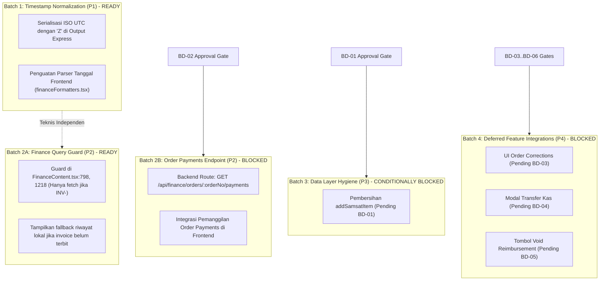

# PHASE 1C — FINAL REMEDIATION PLAN VALIDATION
## Contract Gap Analysis — Approval Readiness Addendum

> **Mode:** STRICT READ-ONLY VALIDATION ADDENDUM  
> **Target:** Verification of Implementation Dependencies, Business Approval Gates & Remediation Safety  
> **Author:** Senior Software Architect, API Contract Analyst & Technical Remediation Planner  
> **Date:** 2026-11-09  
> **Integrity Status:** Database SHA-256 Unchanged (`D560674CCD917049241415018FA00A4CF21B78BB9103F380C808B3B90408171C`), Zero Code Mutations Applied  

---

## 1. Executive Summary

Dokumen ini merupakan **Final Remediation Plan Validation Addendum** resmi terhadap laporan *Phase 1C — Contract Gap Analysis & Alignment*. Tujuan addendum ini adalah memastikan bahwa seluruh unit perbaikan (*remediation units*), dependensi kerja, batas persetujuan bisnis (*business approval gates*), dan proteksi integritas data telah teruji secara objektif sebelum memasuki **Phase 1D — Implementation & Verification**.

### Ringkasan Validasi & Penyelarasan Kunci

1. **Dekomposisi Dependensi Antar-Batch:**  
   Menghilangkan ketergantungan artifisial antara Batch 1 dan Batch 2. **Batch 1 (Serialisasi Timestamp API-06 [P1])** dan **Batch 2 Task 2A (Frontend Guard Pembayaran Invoice [P2])** terbukti tidak memiliki keterkaitan teknis dan dapat dieksekusi secara independen pada Phase 1D.

2. **Penetapan Status Endpoint Baru Finansial:**  
   Rencana endpoint `GET /api/finance/orders/:orderNo/payments` ditetapkan secara tegas berstatus **`PROPOSED CONTRACT — PENDING BD-02 APPROVAL`**, bukan kontrak backend yang sudah disahkan. Perbaikan frontend untuk mencegah query salah dapat dijalankan segera tanpa menunggu endpoint baru.

3. **Gerbang Bersyarat Penghapusan Method Samsat:**  
   Penghapusan method dormant `addSamsatItem()` di provider frontend **dilarang dieksekusi** sebelum keputusan bisnis **BD-01** disahkan. Dua skenario teknis bersyarat (Katalog Tertutup vs Katalog Dinamis) telah disiapkan secara lengkap.

4. **Batasan Ketat Serialisasi Timestamp (GAP-03):**  
   Perbaikan pergeseran waktu 7 jam dilakukan secara eksklusif pada **API Serialization Boundary** (lapisan output JSON Express). **Dilarang keras melakukan migrasi data historis atau penulisan ulang pada basis data SQLite**.

5. **Dokumentasi Formal Divergensi RBAC (API-01):**  
   Perbedaan izin akses antara rute `/api/audit` dan `/api/audit-logs` didokumentasikan secara rinci dengan source path aktual dan ditetapkan sebagai dependensi penuh dari **Phase 3 RBAC** (BD-07 tetap berstatus pending).

6. **Fakta Empiris Retrial Penghapusan File GDPR:**  
   Pemeriksaan kode sumber membuktikan bahwa **tidak ada background cron scheduler otomatis** di backend untuk retry job pembersihan berkas fisik GDPR. Endpoint `POST /users/file-deletion-jobs/:jobId/retry` saat ini strictly manual.

7. **Penyelarasan Nomenklatur Fase:**  
   Menetapkan konvensi resmi bahwa fase berikutnya adalah **Phase 1D — Implementation & Verification** (fase pelaksanaan perbaikan yang disetujui), bukan sekadar perencanaan.

---

## 2. Corrections to GAP-01 through GAP-12

Tabel perbandingan status, tingkat tindakan, dan syarat gerbang persetujuan untuk seluruh 12 Gap:

| Gap ID | Domain | Kondisi Awal Phase 1C | Koreksi / Penegasan Addendum | Status Kesiapan Implementasi | Syarat Gerbang (Approval Gate) |
|---|---|---|---|---|---|
| **GAP-01** | Pricing | Direncanakan hapus di Batch 3 | **Penghapusan method diblokir** hingga BD-01 disahkan. Sediakan 2 alternatif teknis. | BLOCKED ON BD-01 | Menunggu keputusan tertulis BD-01 |
| **GAP-02** | Finance | Diusulkan endpoint baru & guard FE | Pisahkan: **Task 2A (FE Guard)** siap segera; **Task 2B (BE Route)** berstatus PROPOSED CONTRACT. | TASK 2A READY / TASK 2B BLOCKED | Task 2B menunggu persetujuan BD-02 |
| **GAP-03** | Timestamps | Standarisasi serialisasi BE & parser FE | **Strict Boundary:** Hanya ubah output JSON Express & parser FE. **Zero DB migration**. | **READY FOR PHASE 1D** | Tanpa dependensi eksternal (P1 Mandat) |
| **GAP-04** | Auth/RBAC | Dokumentasi batas RBAC | Dokumentasikan divergensi izin `/audit` vs `/audit-logs`. Penyelarasan dialihkan ke Phase 3. | DEFERRED TO PHASE 3 | Menunggu Phase 3 & BD-07 |
| **GAP-05** | Governance | Rencana bangun UI koreksi di Batch 4 | Tetap deferred. Pembangunan antarmuka SPV memerlukan persetujuan produk BD-03. | BLOCKED ON BD-03 | Menunggu keputusan BD-03 |
| **GAP-06** | Finance | Rencana bangun UI transfer kas di Batch 4 | Tidak ada selisih kas terbukti saat ini; perbaikan murni eliminasi risiko dual-entry. | BLOCKED ON BD-04 | Menunggu keputusan BD-04 |
| **GAP-07** | Messenger | Rencana tambah tombol void di Batch 4 | Tetap deferred. Tombol void wajib mematuhi pembalikan jurnal kas otomatis. | BLOCKED ON BD-05 | Menunggu keputusan BD-05 |
| **GAP-08** | Users/GDPR | Rencana tambah tombol retry di Batch 4 | Terbukti tidak ada cron otomatis di backend. Endpoint retry strictly manual via HTTP. | BLOCKED ON BD-06 | Menunggu keputusan BD-06 |
| **GAP-09** | Master Data | Rekomendasi background hydration API | **Dikoreksi menjadi NO ACTION REQUIRED**. Bundel statis wilayah bekerja optimal dan stabil. | NO ACTION REQUIRED | Tidak perlu pekerjaan baru |
| **GAP-10** | Workflow | Rekomendasi refactor alias tipe data | **Dikoreksi menjadi NO ACTION REQUIRED**. Adapter mapping telah bekerja 100% akurat. | NO ACTION REQUIRED | Tidak perlu refactor kosmetik |
| **GAP-11** | Health | Retain infrastructure capability | Tetap **NO ACTION REQUIRED**. Konsumen eksternal strictly NOT VERIFIED. | NO ACTION REQUIRED | Kapabilitas internal proses |
| **GAP-12** | Public API | Retain public customer portal routes | Tetap **NO ACTION REQUIRED**. Kontrak publik berada di luar lingkup dashboard admin. | NO ACTION REQUIRED | Repositori terpisah |

---

## 3. Timestamp Safety and Acceptance Criteria (GAP-03)

### A. Klasifikasi Lapangan Field Timestamp Terverifikasi
Investigasi empiris kode sumber dan database membuktikan status masing-masing field tanggal:

1. **Terbukti Terdampak (Proven Affected — Wajib Diformat di Serializer):**
   - `orders.updated_at` (SQLite `datetime('now')` tanpa `Z` $\to$ bergeser 7 jam mundur).
   - `order_status_history.waktu_transisi` (SQLite `datetime('now')` tanpa `Z` $\to$ bergeser 7 jam mundur).
   - `security_audit_logs.created_at` (SQLite `datetime('now')` tanpa `Z` $\to$ bergeser 7 jam mundur).

2. **Terbukti Benar (Proven Correct — Dilarang Dimutasi/Dikonversi Dua Kali):**
   - `audit_logs.created_at` (Dihasilkan oleh Node.js via `new Date().toISOString()`, berakhiran `Z` $\to$ browser membaca akurat).
   - `orders.tanggal_masuk_berkas` (Dihasilkan oleh Node.js dengan format ISO `Z` $\to$ akurat).
   - `orders.created_at` (Format murni kalender `YYYY-MM-DD` $\to$ **wajib tetap date-only**, jangan tambahkan `T00:00:00Z`).
   - `kas_kantor.tanggal` (Format murni kalender `YYYY-MM-DD` $\to$ wajib tetap date-only).
   - `invoice_payments.tanggal_bayar` (Format murni kalender `YYYY-MM-DD` $\to$ wajib tetap date-only).

3. **Belum Terverifikasi / Dormant (Tidak Ada Data Aktif):**
   - `laba_rugi_snapshots.created_at` (Tabel saat ini kosong di `database.sqlite`).
   - `order_corrections.requested_at` (Tabel saat ini kosong di `database.sqlite`).

### B. Batasan Ketat Implementasi (Safety Boundary)
- **Zero Database Alteration:** Dilarang menjalankan query `UPDATE` untuk mengubah string di dalam `database.sqlite`. Nilai di database tetap menjadi catatan audit asli.
- **API Serialization Boundary:** Penyelarasan dilakukan saat objek diserialisasi ke JSON pada controller/repository backend:
  ```typescript
  // Aturan Serialisasi: Hanya string dengan pemisah spasi tanpa Z yang diformat
  function serializeTimestamp(val: string | null | undefined): string | null {
    if (!val) return null;
    if (/^\d{4}-\d{2}-\d{2} \d{2}:\d{2}:\d{2}$/.test(val)) {
      return val.replace(" ", "T") + ".000Z";
    }
    return val; // String berakhiran Z atau format date-only YYYY-MM-DD tidak diubah
  }
  ```
- **Frontend Parsing Resilience:** Parser frontend pada `financeFormatters.tsx` diperkuat untuk mengenali format tanpa timezone tanpa menyebabkan double-offset.

### C. Kriteria Keberterimaan (Acceptance Criteria)
1. Nilai database SQLite `2026-11-04 14:47:06` diserialisasi pada response API menjadi `"2026-11-04T14:47:06.000Z"`.
2. Antarmuka browser pada zona waktu `Asia/Jakarta` (WIB, UTC+7) menampilkan waktu `"04 Nov 2026 21:47:06"`.
3. Field tanggal kalender `orders.created_at: "2026-11-04"` tetap ditampilkan sebagai tanggal `04/11/2026` di seluruh zona waktu tanpa bergeser hari.
4. Checksum `server/data/database.sqlite` sebelum dan sesudah verifikasi terbukti **identik (tidak termutasi)**.

---

## 4. Finance Contract Approval Gate (GAP-02)

### A. Status Rencana Endpoint Baru
Rencana penambahan endpoint:
`GET /api/finance/orders/:orderNo/payments`
ditetapkan secara formal dengan status:  
**`PROPOSED CONTRACT — PENDING BD-02 APPROVAL`**

Kontrak ini **belum disahkan** dan tidak boleh diimplementasikan pada backend sebelum persetujuan tertulis dari pemilik produk.

### B. Pemisahan Pekerjaan: Frontend Guard vs Backend Extension

#### 1. Task 2A — Frontend Guard (Siap Dikerjakan Segera di Phase 1D)
- **Lokasi:** `src/app/components/FinanceContent.tsx:798` dan `1218`.
- **Tindakan:** Tambahkan validasi format sebelum melakukan pemanggilan API:
  ```typescript
  // Validasi: Endpoint /invoices/:invoiceNo/payments strictly hanya menerima nomor invoice resmi
  const invoiceNum = item.invoice || item.invoiceNo;
  if (invoiceNum && /^INV-/i.test(invoiceNum)) {
    // Eksekusi fetch aman
  } else {
    // Jangan memanggil endpoint invoice dengan orderNo
    setTargetPayments(item.riwayatPembayaran || item.paymentRecords || []);
  }
  ```
- **Hasil:** Mencegah pengiriman `orderNo` ke endpoint invoice yang selama ini menghasilkan respon query kosong (`[]`).
- **Dependensi:** Nol (dapat dieksekusi tanpa menunggu perubahan backend).

#### 2. Task 2B — Backend Route Extension (Tertahan BD-02)
- **Lokasi:** `server/src/routes/financeRoutes.ts`, `server/src/controllers/financeController.ts`.
- **Tindakan (Jika BD-02 disetujui):** Mengekspos method yang sudah ada `dbFinanceRepository.getPaymentsByOrderNo(orderNo)` via HTTP route.
- **Response Contract:** `{ success: true, data: InvoicePaymentRecord[], timestamp: string }`.
- **Authorization:** `requireAuth`, `requireFinanceOrAdmin`.
- **Catatan Keamanan:** Route eksisting `/api/finance/invoices/:invoiceNo/payments` dipertahankan 100% tanpa perubahan.

---

## 5. Samsat Catalog Approval Gate (GAP-01)

Penghapusan method dormant `addSamsatItem()` diatur secara ketat melalui gerbang persetujuan **BD-01**.

### Skenario A — Jika Katalog Tertutup Disetujui (Recommended)
Jika bisnis menetapkan bahwa 29 komponen Samsat nasional adalah master data tetap:
1. **Verifikasi Referensi Kode:** Seluruh 4 lokasi deklarasi diverifikasi aman dari dependensi aktif:
   - Interface `PricingProvider` pada `src/domain/pricing/types.ts:246`.
   - Delegasi repository pada `src/data/repositories/pricingRepository.ts:65`.
   - Implementasi API provider pada `src/data/api/apiPricingProvider.ts:184-201`.
   - Method lokal memori pada `src/app/data/pricingStore.ts:2914`.
2. **Konfirmasi Bebas Panggilan UI:** Terbukti tidak ada form atau tombol di `HargaDasarSamsat.tsx` yang memanggil method ini.
3. **Eksekusi:** Method dihapus dengan aman pada Phase 1D Batch 3.

### Skenario B — Jika Katalog Dinamis Disetujui
Jika bisnis mengizinkan staf menambah komponen Samsat kustom secara bebas:
1. **Backend Contract:** Backend wajib mengimplementasikan `POST /api/pricing/samsat`.
2. **Skema Validasi:** Field wajib `namaItem`, `kategori`, `tipeKendaraan`, `biayaDasar`.
3. **Uniqueness:** Pemeriksaan integritas agar nama komponen tidak duplikat dengan 29 item kanonis.
4. **Authorization:** Restricted strictly to `requireFinanceOrSuperAdmin`.
5. **Logging:** Pencatatan ke tabel audit log untuk penambahan master data harga.

---

## 6. RBAC Dependency & API-01 Verification (GAP-04)

### A. Bukti Empiris Divergensi Izin Rute Audit Log
Pemeriksaan terhadap `server/src/routes/auditRoutes.ts:14-50` membuktikan konfigurasi otorisasi aktual:

```typescript
// server/src/routes/auditRoutes.ts:14
auditRouter.get("/", requireAuth, requireRoles("administrator", "svp", "admin"), getAuditLogs);

// server/src/routes/auditRoutes.ts:35-43 (DELETE /)
auditRouter.delete("/", requireAuth, (req, res, next) => {
  if (req.baseUrl?.includes("audit-logs")) {
    return requireRoles("administrator")(req, res, next); // Strictly Superadmin
  }
  return requireRoles("administrator", "svp", "admin")(req, res, next); // Admin allowed
}, clearAuditLogs);

// server/src/routes/auditRoutes.ts:46 (POST /clear)
auditRouter.post("/clear", requireAuth, requireRoles("administrator", "svp", "admin"), clearAuditLogs);
```

### B. Analisis Dampak Akses Nyata
1. **Mount Point Alias:** `app.ts:144-145` me-mount `auditRouter` pada dua path: `/api/audit-logs` dan `/api/audit`.
2. **Inkonsistensi Otorisasi:**  
   - Request `DELETE /api/audit-logs` ditolak jika user bukan `administrator`.
   - Request `DELETE /api/audit` atau `POST /api/audit/clear` diizinkan untuk role `admin`!
3. **Status Kebijakan:** Penyelarasan izin ini merupakan kebijakan keamanan formal yang **wajib dibawa ke Phase 3 RBAC**. Tidak boleh diubah secara sepihak di Phase 1D.
4. **Status Gerbang:** **BD-07 tetap berstatus PENDING BUSINESS APPROVAL**.

---

## 7. Unused Capability Validation (GAP-06, GAP-07, GAP-08)

### A. GAP-06 (Internal Cash Transfer)
- **Klarifikasi Fakta:** Tidak ditemukan bukti adanya kebocoran atau selisih fisik kas operasional pada transaksi historis database. Masalah yang ada murni risiko operasional akibat pencatatan terpisah (manual dual-entry).
- **Status:** Pembangunan modal transfer kas UI tetap **tertahan hingga BD-04 disahkan**.

### B. GAP-07 (Reimbursement Void)
- **Klarifikasi Fakta:** Backend telah memiliki `POST /api/messenger/reimbursements/:id/void` yang secara otomatis mengembalikan saldo kas kantor via `dbFinanceRepository.updateKasKantorSaldo()`.
- **Status:** Penambahan tombol void di UI kasir tetap **tertahan hingga BD-05 disahkan**.

### C. GAP-08 (GDPR File Deletion Job Retry)
- **Klarifikasi Fakta Kode:** Pemeriksaan terhadap `server/src/services/permanentErasureService.ts:1109` membuktikan bahwa:
  - Method `retryFileDeletionJob(jobId)` benar-benar tersedia di backend.
  - **TIDAK ADA cron scheduler atau background daemon** yang berjalan secara berkala untuk me-retry job gagal secara otomatis.
  - Retry saat ini **strictly manual via HTTP request `POST /api/users/file-deletion-jobs/:jobId/retry`**.
- **Pemisahan Keputusan BD-06:**
  - Opsi A: Sediakan tombol retry visual pada panel Settings UI bagi administrator.
  - Opsi B: Bangun worker/scheduler otomatis di backend.
- **Status:** Tertahan hingga **BD-06 disahkan**.

---

## 8. Revised Implementation Batches

Urutan batch direvisi untuk mencerminkan dependensi teknis aktual:



### Rincian Kesiapan Eksekusi:
- **Batch 1 (Timestamp API-06):** **SIAP DIEKSEKUSI SEGERA PADA PHASE 1D**. Independen dari batch lain.
- **Batch 2A (Finance UI Guard):** **SIAP DIEKSEKUSI SEGERA PADA PHASE 1D**. Independen dari backend.
- **Batch 2B (Order Payments Route):** **TERTAHAN** menunggu persetujuan tertulis BD-02.
- **Batch 3 (Pricing Hygiene):** **TERTAHAN** menunggu persetujuan tertulis BD-01.
- **Batch 4 (Fitur UI Baru):** **TERTAHAN** menunggu persetujuan tertulis BD-03 s.d. BD-06.

---

## 9. Business Decision Status

Rekapitulasi status seluruh 7 keputusan bisnis:

| Decision ID | Deskripsi Keputusan | Status Saat Ini | Dampak Gerbang (Gate Impact) | Opsi Direkomendasikan |
|---|---|---|---|---|
| **BD-01** | Kebijakan Katalog Komponen Biaya Samsat | **PENDING APPROVAL** | Membuka / memblokir pembersihan method `addSamsatItem` di Batch 3 | Opsi A: Katalog Tertutup 29 Komponen Kanonis |
| **BD-02** | Pencarian Pembayaran Pra-Invoice by `orderNo` | **PENDING APPROVAL** | Membuka / memblokir pembuatan rute `GET /orders/:orderNo/payments` di Batch 2B | Opsi A: Sediakan rute backend baru |
| **BD-03** | Antarmuka UI Supervisi Koreksi Order SPV | **PENDING APPROVAL** | Membuka / memblokir pembuatan UI koreksi di Batch 4 | Opsi A: Bangun antarmuka pada Batch 4 |
| **BD-04** | Modal Antarmuka Transfer Kas Kantor-Messenger | **PENDING APPROVAL** | Membuka / memblokir pembuatan modal transfer kas di Batch 4 | Opsi A: Bangun modal transfer kas terintegrasi |
| **BD-05** | Tombol UI Pembatalan Klaim Reimbursement | **PENDING APPROVAL** | Membuka / memblokir pembuatan tombol void klaim di Batch 4 | Opsi A: Sediakan tombol void berizin Finance |
| **BD-06** | Mekanisme Retry Job Hapus File GDPR | **PENDING APPROVAL** | Menentukan UI tombol manual vs worker otomatis di Batch 4 | Opsi A: Sediakan tombol retry visual di Settings |
| **BD-07** | Penyelarasan Hak Akses Audit Log (API-01) | **PENDING APPROVAL** | Menentukan aturan role pada Phase 3 RBAC | Opsi A: Formalisasikan di Phase 3 RBAC |

---

## 10. Data Integrity and Regression Safeguards

1. **Preservasi Checksum Basis Data:** Checksum SHA-256 `server/data/database.sqlite` (`D560674CCD917049241415018FA00A4CF21B78BB9103F380C808B3B90408171C`) menjadi acuan integritas. Backup fisik wajib dilakukan sebelum Batch 1 dieksekusi.
2. **Immutabilitas Kontrak Invoice Eksisting:** Rute `/api/finance/invoices/:invoiceNo/payments` tidak dimodifikasi perilakunya untuk menjamin transaksi invoice yang sudah berjalan tidak terdampak.
3. **Perlindungan Snapshot Historis:** Snapshot konfigurasi layanan dan rekonsiliasi mutasi pada order selesai terisolasi dan tidak boleh dihitung ulang.

---

## 11. Final Phase 1D Readiness

### A. Rekapitulasi Kesiapan Eksekusi
- **Tugas Siap Dijalankan di Phase 1D:**
  1. **REM-01 (Batch 1 — P1):** Standarisasi serialisasi ISO 8601 UTC dengan penanda `Z` di boundary Express dan perkuatan parser tanggal frontend.
  2. **REM-02A (Batch 2A — P2):** Penerapan guard validasi format invoice pada `FinanceContent.tsx:798, 1218`.
- **Tugas Terblokir (Menunggu Keputusan Pengguna):**
  1. **REM-02B (Batch 2B):** Pembuatan endpoint order payments (Tertahan BD-02).
  2. **REM-03 (Batch 3):** Pembersihan method pricing dormant (Tertahan BD-01).
  3. **REM-05 (Batch 3):** Penyelarasan RBAC (Tertahan Phase 3 & BD-07).
  4. **REM-06..08 (Batch 4):** Pembangunan fitur UI baru (Tertahan BD-03 s.d. BD-06).

### B. Pernyataan Penutup
Rencana remediasi Phase 1C telah teruji secara objektif, aman dari risiko kerusakan data historis, memisahkan keputusan bisnis dari keputusan teknis, dan **LAYAK DISETUJUI** sebagai dasar pelaksanaan **Phase 1D — Implementation & Verification**.

> [!IMPORTANT]
> **STOP — TAHAP ADDENDUM SELESAI.**  
> Seluruh analisis dan validasi Phase 1C telah selesai. Tidak ada baris kode atau konfigurasi yang diubah. Menunggu review dan persetujuan tertulis dari pengguna sebelum memulai **Phase 1D — Implementation & Verification**.
