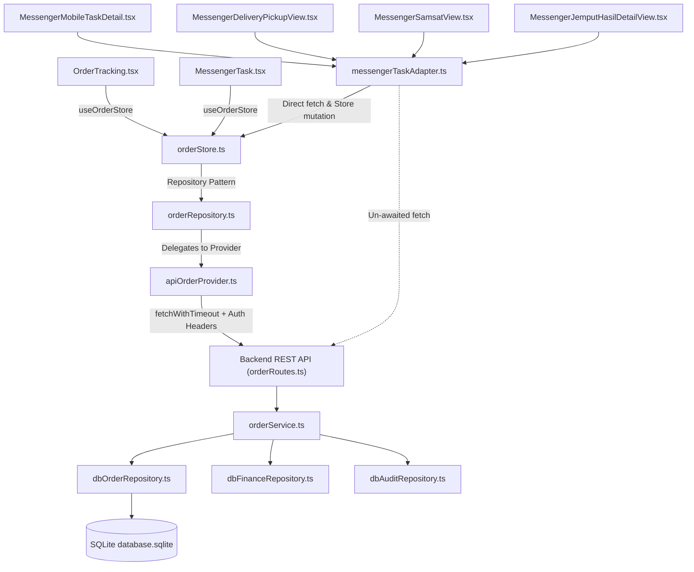
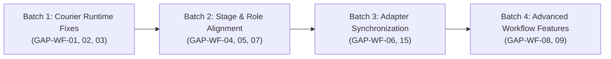

# PHASE 2A — ORDER WORKFLOW ALIGNMENT AUDIT
## SUN89 / SUNBiroJasa — Comprehensive Canonical Workflow & Integration Analysis

**Execution Mode:** STRICT READ-ONLY AUDIT  
**Project:** SUN89 / SUNBiroJasa Admin Platform  
**Target File:** `docs/audits/PHASE_2A_ORDER_WORKFLOW_AUDIT.md`  
**Audit Timestamp:** 2026-11-10T08:55:00+07:00  
**Database Invariant:** `server/data/database.sqlite` (SHA-256: `D560674CCD917049241415018FA00A4CF21B78BB9103F380C808B3B90408171C`, 1,441,792 bytes — Verified Unchanged)  
**Uploads Invariant:** `server/uploads/` (51 files, 1,525,984 bytes — Verified Unchanged)  
**System Principle (SSoT):** Backend rules, validations, transition matrices, and authorization logic are the Single Source of Truth. Frontend UI and store adapters must adapt to the valid backend contract.

---

## 1. EXECUTIVE SUMMARY

Phase 2A conducts an exhaustive, evidence-based technical audit across the complete 8-stage canonical order workflow of the SUN89 / SUNBiroJasa platform. The audit contrasts backend REST endpoints, domain services, database triggers, and security middleware against frontend API providers, state stores, and user interface components.

### 1.1 Key Audit Highlights

1. **Canonical 8-Stage Sequential Workflow:**  
   The backend strictly implements the 8-stage lifecycle: `Verifikasi` (1) → `Penjadwalan` (2) → `Verifikasi Dokumen` (3) → `Proses Samsat` (4) → `Verifikasi Ulang` (5) → `Supervisi` (6) → `Pengantaran` (7) → `Dokumen Telah Diterima` (8). Transitions must be strictly sequential (`targetStep === currentStep + 1`), with exactly one sanctioned shortcut: Step 1 → Step 3 for Walk-In / Datang Langsung orders. Any other skip is rejected with HTTP 400 `INVALID_STAGE_TRANSITION`.
2. **Terminal State and Rollback Protections:**  
   Step 8 is an irreversible terminal state for forward progression; forward transitions from Step 8 throw HTTP 400. Rollbacks are isolated to `POST /api/orders/:orderNo/rollback` with transactional revocation of supervisor approvals, reset of delivery statuses, and automatic Samsat cycle incrementation (`samsatCycle++`).
3. **Critical Runtime Finding — Courier Task Decline Deadlock (GAP-WF-01):**  
   A severe contract contradiction was discovered between `MessengerMobileTaskDetail.tsx` and `orderService.ts`. The frontend mandates that couriers provide a free-text reason when declining a task, whereas the backend strictly forbids free-text notes for messenger callers and throws HTTP 400 `MESSENGER_NOTES_NOT_ALLOWED`. Consequently, messengers are 100% unable to decline tasks via the UI.
4. **Data Loss in Task Completion Endpoints (GAP-WF-02, GAP-WF-03):**  
   Field name mismatches exist in courier task completion. In `/pickup/complete`, frontend sends `{ pickupChecklist, photoProofUrl }` while backend expects `{ checklist, photoUrl }`, resulting in unpersisted proof data. In `/delivery/complete`, frontend sends `photoProofUrl` instead of `photoUrl` and transmits free-text notes that trigger HTTP 400 `MESSENGER_NOTES_NOT_ALLOWED`. Because the frontend adapter uses un-awaited, fire-and-forget `fetch` with empty `.catch(() => {})`, the UI displays a false-positive success while the backend either drops the payload or rejects the call entirely.
5. **Stage 4 Admin Advancement Block (GAP-WF-04):**  
   Frontend `permissionStore.ts` hardcodes Stage 4 (`Proses Samsat`) and Stage 6 (`Supervisi`) as view-only for non-SVP roles. While the backend intentionally restricts Stage 6 to Supervisor/SVP, backend `requireStageAuthority` expressly allows `admin` to advance Stage 4 to Stage 5 once Samsat results are delivered to the office. The frontend UI incorrectly blocks the admin role with HTTP 403 / "Akses Ditolak".
6. **Illegal Workflow Jumps in Task Creation (GAP-WF-05):**  
   `src/app/components/MessengerTask.tsx` attempts to advance newly created orders directly from Step 1 to Step 4 (`Proses Samsat`) or Step 1 to Step 7 (`Pengantaran`), bypassing canonical intermediate stages. This causes runtime rejections (`INVALID_STAGE_TRANSITION`) from the backend SSoT.
7. **Complete Absence of Rollback UI (GAP-WF-08):**  
   While the backend provides a comprehensive, transactionally safe rollback engine with full audit trail logging, the frontend `OrderTracking.tsx` only destructures `rollbackOrderAsync` but provides zero buttons, menus, or dialogs to trigger it.

---

## 2. CANONICAL BACKEND WORKFLOW MAP

The canonical workflow consists of 8 linear operational stages and 1 terminal completion stage, supported by an out-of-band cancellation state.

```mermaid
flowchart TD
    S1["Stage 1: Verifikasi<br/>(Step 1 - Order Masuk & Initial Payment)"] -->|Normal Flow| S2["Stage 2: Penjadwalan<br/>(Step 2 - Courier Pickup Scheduling)"]
    S1 -->|Datang Langsung / Walk-In Shortcut| S3["Stage 3: Verifikasi Dokumen<br/>(Step 3 - Office Document Inspection)"]
    
    S2 -->|Pickup Completed / Dokumen Tersedia| S3
    S3 -->|Documents Verified Physically| S4["Stage 4: Proses Samsat<br/>(Step 4 - Loket Samsat & Jemput Hasil)"]
    
    S4 -->|100% Loket Completed & Dokumen di Kantor| S5["Stage 5: Verifikasi Ulang<br/>(Step 5 - Biaya Final Reconciliation)"]
    S5 -->|Stage 5 Verified by Admin/SPV| S6["Stage 6: Supervisi<br/>(Step 6 - Managerial SPV Approval)"]
    
    S6 -->|Stage 6 SPV Approved (SPV Only)| S7["Stage 7: Pengantaran<br/>(Step 7 - Courier Delivery / Counter Handover)"]
    S7 -->|Delivery Completed / Direct Handover| S8["Stage 8: Dokumen Telah Diterima<br/>(Step 8 - Terminal State / Invoice Due)"]

    S8 -.->|Explicit Rollback Only| S1
    S8 -.->|Explicit Rollback Only| S4
    S8 -.->|Explicit Rollback Only| S5
    S8 -.->|Explicit Rollback Only| S6
    S8 -.->|Explicit Rollback Only| S7

    S1 -.->|Cancel Order| CX["Dibatalkan<br/>(Step 0 - Cancelled / Refund Liability)"]
    S2 -.->|Cancel Order| CX
    S3 -.->|Cancel Order| CX
    S4 -.->|Cancel Order| CX
    S5 -.->|Cancel Order| CX
    S6 -.->|Cancel Order| CX
    S7 -.->|Cancel Order| CX
```

### Stage Definitions & Canonical Representations

| Step | Canonical Stage Name (`currentStageName`) | DB `current_step` | Primary Actor | Description & Purpose | Terminal? |
|:---:|:---|:---:|:---|:---|:---:|
| **1** | `Verifikasi` | `1` | Admin / Staff | Validasi data pemohon, kelengkapan berkas awal, nopol, dan verifikasi DP (jika Bayar di Awal). | No |
| **2** | `Penjadwalan` | `2` | Admin & Messenger | Penugasan kurir jemput berkas, penerimaan tugas oleh kurir, dan pelaksanaan penjemputan fisik. | No |
| **3** | `Verifikasi Dokumen` | `3` | Admin Loket | Pemeriksaan fisik kelengkapan berkas asli (STNK, BPKB, KTP, SKKP, Surat Kuasa) di kantor. | No |
| **4** | `Proses Samsat` | `4` | Messenger Samsat & Admin | Pengurusan di loket Samsat, update progres komponen loket, penjemputan hasil ke kantor. | No |
| **5** | `Verifikasi Ulang` | `5` | Admin Biaya / Loket | Rekonsiliasi rincian biaya real Samsat vs estimasi awal, upload hasil berkas baru. | No |
| **6** | `Supervisi` | `6` | Supervisor / SVP | Review manajerial, verifikasi anomali finansial, persetujuan resmi berkas dan biaya. | No |
| **7** | `Pengantaran` | `7` | Messenger / Loket | Pengantaran dokumen jadi ke alamat customer atau serah terima langsung di loket. | No |
| **8** | `Dokumen Telah Diterima` | `8` | System / Client | Berkas diterima pemesan. Tagihan piutang jatuh tempo (`JATUH_TEMPO` / `LUNAS`). | **Yes** |
| **0** | `Dibatalkan` | `0` | Admin / Finance / SVP | Order dibatalkan. Tagihan di-cancel; dana masuk liabilitas refund jika ada pembayaran. | **Yes** |

---

## 3. TRANSITION MATRIX

The transition matrix specifies all possible movements between order stages, endpoint bindings, and execution guards.

| From Stage (Step) | To Target Stage (Step) | Endpoint | Condition / Guard | Allowed Roles | Backend Evidence |
|:---|:---|:---|:---|:---|:---|
| **Verifikasi (1)** | **Penjadwalan (2)** | `POST /api/orders/:orderNo/advance` | Standard sequential transition (`targetStep === currentStep + 1`) | Administrator, Admin, SVP | `orderService.ts:1514-1525` |
| **Verifikasi (1)** | **Verifikasi Dokumen (3)** | `POST /api/orders/:orderNo/advance` | Walk-In Shortcut: `isDatangLangsung === true` (`metodeLayanan === "Datang Langsung"`) | Administrator, Admin, SVP | `orderService.ts:1516` |
| **Verifikasi (1)** | **Proses Samsat (4)** | `POST /api/orders/:orderNo/advance` | **PROHIBITED** (HTTP 400 `INVALID_STAGE_TRANSITION`) | None | `orderService.ts:1518-1524` |
| **Verifikasi (1)** | **Pengantaran (7)** | `POST /api/orders/:orderNo/advance` | **PROHIBITED** (HTTP 400 `INVALID_STAGE_TRANSITION`) | None | `orderService.ts:1518-1524` |
| **Penjadwalan (2)** | **Verifikasi Dokumen (3)** | `POST /api/orders/:orderNo/advance` | `isPickupDone === true` (`pickupCompleted` OR `messengerTaskStatus === "Dokumen Sudah Tersedia"` OR `isDatangLangsung`) | Administrator, Admin, SVP | `orderService.ts:1534-1549` |
| **Verifikasi Dokumen (3)** | **Proses Samsat (4)** | `POST /api/orders/:orderNo/advance` | `documentsVerified === true` (Berkas fisik wajib disetujui) | Administrator, Admin, SVP | `orderService.ts:1551-1563` |
| **Proses Samsat (4)** | **Verifikasi Ulang (5)** | `POST /api/orders/:orderNo/advance` | `validateSamsatCompletion(order).allowed === true` (100% loket components `COMPLETED`). Non-exempt must have ≥ 1 component. | Administrator, Admin, SVP | `orderService.ts:1565-1575` |
| **Verifikasi Ulang (5)** | **Supervisi (6)** | `POST /api/orders/:orderNo/advance` | `stage5Verified === true` OR `documentsVerified === true` | Administrator, Admin, SVP | `orderService.ts:1577-1591` |
| **Supervisi (6)** | **Pengantaran (7)** | `POST /api/orders/:orderNo/advance` | `stage6Approved === true` OR `approvedBySpv === true`. Caller MUST be SPV (`role === "administrator" || jabatan === "SVP"`). Admin gets 403. | Administrator, SVP (Supervisor Only) | `auth.ts:201-211`, `orderService.ts:1528-1532, 1612-1624` |
| **Pengantaran (7)** | **Dokumen Telah Diterima (8)** | `POST /api/orders/:orderNo/advance` | Sequential transition to terminal state. Receiver name & delivery handover recorded. | Administrator, Admin, SVP | `orderService.ts:1514-1525, 1626` |
| **Dokumen Telah Diterima (8)** | *Any forward stage* | `POST /api/orders/:orderNo/advance` | **PROHIBITED** (HTTP 400 `INVALID_STAGE_TRANSITION`: Terminal step cannot advance) | None | `orderService.ts:1489-1497` |
| **Any Stage (N)** | **Any Earlier Stage (M < N)** | `POST /api/orders/:orderNo/advance` | **PROHIBITED** (HTTP 400 `INVALID_STAGE_TRANSITION`: Must use `/rollback`) | None | `orderService.ts:1500-1506` |
| **Any Stage (N)** | **Any Earlier Stage (M < N)** | `POST /api/orders/:orderNo/rollback` | `targetStep < currentStep`. Order not cancelled or archived. Transactional state revocation. | Administrator, Admin, SVP (Messenger & Finance forbidden) | `orderService.ts:1656-1800` |
| **Any Stage (1-7)** | **Dibatalkan (0)** | `POST /api/orders/:orderNo/cancel` | Mandatory non-empty `reason`. Cancels matching invoice; routes funds to refund liability if paid. | Administrator, Admin, Finance, SVP | `orderService.ts:2027-2107` |

---

## 4. TRANSITION PRECONDITIONS MATRIX

Every stage transition enforces specific preconditions in the service and repository layers before state changes are committed.

```
+--------------------------------------------------------------------------------------------------------------------+
| STAGE TRANSITION PRECONDITIONS                                                                                    |
+-------------------+--------------------+-------------------------------------------+-------------------------------+
| Transition        | Gating Code        | Exact Precondition Expression             | Failure Behavior              |
+-------------------+--------------------+-------------------------------------------+-------------------------------+
| Step 1 -> Step 2  | VALIDATION_ERROR   | Order must exist; not cancelled/archived; | 400 ORDER_CANCELLED /         |
| (Verifikasi ->    |                    | targetStep === currentStep + 1            | 400 INVALID_STAGE_TRANSITION  |
| Penjadwalan)      |                    |                                           |                               |
+-------------------+--------------------+-------------------------------------------+-------------------------------+
| Step 1 -> Step 3  | INVALID_STAGE_     | isDatangLangsung === true:                | 400 INVALID_STAGE_TRANSITION  |
| (Verifikasi ->    | TRANSITION         | existing.metodeLayanan === "Datang Langsung"|                              |
| Verifikasi Dok)   |                    | updates.metodeLayanan === "Datang Langsung"|                              |
| [Shortcut]        |                    | costSnapshot.metodeLayanan === "Datang L." |                               |
+-------------------+--------------------+-------------------------------------------+-------------------------------+
| Step 2 -> Step 3  | PREREQUISITE_      | isPickupDone === true:                    | 400 PREREQUISITE_NOT_MET:     |
| (Penjadwalan ->   | NOT_MET            | isDatangLangsung || updates.pickupCompleted| "Penjemputan berkas oleh      |
| Verifikasi Dok)   |                    | || existing.pickupCompleted ||            | kurir belum selesai."         |
|                   |                    | updates.messengerTaskStatus === "Dokumen  |                               |
|                   |                    | Sudah Tersedia" || existing.messenger...  |                               |
+-------------------+--------------------+-------------------------------------------+-------------------------------+
| Step 3 -> Step 4  | PREREQUISITE_      | isDocsDone === true:                      | 400 PREREQUISITE_NOT_MET:     |
| (Verifikasi Dok ->| NOT_MET            | updates.documentsVerified ||              | "Verifikasi kelengkapan berkas|
| Proses Samsat)    |                    | existing.documentsVerified === true       | fisik wajib disetujui..."     |
+-------------------+--------------------+-------------------------------------------+-------------------------------+
| Step 4 -> Step 5  | SAMSAT_COMPONENTS_ | validateSamsatCompletion(existing).allowed| 400 SAMSAT_COMPONENTS_        |
| (Proses Samsat -> | INCOMPLETE /       | === true:                                 | INCOMPLETE: "Seluruh tahapan  |
| Verifikasi Ulang) | SAMSAT_COMPONENTS_ | - If not exempt (LAINNYA), totalComps > 0 | komponen loket Samsat wajib   |
|                   | REQUIRED           | - 100% of components status === COMPLETED | berstatus Selesai..."         |
+-------------------+--------------------+-------------------------------------------+-------------------------------+
| Step 5 -> Step 6  | DOCUMENTS_NOT_     | isApproved === true:                      | 400 DOCUMENTS_NOT_VERIFIED:   |
| (Verifikasi Ulang | VERIFIED           | updates.documentApproval?.stage5Verified||| "Dokumen berkas Samsat wajib  |
| -> Supervisi)     |                    | existing.documentApproval?.stage5Verified||| diperiksa dan disetujui..."  |
|                   |                    | updates.documentsVerified || existing...  |                               |
+-------------------+--------------------+-------------------------------------------+-------------------------------+
| Step 6 -> Step 7  | FORBIDDEN /        | 1. Role Authority: Caller is SPV          | 403 FORBIDDEN: "Hanya SPV..." |
| (Supervisi ->     | DOCUMENTS_NOT_     |    (role === "administrator" || SVP)      | 400 DOCUMENTS_NOT_APPROVED:   |
| Pengantaran)      | APPROVED           | 2. Gating: stage6Approved || approvedBySpv| "Dokumen hasil Samsat wajib   |
|                   |                    |    === true                               | disetujui oleh SPV..."        |
+-------------------+--------------------+-------------------------------------------+-------------------------------+
| Step 7 -> Step 8  | INVALID_STAGE_     | targetStep === 8. Receiver name recorded; | 400 INVALID_STAGE_TRANSITION  |
| (Pengantaran ->   | TRANSITION         | isReceived === true.                      |                               |
| Dokumen Diterima) |                    |                                           |                               |
+-------------------+--------------------+-------------------------------------------+-------------------------------+
```

### Rollback Revocation Cascades (`orderService.ts:1705-1780`)

When an order is rolled back to a previous stage, the backend executes a transactional cleanup cascade:

1. **Rollback to $\le$ Step 6:** Revokes Supervisor approval (`stage6Approved = false`, clears `stage6ApprovedBy/At`, resets `approvedBySpv = false`, `spvApprovedAt = null`, `spvName = null`). Resets delivery scheduling (`isDeliveryScheduled = false`, `deliveryStartedAt = null`, `deliveryStatus = null`, `tanggalPengantaran = null`).
2. **Rollback to $\le$ Step 5:** Revokes Stage 5 verification (`stage5Verified = false`, clears `stage5VerifiedBy/At`, resets `documentsVerified = false`, `isVerified = false`).
3. **Rollback to $\le$ Step 4:** Increments `samsatCycle = samsatCycle + 1`. If `samsatStatus === "Selesai"`, resets to `"Sedang Proses Samsat"`. Resets `samsatPickupStatus` to `"Belum Dijadwal"`, clears pickup courier assignment, and marks existing `Jemput Hasil Samsat` task acceptance as `SUPERSEDED` (`isLocked = true`, `supersededReason = "Samsat rolled back"`).
4. **Rollback to $\le$ Step 7:** Resets reception completion (`isReceived = false`, `tanggalDiterima = null`, `receiverName = null`).

---

## 5. ROLE AND AUTHORIZATION MATRIX

### 5.1 Backend Authorization Architecture

The backend employs a two-tier defense-in-depth model:
1. **Route Middleware Tier (`server/src/middleware/auth.ts`):**
   - `requireAuth`: Enforces cryptographic JWT verification and extracts `TokenPayload`.
   - `requireRoles(...allowedRoles)`: Coarse-grained route perimeter gating.
   - `requireStageAuthority`: Stage-aware fine-grained gating on `/advance` and `/rollback`.
2. **Service Domain Tier (`server/src/services/orderService.ts`):**
   - In-transaction invariant checks on `user.role`, `user.jabatan`, and caller ownership.
   - Identity sanitization: Non-SPV callers cannot forge `approvedBySpv` or `documentApproval.stage6Approved` in update payloads (lines 1593-1609).

### 5.2 Comparative Role Matrix (Backend vs Frontend)

| Workflow Action | Endpoint | Backend Required Authority | Frontend UI Permission Check | Alignment Status | Notes & Divergence |
|:---|:---|:---|:---|:---:|:---|
| **Create Order** | `POST /api/orders` | `administrator`, `admin`, `svp` | `canManageModule("orders")` | **MATCH** | Admin and SVP can create orders. |
| **Update Order Data** | `PUT /api/orders/:orderNo` | `administrator`, `admin`, `finance`, `svp`, `messenger` | View-dependent permission checks | **MATCH** | Sensitive lifecycle fields stripped by `aliasNormalizer.ts`. |
| **Advance Step 1 $\rightarrow$ 2 / 3** | `POST /:orderNo/advance` | `administrator`, `admin`, `svp` | `canManage(1)` $\rightarrow$ Allowed for Admin & SVP | **MATCH** | Messenger & Finance forbidden. |
| **Advance Step 2 $\rightarrow$ 3** | `POST /:orderNo/advance` | `administrator`, `admin`, `svp` | `canManage(2)` $\rightarrow$ Allowed for Admin & SVP | **MATCH** | Requires pickup completion. |
| **Advance Step 3 $\rightarrow$ 4** | `POST /:orderNo/advance` | `administrator`, `admin`, `svp` | `canManage(3)` $\rightarrow$ Allowed for Admin & SVP | **MATCH** | Physical document verification check. |
| **Advance Step 4 $\rightarrow$ 5** | `POST /:orderNo/advance` | `administrator`, `admin`, `svp` | `canManage(4)` $\rightarrow$ **FALSE for Admin** | **MISMATCH** | **GAP-WF-04**: Backend allows Admin; Frontend `permissionStore.ts` hardcodes Stage 4 to view-only for non-SVP. |
| **Approve Stage 5 Docs** | `POST /:orderNo/approve-documents` | `administrator`, `admin`, `svp` | `canManage(5)` $\rightarrow$ Allowed for Admin & SVP | **MATCH** | Both Admin and SVP can verify Stage 5. |
| **Advance Step 5 $\rightarrow$ 6** | `POST /:orderNo/advance` | `administrator`, `admin`, `svp` | `canManage(5)` $\rightarrow$ Allowed for Admin & SVP | **MATCH** | Requires Stage 5 approval. |
| **Approve Stage 6 Docs** | `POST /:orderNo/approve-documents` | `administrator`, `svp` (Supervisor) | `canManage(6)` $\rightarrow$ Only SVP | **MATCH** | Admin is strictly view-only. |
| **Advance Step 6 $\rightarrow$ 7** | `POST /:orderNo/advance` | `administrator`, `svp` (Supervisor) | `canManage(6)` $\rightarrow$ Only SVP | **MATCH** | Admin receives 403 on backend. |
| **Advance Step 7 $\rightarrow$ 8** | `POST /:orderNo/advance` | `administrator`, `admin`, `svp` | `canManage(7)` $\rightarrow$ Allowed for Admin & SVP | **MATCH** | Delivery completion / Direct handover. |
| **Rollback Order** | `POST /:orderNo/rollback` | `administrator`, `admin`, `svp` | **No UI Action Available** | **UNUSED** | **GAP-WF-08**: Destructured but never bound to any UI button. |
| **Cancel Order** | `POST /:orderNo/cancel` | `administrator`, `admin`, `finance`, `svp` | Action button in Order Tracking / Management | **MATCH** | Requires mandatory reason. |
| **Verify Payment** | `POST /:orderNo/verify-payment` | `administrator`, `admin`, `finance`, `svp` | Action button in Stage 1 / Finance | **MATCH** | Requires proof file if paid > 0. |
| **Verify Order Cost** | `POST /:orderNo/verify-cost` | `administrator`, `admin`, `svp` | Final Cost verification workspace | **MATCH** | Protected cost calculation. |
| **Accept Courier Task** | `POST /:orderNo/tasks/:taskType/accept` | `messenger`, `admin`, `administrator` | Messenger Workspace & Task Card | **MATCH** | Concurrency conflict check (HTTP 409). |
| **Decline Courier Task** | `POST /:orderNo/tasks/:taskType/decline` | `messenger`, `admin`, `administrator` | `MessengerMobileTaskDetail.tsx` | **MISMATCH** | **GAP-WF-01**: Backend rejects free-text notes with 400; frontend requires free-text input. |
| **Reassign Courier Task** | `POST /:orderNo/tasks/:taskType/reassign` | `administrator`, `admin`, `svp` | `MessengerTask.tsx` Alihkan Tugas Modal | **MATCH** | Requires replacement courier & reason. |
| **Report Samsat Kendala**| `POST /:orderNo/samsat-pickup/kendala` | `messenger`, `admin`, `administrator` | `MessengerJemputHasilDetailView.tsx` | **MATCH** | Structured status to Terkendala. |
| **Recover Samsat Kendala**| `POST /:orderNo/samsat-pickup/recover` | `administrator`, `admin`, `svp` | Pulihkan Kendala Button | **MATCH** | Admin/SPV restores task to active. |

---

## 6. MESSENGER AND DELIVERY AUDIT

### 6.1 Task Ownership Contract

Backend enforces strict canonical messenger identity validation in `assertMessengerOwnership` (`orderService.ts:275-340`):
- Authoritative identifier is `user.employeeId` (e.g. `EMP-2026-004`).
- Generic placeholders (`EMP-MSG`, `EMP-SAMSAT`, `Belum Ditugaskan`, `-`) are strictly rejected with HTTP 403 `FORBIDDEN`.
- Display names (`user.nama`, `user.userName`) are strictly prohibited as authorization keys.
- Administrator / Admin roles possess universal override authority (`isAuthorizedRole`).

### 6.2 Task Types & Context Bindings

The platform defines 4 canonical messenger task types:
1. `Jemput Dokumen` (Stage 2): Bound to `assignedMessengerId` / `order.taskAcceptance["Jemput Dokumen"]`.
2. `Proses Samsat` (Stage 4): Bound to `samsatMessengerId` / `order.taskAcceptance["Proses Samsat"]`.
3. `Jemput Hasil Samsat` (Stage 4.5): Bound to `samsatPickupMessengerId` / `order.taskAcceptance["Jemput Hasil Samsat"]`. Auto-spawned upon `completeSamsatProcess`.
4. `Pengantaran Dokumen` (Stage 7): Bound to `deliveryMessengerId` / `order.taskAcceptance["Pengantaran Dokumen"]`.

### 6.3 Lifecycle Endpoints vs Frontend Adapter Calls

```
+-------------------------------------------------------------------------------------------------------------------------+
| COURIER TASK LIFECYCLE AUDIT SUMMARY                                                                                   |
+--------------------------+-------------------------------------+-----------------------+--------------------------------+
| Operation                | Backend Endpoint                    | Frontend Method       | Status / Defect                |
+--------------------------+-------------------------------------+-----------------------+--------------------------------+
| Accept Task              | POST /:orderNo/tasks/:type/accept   | acceptMessengerTask...| MATCH (Async, checks 409)      |
| Decline Task             | POST /:orderNo/tasks/:type/decline  | declineMessengerTask..| MISMATCH (GAP-WF-01: 400 notes)|
| Reassign Task            | POST /:orderNo/tasks/:type/reassign | reassignMessenger...  | MATCH (Admin/SPV only)         |
| Start Pickup             | POST /:orderNo/pickup/start         | startPickupTaskAction | PARTIAL (Fire-and-forget fetch)|
| Complete Pickup          | POST /:orderNo/pickup/complete      | completePickupTask... | MISMATCH (GAP-WF-02: payload)  |
| Release Pickup           | POST /:orderNo/pickup/release       | releasePickupTask...  | PARTIAL (Fire-and-forget fetch)|
| Start Samsat             | POST /:orderNo/samsat/start         | startSamsatProcess... | PARTIAL (Fire-and-forget fetch)|
| Complete Samsat          | POST /:orderNo/samsat/complete      | completeSamsatProcess | PARTIAL (GAP-WF-03: note leak) |
| Report Pickup Kendala    | POST /:orderNo/samsat-pickup/kendala| reportSamsatPickup... | PARTIAL (Fire-and-forget fetch)|
| Recover Pickup Kendala   | POST /:orderNo/samsat-pickup/recover| recoverSamsatPickup...| MATCH (Authoritative response) |
| Complete Samsat Pickup   | POST /:orderNo/samsat-pickup/complete completeSamsatPickup..| PARTIAL (Fire-and-forget fetch)|
| Start Delivery           | POST /:orderNo/delivery/start       | startDeliveryTaskAction PARTIAL (Fire-and-forget fetch)|
| Complete Delivery        | POST /:orderNo/delivery/complete    | completeDeliveryTask..| MISMATCH (GAP-WF-03: payload)  |
| Release Delivery         | POST /:orderNo/delivery/release     | releaseDeliveryTask...| PARTIAL (Fire-and-forget fetch)|
+--------------------------+-------------------------------------+-----------------------+--------------------------------+
```

---

## 7. FRONTEND-TO-BACKEND MAPPING

### 7.1 Consumer Architecture



### 7.2 Integration Consistency Assessment

1. **Order Tracking (`OrderTracking.tsx`):**
   - Direct integration via `orderStore.advanceOrderAsync` is clean, robust, and handles errors with inline banners (`ActionInlineError`) and toasts.
   - Idempotency is enforced using `actionFeedback.isLoading(...)` to disable buttons during in-flight mutations.
2. **Messenger Task Adapter (`messengerTaskAdapter.ts`):**
   - Suffers from an architectural anti-pattern: methods are synchronous (`export function startPickupTaskAction...`) and update the local in-memory store immediately, followed by an un-awaited background `fetch(...).catch(() => {})`.
   - Any server-side error (HTTP 400, 401, 403, 409, 500) fails silently. The UI reflects an invalid state that disappears upon page reload.
3. **Takeover & Manual Override (`MessengerTask.tsx`):**
   - Generates non-canonical employee IDs (`admin-takeover`).
   - Uses non-blocking synchronous `orderStore.advanceOrder` calls that catch errors only in console.

---

## 8. GAP REGISTER

The Gap Register compiles all verified workflow deviations, classified by severity, evidence, impact, and standard classification:

| ID | Title | Severity | Classification | Source File & Lines | Actual Behavior | Expected Contract | Runtime Impact |
|:---|:---|:---:|:---:|:---|:---|:---|:---|
| **GAP-WF-01** | Courier Task Decline Deadlock | **CRITICAL** | **MISMATCH** | `messengerTaskAdapter.ts:1841-1865`<br/>`MessengerMobileTaskDetail.tsx:125-145`<br/>`orderService.ts:2389-2395` | Frontend requires non-empty reason and sends `{ reason: string }`. Backend strictly throws 400 `MESSENGER_NOTES_NOT_ALLOWED` for messengers. | Backend zero free-text policy canonicalizes to `"Ditolak oleh kurir"`. Frontend should allow decline without free-text reason. | **100% Failure:** Couriers can never decline a task; action is completely broken. |
| **GAP-WF-02** | Payload Field Name Mismatch in Pickup Completion | **HIGH** | **MISMATCH** | `messengerTaskAdapter.ts:1330, 1386-1402`<br/>`orderService.ts:2881, 2917, 2944` | Frontend sends `{ pickupChecklist, photoProofUrl }`. Backend expects `{ checklist, photoUrl }`. | Field names must match backend signature. | Photo proof URL and checklist items are dropped by the server and never persisted in database. |
| **GAP-WF-03** | Field Mismatch & Free-Text Rejection in Delivery Completion | **HIGH** | **MISMATCH** | `messengerTaskAdapter.ts:1533-1541, 1613-1620`<br/>`orderService.ts:3125-3135, 3173` | Frontend sends `photoProofUrl` and `notes`. Backend expects `photoUrl` and throws 400 if `notes` is present for messenger callers. | Payload must send `photoUrl` and omit free-text notes for courier roles. | Server rejects request with HTTP 400 or drops photo proof. Catch-all hides error from courier. |
| **GAP-WF-04** | Stage 4 Advancement Block for Admin Role | **HIGH** | **MISMATCH** | `permissionStore.ts:192-200`<br/>`OrderTracking.tsx:1329, 1363, 5896`<br/>`auth.ts:193-211` | Frontend hardcodes `canManageStage(4) === false` for non-SVP, blocking Admin from advancing Stage 4 $\rightarrow$ 5. | Backend `requireStageAuthority` expressly permits Admin to advance Stage 4. | Admin users cannot advance orders from Samsat to Verifikasi Biaya in the UI, requiring SPV intervention. |
| **GAP-WF-05** | Illegal Non-Sequential Stage Jumps in Messenger Task | **HIGH** | **MISMATCH** | `MessengerTask.tsx:482, 488`<br/>`orderService.ts:1514-1525` | `MessengerTask.tsx` attempts to advance orders directly from Step 1 $\rightarrow$ 4 and Step 1 $\rightarrow$ 7. | Backend enforces sequential transition (`targetStep === currentStep + 1`), rejecting jumps with HTTP 400. | Orders created via this menu fail stage progression on backend and desynchronize client store. |
| **GAP-WF-06** | Fire-and-Forget Mutations in Messenger Task Adapter | **MEDIUM** | **PARTIAL** | `messengerTaskAdapter.ts:1310-1319, 1394-1404, 1611-1621, 2264-2273, 2518-2527, 3696-3705, 3807-3817` | Courier operations mutate local store optimistically and fire background fetch with `.catch(() => {})`. | Actions should be `async`, await backend confirmation, and handle errors visibly. | Network failures or backend rejections are silently ignored; user assumes task completed, but reload loses state. |
| **GAP-WF-07** | Non-Canonical Status on Samsat Pickup Acceptance | **MEDIUM** | **MISMATCH** | `messengerTaskAdapter.ts:1815`<br/>`orderService.ts:2346` | Frontend sets local `samsatPickupStatus = "Terjadwal"`. Backend sets canonical `"Sedang Jemput Dokumen Samsat"`. | Status values must match backend canonical definitions. | Filter tabs and badges show inconsistent states between client session and server reload. |
| **GAP-WF-08** | Rollback Functionality Missing in Frontend UI | **MEDIUM** | **UNUSED** | `OrderTracking.tsx:225`<br/>`orderRoutes.ts:82-88`<br/>`orderService.ts:1656-1800` | Backend provides robust transactional rollback engine. Frontend destructures method but has zero UI triggers. | Staff should be able to trigger authorized rollback from the UI for data/loket correction. | Staff cannot correct mistakenly advanced orders or initiate second Samsat cycle from the UI. |
| **GAP-WF-09** | Canonical Status History Endpoint Unused | **LOW** | **UNUSED** | `server/src/routes/orderRoutes.ts:55`<br/>`server/src/repositories/dbOrderRepository.ts:765-773` | Backend logs every transition in `order_status_history` and exposes `GET /:orderNo/status-history`. Frontend never calls it. | Frontend displays local client JSON timeline instead of immutable backend status history. | Client timeline can diverge from authoritative SQLite audit records. |
| **GAP-WF-10** | Stage 6 SPV Authority Enforcement | **N/A** | **MATCH** | `auth.ts:201-211`<br/>`orderService.ts:1528-1532`<br/>`OrderTracking.tsx:1765-1770, 7436` | Both backend and frontend restrict Stage 6 document approval and advancement to Supervisor / SVP. | Admin is view-only; SPV possesses managerial approval authority. | Verified aligned. |
| **GAP-WF-11** | Walk-In Step 1 $\rightarrow$ Step 3 Shortcut | **N/A** | **MATCH** | `orderService.ts:1516`<br/>`OrderTracking.tsx:1060-1087` | Both backend and frontend allow Datang Langsung orders to bypass Step 2 Penjadwalan. | Walk-in flow skips courier pickup and enters physical verification directly. | Verified aligned. |
| **GAP-WF-12** | 100% Loket Component Completion Validation | **N/A** | **MATCH** | `orderService.ts:140-240, 1566-1575`<br/>`messengerTaskAdapter.ts:3540-3634` | Both backend and frontend validate that 100% of loket components must be in COMPLETED status. | Order cannot leave Stage 4 without full Samsat completion. | Verified aligned. |
| **GAP-WF-13** | Terminal Step 8 Advance Guard | **N/A** | **MATCH** | `orderService.ts:1489-1497`<br/>`OrderTracking.tsx` | Advancing past Step 8 throws HTTP 400. UI disables advance action on completed orders. | Step 8 is strictly terminal for forward transitions. | Verified aligned. |
| **GAP-WF-14** | Protected Lifecycle Field Tampering Defense | **N/A** | **MATCH** | `validation.ts:244-280`<br/>`aliasNormalizer.ts:411-480`<br/>`apiOrderProvider.ts:415-445` | Client cannot tamper with `currentStep`, `currentStageName`, `documentApproval`, or `isCostVerified` via PUT or transition payloads. | Server-controlled lifecycle fields are protected against client override. | Verified aligned. |
| **GAP-WF-15** | Non-Canonical Courier Identity in Admin Takeover | **MEDIUM** | **PARTIAL** | `MessengerTask.tsx:781-785`<br/>`orderService.ts:275-298` | Admin takeover synthesizes `employeeId: "admin-takeover"`. Backend requires canonical employee ID from auth token. | Caller employee identity must be resolved from server authentication context. | Risk of 403 FORBIDDEN if sent to strict backend messenger ownership endpoints. |

---

## 9. BUSINESS DECISIONS REQUIRED

The following operational workflow questions require formal business owner approval before technical remediation is implemented:

### BD-WF-01: Courier Operational Free-Text Notes Policy
- **Background:** The backend enforces a strict "Zero Free-Text Notes" policy for messenger roles (`MESSENGER_NOTES_NOT_ALLOWED`) on `/tasks/:type/decline`, `/pickup/complete`, `/delivery/complete`, and `/samsat/complete` to prevent un-audited or unprofessional entries. However, the frontend UI was designed with free-text note fields, causing runtime rejections (GAP-WF-01, GAP-WF-03).
- **Options:**
  - **Option A (Recommended):** Maintain backend Zero Free-Text policy. Replace frontend free-text inputs for couriers with standardized dropdown reason codes (e.g., "Ban Bocor / Kendaraan Rusak", "Hujan Lebat / Banjir", "Customer Tidak di Tempat", "Dokumen Kurang"), and pass pre-defined canonical codes to the backend.
  - **Option B:** Relax backend policy to permit optional free-text notes for couriers up to 255 characters, subject to XSS sanitization.
- **Status:** **PENDING BUSINESS APPROVAL**.

### BD-WF-02: Operational Scope of Admin Role on Stage 4 (Proses Samsat)
- **Background:** Backend `requireStageAuthority` allows `admin` to advance Stage 4 to Stage 5 once documents are delivered to the office (`samsatPickupStatus === "Dokumen Samsat Diterima di Kantor"`), while frontend `permissionStore.ts` hardcodes Stage 4 as view-only for non-SVP (GAP-WF-04).
- **Options:**
  - **Option A (Recommended):** Align frontend with backend SSoT. Permit Admin to perform office operations on Stage 4 (scheduling pickup of Samsat results and advancing order to Stage 5 once documents are received at the office), while keeping loket processing reserved for couriers and Stage 6 reserved for Supervisors.
  - **Option B:** Restrict Stage 4 advance exclusively to Supervisor / SVP in both frontend and backend.
- **Status:** **PENDING BUSINESS APPROVAL**.

### BD-WF-03: Rollback Authorization & UI Availability
- **Background:** The backend possesses a full rollback capability (`POST /api/orders/:orderNo/rollback`), but there is no user-facing interface to trigger it (GAP-WF-08).
- **Options:**
  - **Option A (Recommended):** Expose a controlled "Kembalikan ke Tahap Sebelumnya (Rollback)" action in `OrderTracking.tsx`, gated strictly to Supervisor / SVP with mandatory justification notes and confirmation modal.
  - **Option B:** Allow both Admin and Supervisor to initiate rollbacks for stages $\le 5$, but require Supervisor for stages $\ge 6$.
  - **Option C:** Keep rollback completely out of the UI; handle rollbacks only via administrative scripts or customer service escalation.
- **Status:** **PENDING BUSINESS APPROVAL**.

---

## 10. RECOMMENDED REMEDIATION BATCHES

To maintain stability and adhere to controlled deployment principles, remediations should be executed in strict sequence:



### Batch 1: Critical Courier Contract Alignment (Fix Runtime Failures)
- **Scope:** GAP-WF-01, GAP-WF-02, GAP-WF-03.
- **Actions:**
  1. Update `declineMessengerTaskAction` and `MessengerMobileTaskDetail.tsx` to align with backend decline contract (remove free-text note transmission or implement approved dropdown codes under BD-WF-01).
  2. Fix payload mapping in `completePickupTaskAction`: map `pickupChecklist` $\rightarrow$ `checklist`, `photoProofUrl` $\rightarrow$ `photoUrl`.
  3. Fix payload mapping in `completeDeliveryTaskAction`: map `photoProofUrl` $\rightarrow$ `photoUrl`, strip free-text notes for messenger callers.
- **Risk:** Low (pure client-contract alignment to existing backend contract).

### Batch 2: Role Authorization & Sequential Workflow Guarding
- **Scope:** GAP-WF-04, GAP-WF-05, GAP-WF-07.
- **Actions:**
  1. Align `permissionStore.ts:canManageStage` to allow `admin` to advance Stage 4 once Samsat results are delivered to the office, resolving the Admin lockout.
  2. Refactor `MessengerTask.tsx` order creation: prevent illegal stage jumps (Step 1 $\rightarrow$ 4 or Step 1 $\rightarrow$ 7); enforce sequential workflow or route through proper task assignment queues.
  3. Harmonize status in `acceptMessengerTaskAction`: use canonical `"Sedang Jemput Dokumen Samsat"` instead of `"Terjadwal"`.
- **Risk:** Low.

### Batch 3: Courier Task Adapter Asynchronous Reliability
- **Scope:** GAP-WF-06, GAP-WF-15.
- **Actions:**
  1. Refactor courier lifecycle methods in `messengerTaskAdapter.ts` from fire-and-forget synchronous helpers to `async` functions that await backend responses, handle error codes, and update the store from authoritative server snapshots.
  2. Eliminate synthetic `admin-takeover` employee IDs in `MessengerTask.tsx`; use canonical authenticated server context.
- **Risk:** Medium (requires testing courier mobile views).

### Batch 4: Workflow Capabilities & Audit Visualization
- **Scope:** GAP-WF-08, GAP-WF-09.
- **Actions:**
  1. Design and integrate the Rollback UI dialog in `OrderTracking.tsx` (subject to BD-WF-03 approval).
  2. Connect `GET /api/orders/:orderNo/status-history` to the Order Tracking timeline tab for canonical audit trail display.
- **Risk:** Low.

---

## 11. DEPENDENCIES AND OUT-OF-SCOPE ITEMS

### Dependencies
- **Phase 1D Invariant:** Serialized ISO UTC timestamps (`timestampSerializer.ts`) and sanitized invoice numbers must remain intact.
- **Auth Provider:** Courier employee ID resolution depends on canonical JWT payload (`req.user.employeeId`).

### Out-of-Scope Items
- **Phase 3 Dynamic RBAC:** Any reconfiguration of permissions table, role management, or dynamic permission endpoints is deferred to Phase 3.
- **Database Migrations:** No schema alters, column additions, or table redefinitions are permitted in this audit phase.
- **Automated Scheduler:** Scheduler reconciliation remains under deployment-level infrastructure scope.

---

## 12. AUDIT LIMITATIONS AND UNVERIFIED CONDITIONS

1. **Hardware Device Constraints:**  
   Physical mobile camera integration and hardware GPS capture during courier pickup/delivery were evaluated via static code inspection and repository mocks; field hardware operation was not physically tested.
2. **Third-Party Payment Gateways:**  
   Automated bank mutation feeds or external payment gateway webhooks are not present in the current codebase; all payment verifications are handled via internal loket/transfer ledger records.
3. **Database Checksum Verification:**  
   All audit evaluations were executed in strict read-only mode. Database checksum (`D560674CCD917049241415018FA00A4CF21B78BB9103F380C808B3B90408171C`) was verified before and after audit execution.

---

## 13. CONCLUSION & STOP CONDITION

Phase 2A order workflow audit is **COMPLETE**. All 8 canonical stages, transition matrices, preconditions, role authorizer policies, and courier lifecycle mechanisms have been thoroughly analyzed with exact source code references.

**STOP CONDITION ENFORCED:**  
In accordance with strict instructions, no source code, database records, tests, or configurations have been altered. Implementation must **NOT** proceed until human review and formal business decisions (BD-WF-01, BD-WF-02, BD-WF-03) are approved.
