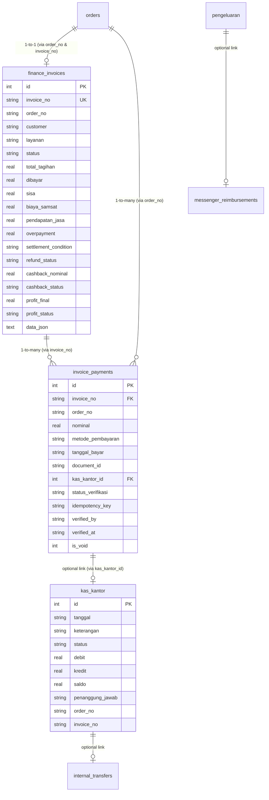
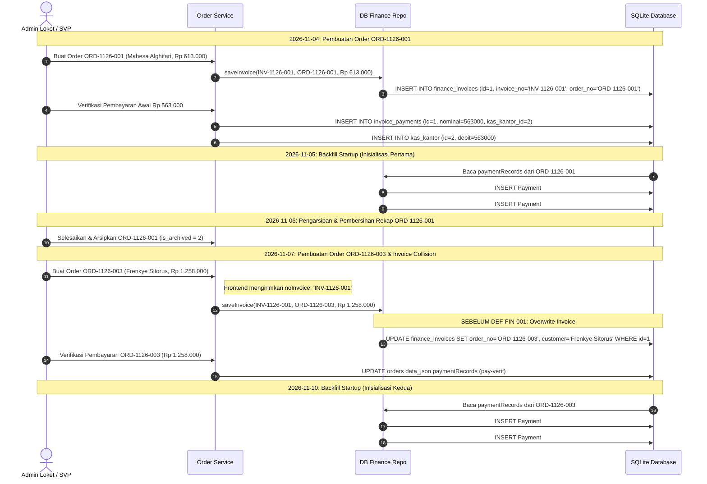

# PHASE 4A — FINANCE & TRANSACTION INTEGRITY AUDIT REPORT

**Project:** SUN89 / SUNBiroJasa Admin Platform  
**Mode:** STRICT READ-ONLY AUDIT — ZERO IMPLEMENTATION  
**Single Source of Truth (SSoT):** Backend Financial Business Logic & Authorization  
**Date:** 2026-11-10  
**Overall Status:** **AUDIT COMPLETE — REMEDIATION REQUIRED BEFORE PHASE 4B**  

---

## 1. EXECUTIVE SUMMARY

Audit Phase 4A dilakukan secara menyeluruh terhadap integritas transaksi keuangan, konsistensi data finansial, pembukuan kas, serta keamanan operasi finansial di platform SUN89 / SUNBiroJasa. Audit ini berfokus pada pembuktian faktual terhadap anomali transaksi, penelusuran akar masalah teknis (*root cause analysis*), serta pemetaan risiko integritas sistem secara menyeluruh.

### Temuan Kunci Utama:
1. **Mandatory Finding `INV-1126-001` Terbukti Secara Faktual & Sistemik:**  
   Teridentifikasi tabrakan nomor invoice (*cross-order invoice collision*) dan penggabungan pembayaran lintas order (*cross-order payment aggregation*). Invoice `INV-1126-001` yang tercatat pada `finance_invoices` untuk pesanan `ORD-1126-003` (Frenkye Sitorus, total tagihan Rp 1.258.000) secara keliru menggabungkan 3 record pembayaran milik `ORD-1126-001` (Mahesa Alghifari S.Kom, nominal terverifikasi 2x Rp 563.000 = Rp 1.126.000) dengan pembayaran milik `ORD-1126-003` (Rp 1.258.000). Total pembayaran terhitung menjadi **Rp 2.384.000**, menghasilkan status semu **`OVERPAID`** dengan surplus fiktif sebesar **Rp 1.126.000**.
2. **Duplikasi Pembayaran pada Mekanisme Backfill Startup (`schema.ts`):**  
   Mekanisme migrasi/backfill startup memproses riwayat `paymentRecords` dari JSON order tanpa membedakan status transisi (menunggu verifikasi vs terverifikasi), sehingga menyisipkan pembayaran ganda ke dalam tabel `invoice_payments`.
3. **Arsitektur Pembayaran Asimetris (Dual-Path Payment):**  
   Pembayaran awal ("Bayar di Awal" / DP) diproses melalui `orderService.verifyPayment` yang hanya memperbarui JSON order dan kolom statis `finance_invoices`, tanpa menyisipkan ke `invoice_payments` dan tanpa mencatat jurnal pada `kas_kantor`. Sebaliknya, pelunasan di modul finance diproses melalui `financeService.recordPayment` yang menyisipkan ke `invoice_payments`. Hal ini menyebabkan transaksi Rp 1.258.000 pada `ORD-1126-003` tidak pernah masuk ke buku kas (`kas_kantor`).
4. **Kontradiksi Internal Antara Detail Invoice dan List Invoice:**  
   `getInvoiceById(id)` membaca kolom statis tabel `finance_invoices` (menghasilkan status `PAID`, dibayar Rp 1.258.000, balance Rp 0). Sedangkan `getAllInvoices()` menghitung ulang secara dinamis dari `invoice_payments` dengan filter `invoice_no` saja (menghasilkan status `OVERPAID`, dibayar Rp 2.384.000, overpayment Rp 1.126.000).
5. **Penghapusan Destruktif pada Buku Kas Operasional:**  
   Endpoint `DELETE /api/finance/kas-kantor/:id` dan `DELETE /api/finance/pengeluaran/:id` mengizinkan penghapusan fisik record kas, yang merusak integritas *running balance* (`saldo`) dan melanggar prinsip *immutable financial audit trail*.
6. **Ketidaksinkronan Otorisasi Frontend vs Backend pada Fitur Void:**  
   Komponen frontend `FinanceContent.tsx` mengizinkan role `admin` mengakses tombol dan alur Void pembayaran, sedangkan backend `financeRoutes.ts` dan `financeService.ts` membatasi fitur Void secara ketat hanya untuk `administrator` dan `svp`.

---

## 2. AUDIT METHODOLOGY & FILES INSPECTED

Audit dilakukan menggunakan metode **Strict Read-Only Investigation** dengan membuka koneksi SQLite dalam mode `readOnly: true`, menghitung checksum kriptografis, menelusuri alur kode sumber, serta menganalisis data historis audit log.

### File Backend yang Diperiksa:
- `server/src/database/schema.ts` (Definisi DDL, Foreign Keys, Backfill Migration logic)
- `server/src/database/db.ts` (Implementasi `runInTransaction`, `BEGIN IMMEDIATE`, connection management)
- `server/src/database/seed.ts` (Data inisialisasi awal)
- `server/src/repositories/dbFinanceRepository.ts` (Query invoices, payments, kas kantor, pengeluaran, P&L aggregation)
- `server/src/repositories/dbOrderRepository.ts` (Query order, hard delete, archive cleanup)
- `server/src/services/financeService.ts` (Business logic pembayaran, void, cashback payout, OCC, audit log)
- `server/src/services/orderService.ts` (Pembuatan order, verifikasi pembayaran awal, penomoran invoice)
- `server/src/controllers/financeController.ts` (API controller finance)
- `server/src/controllers/orderController.ts` (API controller order)
- `server/src/routes/financeRoutes.ts` (Definisi routing dan permission middleware finance)
- `server/src/routes/orderRoutes.ts` (Definisi routing order dan verifikasi pembayaran)

### File Frontend & Domain yang Diperiksa:
- `src/domain/finance/types.ts` & `src/domain/finance/labaRugiCanonical.ts` (Formula kanonikal laba rugi, rekonsiliasi kas, kalkulasi overpayment)
- `src/data/api/apiFinanceProvider.ts` (Adapter API finance, caching, optimistic update)
- `src/app/data/financeStore.ts` & `src/app/data/orderStore.ts` (State store, penomoran order dan invoice)
- `src/app/components/FinanceContent.tsx` & `src/app/components/Finance.tsx` (UI finance, form pelunasan, void dialog, role check)
- `src/app/components/BuatOrder.tsx` (Form pembuatan order baru)

### Test Suites yang Dianalisis:
- `tests/e2e-business-financial-reconciliation.test.ts`
- `tests/rem-02a-finance-guard.test.ts`
- `tests/finance-sync.test.ts`
- `tests/canonical-pnl-reconciliation.test.ts`

---

## 3. FINANCE DATA MODEL & RELATIONSHIPS

Arsitektur database relasional keuangan pada `server/data/database.sqlite` terdiri dari tabel-tabel utama berikut:



### Anomali Struktural Skema:
1. **Tidak Ada Foreign Key Constraint dari `orders` ke `finance_invoices`:**  
   `orders` tidak memiliki kolom `invoice_no` pada skema SQL; nomor invoice hanya tersimpan di dalam string JSON `orders.data_json`.
2. **`finance_invoices.order_no` Tidak Memiliki Indeks Unik:**  
   Meskipun `invoice_no` bertipe `UNIQUE`, kolom `order_no` hanya memiliki indeks biasa (`idx_invoices_order`). Hal ini secara teknis memungkinkan beberapa invoice merujuk ke `order_no` yang sama, atau satu invoice dialihkan ke order lain.
3. **`invoice_payments` Memiliki Relasi Ganda yang Berpotensi Konflik:**  
   `invoice_payments` menyimpan `invoice_no` DAN `order_no` secara terpisah tanpa *foreign key composite check*. Jika `invoice_no` diasosiasikan dengan order berbeda, integritas data runtuh.

---

## 4. INVOICE INTEGRITY FINDINGS

### 4.1 Hubungan Invoice dan Order
- **Kondisi Faktual:** Database operasional saat ini memiliki 3 order dan 2 invoice.
  - `ORD-1126-001` (Customer: Mahesa Alghifari S.Kom, Status: Selesai/Arsip, Total: Rp 613.000) -> **TIDAK MEMILIKI RECORD INVOICE** di `finance_invoices`.
  - `ORD-1126-002` (Customer: Gibran rakabuming raka, Status: Selesai/Arsip, Total: Rp 59.078.000) -> Terhubung ke `INV-1126-002` (ID 2).
  - `ORD-1126-003` (Customer: Frenkye Sitorus, Status: Proses Samsat, Total: Rp 1.258.000) -> Terhubung ke `INV-1126-001` (ID 1).
- **Temuan Anomali:** `ORD-1126-001` dibuat pada 2026-11-04 dan awalnya memiliki invoice `INV-1126-001`. Namun record invoice tersebut ditimpa (*overwritten/hijacked*) oleh `ORD-1126-003` pada 2026-11-07.

### 4.2 Invoice Number Generation & Collision Risk
- **Kode Sumber:** `server/src/services/orderService.ts` L640–L678 & `src/app/data/orderStore.ts` L80–L99.
- **Mekanisme Pemicu:**
  1. Frontend menghitung `nextSeq` berdasarkan order yang ada di memori lokal klien (`orderStore.ts`). Jika state lokal kosong/belum ter-fetch, klien menghasilkan `INV-1126-001`.
  2. Frontend mengirimkan `noInvoice: "INV-1126-001"` ke endpoint `POST /api/orders`.
  3. Backend `orderService.ts` mengekstrak `rawNoInvoice` dari payload klien.
  4. Sebelum perbaikan `DEF-FIN-001` diimplementasikan, backend mempercayai input klien dan menimpa record invoice ID 1 di `finance_invoices`.
  5. Meskipun perbaikan `DEF-FIN-001` (L658-L677) telah ditambahkan untuk mencegah order baru menimpa invoice yang sudah ada, **data historis yang telah terkorupsi di database operasional belum pernah direkonsiliasi**.

### 4.3 Inkonsistensi Snapshot Invoice vs Order Data
| Field | Nilai di `orders.data_json` (ORD-1126-003) | Nilai di `finance_invoices` (ID 1) | Hasil Query `getAllInvoices()` | Status |
| :--- | :--- | :--- | :--- | :--- |
| **Invoice No** | `INV-1126-001` | `INV-1126-001` | `INV-1126-001` | MATCH |
| **Order No** | `ORD-1126-003` | `ORD-1126-003` | `ORD-1126-003` | MATCH |
| **Total Tagihan**| Rp 1.258.000 | Rp 1.258.000 | Rp 1.258.000 | MATCH |
| **Dibayar** | Rp 1.258.000 | Rp 1.258.000 | **Rp 2.384.000** | **MISMATCH (Poisoned)** |
| **Sisa** | Rp 0 | Rp 0 | Rp 0 | MATCH |
| **Overpayment** | Rp 0 | Rp 0 | **Rp 1.126.000** | **MISMATCH (Poisoned)** |
| **Status** | `Lunas` | `PAID` | **`OVERPAID`** | **MISMATCH (Poisoned)** |

---

## 5. PAYMENT INTEGRITY FINDINGS

### 5.1 Siklus Verifikasi Pembayaran & Asymmetric Persistence
Sistem memiliki dua alur terpisah untuk pencatatan dan verifikasi pembayaran:
1. **Alur Verifikasi Pembayaran Awal:** `POST /api/orders/:orderNo/verify-payment`  
   - Dijalankan oleh Admin/SVP saat order baru dibuat.
   - Mengubah status order menjadi `Lunas` dan memperbarui `orders.data_json.payment.paymentRecords`.
   - Memperbarui kolom statis `finance_invoices.dibayar` dan `finance_invoices.status`.
   - **KELEMAHAN FATAL:** Tidak melakukan `INSERT` ke tabel `invoice_payments` dan tidak mencatat mutasi `kas_kantor`.
2. **Alur Pelunasan Tagihan Finance:** `POST /api/finance/invoices/:id/pay`  
   - Dijalankan oleh Finance/Administrator.
   - Memerlukan pemeriksaan ketat bahwa order telah disetujui di Stage 6 (Supervisi).
   - Melakukan `INSERT` ke tabel `invoice_payments`.
   - Mengharuskan verifikasi lanjutan sebelum diposting ke `kas_kantor`.

### 5.2 Duplikasi Pembayaran pada Backfill Migration (`schema.ts`)
Pada `server/src/database/schema.ts` (L2091–L2122), terdapat fungsi backfill yang berjalan setiap kali server melakukan inisialisasi database.
- Saat membaca `orderJson.payment.paymentRecords`, ditemukan 2 entri:
  - Entri 1: `id: pay-...`, nominal 563.000, `statusVerifikasi: MENUNGGU_VERIFIKASI`, `tanggal: 2026-11-04T14:46:40.982Z`.
  - Entri 2: `id: pay-verif-...`, nominal 563.000, `statusVerifikasi: TERVERIFIKASI`, `tanggal: 2026-11-04T14:46:55.526Z`.
- Evaluasi deduplikasi backfill:
  ```ts
  const alreadyRecorded = existingPayments.some(
    (ep) => ep.idempotency_key === key ||
    (Number(ep.nominal) === nominal && ep.tanggal_bayar === (pr.tanggal || inv.created_at))
  );
  ```
- Karena `tanggal_bayar` pada entri awal (`2026-11-04`) berbeda format dengan entri verifikasi (`2026-11-04T14:46:55.526Z`), logika menganggapnya sebagai dua transaksi berbeda.
- **Akibat:** Tabel `invoice_payments` menerima 2 record `TERVERIFIKASI` untuk pembayaran yang sama (Payment #1 dan Payment #3), menggandakan pembayaran tercatat dari Rp 563.000 menjadi Rp 1.126.000.

---

## 6. TRANSACTION SAFETY & CONCURRENCY FINDINGS

### 6.1 Analisis `runInTransaction` & SQLite Locking
- **Kode Sumber:** `server/src/database/db.ts` L140–L161.
- **Mekanisme:** Menggunakan `activeDb.exec("BEGIN IMMEDIATE;")`.
- **Evaluasi:**
  - `BEGIN IMMEDIATE` mengakuisisi write-lock pada SQLite secara instan, mencegah *deadlock* dan transaksi konkuren lain melakukan penulisan di saat yang sama.
  - Penanganan rollback pada blok `catch` berjalan fail-safe dengan flag `inTransaction`.
  - Operasi mutasi pada `financeService.ts` (`recordPayment`, `payoutCashback`, `voidInvoicePayment`) dan `orderService.ts` (`createOrder`, `verifyPayment`, `advanceOrder`) telah terbungkus dengan baik di dalam `runInTransaction`.

### 6.2 Idempotency & Optimistic Concurrency Control (OCC)
- **Payment Idempotency:** `financeService.ts` L188–L206 memeriksa tabel `idempotency_keys`. Percobaan request berulang dengan payload identik mengembalikan state yang ada (*idempotent safe*), sedangkan penggunaan kembali key dengan parameter berbeda ditolak dengan HTTP 409 (`IDEMPOTENCY_CONFLICT`).
- **Cashback Payout OCC:** `financeService.ts` L517–L540 memvalidasi `expectedVersion` terhadap `payoutVersion`. Jika terjadi race condition / mutasi paralel, sistem melempar HTTP 409 (`VERSION_CONFLICT`).

---

## 7. CASH LEDGER & FINANCIAL RECORDS FINDINGS

### 7.1 Buku Kas Kantor (`kas_kantor`)
Tabel `kas_kantor` hanya memiliki 2 baris data fisik:
1. `id: 1` | `tanggal: 2026-11-04` | Saldo Awal Kas Kantor | Status: `DEBIT` | Debit: 0 | Kredit: 0 | Saldo: 0.
2. `id: 2` | `tanggal: 2026-11-04T14:46:40.982Z` | `Pembayaran: INV-1126-001 - Mahesa Alghifari S.Kom` | Status: `Debit` | Debit: 563.000 | Kredit: 0 | Saldo: 563.000.

### 7.2 Anomali Buku Kas:
1. **Penerimaan Pembayaran `ORD-1126-003` Hilang dari Buku Kas:**  
   Order `ORD-1126-003` berstatus `Lunas` sebesar Rp 1.258.000 dengan bukti transfer terlampir (`DOC-DDFF6098`), tetapi **tidak ada mutasi kas masuk sama sekali** di tabel `kas_kantor`. Kas kantor mengalami *under-reporting* sebesar Rp 1.258.000.
2. **Kalkulasi Running Balance (`saldo`) Statis:**  
   Pada `dbFinanceRepository.ts` L758–L760, saldo dihitung saat penyisipan:
   ```ts
   const newSaldo = isDebit ? currentBalance + debitVal : currentBalance - kreditVal;
   ```
   Nilai ini ditulis statis ke kolom `saldo`. Jika sebuah baris dihapus, nilai `saldo` pada baris-baris setelahnya tidak dihitung ulang secara berantai, mengakibatkan korupsi angka saldo historis.
3. **Risiko Integritas dari Endpoint Delete:**  
   Endpoint `DELETE /api/finance/kas-kantor/:id` dan `DELETE /api/finance/pengeluaran/:id` melakukan hard-delete pada baris tabel, yang bertentangan dengan standar akuntansi pembukuan berpasangan (*double-entry bookkeeping*) yang mewajibkan jurnal pembalik (*reversal/contra entry*).

---

## 8. FINANCIAL CALCULATION FINDINGS (P&L & REVENUE)

### 8.1 Perhitungan Laba Rugi (`computeCanonicalLabaRugi`)
- **Kode Sumber:** `src/domain/finance/labaRugiCanonical.ts` L290–L460.
- **Logika Pengakuan Pendapatan:**
  - Menggunakan metode *Proportional Cost Matching Formula*:
    $$\alpha = \frac{\text{Biaya Samsat}}{\text{Total Tagihan}}$$
    $$\text{Matched COGS} = \min(\text{Biaya Samsat}, \text{round}(\alpha \times \text{Recognized Revenue}))$$
    $$\text{Profit} = \text{Recognized Revenue} - \text{Matched COGS}$$
- **Dampak Pembayaran Terkontaminasi:**
  - `computeCanonicalLabaRugi` menerima input dari `dbFinanceRepository.getAllInvoices()`.
  - Karena invoice `INV-1126-001` memiliki `dibayar = 2.384.000`:
    - `totalGrossReceipts` tercatat bertambah Rp 2.384.000 (seharusnya Rp 1.258.000).
    - `totalOverpayment` tercatat membengkak menjadi Rp 1.126.000 (seharusnya Rp 0).
    - Meskipun `recognizedRevenue` dibatasi oleh `eligiblePayment = Math.min(netCustomerReceipts, totalTagihan)` sebesar Rp 1.258.000 sehingga angka profit operasional bersih tidak melambung, **laporan arus kas kotor (*Gross Receipts*) dan kewajiban refund (*Overpayment Liability*) mengalami distorsi parah sebesar Rp 1.126.000**.

---

## 9. AUTHORIZATION & FINANCIAL CONTROLS FINDINGS

### 9.1 Matriks Kewenangan Operasi Keuangan
| Operasi Finansial | Endpoint | Role yang Diizinkan Backend | Frontend Role Check | Konsistensi |
| :--- | :--- | :--- | :--- | :--- |
| **Lihat Daftar Invoice** | `GET /api/finance/invoices` | SVP, Admin, Finance | SVP, Admin, Finance | **KONSISTEN** |
| **Lihat Laporan P&L** | `GET /api/finance/laba-rugi` | SVP, Finance | SVP, Finance | **KONSISTEN** |
| **Lihat Profit List** | `GET /api/finance/profit` | SVP, Finance | SVP, Finance | **KONSISTEN** |
| **Input Pembayaran Invoice** | `POST /api/finance/invoices/:id/pay` | SVP, Finance | SVP, Finance | **KONSISTEN** |
| **Verifikasi Pembayaran Order** | `POST /api/orders/:orderNo/verify-payment` | SVP, Admin, Finance | SVP, Admin, Finance | **KONSISTEN** |
| **Pencairan Cashback / Refund** | `POST /api/finance/invoices/:id/cashback-payout`| SVP, Finance | SVP, Finance | **KONSISTEN** |
| **Void Transaksi Pembayaran** | `POST /api/finance/invoices/:id/payments/:pId/void` | **SVP Only** (`administrator`, `svp`) | **SVP & Admin** | **MISMATCH (GAP-FIN-07)** |
| **Hapus Entri Kas Kantor** | `DELETE /api/finance/kas-kantor/:id` | SVP, Finance | SVP, Finance | **KONSISTEN (RISK)** |
| **Hapus Entri Pengeluaran** | `DELETE /api/finance/pengeluaran/:id` | SVP, Finance | SVP, Finance | **KONSISTEN (RISK)** |

### 9.2 Analisis Kesenjangan Otorisasi
Pada `src/app/components/FinanceContent.tsx` L1084–L1101:
```ts
const isSpvOrAdmin = useMemo(() => {
  ...
  return (
    ["administrator", "supervisor", "spv", "svp", "admin"].includes(r) ||
    ...
  );
}, []);
```
Frontend mengizinkan user dengan role `admin` membuka modal dan men-submit aksi Void Pembayaran. Namun saat request dikirim ke backend, `requireRoles("administrator", "svp")` di `financeRoutes.ts` L110 menolak dengan HTTP 403 Forbidden.

---

## 10. FRONTEND FINANCE INTEGRATION FINDINGS

1. **Optimistic Updates & Rollback Safety:**  
   `ApiFinanceProvider` (`src/data/api/apiFinanceProvider.ts`) mengimplementasikan *optimistic update* pada beberapa operasi (misal: `completeInvoice`). Jika request backend gagal, state dikembalikan melalui refetch.
2. **Double-Submit Protection:**  
   `FinanceContent.tsx` menggunakan referensi `useRef` (`voidPaymentRef`, `voidCashbackRef`) untuk mengunci tombol selama request berlangsung, mencegah pengiriman ganda dari interaksi UI.
3. **Format Identifier Guard (REM-02A):**  
   Fungsi `extractValidInvoiceNo` di `FinanceContent.tsx` telah berhasil mencegah order identifier (`ORD-*`) disalahartikan sebagai invoice number pada alur pembayaran pelunasan.

---

## 11. MANDATORY INVESTIGATION: `INV-1126-001`

Penyelidikan mendalam terhadap invoice `INV-1126-001` menghasilkan rekonstruksi kronologis dan faktual sebagai berikut:

### 11.1 Rekonstruksi Kronologis Transaksi


### 11.2 Inventarisasi 5 Record `invoice_payments` dengan `INV-1126-001`
1. **Payment ID #1:**  
   - `order_no`: `ORD-1126-001` | `nominal`: Rp 563.000 | `status_verifikasi`: `TERVERIFIKASI` | `kas_kantor_id`: `2` | `tanggal_bayar`: `2026-11-04` | `catatan`: *"Pembayaran awal saat pembuatan order"* | `idempotency_key`: `REQ-1793803600982-1jwhdkm-init-pay`
2. **Payment ID #2:**  
   - `order_no`: `ORD-1126-001` | `nominal`: Rp 563.000 | `status_verifikasi`: `MENUNGGU_VERIFIKASI` | `kas_kantor_id`: `null` | `tanggal_bayar`: `2026-11-04T14:46:40.982Z` | `catatan`: *"Migrasi historis payment record"* | `idempotency_key`: `BACKFILL-INV-1126-001-pay-...`
3. **Payment ID #3:**  
   - `order_no`: `ORD-1126-001` | `nominal`: Rp 563.000 | `status_verifikasi`: `TERVERIFIKASI` | `kas_kantor_id`: `null` | `tanggal_bayar`: `2026-11-04T14:46:55.526Z` | `catatan`: *"Verifikasi Pembayaran Awal"* | `idempotency_key`: `BACKFILL-INV-1126-001-pay-verif-...`
4. **Payment ID #6:**  
   - `order_no`: `ORD-1126-003` | `nominal`: Rp 1.258.000 | `status_verifikasi`: `MENUNGGU_VERIFIKASI` | `kas_kantor_id`: `null` | `tanggal_bayar`: `2026-11-07T12:14:45.074Z` | `catatan`: *"Migrasi historis payment record"* | `idempotency_key`: `BACKFILL-INV-1126-001-pay-...`
5. **Payment ID #7:**  
   - `order_no`: `ORD-1126-003` | `nominal`: Rp 1.258.000 | `status_verifikasi`: `TERVERIFIKASI` | `kas_kantor_id`: `null` | `tanggal_bayar`: `2026-11-07T12:15:34.438Z` | `catatan`: *"Verifikasi Pembayaran Awal"* | `idempotency_key`: `BACKFILL-INV-1126-001-pay-verif-...`

### 11.3 Analisis Akar Masalah Perhitungan:
Pada `server/src/repositories/dbFinanceRepository.ts` L96–L106 dan L113–L125:
- Query mengambil semua pembayaran yang memiliki `invoice_no = 'INV-1126-001'`.
- Filter pembayaran terverifikasi menjaring:
  - Payment #1 (Rp 563.000 dari ORD-1126-001)
  - Payment #3 (Rp 563.000 dari ORD-1126-001)
  - Payment #7 (Rp 1.258.000 dari ORD-1126-003)
- Total Terbayar = $563.000 + 563.000 + 1.258.000 = \text{Rp } 2.384.000$.
- Total Tagihan `INV-1126-001` (milik ORD-1126-003) = Rp 1.258.000.
- Overpayment = $2.384.000 - 1.258.000 = \text{Rp } 1.126.000$.
- Status otomatis berubah menjadi **`OVERPAID`**.

### 11.4 Jawaban Atas Pertanyaan Investigasi Wajib:
1. *Apakah masalah ini hanya terjadi pada invoice ini atau merupakan risiko sistemik?*  
   **Risiko bersifat sistemik pada query level.** Logika pengelompokan pembayaran pada `dbFinanceRepository.getAllInvoices()` dan `getValidPaymentsTotal()` hanya memfilter berdasarkan `WHERE invoice_no = ?` tanpa memasukkan `order_no`. Jika ada nomor invoice yang digunakan ulang atau terduplikasi lintas order, collision dan penggabungan pembayaran pasti terjadi pada semua invoice.
2. *Bagaimana dampak riil terhadap keuangan?*  
   Secara riil, Frenkye Sitorus (`ORD-1126-003`) membayar tepat Rp 1.258.000 dan tidak memiliki kelebihan bayar. Nilai Rp 1.126.000 murni merupakan artefak korupsi data historis dan duplikasi backfill dari order Mahesa Alghifari (`ORD-1126-001`).

---

## 12. GAP REGISTER

| Gap ID | Severity | File / Komponen | Deskripsi Singkat | Dampak Bisnis / Teknis | Rekomendasi Remediasi Phase 4B |
| :--- | :--- | :--- | :--- | :--- | :--- |
| **GAP-FIN-01** | **CRITICAL** | `dbFinanceRepository.ts` L96–L125 | `getAllInvoices()` mengelompokkan pembayaran hanya berdasarkan `invoice_no` tanpa memvalidasi `order_no`. | Pembayaran lintas order digabungkan; muncul status `OVERPAID` fiktif Rp 1.126.000. | Ubah pengelompokan menggunakan composite key `(invoice_no, order_no)`. |
| **GAP-FIN-02** | **CRITICAL** | `dbFinanceRepository.ts` L310–L449 & `schema.ts` L499 | Skema tidak memiliki constraint unique pada `order_no` di `finance_invoices`; record invoice ID 1 ditimpa oleh order lain. | `ORD-1126-001` kehilangan record invoice resminya di `finance_invoices`. | Tambahkan unique constraint / validasi 1-to-1 dan jalankan rekonsiliasi data historis. |
| **GAP-FIN-03** | **HIGH** | `schema.ts` L2091–L2122 | Logika deduplikasi backfill startup gagal mendeteksi format tanggal ISO vs Date, menyisipkan pembayaran ganda. | Pembayaran terverifikasi terduplikasi (Payment #1 dan #3), menggandakan saldo terbayar. | Perbaiki komparasi tanggal kanonikal pada deduplikasi backfill; bersihkan record duplikat. |
| **GAP-FIN-04** | **HIGH** | `orderService.ts` L2127–L2225 & `financeService.ts` L226 | Dual-path payment: verifikasi pembayaran awal di order tidak membuat record di `invoice_payments` dan `kas_kantor`. | Pembayaran Rp 1.258.000 pada `ORD-1126-003` hilang dari buku kas operasional. | Satukan alur pembayaran agar setiap verifikasi otomatis mencatat ke `invoice_payments` dan `kas_kantor`. |
| **GAP-FIN-05** | **HIGH** | `dbFinanceRepository.ts` L86 vs L288 | Inkonsistensi kalkulasi antara `getInvoiceById()` (statis) dan `getAllInvoices()` (dinamis). | Tampilan detail invoice berbeda status dan saldonya dengan tampilan tabel daftar invoice. | Standarisasi kedua fungsi menggunakan kalkulator kanonikal yang sama. |
| **GAP-FIN-06** | **MEDIUM** | `financeRoutes.ts` L147, L171 & `financeService.ts` L1302 | Endpoint delete kas kantor dan pengeluaran melakukan hard-delete fisik pada buku kas. | Merusak kesinambungan running balance (`saldo`) dan menghilangkan jejak audit keuangan. | Nonaktifkan hard-delete (return HTTP 405) dan gantikan dengan jurnal pembalik (*reversal*). |
| **GAP-FIN-07** | **MEDIUM** | `FinanceContent.tsx` L1084 & `financeRoutes.ts` L110 | Frontend mengizinkan role `admin` mengakses tombol Void Pembayaran, sementara backend menolak dengan HTTP 403. | False-positive UX: admin mengira bisa membatalkan transaksi, namun request gagal di backend. | Samakan pemeriksaan role di frontend agar tombol Void hanya aktif untuk SVP / Administrator. |
| **GAP-FIN-08** | **MEDIUM** | `orderStore.ts` L80–L99 & `orderService.ts` L648 | Penomoran invoice di-generate secara independen oleh frontend dan diterima oleh backend. | Risiko collision nomor invoice jika state klien belum tersinkronisasi dengan server. | Jadikan backend sebagai Single Source of Truth penomoran invoice; frontend tidak boleh mengirim `noInvoice`. |

---

## 13. BUSINESS DECISIONS MEMERLUKAN PERSETUJUAN

Sebelum implementasi Phase 4B dijalankan, empat keputusan bisnis berikut memerlukan persetujuan formal:

### BD-FIN-01: Kebijakan Rekonsiliasi Data Historis `INV-1126-001`
- **Pilihan A (Rekomendasi):**  
  Pisahkan identitas invoice:
  1. Tetapkan `INV-1126-001` secara sah sebagai invoice milik `ORD-1126-001` (Customer: Mahesa Alghifari S.Kom, total tagihan Rp 613.000, terbayar Rp 563.000, sisa Rp 50.000, status `Kurang Bayar`). Hapus Payment #3 (duplikat) dan tautkan Payment #1 ke invoice ini.
  2. Terbitkan invoice baru `INV-1126-003` untuk `ORD-1126-003` (Customer: Frenkye Sitorus, total tagihan Rp 1.258.000, terbayar Rp 1.258.000, sisa Rp 0, status `Lunas`). Pindahkan Payment #6 dan Payment #7 ke `INV-1126-003`.
- **Pilihan B:**  
  Pertahankan `INV-1126-001` untuk `ORD-1126-003` dan buat invoice baru `INV-1126-001-LEGACY` untuk `ORD-1126-001`.

### BD-FIN-02: Kebijakan Integritas Buku Kas (Immutable Cash Ledger)
- Nonaktifkan endpoint `DELETE /api/finance/kas-kantor/:id` dan `DELETE /api/finance/pengeluaran/:id` dengan merespons `405 Method Not Allowed`.
- Koreksi kas kantor wajib dilakukan melalui jurnal pembalik (*contra-entry*) berstatus `Kredit` atau `Debit` dengan referensi ID transaksi asal.

### BD-FIN-03: Kebijakan Penomoran Invoice (Backend SSoT)
- Klien frontend dilarang meng-generate atau mengirimkan `noInvoice` saat membuat order baru.
- Backend `orderService` secara mutlak menjadi otoritas tunggal pembuat nomor invoice berdasarkan sekuensial transaksi database yang terkunci (`BEGIN IMMEDIATE`).

### BD-FIN-04: Hak Akses Void Transaksi Keuangan
- Tegaskan bahwa pembatalan (*void*) pembayaran dan cashback hanya boleh dilakukan oleh SVP/Administrator.
- Perbarui UI frontend agar tombol Void tersembunyi bagi role Admin dan Finance.

---

## 14. PROPOSED REMEDIATION BATCHES UNTUK PHASE 4B

Implementasi perbaikan pada Phase 4B direkomendasikan dibagi menjadi 3 batch terkontrol:

### Batch 1: Repository & SSoT Calculation Hardening
- Perbaiki `dbFinanceRepository.getAllInvoices()` agar mengelompokkan pembayaran berdasarkan composite key `(invoice_no, order_no)`.
- Perbaiki `getValidPaymentsTotal(invoiceNo, orderNo)` agar memfilter `order_no`.
- Sinkronkan `getInvoiceById()` agar menggunakan formula kalkulasi dinamis yang sama persis dengan `getAllInvoices()`.

### Batch 2: Payment Unification & Cash Ledger Integration
- Satukan alur `verifyPayment` pada `orderService.ts` agar menyisipkan record ke `invoice_payments` dan mencatat kas masuk ke `kas_kantor`.
- Nonaktifkan endpoint `DELETE` pada kas kantor dan pengeluaran (kembalikan HTTP 405 `CASH_LEDGER_IMMUTABLE`).
- Perbaiki logika deduplikasi backfill pada `schema.ts`.

### Batch 3: Data Reconciliation & Frontend Alignment
- Eksekusi skrip migrasi rekonsiliasi data historis `INV-1126-001` sesuai Business Decision yang disetujui.
- Perbarui frontend `FinanceContent.tsx` untuk menyelaraskan permission Void (SVP only).
- Hapus pengiriman `noInvoice` dari frontend `orderStore.ts` / `BuatOrder.tsx`.

---

## 15. TEST COVERAGE & VERIFICATION GAPS

1. **Gap Pengujian Saat Ini:**  
   - `tests/e2e-business-financial-reconciliation.test.ts` hanya memverifikasi order secara individual melalui `getInvoiceByOrderNo()` dan tidak menguji tabrakan nomor invoice pada `getAllInvoices()`.
   - Tidak ada pengujian integrasi yang memvalidasi bahwa verifikasi pembayaran awal via order mencatatkan mutasi ke `kas_kantor`.
   - Tidak ada pengujian konkurensi untuk dua order yang mencoba mengklaim invoice number yang sama.
2. **Kebutuhan Pengujian Phase 4B:**  
   - Tambahkan test suite integrasi khusus `phase4b-finance-integrity.test.ts` yang menguji:
     - Isolasi pembayaran antar order dengan nomor invoice mirip/sama.
     - Penolakan payload `noInvoice` dari frontend.
     - Immutability kas kantor (verifikasi HTTP 405 pada DELETE).
     - Verifikasi rekonsiliasi saldo kas terhadap total pembayaran terverifikasi.

---

## 16. DATA INTEGRITY BASELINE & AUDIT LIMITATIONS

### 16.1 Pre-Audit & Post-Audit Baseline Verification
Pengukuran integritas fisik dilakukan sebelum dan sesudah audit:

| Target Verifikasi | Baseline Awal (Pre-Audit) | Baseline Akhir (Post-Audit) | Status |
| :--- | :--- | :--- | :--- |
| **Ukuran Database (`database.sqlite`)** | `1,441,792 bytes` | `1,441,792 bytes` | **EXACT MATCH** |
| **SHA-256 Database** | `898C0C7127D49392D40CA3A6AB73BA16E1F92C67E2C6E8D95EF5D81FEEC7B12C` | `898C0C7127D49392D40CA3A6AB73BA16E1F92C67E2C6E8D95EF5D81FEEC7B12C` | **EXACT MATCH** |
| **Jumlah Tabel Database** | 41 tabel | 41 tabel | **EXACT MATCH** |
| **Baris `finance_invoices`** | 2 baris | 2 baris | **EXACT MATCH** |
| **Baris `invoice_payments`** | 7 baris | 7 baris | **EXACT MATCH** |
| **Baris `kas_kantor`** | 2 baris | 2 baris | **EXACT MATCH** |
| **Baris `orders`** | 3 baris | 3 baris | **EXACT MATCH** |
| **Jumlah File Uploads** | 51 file fisik | 51 file fisik | **EXACT MATCH** |
| **Total Bytes Uploads** | `1,525,984 bytes` | `1,525,984 bytes` | **EXACT MATCH** |
| **Manifest SHA-256 Uploads** | `4FD418787BCC18CBA3A55E78E02D87BDCA0372EBAA3BD8C696DB9C5B8C8242E5` | `4FD418787BCC18CBA3A55E78E02D87BDCA0372EBAA3BD8C696DB9C5B8C8242E5` | **EXACT MATCH** |

### 16.2 Batasan Audit (*Audit Limitations*)
- Audit ini beroperasi dalam mode STRICT READ-ONLY. Tidak ada baris data yang diubah, dihapus, atau dimigrasi pada database operasional.
- Verifikasi logika perhitungan dinamis dilakukan menggunakan simulasi memori terisolasi berbasis script scratch tanpa menyentuh file produksi.

---

## 17. FINAL RECOMMENDATION

Berdasarkan audit faktual, gap register, dan analisis risiko transaksi finansial di atas:

**STATUS: READY FOR PHASE 4B REVIEW (DENGAN REKOMENDASI REMEDIASI KETAT)**

Sistem **TIDAK AMAN** jika dibiarkan tanpa perbaikan Phase 4B karena risiko penggabungan pembayaran lintas order (*cross-order payment collision*) dan ketidaksinkronan buku kas operasional. 

Langkah selanjutnya adalah meninjau dan menyetujui empat Business Decisions (BD-FIN-01 s/d BD-FIN-04) sebelum memulai pengerjaan implementasi terarah pada Phase 4B.
