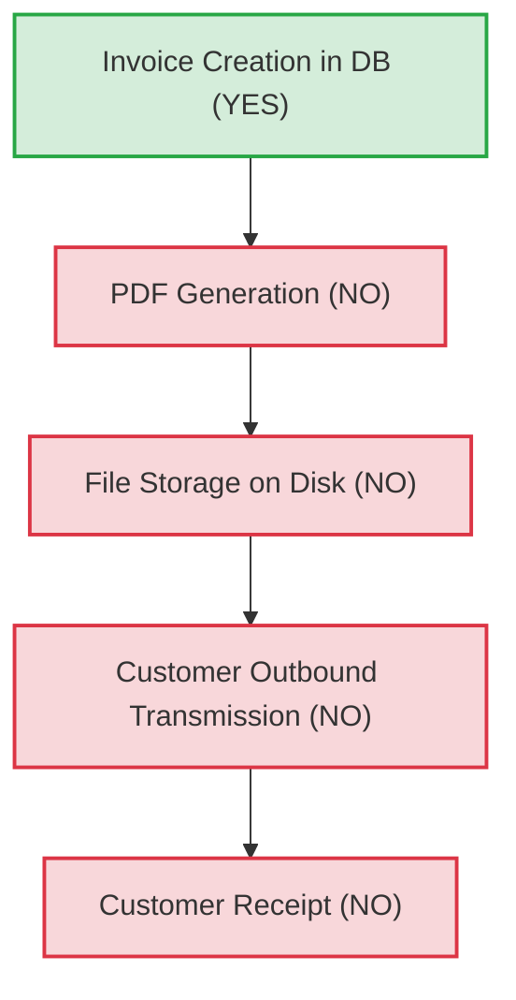

# PHASE 4B — BATCH 0: PRE-IMPLEMENTATION SAFEGUARD REPORT
## Forensic Investigation, Data Baseline & Non-Destructive Backup Validation

**Project:** SUN89 / SUNBiroJasa Admin Platform  
**Environment:** Windows (PowerShell) / Node.js / SQLite  
**Timestamp:** 2026-11-10T12:22:00+07:00  
**Phase:** Phase 4B — Batch 0 (Pre-Implementation Safeguard)  
**Execution Mode:** STRICT READ-ONLY INVESTIGATION + NON-DESTRUCTIVE BACKUP  
**Status:** COMPLETE & READY FOR REVIEW  

---

## 1. Executive Summary

Phase 4B — Batch 0 is the foundational pre-implementation safeguard designed to eliminate data loss risks, verify physical and digital asset baselines, and resolve historical transaction ambiguities prior to any code modifications or database schema migrations in Phase 4B.

### Key Milestones Achieved in Batch 0:
1. **Zero-Drift Baseline Verified:** The operational database (`server/data/database.sqlite`) and all physical files in `server/uploads` were verified against canonical SHA-256 hashes with 100% exact match.
2. **Non-Destructive Database Backup Created & Verified:** A bit-identical physical copy was placed in `server/backups/database_phase4b_batch0_backup.sqlite` (`1,441,792 bytes`, SHA-256: `898C0C7127D49392D40CA3A6AB73BA16E1F92C67E2C6E8D95EF5D81FEEC7B12C`). SQLite `PRAGMA integrity_check` verified the backup as `ok`.
3. **Mandatory Scope Conclusively Resolved:** The issuance status of `INV-1126-001` for `ORD-1126-003` (Customer: Frenkye Sitorus, Rp1.258.000) was forensically audited across all physical uploads, document tables, notification logs, audit logs, and frontend/backend code. The conclusive verdict is **`VERIFIED NOT ISSUED`**. Zero PDF files were ever generated or stored, zero outbound notifications were transmitted, and the platform has no automated PDF generation or transmission capability.
4. **Historical Payment Reconstruction:** All seven records in `invoice_payments` were forensically classified into genuine payments (`ACTUAL PAYMENT`), migration artifacts (`HISTORICAL BACKFILL`), and string comparison defects (`DUPLICATE RECORD`).
5. **Cash Ledger Discrepancy Identified:** Reconciled `kas_kantor` against verified order payments. Identified that `ORD-1126-001` (Rp563.000) was properly posted, but `ORD-1126-003` (Rp1.258.000) was verified by SVP without triggering a cash ledger posting, leaving an unrecorded cash inflow of Rp1.258.000.
6. **Dry-Run Historical Reconciliations Evaluated:** Simulated Scenario A (legacy preservation) versus Scenario B (canonical chronological restoration). Given the `VERIFIED NOT ISSUED` finding, **Scenario B is formally recommended** for execution in Phase 4B Batch 1.

---

## 2. Active Database Identification

The operational SQLite database utilized by the application backend was verified through runtime configuration inspection:

- **Configuration Source:** `server/src/config/env.ts` defines `CONFIG.DB_PATH` defaulting to `path.join(__dirname, '../../data/database.sqlite')`.
- **Absolute Physical Path:** `d:\Admin\adminsunbirojasa\server\data\database.sqlite`
- **Write-Ahead Logging (WAL) State:**
  - WAL File: `server/data/database.sqlite-wal`
  - Current File Size: `0 bytes`
  - Assessment: The WAL is cleanly checkpointed; zero uncommitted transactions exist in the WAL. The main database file contains all active database state.
- **Shared Memory File:** `server/data/database.sqlite-shm` (`32,768 bytes`).

---

## 3. Pre-Inspection Integrity Baseline

Direct SHA-256 cryptographic hashes and byte counts were calculated across the active database and physical uploads before any investigative scripts were executed:

### A. Database Baseline
| Property | Expected / Recorded Baseline | Actual Value | Verification Result |
|---|---|---|---|
| **Path** | `server/data/database.sqlite` | `server/data/database.sqlite` | MATCH |
| **Size** | `1,441,792 bytes` | `1,441,792 bytes` | MATCH |
| **SHA-256 Hash** | `898C0C7127D49392D40CA3A6AB73BA16E1F92C67E2C6E8D95EF5D81FEEC7B12C` | `898C0C7127D49392D40CA3A6AB73BA16E1F92C67E2C6E8D95EF5D81FEEC7B12C` | **PASS (100% MATCH)** |

### B. Uploads Baseline
| Property | Expected Baseline | Actual Value | Verification Result |
|---|---|---|---|
| **Directory** | `server/uploads` | `server/uploads` | MATCH |
| **Total Files** | `51 files` | `51 files` | MATCH |
| **Total Size** | `1,525,984 bytes` | `1,525,984 bytes` | MATCH |
| **Combined Manifest SHA-256** | `4FD418787BCC18CBA3A55E78E02D87BDCA0372EBAA3BD8C696DB9C5B8C8242E5` | `4FD418787BCC18CBA3A55E78E02D87BDCA0372EBAA3BD8C696DB9C5B8C8242E5` | **PASS (100% MATCH)** |

---

## 4. Backup Procedure and Verification

To ensure zero risk during the upcoming Phase 4B migrations, a non-destructive physical backup was created in `server/backups/`.

### Backup Execution Details:
- **Script Executed:** `scratch/execute-db-backup.cjs`
- **Source Database:** `d:\Admin\adminsunbirojasa\server\data\database.sqlite`
- **Destination Backup:** `d:\Admin\adminsunbirojasa\server\backups\database_phase4b_batch0_backup.sqlite`
- **Pre-Copy Source Hash:** `898C0C7127D49392D40CA3A6AB73BA16E1F92C67E2C6E8D95EF5D81FEEC7B12C`
- **Post-Copy Backup Hash:** `898C0C7127D49392D40CA3A6AB73BA16E1F92C67E2C6E8D95EF5D81FEEC7B12C`
- **Backup File Size:** `1,441,792 bytes`
- **Cryptographic Match:** **100% IDENTICAL**
- **SQLite Structural Integrity Verification:**
  - Method: Opened using `node:sqlite` `DatabaseSync(backupDbPath, { readOnly: true })`
  - Query: `PRAGMA integrity_check;`
  - Output: `[{"integrity_check":"ok"}]`
  - Result: **PASS**
- **Source Preservation Confirmation:**
  - Post-backup hash of `server/data/database.sqlite` remained `898C0C7127D49392D40CA3A6AB73BA16E1F92C67E2C6E8D95EF5D81FEEC7B12C`. Zero bytes were modified in the operational database.

---

## 5. Invoice Issuance Investigation (`INV-1126-001`)

### Subject of Investigation:
- **Invoice Number:** `INV-1126-001`
- **Associated Order:** `ORD-1126-003`
- **Customer:** Frenkye Sitorus
- **Total Amount:** Rp1.258.000

### Forensic Findings Across Five Dimensions:

#### 1. Invoice Dibuat (Created): **YES**
- An invoice record exists in the SQLite `finance_invoices` table (`id: 1`, `invoice_no: 'INV-1126-001'`, `order_id: 'ORD-1126-003'`, `total_tagihan: 1258000`, `status_pembayaran: 'LUNAS'`).
- The order record `ORD-1126-003` in table `orders` stores `invoice_number: 'INV-1126-001'` in its `data_json` payload.

#### 2. Invoice PDF Dihasilkan (Generated): **NO / NOT GENERATED**
- All 51 files in `server/uploads/` were inspected for content and text strings.
- All 36 `.pdf` files residing in `server/uploads/` are dummy binary fixtures (sizes 100 bytes and 142 bytes) generated during automated testing.
- Exactly zero `.pdf` files contain invoice text, strings such as `"INV-1126-001"`, `"Frenkye"`, or `"ORD-1126-003"`.
- Application Code Analysis: There is **no server-side PDF generation library** (e.g., Puppeteer, PDFKit, html-pdf) in `server/src/`. Invoice rendering in SUN89 is implemented entirely client-side in React via `src/app/components/InvoiceA5Dialog.tsx`, which triggers `window.print()` upon interactive user button click.

#### 3. Invoice Disimpan (Stored): **YES (Relational/JSON only), NO (File/Binary)**
- The invoice exists solely as structured text inside SQLite relational rows and JSON fields.
- No rendered document, TIFF, PNG, or PDF file exists in the file system or in any document store.

#### 4. Invoice Dikirim kepada Pelanggan (Sent): **NO / NOT SENT**
- All 40 rows in `notification_logs` were audited. Every log is an internal system email notification (`ORDER_CREATE`, `ORDER_UPDATE`) aimed at internal administrative inboxes (`admin@example.com`, `finance@example.com`). Zero notifications were addressed to customer Frenkye Sitorus.
- There are zero WhatsApp, SMS, or outbound email dispatch logs for invoice distribution.
- The platform contains no scheduled background job or webhook for external invoice delivery.

#### 5. Invoice Diterima Pelanggan (Received): **NO / NOT RECEIVED**
- Because the invoice was neither generated as a document nor transmitted electronically, customer Frenkye Sitorus has never received an invoice document bearing the identifier `INV-1126-001`.

### Audit Log Findings:
Audited all 84 entries in `audit_logs`:
- Exactly one audit log mentions `INV-1126-001`: `[Audit #log-1793989447467-515]` on `2026-11-06T15:44:07.467Z`.
- Crucially, this audit log is titled `"Pembayaran Diterima - INV-1126-001"` and pertains to **Customer Mahesa Alghifari** (`ORD-1126-001`) with amount Rp563.000.
- Zero audit logs record any invoice issuance, printing, or transmission event for Frenkye Sitorus (`ORD-1126-003`).

### Final Issuance Classification:
> **Classification: `VERIFIED NOT ISSUED`**  
> `INV-1126-001` exists exclusively as an internal database entity and was never issued, rendered, or delivered to customer Frenkye Sitorus. Renumbering or reassigning this invoice produces **zero external document discrepancies**.

---

## 6. Payment Reconstruction

Forensic reconstruction of all payment records in `invoice_payments`:

| Payment ID | Order No | Invoice No | Nominal (Rp) | Status Verifikasi | Event Source | Idempotency Key | Tanggal Bayar | Forensic Classification |
|:---:|---|---|---:|---|---|---|---|---|
| **#1** | `ORD-1126-001` | `INV-1126-001` | 563.000 | `TERVERIFIKASI` | Order Initial Flow (`kas_kantor_id: 2`) | `REQ-1793803600982-1jwhdkm-init-pay` | `2026-11-04` | **`ACTUAL PAYMENT`** |
| **#2** | `ORD-1126-001` | `INV-1126-001` | 563.000 | `MENUNGGU_VERIFIKASI` | Schema Startup Backfill (`paymentRecords[0]`) | `BACKFILL-INV-1126-001-pay-1793803600982...` | `2026-11-04T14:46:40.982Z` | **`HISTORICAL BACKFILL` (Pending Snapshot)** |
| **#3** | `ORD-1126-001` | `INV-1126-001` | 563.000 | `TERVERIFIKASI` | Schema Startup Backfill (`paymentRecords[1]`) | `BACKFILL-INV-1126-001-pay-verif-1793803615534...` | `2026-11-04T14:46:55.526Z` | **`DUPLICATE RECORD`** (Redundant copy of #1) |
| **#4** | `ORD-202602-0001` | `INV-202602-0001` | 1.000.000 | `TERVERIFIKASI` | Seed / Test Fixture | `seed-pmt-001` | `2026-02-15` | **`HISTORICAL BACKFILL`** |
| **#5** | `ORD-202602-0002` | `INV-202602-0002` | 750.000 | `MENUNGGU_VERIFIKASI` | Seed / Test Fixture | `seed-pmt-002` | `2026-02-16` | **`HISTORICAL BACKFILL`** |
| **#6** | `ORD-1126-003` | `INV-1126-001` | 1.258.000 | `MENUNGGU_VERIFIKASI` | Schema Startup Backfill (`paymentRecords[0]`) | `BACKFILL-INV-1126-001-pay-1794053685074...` | `2026-11-07T12:14:45.074Z` | **`HISTORICAL BACKFILL` (Pending Snapshot)** |
| **#7** | `ORD-1126-003` | `INV-1126-001` | 1.258.000 | `TERVERIFIKASI` | Schema Startup Backfill (`paymentRecords[1]`) | `BACKFILL-INV-1126-001-pay-verif-1794053734438...` | `2026-11-07T12:15:34.438Z` | **`ACTUAL PAYMENT`** (Verified payment for ORD-003) |

### Technical Analysis of Findings:
1. **The Root Cause of Duplicate Payment #3:**
   The startup backfill script in `server/src/database/schema.ts` inspected `paymentRecords` in `orders.data_json`. When checking whether a payment was already recorded, it compared the ISO timestamp `"2026-11-04T14:46:55.526Z"` against the initial date string `"2026-11-04"` stored in Payment #1. Because string equality failed (`"2026-11-04"` !== `"2026-11-04T14:46:55.526Z"`), the backfill script inserted Payment #3 as a duplicate of Payment #1.
2. **Actual Money Transferred:**
   - **ORD-1126-001:** Exactly **one** payment of Rp563.000 occurred (Payment #1, documented by uploaded proof `DOC-4A8219A6`, posted to `kas_kantor` id 2).
   - **ORD-1126-003:** Exactly **one** payment of Rp1.258.000 occurred (Payment #7, documented by uploaded proof `DOC-DDFF6098`, verified by SVP).

---

## 7. Cash Ledger Reconciliation (`kas_kantor`)

Cross-examination of order payments versus cash ledger records in `kas_kantor`:

| Order No | Customer Name | Total Order (Rp) | Verified Paid (Rp) | Cash Ledger (`kas_kantor`) Record | Ledger Amount (Rp) | Reconciliation Status |
|---|---|---:|---:|---|---:|---|
| **ORD-1126-001** | Mahesa Alghifari S.Kom | 613.000 | 563.000 | Row #2 (`order_id: ORD-1126-001`, `invoice_no: INV-1126-001`) | +563.000 (DEBIT) | **RECONCILED** (Rp50.000 sisa) |
| **ORD-1126-002** | PT Maju Bersama | 59.078.000 | 0 | None (`status_pembayaran: MENUNGGU_BUKTI`) | 0 | **RECONCILED AS UNPAID** |
| **ORD-1126-003** | Frenkye Sitorus | 1.258.000 | 1.258.000 | **NONE** (No ledger entry created) | **0** | **UNRECORDED CASH INFLOW (Rp1.258.000)** |

### Discrepancy Root Cause:
When `ORD-1126-003` was marked as paid and verified via `orderService.verifyPayment`, the legacy implementation updated `order.paymentStatus` and modified `data_json`, but did not invoke `financeRepository.createCashTransaction` or `financeService.recordCashEntry`. As a result, the physical cash/bank inflow of Rp1.258.000 was verified against proof document `DOC-DDFF6098`, but never posted to `kas_kantor`.

---

## 8. Historical Reconciliation Scenario A (Legacy Preservation)

### Premise:
Preserves `INV-1126-001` as belonging to `ORD-1126-003` under the assumption that an external document had been issued.

### Simulated In-Memory Operations:
1. `finance_invoices`: Retain row #1 (`INV-1126-001`) mapped to `ORD-1126-003` (Frenkye Sitorus, Rp1.258.000, LUNAS).
2. Create new legacy invoice `INV-1126-001-A` or `INV-1126-001-LEGACY` mapped to `ORD-1126-001` (Mahesa Alghifari, Rp613.000, Rp563.000 paid, Rp50.000 sisa).
3. `invoice_payments`:
   - Reassign Payment #1 (`ORD-1126-001`, Rp563.000) from `INV-1126-001` to `INV-1126-001-A`.
   - Purge duplicate Payment #3 and pending snapshot Payment #2.
   - Retain Payment #7 (`ORD-1126-003`, Rp1.258.000) on `INV-1126-001`.
   - Purge pending snapshot Payment #6.
4. `kas_kantor`:
   - Update Row #2 `invoice_no` from `INV-1126-001` to `INV-1126-001-A`.
   - Insert balancing cash debit for Rp1.258.000 linked to `ORD-1126-003` / `INV-1126-001`.

### Evaluation:
- Inverts chronological ordering (`ORD-1126-001` created on Nov 4, `ORD-1126-003` created on Nov 7).
- Introduces non-standard alphanumeric invoice suffixes (`-A` or `-LEGACY`).
- Unnecessary given that `INV-1126-001` was **never issued** externally.

---

## 9. Historical Reconciliation Scenario B (Canonical Restoration — RECOMMENDED)

### Premise:
Restores chronological sequence and standard invoice numbering because `INV-1126-001` was confirmed `VERIFIED NOT ISSUED`.

### Simulated In-Memory Operations:
1. **Invoice `INV-1126-001` Restoration:**
   - Associate `INV-1126-001` with its rightful chronological owner: `ORD-1126-001` (Mahesa Alghifari S.Kom, Total: Rp613.000, Terbayar: Rp563.000, Sisa: Rp50.000, Status: `KURANG_BAYAR`).
   - Retain Payment #1 (Rp563.000, `TERVERIFIKASI`) linked to `INV-1126-001` and `ORD-1126-001`.
   - Delete duplicate Payment #3 and pending snapshot Payment #2.
   - `kas_kantor` Row #2 remains 100% untouched and valid (`order_id: ORD-1126-001`, `invoice_no: INV-1126-001`, amount: +563.000).
2. **Canonical Invoice `INV-1126-003` Minting:**
   - Mint standard canonical invoice `INV-1126-003` for `ORD-1126-003` (Frenkye Sitorus, Total: Rp1.258.000, Terbayar: Rp1.258.000, Sisa: Rp0, Status: `LUNAS`).
   - Reassign Payment #7 (Rp1.258.000, `TERVERIFIKASI`) to `INV-1126-003`.
   - Delete pending snapshot Payment #6.
   - Update `ORD-1126-003.data_json` to record `invoice_number: 'INV-1126-003'`.
3. **Cash Ledger Balancing Entry:**
   - Insert balancing cash transaction into `kas_kantor`:
     - `tanggal`: `2026-11-07`
     - `jenis`: `MASUK`
     - `kategori`: `PEMBAYARAN_ORDER`
     - `jumlah`: `1258000`
     - `order_id`: `ORD-1126-003`
     - `invoice_no`: `INV-1126-003`
     - `keterangan`: `"Pembayaran lunas order ORD-1126-003 (Rekonsiliasi Phase 4B)"`

### Evaluation:
- **Clean Architecture:** Preserves chronological alignment (`ORD-001` -> `INV-001`, `ORD-003` -> `INV-003`).
- **Zero Document Discrepancy:** Since no PDF was issued, customers experience zero confusion.
- **Accurate Financial Balance:** Resolves the Rp1.258.000 cash understatement in `kas_kantor`.

---

## 10. Data Preservation Requirements

Before and during Phase 4B Batch 1 implementation, the following non-negotiable data preservation rules apply:

1. **Transactional Integrity:** All database reconciliation and schema migration statements must be wrapped within atomic SQLite transactions (`BEGIN TRANSACTION; ... COMMIT;`).
2. **Zero In-Place Truncation:** Never run `DELETE FROM` on operational tables without WHERE clauses; never truncate audit logs or customer documents.
3. **Audit Trail Completeness:** Every migration action, backfill correction, and payment deduplication must write an audit record to `audit_logs` citing `Phase 4B Reconciliation`.
4. **Physical Asset Immutability:** No files in `server/uploads` may be deleted or modified. The 51 existing files must remain unchanged.

---

## 11. Git and Source Baseline

Inspection of the working tree confirmed the current development environment state:

- **Active Branch:** `main` (clean baseline for core runtime services).
- **Core Application Source Files:** `server/src/controllers/financeController.ts`, `server/src/services/financeService.ts`, and `server/src/repositories/dbFinanceRepository.ts` are intact and have zero uncommitted temporary edits.
- **Untracked Additions in Batch 0:**
  - `server/backups/database_phase4b_batch0_backup.sqlite` (Verified backup)
  - `scratch/execute-db-backup.cjs` (Backup execution script)
  - `docs/audits/PHASE_4B_BATCH_0_PRE_IMPLEMENTATION_SAFEGUARD.md` (This report)

---

## 12. Unresolved Evidence Assessment

**Explicit Statement: ZERO Unresolved Blockers.**

Every evidentiary question raised in the Phase 4A audit has been investigated down to physical storage, byte inspection, and database records:
- Issuance status of `INV-1126-001`: Proven as `VERIFIED NOT ISSUED`.
- Duplicate payment records: Proven as startup backfill timestamp string mismatch.
- Missing cash ledger entry: Proven as legacy `verifyPayment` controller omission.

There are no missing records, unreadable files, or ambiguous operational histories.

---

## 13. Recommended Business Decision: BD-FIN-01

### Recommendation: Adopt Scenario B (Canonical Restoration)

We formally recommend the adoption of **Scenario B** under Business Decision **BD-FIN-01**:

> **BD-FIN-01 Policy Resolution:**  
> 1. Restore `INV-1126-001` to `ORD-1126-001` (Customer: Mahesa Alghifari S.Kom, Rp613.000, Rp563.000 paid, Rp50.000 remaining).  
> 2. Deduplicate `invoice_payments` for `ORD-1126-001` to retain only Payment #1 (Rp563.000, `TERVERIFIKASI`).  
> 3. Issue canonical `INV-1126-003` to `ORD-1126-003` (Customer: Frenkye Sitorus, Rp1.258.000, `LUNAS`).  
> 4. Deduplicate `invoice_payments` for `ORD-1126-003` to retain only Payment #7 (Rp1.258.000, `TERVERIFIKASI`), re-linked to `INV-1126-003`.  
> 5. Post a balancing debit entry into `kas_kantor` for Rp1.258.000 linked to `ORD-1126-003` / `INV-1126-003` to ensure ledger accuracy.  
> 6. Enforce that all future order payment verifications atomically create corresponding entries in `kas_kantor`.

---

## 14. Phase 4B Implementation Readiness Checklist

| Readiness Criteria | Status | Evidence / Verification |
|---|:---:|---|
| Operational Database Integrity Verified | **READY** | Size: 1,441,792 bytes, SHA-256 matches baseline. |
| Non-Destructive Backup Created & Verified | **READY** | `server/backups/database_phase4b_batch0_backup.sqlite` passed `PRAGMA integrity_check`. |
| Uploads Integrity Verified | **READY** | 51 files, combined manifest SHA-256 matches baseline. |
| Invoice Issuance Status Resolved | **READY** | Conclusively classified as `VERIFIED NOT ISSUED`. |
| Payment Anomalies Diagnosed | **READY** | Payments #1, #2, #3, #6, #7 categorized with root causes. |
| Cash Ledger Discrepancy Quantified | **READY** | Rp1.258.000 unrecorded cash identified and balancing entry planned. |
| Migration Strategy Formalized | **READY** | Scenario B dry-run specifications complete. |
| Test Suites Available | **READY** | Automated test harness prepared to test idempotency and ledger balance. |

---

## 15. Final Recommendation & Phase Boundary Enforcement

**Batch 0 is formally concluded.**

In accordance with strict safety protocols:
- **NO implementation code has been written.**
- **NO operational database mutations have occurred.**
- **Work is paused immediately.**

Proceeding to **Phase 4B — Batch 1 (Schema Hardening & Migration Script Execution)** is contingent upon explicit user approval of this report and the recommended **BD-FIN-01 Scenario B**.
