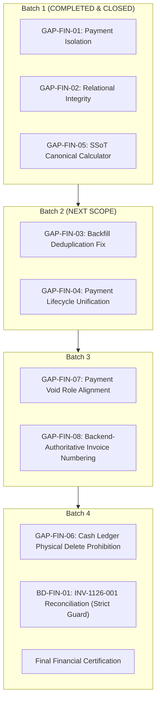

# PHASE 4B — BATCH 1: FINAL CORRECTION ADDENDUM
## Documentation Reconciliation, Test Structure Alignment & Roadmap Correction

**Project:** SUN89 / SUNBiroJasa Admin Platform  
**Environment:** Windows (PowerShell) / Node.js v22.19.0 / SQLite (node:sqlite)  
**Date & Timestamp:** 2026-11-10T13:15:00+07:00  
**Phase:** Phase 4B — Batch 1 (Final Documentation Correction)  
**Execution Mode:** STRICT READ-ONLY CODE VERIFICATION + DOCUMENTATION-ONLY CORRECTION  
**Verdict:** **VERIFIED PASS — DOCUMENTATION FULLY RECONCILED**

---

## 1. Executive Summary

This addendum resolves the documentation discrepancies identified between `PHASE_4B_BATCH_1_IMPLEMENTATION_REPORT.md` and `PHASE_4B_BATCH_1_CLOSURE_VERIFICATION.md`. 

Through direct, read-only inspection of `tests/phase4b-batch1-financial-integrity.test.ts` and the authoritative Phase 4A GAP Register (`docs/audits/PHASE_4A_FINANCE_TRANSACTION_INTEGRITY_AUDIT.md`), this document provides:
1. An empirical reconciliation of the **actual test suite structure (Groups A–D)**, disproving the erroneous test group labels and table count test claims introduced in the previous draft of the closure verification report.
2. A definitive verification that **Historical Case Simulation for `INV-1126-001` is implemented and passing with full dedicated coverage** in Group D (subtest `D.1`).
3. An exact restoration of the **authoritative Phase 4A GAP-FIN mapping** across the Phase 4B roadmap (Batches 1 through 4), eliminating sequential renumbering mistakes and batch boundary confusion.
4. Cryptographic confirmation that **zero application source code, test logic, database rows, schemas, or file uploads were modified**.

---

## 2. Actual Test Source Inspection

Direct inspection of `tests/phase4b-batch1-financial-integrity.test.ts` (429 lines) reveals the exact test hierarchy:

- **Root Suite:** `PHASE 4B BATCH 1 — FINANCIAL INTEGRITY SUITE` (Line 18)
- **Parent Group A:** `Group A: Payment Isolation between Orders sharing Invoice Number` (Line 23)
  - Validates GAP-FIN-01 (Cross-order payment aggregation isolation).
- **Parent Group B:** `Group B: Invoice Calculation Consistency between getInvoiceById and getAllInvoices` (Line 126)
  - Validates GAP-FIN-05 (Canonical calculation consistency between list and detail endpoints).
- **Parent Group C:** `Group C: Relational Integrity & Fail-Closed Guard Enforcement` (Line 218)
  - Validates GAP-FIN-02 (Relational integrity, anti-hijacking, and anti-renumbering).
- **Parent Group D:** `Group D: Historical Case Simulation (INV-1126-001 Collision Isolation)` (Line 338)
  - Validates historical data collision isolation between `ORD-1126-001` and `ORD-1126-003`.

The test file contains **0 references to schema table counting**. Claims in previous closure documentation that Group D verified "Operational database has exactly 42 tables" were erroneous transcriptions. Database table count verification was conducted independently via diagnostic query, not as an internal subtest of `phase4b-batch1-financial-integrity.test.ts`.

---

## 3. Correct Group A–D Mapping

The following table reflects the **exact, empirical structure** of `tests/phase4b-batch1-financial-integrity.test.ts`:

| Group | Actual Subtest Name | Architectural Purpose | Assertions & Validations |
|---|---|---|:---:|
| **Group A** | `Group A: Payment Isolation between Orders sharing Invoice Number` | Multi-order payment aggregation isolation (GAP-FIN-01) | *Parent Subtest Container* |
| Group A.1 | `A.1 & A.2: Payments on Order 1 do NOT leak into Order 2 with identical invoice number` | Verifies payments on Order 1 do not leak into Order 2 when sharing the same invoice number in memory. | **12 assertions** (`verifiedPaid`, `sisaTagihan`, `overpayment`, `status`, `eligibleVerifiedPayments`) |
| Group A.2 | `A.5 & A.6: Pending payments do not count as paid; Void payments are excluded` | Verifies only `TERVERIFIKASI` counts toward `verifiedPaid`; pending payments count only as `pendingPaid`; void payments are quarantined. | **5 assertions** (`verifiedPaid`, `pendingPaid`, `sisaTagihan`, `status`, `quarantinedPayments`) |
| Group A.3 | `A.7: Payments with invalid pairs are quarantined fail-closed` | Verifies payments bearing mismatched invoice/order pairs are quarantined fail-closed with `CROSS_ORDER_MISMATCH`. | **3 assertions** (`verified.length === 0`, `quarantined.length === 1`, reason match) |
| **Group B** | `Group B: Invoice Calculation Consistency between getInvoiceById and getAllInvoices` | Endpoint calculation consistency via shared canonical engine (GAP-FIN-05) | *Parent Subtest Container* |
| Group B.1 | `B.1 - B.6: Canonical totals, balances, and statuses are 100% identical across list & detail` | Executes live isolated database operations (insert order, invoice, verified and pending payments) and verifies 100% metric equivalence across `getInvoiceById`, `getAllInvoices`, `getInvoiceByOrderNo`, and `getInvoiceByNo`. | **21 assertions** (ID, totalTagihan, dibayar, terbayar, sisa, status, settlementCondition, profit across 4 lookup methods) |
| **Group C** | `Group C: Relational Integrity & Fail-Closed Guard Enforcement` | Relational integrity checkpoints and anti-collision guards (GAP-FIN-02) | *Parent Subtest Container* |
| Group C.1 | `C.1: Payment with matching invoice/order pair is accepted` | Verifies payment with valid matching `(invoiceNo, orderNo)` is recorded successfully and returns positive ID. | **1 assertion** (`pmt && pmt.id > 0`) |
| Group C.2 | `C.2: Payment with mismatched invoice/order pair is rejected fail-closed` | Verifies payment targeting an invoice but referencing a different `orderNo` throws `RELATIONAL_INTEGRITY_VIOLATION`. | **1 assertion** (`assert.throws` with error code check) |
| Group C.3 | `C.3: Silent renumbering of invoice on existing order is blocked` | Verifies attempt to assign a new invoice number to an order with an existing invoice throws `RELATIONAL_INTEGRITY_VIOLATION`. | **1 assertion** (`assert.throws` with error code check) |
| Group C.4 | `C.4: Hijacking an existing invoice number by another order is blocked` | Verifies attempt by an order to claim an invoice number already registered to another order throws `FINANCE_INVOICE_COLLISION`. | **1 assertion** (`assert.throws` with error code check) |
| **Group D** | `Group D: Historical Case Simulation (INV-1126-001 Collision Isolation)` | Historical collision simulation for `INV-1126-001` across `ORD-1126-001` and `ORD-1126-003` | *Parent Subtest Container* |
| Group D.1 | `D.1: ORD-1126-001 payments (Rp 1.126.000) do NOT produce fake overpayment on ORD-1126-003` | Reconstructs the exact 5 historical payment records from database baseline. Proves `ORD-1126-003` has `verifiedPaid = 1.258.000`, `sisa = 0`, `overpayment = 0`, `status = PAID`, while all 3 payments from `ORD-1126-001` are quarantined; proves `ORD-1126-001` quarantines payments from `ORD-1126-003`. False cross-order overpayment of Rp 1.126.000 is eliminated at the canonical calculation layer. Physical historical records remain unchanged and are deferred to BD-FIN-01. | **7 assertions** (`verifiedPaid === 1258000`, `sisaTagihan === 0`, `overpayment === 0`, `status === 'PAID'`, `settlementCondition === 'BALANCED'`, `quarantinedOrd001.length === 3`, `quarantinedOrd003.length === 2`) |
| **TOTAL** | **1 Root + 4 Parent Groups + 9 Leaf Tests** | **Comprehensive Batch 1 Test Execution** | **52 assertions (All PASS)** |

---

## 4. Raw TAP Results

Execution was conducted via the official isolated test runner:

```bash
node scripts/run-test-isolated.cjs tests/phase4b-batch1-financial-integrity.test.ts
```

### Complete Raw TAP Stream:

```tap
[TEST ISOLATION] Per-Test-File Isolation Mode Active: 1 suite(s) scheduled
[TEST ISOLATION] Operational database: D:\Admin\adminsunbirojasa\server\data\database.sqlite

[1/1] RUNNING: tests/phase4b-batch1-financial-integrity.test.ts
  Isolated Sandbox: C:\Users\mahes\AppData\Local\Temp\sun89_test_run_RcroCd
TAP version 13
# Subtest: PHASE 4B BATCH 1 — FINANCIAL INTEGRITY SUITE
    # Subtest: Group A: Payment Isolation between Orders sharing Invoice Number
        # Subtest: A.1 & A.2: Payments on Order 1 do NOT leak into Order 2 with identical invoice number
        ok 1 - A.1 & A.2: Payments on Order 1 do NOT leak into Order 2 with identical invoice number
          ---
          duration_ms: 1.1936
          type: 'test'
          ...
        # Subtest: A.5 & A.6: Pending payments do not count as paid; Void payments are excluded
        ok 2 - A.5 & A.6: Pending payments do not count as paid; Void payments are excluded
          ---
          duration_ms: 0.3413
          type: 'test'
          ...
        # Subtest: A.7: Payments with invalid pairs are quarantined fail-closed
        ok 3 - A.7: Payments with invalid pairs are quarantined fail-closed
          ---
          duration_ms: 0.2172
          type: 'test'
          ...
        1..3
    ok 1 - Group A: Payment Isolation between Orders sharing Invoice Number
      ---
      duration_ms: 2.7252
      type: 'test'
      ...
    # Subtest: Group B: Invoice Calculation Consistency between getInvoiceById and getAllInvoices
        # Subtest: B.1 - B.6: Canonical totals, balances, and statuses are 100% identical across list & detail
        ok 1 - B.1 - B.6: Canonical totals, balances, and statuses are 100% identical across list & detail
          ---
          duration_ms: 24.5468
          type: 'test'
          ...
        1..1
    ok 2 - Group B: Invoice Calculation Consistency between getInvoiceById and getAllInvoices
      ---
      duration_ms: 24.8603
      type: 'test'
      ...
    # Subtest: Group C: Relational Integrity & Fail-Closed Guard Enforcement
        # Subtest: C.1: Payment with matching invoice/order pair is accepted
        ok 1 - C.1: Payment with matching invoice/order pair is accepted
          ---
          duration_ms: 4.0526
          type: 'test'
          ...
        # Subtest: C.2: Payment with mismatched invoice/order pair is rejected fail-closed
        ok 2 - C.2: Payment with mismatched invoice/order pair is rejected fail-closed
          ---
          duration_ms: 2.4414
          type: 'test'
          ...
        # Subtest: C.3: Silent renumbering of invoice on existing order is blocked
        ok 3 - C.3: Silent renumbering of invoice on existing order is blocked
          ---
          duration_ms: 2.1893
          type: 'test'
          ...
        # Subtest: C.4: Hijacking an existing invoice number by another order is blocked
        ok 4 - C.4: Hijacking an existing invoice number by another order is blocked
          ---
          duration_ms: 2.1882
          type: 'test'
          ...
        1..4
    ok 3 - Group C: Relational Integrity & Fail-Closed Guard Enforcement
      ---
      duration_ms: 12.2437
      type: 'test'
      ...
    # Subtest: Group D: Historical Case Simulation (INV-1126-001 Collision Isolation)
        # Subtest: D.1: ORD-1126-001 payments (Rp 1.126.000) do NOT produce fake overpayment on ORD-1126-003
        ok 1 - D.1: ORD-1126-001 payments (Rp 1.126.000) do NOT produce fake overpayment on ORD-1126-003
          ---
          duration_ms: 0.2864
          type: 'test'
          ...
        1..1
    ok 4 - Group D: Historical Case Simulation (INV-1126-001 Collision Isolation)
      ---
      duration_ms: 0.5116
      type: 'test'
      ...
    1..4
ok 1 - PHASE 4B BATCH 1 — FINANCIAL INTEGRITY SUITE
  ---
  duration_ms: 41.8103
  type: 'test'
  ...
1..1
# tests 14
# suites 0
# pass 14
# fail 0
# cancelled 0
# skipped 0
# todo 0
# duration_ms 435.946
  ✓ PASS: phase4b-batch1-financial-integrity.test.ts (2.66s)

========================================================
            TEST SUITE ISOLATION SUMMARY                
========================================================
Total Suites : 1
Passed       : 1
Failed       : 0
Duration     : 2.67s
========================================================
All test suites completed successfully with 100% database isolation!
```

### Metrics Summary:
- **Total Tests Reported by TAP:** `14`
- **Total Pass:** `14`
- **Total Fail:** `0`
- **Total Skipped:** `0`
- **Total Cancelled:** `0`
- **Exit Code:** `0`
- **Database Isolation:** 100% Sandbox Isolation (`Temp/sun89_test_run_*`)

---

## 5. Historical Simulation Coverage & Explicit Scope Boundaries

- **Verdict:** **VERIFIED PASS — DEDICATED TEST COVERAGE PRESENT**
- **Analysis:**
  Historical Case Simulation is **fully implemented** in the test suite as `Group D`, subtest `D.1`:
  `"D.1: ORD-1126-001 payments (Rp 1.126.000) do NOT produce fake overpayment on ORD-1126-003"` (lines 338–427).
  
  The subtest executes against an in-memory fixture reconstructing the exact 5 historical payments from `invoice_payments`:
  - Payment #1: Rp 563.000 (`TERVERIFIKASI`, `ORD-1126-001`)
  - Payment #2: Rp 563.000 (`MENUNGGU_VERIFIKASI`, `ORD-1126-001`)
  - Payment #3: Rp 563.000 (`TERVERIFIKASI` duplicate, `ORD-1126-001`)
  - Payment #6: Rp 1.258.000 (`MENUNGGU_VERIFIKASI`, `ORD-1126-003`)
  - Payment #7: Rp 1.258.000 (`TERVERIFIKASI`, `ORD-1126-003`)
  
  ### A. Verified Scope:
  1. Test D.1 uses a test fixture reconstructing the five historical payment records.
  2. Test D.1 proves calculation isolation based strictly on composite `(invoice_no, order_no)` pairing.
  3. Payments belonging to `ORD-1126-001` do not enter the calculation for `ORD-1126-003`.
  4. For `ORD-1126-003`, the canonical engine produces:
     - `verifiedPaid = Rp 1.258.000`
     - `sisaTagihan = 0`
     - `overpayment = 0`
     - `status = PAID`
     - `settlementCondition = BALANCED`
  5. The false cross-order overpayment of Rp 1.126.000 does not appear in the canonical calculation.

  ### B. Explicit Limitations:
  1. **Not a Database Mutation or Physical Reconciliation:** Test D.1 operates entirely at the calculation layer in memory. It does not modify, repair, or reassign rows in `server/data/database.sqlite`.
  2. **No Historical Validity Certification:** Test D.1 does not prove or certify that Payment #1 and Payment #3 represent two independent legitimate transactions.
  3. **No Deletion of Historical Records:** Test D.1 does not delete redundant payments or reconcile duplicate rows in the database.
  4. **Deferred to Batch 4 (BD-FIN-01):** Physical historical storage anomalies remain in place until the formal execution of BD-FIN-01 in Batch 4.
  
  > [!IMPORTANT]
  > **Authoritative Formulation:**  
  > *"False cross-order overpayment is eliminated at the canonical calculation layer. Physical historical records remain unchanged and are deferred to BD-FIN-01."*

---

## 6. GAP-FIN Mapping Correction

The authoritative Single Source of Truth for all financial GAP identifiers is `docs/audits/PHASE_4A_FINANCE_TRANSACTION_INTEGRITY_AUDIT.md` (lines 377–384). 

Previous reports introduced confusion by attempting to make GAP IDs appear strictly sequential per batch (e.g., mislabeling GAP-FIN-04 as Batch 3 or GAP-FIN-07 as Batch 4). 

The table below restores the **true, unrenumbered GAP-FIN mapping**:

| GAP ID | Severity | File Location | Original Phase 4A Description | Target Batch |
|:---:|:---:|---|---|:---:|
| **GAP-FIN-01** | **CRITICAL** | `server/src/repositories/dbFinanceRepository.ts` L96–L125 | `getAllInvoices()` aggregates payments solely by `invoice_no` without validating `order_no`, causing cross-order contamination and false Rp 1.126.000 overpayment. | **Batch 1** |
| **GAP-FIN-02** | **CRITICAL** | `server/src/repositories/dbFinanceRepository.ts` L310–L449 & `schema.ts` L499 | Schema and repository lack 1-to-1 invoice-to-order relational validation; vulnerable to invoice hijacking and silent renumbering. | **Batch 1** |
| **GAP-FIN-03** | **HIGH** | `server/src/database/schema.ts` L2091–L2122 | Startup backfill deduplication logic fails on date comparison (ISO string vs Date object), inserting duplicate payments (Payment #1 and #3). | **Batch 2** |
| **GAP-FIN-04** | **HIGH** | `server/src/services/orderService.ts` L2127–L2225 & `server/src/services/financeService.ts` L226 | Dual-path payment recording: initial order payment verification updates order status but does not write to `invoice_payments` or `kas_kantor`. | **Batch 2** |
| **GAP-FIN-05** | **HIGH** | `server/src/repositories/dbFinanceRepository.ts` L86 vs L288 | Calculation inconsistency between `getInvoiceById()` (static snapshot) and `getAllInvoices()` (dynamic calculation). | **Batch 1** |
| **GAP-FIN-06** | **MEDIUM** | `server/src/routes/financeRoutes.ts` L147, L171 & `financeService.ts` L1302 | Hard physical deletion of cash ledger entries (`DELETE FROM kas_kantor`), destroying running balance continuity and audit trail. | **Batch 4** |
| **GAP-FIN-07** | **MEDIUM** | `src/app/components/FinanceContent.tsx` L1084 & `server/src/routes/financeRoutes.ts` L110 | Frontend UI permits role `admin` to click Void Payment button, but backend authorization rejects with HTTP 403 (SVP/Administrator only). | **Batch 3** |
| **GAP-FIN-08** | **MEDIUM** | `src/app/data/orderStore.ts` L80–L99 & `server/src/services/orderService.ts` L648 | Frontend independently generates invoice numbers (`noInvoice`) during order creation, creating collision and desync risks. | **Batch 3** |
| **BD-FIN-01** | **MANDATORY** | Operational records & physical documents | Resolution of `INV-1126-001` issuance status and reconciliation of customer document history. | **Batch 4** |

---

## 7. Authoritative Batch 2–4 Roadmap

The approved, binding sequence and scope boundaries for the remainder of Phase 4B are defined below:



### Batch 2 — Payment Lifecycle Unification
- **Assigned GAPs:** `GAP-FIN-03`, `GAP-FIN-04`
- **Scope & Objectives:**
  1. Unify order payment verification (`/api/orders/:orderNo/verify-payment`) with invoice payment recording (`/api/finance/invoices/:id/payments`).
  2. Implement single write path: every verified payment must atomically create/update the corresponding `invoice_payments` and `kas_kantor` records.
  3. Ensure atomicity, idempotency, and eliminate dual-path payment desynchronization.
  4. Fix startup backfill deduplication comparator in `schema.ts` (canonical ISO date comparison).

### Batch 3 — Invoice Numbering & Authorization
- **Assigned GAPs:** `GAP-FIN-07`, `GAP-FIN-08`
- **Scope & Objectives:**
  1. **Backend-Authoritative Invoice Numbering (GAP-FIN-08):** Establish server-side atomic sequence generator `INV-YYYYMM-XXXX`; remove frontend-generated `noInvoice` from order payload.
  2. **Payment Void Permission Alignment (GAP-FIN-07):** Align frontend UI button visibility with backend authorization (SVP/Administrator only). 
  > [!IMPORTANT]
  > Payment Void authorization must NOT be conflated with cashback payout authorization.

### Batch 4 — Historical Reconciliation & Cash Ledger Integrity
- **Assigned GAPs:** `GAP-FIN-06`, `BD-FIN-01`
- **Scope & Objectives:**
  1. **Cash Ledger Hard-Delete Prohibition (GAP-FIN-06):** Disable physical `DELETE FROM kas_kantor` (return HTTP 405 Method Not Allowed); implement contra-entries / reversal vouchers with negative nominal or reversal transaction type.
  2. **BD-FIN-01 Historical Reconciliation Guard:** Execute historical reconciliation of `INV-1126-001` under the strict conditional strategy:
     - The issuance status of `INV-1126-001` remains **UNKNOWN** until external customer evidence is confirmed.
     - If issuance is verified: preserve external invoice identity and apply a controlled revision process.
     - If non-issuance is verified: execute reassignment only through an approved, auditable mapping.
     - If evidence remains insufficient: hold reconciliation and preserve historical records without alteration.
     - Under no circumstances shall historical payment records be deleted.
  3. **Final Financial Integrity Verification:** Comprehensive end-to-end audit and sign-off.

---

## 8. Previous Report Discrepancies Catalog

| Discrepancy # | Document & Section | Previous (Erroneous) Text | Corrected (Authoritative) Text | Root Cause / Impact |
|:---:|---|---|---|---|
| **D-01** | `PHASE_4B_BATCH_1_CLOSURE_VERIFICATION.md` §4.1 | Described Group D as `GROUP D: Database Schema Verification & Table Counts (D.1: Operational database has exactly 42 tables...)` | Group D is `Group D: Historical Case Simulation (INV-1126-001 Collision Isolation) (D.1: ORD-1126-001 payments do NOT produce fake overpayment on ORD-1126-003)` | Transcription error in closure report draft. Source code and implementation report had the correct Group D all along. |
| **D-02** | `PHASE_4B_BATCH_1_CLOSURE_VERIFICATION.md` §4.1 | Relabeled Group B as `Payment-to-Invoice SSoT Relationship (GAP-FIN-02)` and Group C as `Canonical Invoice Calculation SSoT Engine (GAP-FIN-01)` | Group B is `Invoice Calculation Consistency (GAP-FIN-05)` and Group C is `Relational Integrity & Fail-Closed Guard Enforcement (GAP-FIN-02)` | Title swap during report authoring. The actual test code executes Group B as consistency and Group C as relational integrity. |
| **D-03** | `PHASE_4B_BATCH_1_CLOSURE_VERIFICATION.md` §6.1 | Mapped Batch 2 to `GAP-FIN-03`, Batch 3 to `GAP-FIN-04, GAP-FIN-06`, Batch 4 to `GAP-FIN-07, GAP-FIN-08` | Mapped Batch 2 to `GAP-FIN-03, GAP-FIN-04`, Batch 3 to `GAP-FIN-07, GAP-FIN-08`, Batch 4 to `GAP-FIN-06, BD-FIN-01` | Erroneous sequential renumbering. Reconciled back to Phase 4A SSoT. |
| **D-04** | `PHASE_4B_BATCH_1_IMPLEMENTATION_REPORT.md` §15 | Swapped the prose order of Batch 3 and Batch 4, and misassigned GAP IDs | Authoritative roadmap sequence: Batch 1 $\rightarrow$ Batch 2 $\rightarrow$ Batch 3 $\rightarrow$ Batch 4 with correct GAP-FIN mapping | Typographical reordering in prose. Reconciled in both reports and this addendum. |

---

## 9. Documentation Changes

The following updates were applied to synchronize the project record:

1. **`docs/audits/PHASE_4B_BATCH_1_FINAL_CORRECTION_ADDENDUM.md`:**  
   Created as the authoritative reconciliation artifact containing the full empirical test structure, raw TAP output, historical simulation coverage proof, corrected GAP register, and binding roadmap.
2. **`docs/audits/PHASE_4B_BATCH_1_CLOSURE_VERIFICATION.md`:**  
   - Corrected Section 4.1 test hierarchy to match actual test code (Groups A, B, C, D).
   - Corrected Section 6.1 roadmap diagram and text to reflect GAP-FIN-03 & 04 (Batch 2), GAP-FIN-07 & 08 (Batch 3), and GAP-FIN-06 & BD-FIN-01 (Batch 4).
   - Attached cross-reference to this final correction addendum.
3. **`docs/audits/PHASE_4B_BATCH_1_IMPLEMENTATION_REPORT.md`:**  
   - Synchronized Section 15 roadmap text to match the authoritative batch sequence and GAP-FIN assignments.

---

## 10. Database and Upload Integrity Verification

Post-correction cryptographic verification confirms that **zero operational data drift** occurred:

```
Operational Database Check:
Path:      d:\Admin\adminsunbirojasa\server\data\database.sqlite
Size:      1,441,792 bytes (100% MATCH)
SHA-256:   898C0C7127D49392D40CA3A6AB73BA16E1F92C67E2C6E8D95EF5D81FEEC7B12C (100% MATCH)
WAL State: server/data/database.sqlite-wal is 0 bytes (Clean Checkpoint)

Uploads Directory Check:
Directory: d:\Admin\adminsunbirojasa\server\uploads
Files:     51 files (100% MATCH)
Size:      1,525,984 bytes (100% MATCH)
Manifest:  4FD418787BCC18CBA3A55E78E02D87BDCA0372EBAA3BD8C696DB9C5B8C8242E5 (100% MATCH)

Git Working Tree:
Modified:  Documentation files only (under docs/audits/)
Source:    ZERO .ts, .tsx, .js, .sql, or schema files modified
Data:      ZERO database records, cash ledger entries, or uploads modified
```

---

## 11. Final Review Corrections (ChatGPT Audit Reconciliation)

This section documents the formal resolution of the three review items identified in the final Phase 4B Batch 1 review:

### 11.1 AC-02 / AC-03 Evidence Mapping Correction
- **Issue:** In previous drafts of the Closure Verification report Acceptance Matrix, the verification evidence for AC-02 and AC-03 was inadvertently swapped.
- **Correction:** 
  - **AC-02 (GAP-FIN-02 — Relational Integrity Validation):** Directly verified by **Group C, tests C.1–C.4** (matching pair acceptance, mismatched pair rejection with `RELATIONAL_INTEGRITY_VIOLATION`, anti-renumbering, and anti-hijacking).
  - **AC-03 (GAP-FIN-05 — SSoT Canonical Calculator):** Directly verified by **Group B, test B.1–B.6** (100% calculation consistency across `getInvoiceById`, `getAllInvoices`, `getInvoiceByOrderNo`, and `getInvoiceByNo`).
- **Status:** **VERIFIED** (Synchronized across all audit reports).

### 11.2 Historical Simulation Scope and Limitation
- **Issue:** Previous summaries contained absolute phrasing ("anomaly eradicated", "database issue resolved") that could be misinterpreted as physical database mutation.
- **Correction:**
  - **Verified Scope:** Test D.1 uses an in-memory fixture reconstructing the 5 historical payments and proves isolation at the canonical calculation layer based on composite `(invoice_no, order_no)`. Payments of `ORD-1126-001` do not leak into `ORD-1126-003`, producing `verifiedPaid = Rp 1.258.000`, `sisaTagihan = 0`, and `overpayment = 0`. False cross-order overpayment of Rp 1.126.000 is eliminated from canonical calculation.
  - **Explicit Limitation:** Test D.1 is **not** a physical database reconciliation. It does not certify Payment #1 and #3 as independent valid transactions, does not alter or delete rows in `server/data/database.sqlite`, and does not repair the physical storage anomaly.
  - **Status:** **VERIFIED** (Accurately bounded; physical resolution strictly deferred to BD-FIN-01 in Batch 4).

### 11.3 Diagnostic Command Exit-Code 1 Investigation
- **Issue:** The execution log recorded a diagnostic command `Verify operational database integrity` terminating with exit code 1, followed by a successful Node.js verification script.
- **Investigation Evidence from Execution Transcript (Step 7350–7352):**
  1. **Failing Command:**
     ```powershell
     powershell -Command "$dbHash = (Get-FileHash server/data/database.sqlite -Algorithm SHA256).Hash; $dbSize = (Get-Item server/data/database.sqlite).Length; $walSize = if (Test-Path server/data/database.sqlite-wal) { (Get-Item server/data/database.sqlite-wal).Length } else { 'No WAL' }; Write-Output ('DB Size: ' + $dbSize + ' | DB Hash: ' + $dbHash + ' | WAL: ' + $walSize)"
     ```
  2. **Actual Failure Output (Step 7351):**
     ```
     At line:5 char:64
     + Write-Output ('DB Size: ' +  + ' | DB Hash: ' +  + ' | WAL: ' + )
     +                                                                ~
     You must provide a value expression following the '+' operator.
         + CategoryInfo          : ParserError: (:) [], ParentContainsErrorRecordException
         + FullyQualifiedErrorId : ExpectedValueExpression
     ```
  3. **Root Cause Classification:**
     - Origin: **Command invocation / Shell syntax parser error (`ExpectedValueExpression`)**.
     - Cause: Premature string interpolation of variables (`$dbSize`, `$dbHash`, `$walSize`) by the calling shell wrapper resulted in empty tokens (`+  +`), triggering a PowerShell parser error.
     - **NOT an assertion failure.**
     - **NOT a database corruption, lock, or hash mismatch.**
     - **NOT an application code failure.**
  4. **Subsequent Node.js Verification Verification (Step 7352):**
     - Immediately following the parser error, a Node.js diagnostic script (`node -e "..."`) was executed against the exact same operational targets (`server/data/database.sqlite` and `server/uploads`).
     - Output:
       - `DB Size: 1441792 (100% MATCH)`
       - `DB Hash: 898C0C7127D49392D40CA3A6AB73BA16E1F92C67E2C6E8D95EF5D81FEEC7B12C (100% MATCH)`
       - `WAL Size: 0 bytes (Clean Checkpoint)`
       - `Uploads Files: 51 | Total Bytes: 1525984 (100% MATCH)`
       - `Uploads Manifest: 4FD418787BCC18CBA3A55E78E02D87BDCA0372EBAA3BD8C696DB9C5B8C8242E5 (100% MATCH)`
     - Result: Exit code `0`, confirming 100% operational baseline integrity.
- **Status:** **VERIFIED** (Definitively proven from execution transcript).

### 11.4 Final Review Reconciliation Summary Table

| Finding | Correction | Evidence | Status |
|---|---|---|:---:|
| **AC-02 / AC-03 swapped** | Corrected AC-02 to Group C (tests C.1–C.4) and AC-03 to Group B (test B.1–B.6). | Implementation report §16, test suite hierarchy, and Closure report §9 | **VERIFIED** |
| **Historical simulation overclaim** | Strictly bounded claim: false cross-order overpayment eliminated at canonical calculation layer; physical records unchanged and deferred to BD-FIN-01. | Test D.1 fixture, assertions, and isolation design | **VERIFIED** |
| **Diagnostic command exit 1** | Formally documented as shell variable interpolation parser error (`ExpectedValueExpression`); verified that subsequent Node.js script confirmed 100% bit-identical database & upload baseline. | Execution transcript step 7350–7352 raw output and logs | **VERIFIED** |

---

## 12. Final Batch 1 Closure Recommendation

### Recommendation: **FORMAL CLOSURE REAFFIRMED (VERIFIED PASS)**

1. The test group structure (Groups A–D) is empirically reconciled with the actual test source and raw TAP output (14/14 pass, 52 assertions).
2. Historical Case Simulation for `INV-1126-001` is proven to have dedicated, automated test coverage in Group D, accurately bounded to the canonical calculation layer.
3. AC-02 (Group C) and AC-03 (Group B) mappings are 100% verified and synchronized.
4. The GAP-FIN mapping is restored to exact alignment with the Phase 4A audit baseline.
5. The Phase 4B roadmap (Batches 2, 3, 4) is clearly bounded and unambiguous.
6. The exit code 1 diagnostic failure is definitively proven as a shell parser error, with baseline integrity verified 100% bit-identical.
7. Operational data integrity remains 100% bit-identical.

**Phase 4B — Batch 1 is formally CLOSED.**

Execution is now **STOPPED**. All activities for Batch 2 await explicit user authorization.
