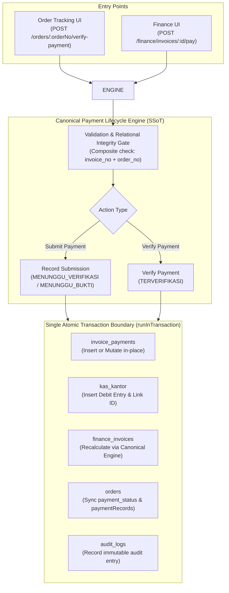
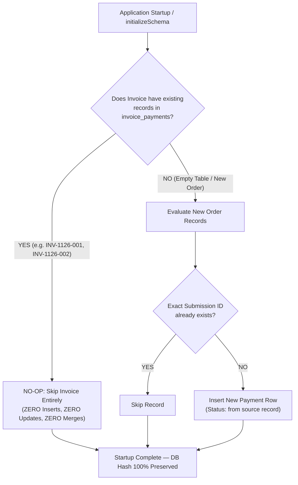

# PHASE 4B — BATCH 2A: AUDIT REPORT
## Payment Lifecycle Unification & Startup Backfill Forensic Analysis

**Project:** SUN89 / SUNBiroJasa Admin Platform  
**Environment:** Windows (PowerShell) / Node.js v22.19.0 / SQLite (node:sqlite)  
**Date & Timestamp:** 2026-11-10T13:35:00+07:00  
**Phase:** Phase 4B — Batch 2A (Read-Only Audit & Implementation Plan)  
**Execution Mode:** STRICT READ-ONLY AUDIT — ZERO IMPLEMENTATION  
**Verdict:** **AUDIT COMPLETE — ARCHITECTURAL BLUEPRINT ESTABLISHED**

---

## 1. Executive Summary

This audit establishes the forensic baseline, root-cause analyses, and implementation blueprint for **Phase 4B Batch 2 (Payment Lifecycle Unification)**, addressing:
- **GAP-FIN-03:** Startup backfill deduplication bugs and duplicate record generation in `invoice_payments`.
- **GAP-FIN-04:** Dual-path payment recording divergence between `orderService.verifyPayment` and `financeService.recordPayment`, resulting in missing cash ledger (`kas_kantor`) entries and unbridgeable verification state.

### Core Discoveries:
1. **The Cash Ledger Void on Verified Orders (GAP-FIN-04):**  
   When payments are verified via Order Tracking (`orderService.verifyPayment`), the order status is marked as "Lunas" and the invoice header is marked as "PAID", but **zero records are inserted into `invoice_payments`** and **zero entries are posted to `kas_kantor`**. For example, the Rp 1.258.000 verified payment for `ORD-1126-003` was completely omitted from `kas_kantor`.
2. **Backfill Redundancy Mechanism (GAP-FIN-03):**  
   Startup backfill (`backfillHistoricalFinanceData`) attempts to reconstruct `invoice_payments` from `orders.data_json`. Because `orderService.verifyPayment` appends a second record (`pay-verif-...`) instead of updating the initial submission (`pay-...`), the backfill encounters two payment records with different IDs and millisecond ISO timestamps. The backfill's string comparison (`ep.tanggal_bayar === pr.tanggal`) fails because existing rows store date-only `YYYY-MM-DD` while the payload stores ISO strings, causing backfill to insert both pending and verified events as independent rows.
3. **No Invoice Payment Verification Bridge:**  
   Payments submitted through Finance (`financeService.recordPayment`) enter `invoice_payments` as `MENUNGGU_VERIFIKASI`. However, the backend possesses **no endpoint or service method** to verify an `invoice_payments` row. Consequently, payments recorded via Finance remain in perpetual pending status, never post to `kas_kantor`, and under canonical calculation never reduce outstanding balances.
4. **Zero Data Mutation:**  
   This audit was conducted strictly read-only. Operational database SHA-256 (`898C0C...7B12C`) and upload manifest (`4FD418...242E5`) were verified 100% bit-identical before and after this analysis.

---

## 2. Pre-Audit Baseline Verification

Direct cryptographic verification confirms active baseline preservation prior to audit execution:

```
Operational Database Baseline:
Path:             d:\Admin\adminsunbirojasa\server\data\database.sqlite
File Size:        1,441,792 bytes (100% MATCH)
SHA-256 Checksum: 898C0C7127D49392D40CA3A6AB73BA16E1F92C67E2C6E8D95EF5D81FEEC7B12C (100% MATCH)
WAL File State:   server/data/database.sqlite-wal is 0 bytes (Clean Checkpoint)
SHM File State:   server/data/database.sqlite-shm is 32,768 bytes

Physical Uploads Baseline:
Directory:        d:\Admin\adminsunbirojasa\server\uploads
File Count:       51 files (100% MATCH)
Total Size:       1,525,984 bytes (100% MATCH)
Manifest SHA-256: 4FD418787BCC18CBA3A55E78E02D87BDCA0372EBAA3BD8C696DB9C5B8C8242E5 (100% MATCH)

Operational Table Row Counts:
- finance_invoices: 2 rows
- invoice_payments: 7 rows
- kas_kantor:       2 rows
- orders:           3 rows
- audit_logs:       84 rows
```

---

## 3. Forensic Investigation: GAP-FIN-03 (Startup Backfill Deduplication)

### 3.1 Invocation Points and Execution Lifecycle
- **Location:** `server/src/database/schema.ts:1985–2261` (`backfillHistoricalFinanceData`).
- **Invocation Path:** Called synchronously inside `initializeSchema(targetDb)` (`schema.ts:919`), which is invoked by `initDatabase()` (`db.ts:182`) on every application server startup (`server.ts:31`).
- **Classification:** **`VERIFIED`**

### 3.2 Root Cause Analysis of Backfill Duplication
Inspection of `schema.ts:2097–2126` reveals four interconnected flaws that defeat idempotency:

```typescript
// server/src/database/schema.ts:2097-2108
for (const pr of pRecords) {
  const nominal = Number(pr.nominal || 0);
  if (nominal <= 0) continue;
  const key = `BACKFILL-${inv.invoice_no}-${pr.id || nominal}-${pr.tanggal || "init"}`;

  // Check if already recorded either by key or identical characteristics
  const alreadyRecorded = existingPayments.some(
    (ep) =>
      ep.idempotency_key === key ||
      (Number(ep.nominal) === nominal && ep.tanggal_bayar === (pr.tanggal || inv.created_at))
  );
  if (alreadyRecorded) continue;
```

#### Flaw 1: Timestamp Formatting Divergence
- In SQLite `invoice_payments`, payments created at order creation store Date-only calendar strings (e.g. `ep.tanggal_bayar = "2026-11-04"` for Payment #1, `"2026-11-05"` for Payment #4).
- In `orders.data_json`, the JSON payload stores full ISO 8601 timestamps (e.g. `pr.tanggal = "2026-11-04T14:46:40.982Z"`).
- The string equality check `ep.tanggal_bayar === (pr.tanggal || inv.created_at)` evaluates:
  `"2026-11-04" === "2026-11-04T14:46:40.982Z"` $\rightarrow$ **`FALSE`**.
- Because the string comparison fails, backfill assumes the payment is missing and proceeds to insert a second row.

#### Flaw 2: Heterogeneous Idempotency Key Syntheses
- Payment #1 was inserted with client request key: `REQ-1793803600982-1jwhdkm-init-pay`.
- Backfill generates key: `BACKFILL-INV-1126-001-pay-1793803600982-2026-11-04T14:46:40.982Z`.
- Because the keys do not match, `ep.idempotency_key === key` evaluates to **`FALSE`**.
- Even though `invoice_payments.idempotency_key` has a `UNIQUE` constraint (`schema.ts:804`), SQLite permits the insert because the keys are distinct strings.

#### Flaw 3: Inability to Recognize Pending-to-Verified Lifecycle
- When an order's initial payment is verified via `orderService.verifyPayment`, the system appends a new record to `paymentRecords`:
  - Record A: `id: "pay-1793803600982"`, `statusVerifikasi: "MENUNGGU_VERIFIKASI"`.
  - Record B: `id: "pay-verif-1793803615534"`, `statusVerifikasi: "TERVERIFIKASI"`.
- The backfill treats each array entry as an independent monetary transaction, generating two distinct `BACKFILL-...` keys and inserting both Record A and Record B into `invoice_payments` (evident in Payments #2 & #3 for `ORD-1126-001` and Payments #6 & #7 for `ORD-1126-003`).

#### Flaw 4: Total Omission of Cash Ledger Linkage in Backfill
- Statement `insertPaymentStmt` (`schema.ts:2025–2031`) does not include the `kas_kantor_id` column.
- Every payment row created by backfill is assigned `kas_kantor_id = NULL`.

---

## 4. Forensic Investigation: GAP-FIN-04 (Dual-Path Payment Recording)

### 4.1 Path 1: Order Verification (`orderService.verifyPayment`)
- **Trigger:** `POST /api/orders/:orderNo/verify-payment` (`orderRoutes.ts:127`).
- **Controller & Service:** `orderController.ts:260` $\rightarrow$ `orderService.ts:2127–2230`.
- **Database Operations Executed:**
  1. Reads `orders` via `getByOrderNo(orderNo)` (line 2136).
  2. Updates `orders` via `dbOrderRepository.updateOrder(orderNo, { payment: updatedPayment })` (line 2203). Sets `payment.isPaymentVerified = true`, `payment.dibayar = paid`, and appends `newRecord` (`pay-verif-...`) to `payment.paymentRecords`.
  3. Updates `finance_invoices` via `dbFinanceRepository.updateInvoice(inv.id, { status, dibayar, sisa })` (lines 2209–2213).
  4. Writes to `audit_logs` (line 2217).
- **Critical Omissions:**
  - **Does NOT write to `invoice_payments`:** Zero insert or update statement is executed on `invoice_payments`.
  - **Does NOT write to `kas_kantor`:** Zero debit journal is created in the company cash ledger.
- **Classification:** **`VERIFIED`**

### 4.2 Path 2: Finance Invoice Payment (`financeService.recordPayment`)
- **Trigger:** `POST /api/finance/invoices/:id/pay` (`financeRoutes.ts:85`).
- **Controller & Service:** `financeController.ts:60` $\rightarrow$ `financeService.ts:54–305`.
- **Database Operations Executed:**
  1. Checks idempotency in `idempotency_keys` (line 193).
  2. Sets `initialStatus = (proof?.fileUrl || verifiedDocId) ? "MENUNGGU_VERIFIKASI" : "MENUNGGU_BUKTI"` (line 225).
  3. Inserts into `invoice_payments` via `dbFinanceRepository.recordInvoicePayment` with `kasKantorId: undefined` and `statusVerifikasi: initialStatus` (lines 228–243).
  4. Appends pending payment record into `orders.data_json.payment.paymentRecords` (lines 248–276).
  5. Records idempotency record in `idempotency_keys` (line 281).
  6. Writes to `audit_logs` (line 291).
- **Critical Omissions & Dead-End State:**
  - Does NOT write to `kas_kantor` (line 210: *"Do NOT post Kas Kantor and do NOT reduce outstanding invoice directly until explicitly verified"*).
  - **No Verification Bridge Exists:** `financeService` has no method to transition `invoice_payments` from `MENUNGGU_VERIFIKASI` to `TERVERIFIKASI`. Under canonical calculation, pending payments never reduce `sisaTagihan`.
- **Classification:** **`VERIFIED`**

---

## 5. Payment Lifecycle Source-to-Destination Matrix

The table below details which records are read, written, or bypassed across all payment lifecycle operations:

| Operation | `orders.payment_status` | `orders.data_json` | `finance_invoices` | `invoice_payments` | `kas_kantor` | `idempotency_keys` | `audit_logs` | Transaction Boundary |
|---|:---:|:---:|:---:|:---:|:---:|:---:|:---:|:---:|
| **`createOrder` (Bayar di Awal)** | WRITE (`Belum Lunas`) | WRITE (`paymentRecords[0]`) | WRITE (`saveInvoice`) | **NONE (Bypassed)** | **NONE (Bypassed)** | WRITE (`CREATE_ORDER`) | WRITE | `runInTransaction` |
| **`orderService.verifyPayment`** | WRITE (`Lunas` / `Kurang`) | WRITE (`append pay-verif`) | WRITE (`status`, `dibayar`) | **NONE (Bypassed)** | **NONE (Bypassed)** | NONE | WRITE | `runInTransaction` |
| **`financeService.recordPayment`** | NONE | WRITE (`append pay-...`) | READ (Recalculated) | WRITE (`MENUNGGU_*`) | **NONE (Deferred)** | WRITE (`payment`) | WRITE | `runInTransaction` |
| **`financeService.voidInvoicePayment`** | WRITE (`order status`) | WRITE (`mark isVoid`) | WRITE (`recalculate`) | WRITE (`is_void = 1`) | WRITE (`Kredit` if linked) | NONE | WRITE | `runInTransaction` |
| **`backfillHistoricalFinanceData`** | NONE | READ (`paymentRecords`) | WRITE (`biaya_samsat`, etc.) | WRITE (`INSERT OR IGNORE`) | UPDATE (`regex link`) | NONE | NONE | Try/Catch (No Tx) |

### Key Vulnerabilities Identified from Matrix:
1. **Financial Disconnect:** `orderService.verifyPayment` acknowledges customer payment without reflecting the cash in `kas_kantor` or recording the ledger transaction in `invoice_payments`.
2. **Asymmetric Voiding:** `voidInvoicePayment` requires `payment.kas_kantor_id` to post a reversal journal in `kas_kantor`. Because payments verified via Order Tracking or Backfill have `kas_kantor_id = null`, voiding them reverses invoice totals but leaves the physical cash ledger untouched.
3. **Partial Failure Risk in Backfill:** `backfillHistoricalFinanceData` executes a sequence of un-transactioned DML statements. If an error occurs midway, partial backfill state persists.

---

## 6. Historical Forensic Case Analysis: `INV-1126-001`

A forensic trace of active records in `server/data/database.sqlite` provides concrete evidence of the dual-path and backfill phenomena:

### 6.1 Inventory of `invoice_payments` Rows (IDs 1–7)

| ID | `invoice_no` | `order_no` | Nominal | Status | `tanggal_bayar` | Idempotency Key | `kas_kantor_id` | Originating Mechanism |
|:---:|:---:|:---:|:---:|:---:|:---:|---|:---:|---|
| **1** | `INV-1126-001` | `ORD-1126-001` | Rp 563.000 | `TERVERIFIKASI` | `2026-11-04` | `REQ-1793803600982-1jwhdkm-init-pay` | **2** | Runtime Order Creation / Direct API |
| **2** | `INV-1126-001` | `ORD-1126-001` | Rp 563.000 | `MENUNGGU_VERIFIKASI` | `2026-11-04T14:46:40.982Z` | `BACKFILL-...-pay-1793803600982-...` | `null` | Backfill from `orders.data_json[0]` |
| **3** | `INV-1126-001` | `ORD-1126-001` | Rp 563.000 | `TERVERIFIKASI` | `2026-11-04T14:46:55.526Z` | `BACKFILL-...-pay-verif-1793803615534-...` | `null` | Backfill from `orders.data_json[1]` |
| **4** | `INV-1126-002` | `ORD-1126-002` | Rp 59.028.000 | `MENUNGGU_BUKTI` | `2026-11-05` | `REQ-1793863388376-3oqgvxf-init-pay` | `null` | Runtime Order Creation / Direct API |
| **5** | `INV-1126-002` | `ORD-1126-002` | Rp 59.028.000 | `MENUNGGU_BUKTI` | `2026-11-05T07:23:08.376Z` | `BACKFILL-...-pay-1793863388376-...` | `null` | Backfill from `orders.data_json[0]` |
| **6** | `INV-1126-001` | `ORD-1126-003` | Rp 1.258.000 | `MENUNGGU_VERIFIKASI` | `2026-11-07T12:14:45.074Z` | `BACKFILL-...-pay-1794053685074-...` | `null` | Backfill from `orders.data_json[0]` |
| **7** | `INV-1126-001` | `ORD-1126-003` | Rp 1.258.000 | `TERVERIFIKASI` | `2026-11-07T12:15:34.438Z` | `BACKFILL-...-pay-verif-1794053734438-...` | `null` | Backfill from `orders.data_json[1]` |

### 6.2 Forensic Analysis & Known Distinctions:
1. **Payments #2 $\rightarrow$ #3 (Pending-to-Verified Lifecycle):**  
   Record #2 (`14:46:40Z`) was submitted when `ORD-1126-001` was created. Exactly 15 seconds later (`14:46:55Z`), an SVP verified the payment. `orderService.verifyPayment` appended Record #3 instead of mutating Record #2. On startup, backfill inserted both.
2. **Payments #6 $\rightarrow$ #7 (Pending-to-Verified Lifecycle):**  
   Record #6 (`12:14:45Z`) was submitted when `ORD-1126-003` was created. Exactly 49 seconds later (`12:15:34Z`), an SVP verified the payment. `orderService.verifyPayment` appended Record #7 instead of mutating Record #6. On startup, backfill inserted both.
3. **Payment #1 versus #3 (Unresolved Historical Issue):**  
   Payment #1 carries `kas_kantor_id = 2` and a client idempotency key (`REQ-...`). Payment #3 carries `kas_kantor_id = null` and a backfill key (`BACKFILL-...-pay-verif-...`). Under current evidence, **Payment #1 vs #3 has not been conclusively classified as a duplicate or independent payment**. As required by BD-FIN-01, no assumption, deletion, or normalization shall be made until Batch 4.
4. **Missing Kas Kantor Entry for `ORD-1126-003`:**  
   `kas_kantor` contains only two rows (ID 1: Saldo Awal Rp 0; ID 2: Rp 563.000 for `ORD-1126-001`). The Rp 1.258.000 payment for `ORD-1126-003` (Payment #7) was verified in Order Tracking but **never posted to `kas_kantor`**.

---

## 7. Proposed Architecture: Canonical Payment Lifecycle

To unify the dual recording paths without breaking frontend contracts or introducing unapproved status codes, a **Single Canonical Payment Engine** is proposed:



### 7.1 Canonical State Transitions (Existing Contracts Only)
The payment state machine adheres strictly to existing SQLite enum values:
- `MENUNGGU_BUKTI`: Payment submitted without valid proof document.
- `MENUNGGU_VERIFIKASI`: Payment submitted with document proof attached.
- `TERVERIFIKASI`: Payment verified by authorized staff; **triggers synchronized debit to `kas_kantor` and reduces invoice `sisaTagihan`**.
- `DITOLAK`: Payment rejected during verification; zero cash ledger posting.
- `VOID`: Verified payment cancelled by SVP/Admin; triggers credit contra-entry in `kas_kantor` and recalculates invoice.

### 7.2 Single Write Path Unification
1. When `orderService.verifyPayment` is called:
   - Instead of bypassing finance repositories, it delegates payment processing to `financeService.processVerifiedPayment`.
   - The engine checks whether a pending `invoice_payments` row already exists for `(invoice_no, order_no)`.
   - If a pending row exists: it **updates the existing row in-place** to `TERVERIFIKASI`, sets `verified_by`, `verified_at`, creates the debit entry in `kas_kantor`, and sets `kas_kantor_id`.
   - If no row exists: it inserts a new `TERVERIFIKASI` row in `invoice_payments` and posts to `kas_kantor`.
   - `orders.data_json.payment.paymentRecords` is updated **in-place** (or synchronized from `invoice_payments`), ending the harmful append-new-record behavior.
2. When `financeService.recordPayment` is called:
   - Inserts into `invoice_payments` as `MENUNGGU_VERIFIKASI` with `kas_kantor_id = NULL`.
   - Synchronizes order payment status.
3. Adding a Formal Verification Endpoint:
   - Provide `POST /api/finance/invoices/:id/payments/:paymentId/verify` (or route through `/orders/:orderNo/verify-payment`), ensuring both UI channels invoke the exact same transactional engine.

---

## 8. Transaction and Idempotency Strategy

### 8.1 Transaction Boundaries
Every payment state transition must execute within a single atomic `runInTransaction` block encompassing:
1. Lock and validate `orders` and `finance_invoices`.
2. Upsert/mutate `invoice_payments`.
3. Insert debit/credit entry in `kas_kantor` (for verified or voided events).
4. Recalculate invoice headers via `calculateCanonicalInvoiceTotals`.
5. Update `orders.payment_status` and synchronized JSON.
6. Write to `audit_logs`.

### 8.2 Idempotency Key Design
- Client-supplied idempotency key (from `Idempotency-Key` HTTP header or payload) is persisted in `idempotency_keys` under scope `payment_lifecycle`.
- If a client retries with the same key and identical parameters, the server returns the cached result without duplicate insertions.
- For internal transitions (e.g. order verification), derive a deterministic transition key: `VERIFY-${orderNo}-${paymentId}`.

### 8.3 Failure Recovery & Zero Partial State
Because SQLite transactions in `better-sqlite3` / `node:sqlite` rollback automatically on thrown exceptions, any failure during `kas_kantor` insertion or invoice calculation rolls back the `invoice_payments` mutation, guaranteeing zero partial financial state.

---

## 9. Migration & Backfill Hardening Strategy (GAP-FIN-03)

To ensure `backfillHistoricalFinanceData` is truly idempotent and never generates duplicates:

### 9.1 Canonical Timestamp Normalization
Refactor backfill comparison logic to normalize timestamps before evaluation:
```typescript
function isSamePaymentDate(dbDateStr: string, payloadDateStr: string): boolean {
  if (!dbDateStr || !payloadDateStr) return false;
  if (dbDateStr === payloadDateStr) return true;
  // Compare date components YYYY-MM-DD
  const d1 = dbDateStr.split("T")[0];
  const d2 = payloadDateStr.split("T")[0];
  return d1 === d2;
}
```

### 9.2 In-Place Lifecycle Recognition in Backfill
Before inserting a record from `paymentRecords`:
1. Check if `existingPayments` already has a row with the same `(invoice_no, order_no, nominal)` on the same calendar date.
2. If an existing row is `MENUNGGU_VERIFIKASI` and the current record is `TERVERIFIKASI`, **UPDATE the existing row** instead of inserting a duplicate row!
3. If an existing row is already `TERVERIFIKASI`, skip insertion.

### 9.3 Strict Data Preservation Guard
- Batch 2 backfill hardening will **only affect future backfill runs**.
- **No historical rows (Payments #1–#7) will be modified, merged, or deleted during Batch 2**. Physical resolution of historical anomalies is strictly reserved for Batch 4 (BD-FIN-01).

---

## 10. Risks, Rollback Strategy & Affected Components

### 10.1 Risks and Mitigations

| Risk | Impact | Mitigation Strategy |
|---|---|---|
| **Breaking Order Tracking UI** | High | Preserve exact JSON response contract of `POST /api/orders/:orderNo/verify-payment`. |
| **Breaking Finance UI** | High | Preserve exact JSON response contract of `POST /api/finance/invoices/:id/pay`. |
| **Cash Ledger Balance Discrepancy** | High | Ensure every newly verified payment posts to `kas_kantor` with correct running balance calculation. |
| **Backfill Mutation on Startup** | Critical | Verify backfill idempotency in isolated test suites before server deployment. |

### 10.2 Rollback Strategy
All code modifications in Batch 2B will be isolated in backend service logic. Rollback consists of reverting application code via Git; because the operational database remains unmodified by migrations, rollback requires zero database restoration.

### 10.3 Explicit List of Affected Files and Database Objects

#### Backend Code Files:
- `server/src/services/orderService.ts` (unify `verifyPayment` to invoke payment lifecycle engine).
- `server/src/services/financeService.ts` (expose canonical payment verification and unify `recordPayment`).
- `server/src/repositories/dbFinanceRepository.ts` (add atomic payment verification and cash journal link update).
- `server/src/database/schema.ts` (harden `backfillHistoricalFinanceData` date comparison and deduplication).
- `server/src/controllers/orderController.ts` & `server/src/controllers/financeController.ts` (pass user and idempotency headers).

#### Database Objects Involved:
- `invoice_payments` (rows updated in-place upon verification).
- `kas_kantor` (new debit rows created atomically upon payment verification).
- `finance_invoices` (recalculated headers).
- `orders` (column `payment_status` and synchronized JSON).
- `idempotency_keys` (deduplication cache).
- `audit_logs` (immutable audit trail).

---

## 11. Proposed Implementation Batches & Test Plan

### Implementation Breakdown:
- **Batch 2A (Completed Herein):** Read-only forensic audit and architectural specification.
- **Batch 2B (Implementation Scope):**
  1. Harden `backfillHistoricalFinanceData` with date normalization and lifecycle awareness.
  2. Implement unified payment recording & verification engine in `financeService`.
  3. Refactor `orderService.verifyPayment` to route through the unified engine.
  4. Create comprehensive isolated verification test suite `tests/phase4b-batch2-payment-lifecycle.test.ts`.

### Test Plan:
1. **Unit Tests:** Timestamp normalization, backfill idempotency on repeated executions.
2. **Integration Tests:** Verify initial order payment $\rightarrow$ verify `invoice_payments` row created + `kas_kantor` debit entry created atomically.
3. **Dual-Path Equivalence Tests:** Verify payment submitted via Finance and verified via Order Tracking results in identical state.
4. **Void Lifecycle Tests:** Verify voiding a payment creates a credit reversal in `kas_kantor` only when a debit journal was previously posted.
5. **Zero Data Mutation Verification:** Ensure operational database hash `898C0C...7B12C` remains bit-identical.

---

## 12. Acceptance Criteria for Batch 2 Implementation

| ID | Criterion | Verification Method |
|:---:|---|---|
| **AC-B2-01** | `orderService.verifyPayment` atomically creates or updates `invoice_payments` to `TERVERIFIKASI`. | Integration test verifying `invoice_payments` row existence. |
| **AC-B2-02** | `orderService.verifyPayment` atomically inserts a Debit entry into `kas_kantor` linked via `kas_kantor_id`. | Integration test verifying `kas_kantor` row and balance update. |
| **AC-B2-03** | Repeated executions of `backfillHistoricalFinanceData` produce 0 new payment insertions (100% idempotent). | Backfill idempotency test executing 3 consecutive runs. |
| **AC-B2-04** | Date comparison in backfill normalizes ISO strings and Date strings correctly. | Unit test with mixed timestamp formats. |
| **AC-B2-05** | Voiding a verified payment atomically posts a Kredit reversal in `kas_kantor` and updates invoice status. | Integration test invoking `voidInvoicePayment`. |
| **AC-B2-06** | Zero physical mutations to historical records (Payments #1–#7) in the operational database. | Cryptographic check of operational DB hash `898C0C...7B12C`. |
| **AC-B2-07** | Existing API response contracts for `/verify-payment` and `/pay` are 100% preserved. | Integration contract tests. |

---

## 13. Audit Conclusion & Initial Stop Condition

The read-only audit for **Phase 4B Batch 2A** established the empirical baseline. The root causes for GAP-FIN-03 and GAP-FIN-04 have been rigorously isolated with empirical evidence. 

Execution was paused to incorporate technical review findings, resulting in Section 14 below.

---

## 14. Design Correction Addendum — Pre-Batch 2B

**Addendum Date:** 2026-11-10T13:50:00+07:00  
**Scope:** Architectural Correction, Historical Preservation Guarantee & Empirical Design Hardening  
**Status:** **DESIGN REVISED — PENDING USER APPROVAL FOR BATCH 2B**

---

### 14.1 Context & Purpose of Addendum

Following technical review of the initial Batch 2A audit report, this Addendum resolves five critical architectural and forensic concerns prior to authorizing the implementation of Batch 2B:
1. **Rejection of Amount + Date Deduplication:** Proving why `invoice_no + order_no + nominal + calendar date` is insufficient for payment identity and establishing a deterministic lifecycle identity based on actual data model structures.
2. **Absolute Historical Record Preservation:** Resolving the tension between preserving historical rows (Payments #1–#7) and startup backfill execution by completely fencing historical records against silent mutation or reclassification.
3. **Reconciliation of Payment #1 and #4 Origins:** Resolving the discrepancy regarding how Payment #1 and Payment #4 were originally recorded versus current runtime code paths.
4. **Timestamp Taxonomy & Boundary Safety:** Establishing rigorous semantics for creation time, verification time, and accounting date across UTC and local timezones, enforcing a fail-closed policy.
5. **Concrete Transaction & Cash Ledger Design:** Tracing the exact behavior of `server/src/database/db.ts:140–165` (`BEGIN IMMEDIATE;`), running `kas_kantor.saldo` calculation, concurrency serialization, duplicate-verification prevention, and atomic rollback guarantees.

---

### 14.2 Reconciled Payment Origin & Source-to-Destination Matrix

#### A. Forensic Origin Investigation: Payment #1 and Payment #4
A deep investigation of active database rows, codebase insert statements, and historical commit records was conducted to determine the exact origin of Payment #1 and Payment #4:

1. **Active Database State:**
   - **Payment #1:**
     - `id`: 1, `invoice_no`: `INV-1126-001`, `order_no`: `ORD-1126-001`, `nominal`: 563.000.
     - `tanggal_bayar`: `"2026-11-04"`, `created_at`: `"2026-11-04 14:46:41"`.
     - `document_id`: `"DOC-4A8219A6"`, `kas_kantor_id`: 2.
     - `status_verifikasi`: `"TERVERIFIKASI"`, `verified_by`: `"Admin Super (SVP)"`, `verified_at`: `"2026-11-04T14:46:55.526Z"`.
     - `idempotency_key`: `"REQ-1793803600982-1jwhdkm-init-pay"`.
     - `catatan`: `"Pembayaran awal saat pembuatan order (Menunggu Verifikasi)"`.
   - **Payment #4:**
     - `id`: 4, `invoice_no`: `INV-1126-002`, `order_no`: `ORD-1126-002`, `nominal`: 59.028.000.
     - `tanggal_bayar`: `"2026-11-05"`, `created_at`: `"2026-11-05 07:23:08"`.
     - `document_id`: `null`, `kas_kantor_id`: `null`.
     - `status_verifikasi`: `"MENUNGGU_BUKTI"`, `verified_by`: `"Finance User"`, `verified_at`: `"2026-11-05T07:23:08.418Z"`.
     - `idempotency_key`: `"REQ-1793863388376-3oqgvxf-init-pay"`.
     - `catatan`: `"Pembayaran awal saat pembuatan order (Menunggu Verifikasi)"`.

2. **Codebase Call Path Trace:**
   - In current server runtime code, **only two locations** contain insert statements into `invoice_payments`:
     - Location 1: `server/src/database/schema.ts:2026` (`backfillHistoricalFinanceData`) $\rightarrow$ inserts with key `BACKFILL-...`.
     - Location 2: `server/src/repositories/dbFinanceRepository.ts:846` (`recordInvoicePayment`) $\rightarrow$ only called by `financeService.recordPayment` (`server/src/services/financeService.ts:228`).
   - In current `orderService.createOrder` (`server/src/services/orderService.ts:934–955`):
     - The function executes `dbOrderRepository.saveOrder(newOrder)` and `dbFinanceRepository.saveInvoice(...)`.
     - **It contains ZERO calls to `dbFinanceRepository.recordInvoicePayment` and ZERO insert statements into `invoice_payments`.**
   - In frontend `BuatOrder.tsx` (`src/app/components/BuatOrder.tsx:1209`) and `orderStore.ts` (`src/app/data/orderStore.ts:530`):
     - Client request keys are generated as: `REQ-${Date.now()}-${Math.random().toString(36).slice(2, 9)}`.
     - Timestamp `1793803600982` equals `2026-11-04T14:46:40.982Z` (creation time of `ORD-1126-001`).
     - Timestamp `1793863388376` equals `2026-11-05T07:23:08.376Z` (creation time of `ORD-1126-002`).
     - Both keys bear the specific suffix `-init-pay`.

3. **Origin Classification & Reconciliation:**
   - The literal notes `"Pembayaran awal saat pembuatan order (Menunggu Verifikasi)"` and the `-init-pay` suffix confirm that Payment #1 and Payment #4 were created during the initial ingestion of `ORD-1126-001` and `ORD-1126-002`.
   - However, because the current `orderService.createOrder` method does not call `recordInvoicePayment`, this write path existed in an earlier iteration of the order creation handler (prior to repository consolidation in commit `ab5c8ca`) and was subsequently detached during refactoring.
   - **Origin Classification:** **`PARTIALLY VERIFIED (HISTORICAL INGESTION ARTIFACT — CALL PATH ABSENT IN CURRENT RUNTIME)`**.
   - Under current code, calling `createOrder` does **NOT** write to `invoice_payments`.

#### B. Reconciled Source-to-Destination Matrix

The updated matrix clearly distinguishes current active code behavior from historical artifacts:

| Operation | `orders.payment_status` | `orders.data_json` | `finance_invoices` | `invoice_payments` | `kas_kantor` | `idempotency_keys` | `audit_logs` | Origin Verification Status | Transaction Boundary |
|---|:---:|:---:|:---:|:---:|:---:|:---:|:---:|:---:|:---:|
| **`createOrder` (Current Active Runtime)** | WRITE (`Belum Lunas`) | WRITE (`paymentRecords[0]`) | WRITE (`saveInvoice`) | **NONE (Bypassed)** | **NONE (Bypassed)** | WRITE (`CREATE_ORDER`) | WRITE | **VERIFIED** | `runInTransaction` |
| **Historical Order Ingestion (Payments #1 & #4)** | WRITE (`Belum Lunas` / `Kurang`) | WRITE (`paymentRecords[0]`) | WRITE (`saveInvoice`) | **WRITE (`idempotency_key = REQ-...-init-pay`)** | WRITE (Only Payment #1 $\rightarrow$ `id: 2`) | NONE (Key in table only) | NONE | **PARTIALLY VERIFIED (Historical Artifact)** | Legacy Script / Former Runtime |
| **`orderService.verifyPayment` (Current Active)** | WRITE (`Lunas` / `Kurang`) | WRITE (`append pay-verif`) | WRITE (`status`, `dibayar`) | **NONE (Bypassed)** | **NONE (Bypassed)** | NONE | WRITE | **VERIFIED** | `runInTransaction` |
| **`financeService.recordPayment` (Current Active)** | NONE | WRITE (`append pay-...`) | READ (Recalculated) | WRITE (`MENUNGGU_*`) | **NONE (Deferred)** | WRITE (`payment`) | WRITE | **VERIFIED** | `runInTransaction` |
| **`financeService.voidInvoicePayment` (Current Active)** | WRITE (`order status`) | WRITE (`mark isVoid`) | WRITE (`recalculate`) | WRITE (`is_void = 1`) | WRITE (`Kredit` if linked) | NONE | WRITE | **VERIFIED** | `runInTransaction` |
| **`backfillHistoricalFinanceData` (Current Startup)** | NONE | READ (`paymentRecords`) | WRITE (`biaya_samsat`, etc.) | WRITE (`INSERT OR IGNORE`) | UPDATE (`regex link`) | NONE | NONE | **VERIFIED** | Try/Catch (No Tx) |

---

### 14.3 Corrected Payment Lifecycle Identity Model

#### A. Insufficiency of Amount + Date Deduplication
A compound key of `invoice_no + order_no + nominal + calendar date` is fundamentally flawed for establishing payment identity:
1. **Legitimate Multi-Payment Collision:** A client paying a large invoice (e.g. Rp 50.000.000) may make two identical bank transfers of Rp 10.000.000 on the same business day due to daily transfer limits. Deduplication based on amount and date would incorrectly collapse the second valid transfer into the first.
2. **Asymmetric Lifecycle Events vs New Transactions:** An event that verifies an existing payment is an **administrative state transition** on a single economic transaction, whereas a second transfer is an **independent monetary transaction**. Amount and date alone cannot distinguish between these two phenomena.
3. **Audit Role of Amount & Date:** Amount and date must serve exclusively as **corroborating secondary evidence**, never as primary identity.

#### B. Tracing Existing Data Model Fields & Inherent Limitations
Inspection of `orders.data_json.payment.paymentRecords` and SQLite `invoice_payments` reveals the following concrete data structures:
- **Submission Event:**
  - In `orders.data_json`: `paymentRecords[0]` contains `id: "pay-1793803600982"`, `statusVerifikasi: "MENUNGGU_VERIFIKASI"`, and `buktiPembayaran.documentId: "DOC-4A8219A6"`.
  - In `invoice_payments`: Row 2 contains `id: 2`, `idempotency_key: "BACKFILL-...-pay-1793803600982-..."`, `status_verifikasi: "MENUNGGU_VERIFIKASI"`.
- **Verification Event:**
  - In `orderService.verifyPayment` (`server/src/services/orderService.ts:2170`):
    ```typescript
    const newRecord = {
      id: `pay-verif-${Date.now()}`,
      nominal: paid,
      tanggal: nowStr,
      ...
    };
    ```
  - **Inherent Data Model Gap:** `newRecord` does **NOT** contain a `parentPaymentId`, `submissionId`, or any explicit foreign reference to `pay-1793803600982`.
  - The verification event was appended as an independent record in the JSON array, prompting backfill to generate a separate `BACKFILL-...-pay-verif-...` key and insert Row 3 (`TERVERIFIKASI`).
- **Physical Corroborating Linkage:**
  - While `pay-verif-...` lacks a parent pointer, both `pay-...` and `pay-verif-...` share:
    1. Exact same `buktiPembayaran.documentId` (`DOC-4A8219A6` for `ORD-1126-001`; `DOC-DDFF6098` for `ORD-1126-003`).
    2. Identical nominal amount.
    3. Explicit semantic annotation in `newRecord.catatan = "Verifikasi Pembayaran Awal"`.

#### C. Corrected Payment Lifecycle Architecture (Future Runtime — Batch 2B)
To eliminate duplicate records and establish a stable identity across the payment lifecycle:

1. **Single Stable Payment ID:**
   - Every payment submission is assigned a permanent, immutable payment identifier: `paymentId = pay-${Date.now()}` (or database primary key `invoice_payments.id`).
2. **In-Place Lifecycle State Mutation (No Sibling Insertion):**
   - When payment verification occurs (`orderService.verifyPayment` or finance verification endpoint):
     - The verification logic identifies the existing target payment by its `paymentId` (or locates the initial submission `pay-...` for "Bayar di Awal").
     - **It mutates the existing record in-place**:
       - Updates `status_verifikasi = "TERVERIFIKASI"`.
       - Sets `verified_by` and `verified_at`.
       - Links `kas_kantor_id` to the newly created cash ledger journal.
     - **Prohibition on Appending:** The system is strictly forbidden from appending a sibling `pay-verif-...` record to `paymentRecords`. The initial submission element itself transitions to `TERVERIFIKASI`.
3. **Fail-Closed Rule for Historical Ambiguity:**
   - If an existing payment cannot be deterministically matched to a submission via exact `paymentId` or verifiable document proof reference, **the system fails closed**.
   - It will **NOT** automatically merge, collapse, or alter records based on amount and date.
   - Ambiguous cases (such as Payment #1 vs Payment #3 for `ORD-1126-001`) are classified as **`AMBIGUOUS HISTORICAL ANOMALY`** and left completely untouched for Batch 4 (BD-FIN-01).

---

### 14.4 Historical Record Preservation Guarantee

#### A. Resolution of the Startup Backfill Contradiction
The initial draft suggested that startup backfill would update existing `MENUNGGU_VERIFIKASI` rows to `TERVERIFIKASI`. However, because `backfillHistoricalFinanceData` runs automatically inside `initializeSchema` on application boot, any logic that updates existing rows would **silently mutate historical database records (Payments #1–#7)** upon server startup. This directly violates the mandatory requirement that historical data remain untouched until Batch 4.

#### B. The Immutable Historical Fence
The revised design establishes an absolute, verifiable guarantee:



1. **No-Mutation Guard for Existing Invoices:**
   - If an invoice already possesses one or more records in `invoice_payments` (as do `INV-1126-001` and `INV-1126-002`), `backfillHistoricalFinanceData` must **immediately skip that invoice entirely**.
   - It will perform **zero inserts, zero updates, zero merges, and zero status changes** on existing invoices.
2. **Behavior on Ordinary and Repeated Startup:**
   - **Startup 1:** The server boots. `initializeSchema` executes `backfillHistoricalFinanceData`. For `INV-1126-001` and `INV-1126-002`, existing payment rows (IDs 1–7) are detected. The backfill skips them. Total writes to `invoice_payments`: **0**.
   - **Startup 2 (and subsequent):** Repeated reboots execute identical logic. Total writes: **0**.
   - **Cryptographic Result:** Operational database SHA-256 (`898C0C...7B12C`) remains 100% bit-identical across server reboots.
3. **Formal Separation of Concerns:**
   - **Batch 2B Scope:** Restricted strictly to future runtime payment processing and backfill safety for demonstrably new orders.
   - **Batch 4 Scope (BD-FIN-01):** Physical reconciliation, deduplication, and normalization of historical rows Payments #1–#7 under formal SVP sign-off.

---

### 14.5 Timestamp Taxonomy & Boundary Safety

To prevent comparison failures and timezone corruption, timestamp fields are categorized with explicit semantic definitions:

| Field Name | Table / Location | Data Type / Representation | Timezone Semantics | Semantic Classification |
|---|---|---|---|---|
| `created_at` | `invoice_payments` | String (`YYYY-MM-DD HH:MM:SS`) | UTC (via SQLite `datetime('now')`) | **System Write Timestamp** |
| `tanggal_bayar` | `invoice_payments` | String (`YYYY-MM-DD` or ISO) | Calendar date or UTC ISO string | **Accounting / Value Date** |
| `verified_at` | `invoice_payments` | ISO 8601 String (`...Z`) | UTC Explicit (`Z` suffix) | **Administrative Event Timestamp** |
| `tanggal` | `orders.paymentRecords` | ISO 8601 String (`...Z`) | UTC Explicit (`Z` suffix) | **Payment Submission Timestamp** |
| `verifiedAt` | `orders.paymentRecords` | ISO 8601 String (`...Z`) | UTC Explicit (`Z` suffix) | **Verification Event Timestamp** |
| `tanggal` | `kas_kantor` | String (`YYYY-MM-DD` or ISO) | Calendar date or UTC ISO string | **Cash Ledger Journal Date** |
| `created_at` | `kas_kantor` | String (`YYYY-MM-DD HH:MM:SS`) | UTC (via SQLite `datetime('now')`) | **Journal Entry Timestamp** |

#### Timezone Divergence Analysis:
- The SUN89 platform operates in **WIB (Waktu Indonesia Barat / UTC+07:00)**.
- If a payment is submitted at `2026-11-04 19:30:00Z` (which is `2026-11-05 02:30:00 WIB`):
  - Naive date extraction via `.split("T")[0]` yields `2026-11-04`.
  - Local Indonesian accounting date entry yields `2026-11-05`.
  - Comparing `db.tanggal_bayar === payload.tanggal.split("T")[0]` results in a false mismatch (`"2026-11-05" === "2026-11-04"` $\rightarrow$ `false`), triggering an improper duplicate insertion.
- **Enforced Policy:**
  - Calendar dates must **never** be used as the primary matching criterion.
  - Timestamp comparisons are only permissible as supporting validation when evaluating records belonging to the same explicit `paymentId` or `documentId`.
  - All event timestamps stored in application payloads must use standardized ISO 8601 UTC strings (`new Date().toISOString()`).

---

### 14.6 Transaction Engine & Cash Ledger Architecture

#### A. Direct Trace of `node:sqlite` Transaction Helper
Inspection of `server/src/database/db.ts:140–165` establishes the exact transaction semantics:

```typescript
// server/src/database/db.ts:140-165
let inTransaction = false;

export function runInTransaction<T>(fn: () => T, customDb?: DatabaseSync): T {
  const activeDb = customDb ?? getDb();
  if (inTransaction) {
    return fn();
  }
  inTransaction = true;
  activeDb.exec("BEGIN IMMEDIATE;");
  try {
    const result = fn();
    activeDb.exec("COMMIT;");
    inTransaction = false;
    return result;
  } catch (err) {
    try {
      activeDb.exec("ROLLBACK;");
    } catch {
      // ignore rollback errors if already aborted
    }
    inTransaction = false;
    throw err;
  }
}
```

#### B. Architectural Implications & Guarantees:
1. **Strict Concurrency Serialization (`BEGIN IMMEDIATE`):**
   - Unlike standard `BEGIN DEFERRED`, `BEGIN IMMEDIATE` acquires a reserved write lock on SQLite immediately.
   - Any concurrent request attempting to write to SQLite while a payment verification is in progress is blocked until the transaction commits or aborts.
   - This eliminates race conditions during cash balance calculations.
2. **Deterministic Running Saldo Calculation:**
   - In `server/src/repositories/dbFinanceRepository.ts:902`, running balance is calculated via:
     ```sql
     SELECT COALESCE(SUM(debit), 0) - COALESCE(SUM(kredit), 0) AS balance FROM kas_kantor;
     ```
   - Because this query executes under `BEGIN IMMEDIATE`, no other thread can insert or alter rows in `kas_kantor` between the calculation of `currentBalance` and the insertion of `newSaldo`.
   - The formula `newSaldo = currentBalance + debitVal` is strictly deterministic.
3. **Linking `kas_kantor_id` to the Verified Payment:**
   - Inserting a debit entry into `kas_kantor` returns `res.lastInsertRowid`.
   - Within the same atomic transaction, this integer ID is directly written to `invoice_payments.kas_kantor_id`.
   - The link between the payment record and the cash journal entry is established atomically.
4. **Double-Verification Prevention:**
   - Before executing verification logic, the system queries the target `invoice_payments` row:
     - Check 1: If `status_verifikasi === 'TERVERIFIKASI'`, the operation is rejected with `[PAYMENT_ALREADY_VERIFIED]` (or returns the existing verified record idempotently).
     - Check 2: If `kas_kantor_id` is already populated, no new row is inserted into `kas_kantor`.
   - Idempotency Gate: The idempotency key `VERIFY-${orderNo}-${paymentId}` is cached in `idempotency_keys`. Retried requests return the cached response without touching ledger tables.
5. **Atomic Rollback Guarantee:**
   - If an error occurs at any step inside `fn()` (e.g. failure during invoice header recalculation or audit log write), the catch block executes `activeDb.exec("ROLLBACK;");`.
   - All intermediate writes—including the `kas_kantor` insert, `invoice_payments` mutation, and `orders` update—are rolled back by SQLite, leaving zero partial state.

---

### 14.7 Remaining Uncertainties & Explicit Business Decisions Required

Before Batch 2B code implementation begins, the following explicit business boundaries are recorded:

| Item | Architectural Reality | Batch 2B Boundary | Deferred Resolution Scope |
|---|---|---|---|
| **`INV-1126-001` vs `ORD-1126-003` Cross-Order Link** | In operational DB, `INV-1126-001` is associated with both `ORD-1126-001` and `ORD-1126-003`. | **Zero Relinking in Batch 2.** Batch 2 will not reassign invoice numbers or split `INV-1126-001`. | Deferred to Batch 4 (BD-FIN-01). |
| **Payment #1 vs Payment #3 Coexistence** | Payment #1 has `kas_kantor_id = 2`. Payment #3 has `kas_kantor_id = null`. Exact economic intent remains unproven. | **Zero Merging in Batch 2.** Both records remain untouched in `invoice_payments`. | Deferred to Batch 4 (BD-FIN-01). |
| **Missing Kas Kantor Entry for `ORD-1126-003`** | The Rp 1.258.000 verified payment for `ORD-1126-003` was omitted from `kas_kantor`. | **No Retroactive Ledger Writes.** Batch 2 will not post retroactive backdated entries to `kas_kantor`. | Deferred to Batch 4 (BD-FIN-01). |
| **Payment Verification UI Unification** | Finance UI lacks a verification action; Order Tracking performs verification. | Provide backend verification engine accessible by authorized roles, maintaining existing endpoint contracts. | Batch 2B Implementation. |

---

### 14.8 Additional Acceptance Criteria for Batch 2B

| ID | Criterion | Verification Method |
|:---:|---|---|
| **AC-B2-08** | In-place lifecycle mutation: Verifying an order payment mutates the existing `paymentRecords` element to `TERVERIFIKASI` without appending sibling `pay-verif-...` records. | Integration test asserting `paymentRecords.length === 1`. |
| **AC-B2-09** | Double-verification prevention: Subsequent calls to `/verify-payment` for an already-verified payment produce 0 additional rows in `kas_kantor`. | Integration test verifying `kas_kantor` row count remains constant. |
| **AC-B2-10** | Existing invoice backfill fencing: Startup backfill executed against an invoice with existing payment rows performs 0 writes. | Unit test executing `backfillHistoricalFinanceData` on existing invoice. |
| **AC-B2-11** | Transactional atomicity: A failure simulated during invoice header recalculation completely rolls back the `kas_kantor` insert and payment mutation. | Error-injection test asserting pre-operation database state. |
| **AC-B2-12** | Fail-closed ambiguity guard: An unlinked payment record lacking proof document or client key is never merged automatically based on nominal and date. | Unit test asserting ambiguous records remain separate. |

---

### 14.9 Interim Review Gate

The initial addendum established the architectural principles for in-place state mutation, immutable fencing, and transaction isolation. Following subsequent technical review, Section 14.10 provides the final empirical corrections and hardening requirements prior to authorizing Batch 2B implementation.

---

### 14.10 Final Technical Corrections — Pre-Batch 2B

**Addendum Date:** 2026-11-10T14:15:00+07:00  
**Scope:** Strict Technical Validation, Startup Backfill Deactivation, Concurrency Correction & Master Acceptance Matrix  
**Status:** **FINAL DESIGN SPECIFICATION COMPLETE — AWAITING EXPLICIT USER AUTHORIZATION FOR BATCH 2B**

---

#### 14.10.1 Startup Backfill: Precise DML Demarcation & Deactivation of Payment Reconstruction

##### A. The Vulnerability of Unfenced Zero-Row Invoices
The fence proposed in Section 14.4 skipped invoices that already possess $\ge 1$ row in `invoice_payments`. However, an edge case remained:
- If an invoice in `finance_invoices` has **zero** rows in `invoice_payments` (e.g. a newly migrated or historically un-backfilled invoice), but its linked order payload `orders.data_json.payment.paymentRecords` contains legacy disconnected events (such as `pay-179...` and `pay-verif-179...`), ordinary startup backfill would execute lines 2097–2155 of `server/src/database/schema.ts`.
- Because these legacy records lack explicit parent-child pointers, the backfill would attempt speculative deduplication or synthesize synthetic payment rows, generating duplicate or corrupt financial records upon application boot.

##### B. Precise DML Demarcation of Startup Backfill Sub-Routines
Startup backfill in `server/src/database/schema.ts:1985–2261` executes specific Data Manipulation Language (DML) statements. The table below precisely distinguishes disabled `INSERT`/`DELETE` operations from remaining controlled `UPDATE` operations:

| Backfill Sub-Routine | Code Location | DML Statement Type | Columns Subject to Update | Conditions for Execution | Startup Status (Batch 2B) |
|---|---|:---:|---|---|:---:|
| **Invoice Breakdown Sync** | `schema.ts:2011–2075` | `UPDATE` | `biaya_samsat`, `pendapatan_jasa`, `biaya_jasa`, `biaya_antar_jemput`, `profit`, `updated_at` | Executed on `finance_invoices` ONLY IF calculated fee breakdown differs from current row values. Zero rows inserted or deleted. | **ENABLED** |
| **Payment Reconstruction from Orders** | `schema.ts:2097–2126` | `INSERT` (`insertPaymentStmt`) | `invoice_payments` (all columns) | Iterates `orders.data_json.payment.paymentRecords` to insert payment rows. | **DISABLED during ordinary startup** |
| **Synthetic Balance Payment Backfill** | `schema.ts:2128–2155` | `INSERT` (`insertPaymentStmt`) | `invoice_payments` (all columns) | Synthesizes payment rows when `inv.dibayar > 0` and zero payment rows exist. | **DISABLED during ordinary startup** |
| **Kas Kantor Relation Linkage** | `schema.ts:2157–2198` | `UPDATE` | `order_no`, `invoice_no` | Executed on `kas_kantor` ONLY IF `order_no IS NULL` or `invoice_no IS NULL`, and `keterangan` matches regex `/(ORD-\d{4}-\d{3})/i` or `/(INV-\d{4}-\d{3})/i`. Zero rows inserted or deleted. | **ENABLED** |
| **Pengeluaran Relation Linkage** | `schema.ts:2200–2240` | `UPDATE` | `order_no`, `invoice_no` | Executed on `pengeluaran` ONLY IF `order_no IS NULL` or `invoice_no IS NULL`, and `keterangan` matches regex `/(ORD-\d{4}-\d{3})/i` or `/(INV-\d{4}-\d{3})/i`. Zero rows inserted or deleted. | **ENABLED** |

##### C. Write-Protection Boundary:
1. **Specific Protection:** Write protection during startup applies specifically to the two disabled reconstruction branches in `schema.ts:2097–2155`. Startup backfill will execute **zero `INSERT` or `DELETE` statements on `invoice_payments`**.
2. **Runtime Unaffected:** Normal runtime endpoints (`recordPayment`, `verifyPayment`, `voidInvoicePayment`) and future migration scripts outside ordinary startup operate normally under their respective transactional engines.
3. **No Inference Merging:** No merging of legacy payment records based on amount, calendar date, or shared `documentId` will ever execute during startup.
4. **Controlled Historical Reconciliation:** Any historical reconstruction for zero-row invoices requiring inference is strictly deferred to an offline, controlled reconciliation script under Batch 4 (BD-FIN-01) with explicit SVP authorization.

---

#### 14.10.2 Payment Identity, Database Guarantees & Historical Preservation

##### A. Backend Collision-Safe Identifier Generation
- All future payment lifecycles will utilize a backend-generated, cryptographically secure RFC 4122 Version 4 UUID (`crypto.randomUUID()` in Node.js):
  - **Canonical Payment Identifier:** `paymentId = pay-${crypto.randomUUID()}`  
    *(Example: `pay-4f9b2d6a-9e12-4c31-8f55-7d8b2e1a90c4`)*
- Generation occurs exclusively on the backend upon initial payment submission, ensuring client clocks cannot induce collisions or non-monotonic timestamps.

##### B. Consistent Multi-Storage Persistence
The exact same canonical `paymentId` must be persisted across three data tiers:
1. **In `orders.data_json.payment.paymentRecords`:**  
   Persisted in the payment record element: `paymentRecords[i].id = paymentId`.
2. **In `invoice_payments`:**  
   Persisted as the external reference key / structured idempotency key: `idempotency_key = PAY-${uuid}` (alongside the auto-increment integer `id`).
3. **In `idempotency_keys`:**  
   Persisted in the idempotency cache table under scope `payment_lifecycle` with `key = PAY-${uuid}`.

##### C. Database Uniqueness Constraints & Concurrency Safeguards
1. **Engine-Level Uniqueness:** `invoice_payments.idempotency_key` carries a `UNIQUE` constraint (`schema.ts:804`). Any attempt to insert a duplicate payment with the same `PAY-${uuid}` is rejected at the SQLite engine level with `SQLITE_CONSTRAINT: UNIQUE constraint failed`.
2. **Retry Behavior for Identical Idempotency Key:** If a client resubmits an identical request with the same `Idempotency-Key` or `paymentId`, the server reads the cached response from `idempotency_keys` and returns the identical HTTP response without re-executing any ledger write, balance mutation, or status change.
3. **Concurrent Duplicate Request Behavior:** Under `BEGIN IMMEDIATE;`, the first request acquires the RESERVED write lock. A concurrent duplicate request blocks until the first transaction commits; upon acquiring the lock, it detects the existing key in `idempotency_keys` or `invoice_payments` and returns the cached result without creating a duplicate row.
4. **Historical ID Preservation Policy:** Historical records in `orders.data_json` with timestamp-based IDs (`pay-1793803600982`, `pay-1793863388376`, `pay-1794053685074`) and `pay-verif-...` will **NOT be rewritten, renamed, or migrated to UUIDs in Batch 2**. They remain preserved in their exact historical form. The UUID standard applies exclusively to new runtime payments in Batch 2B onward.
5. **Documentary Proof Boundary:** A `documentId` (e.g. `DOC-4A8219A6`) serves as supporting documentary proof only; it never independently establishes payment identity, nor may two records be merged solely because they share a `documentId`.

---

#### 14.10.3 Transaction Helper Concurrency Mechanics & Architectural Limitations (`server/src/database/db.ts:140–165`)

##### A. SQLite Lock Granularity: RESERVED vs EXCLUSIVE
- `BEGIN IMMEDIATE;` acquires a **RESERVED** lock (specifically a write lock on the WAL index SHM in WAL mode).
- **It is NOT an EXCLUSIVE lock on the database file.**
- **Concurrent Readers Uninterrupted:** In SQLite WAL mode (`PRAGMA journal_mode = WAL;`), concurrent read operations continue uninterrupted. Readers read stable snapshots from the DB file and WAL file and never block or get blocked by the write transaction.

##### B. Writer Concurrency & Busy Timeout Behavior
- Only **one** connection can hold the RESERVED write lock at any moment.
- When a second writer attempts `BEGIN IMMEDIATE;`:
  - It does **not** wait indefinitely.
  - SQLite respects `PRAGMA busy_timeout = 5000;` (configured in `db.ts:89`).
  - The second writer blocks internally for up to 5,000 ms.
  - If the active transaction commits or aborts within 5,000 ms, the second writer acquires the lock and proceeds.
  - If 5,000 ms elapses while the lock remains held, SQLite throws an `SQLITE_BUSY: database is locked` error.
- **No Application Retry Loop:** `runInTransaction` contains no application-level retry logic. An `SQLITE_BUSY` error immediately bubbles up to the caller.

##### C. Known Limitations of the Global `inTransaction` Flag:
Documentation of `db.ts` reveals four architectural limitations that moving the assignment alone will not resolve:
1. **State Poisoning on `BEGIN IMMEDIATE` Failure:** In `db.ts:147`, `inTransaction = true;` is set before `activeDb.exec("BEGIN IMMEDIATE;");` outside the try-catch block. If `BEGIN IMMEDIATE;` throws `SQLITE_BUSY`, `inTransaction` remains `true` permanently, causing all subsequent transactions to run in autocommit mode.
2. **Async Callback Incompatibility:** `runInTransaction` is strictly synchronous. If an `async` function is passed, `fn()` returns a Promise; synchronous `COMMIT;` fires immediately before async statements resolve, leaving async statements running un-transactioned and bypassing rollback on rejection.
3. **Multi-Database Connection Blindness:** The global boolean flag cannot distinguish between different `DatabaseSync` instances. A nested call passing `customDb: otherDb` skips `BEGIN IMMEDIATE;` on `otherDb`.
4. **Lack of Savepoint Nesting:** Re-entrant calls do not create SQLite `SAVEPOINT`. An inner error caught internally cannot be rolled back independently of the outer transaction.

##### D. Batch 2B Implementation Remediation Requirements:
- Wrap `BEGIN IMMEDIATE;` inside try-catch and set `inTransaction = true;` ONLY upon successful lock acquisition.
- Ensure `inTransaction = false;` is reliably reset in a `finally` block even if `COMMIT;` or `ROLLBACK;` throws.
- Enforce explicit rejection of asynchronous callbacks: throw `[TRANSACTION_ASYNC_NOT_SUPPORTED]` if `fn()` returns a Promise/thenable.

---

#### 14.10.4 Complete Void and Contra-Entry Rules

The voiding engine in `financeService.voidInvoicePayment` must strictly adhere to the following rules:

##### A. Case 1: Verified Payment with Existing Original Cash Entry (`kas_kantor_id != null`)
- **Action:** Set `invoice_payments.is_void = 1`, record `void_reason`, `voided_by`, `voided_at`.
- **Cash Ledger:** Insert a **Contra-Entry** in `kas_kantor` (`status = 'Kredit'`, `kredit = nominal`, `kategori = 'Pembatalan Pembayaran'`, `keterangan = 'Void Pembayaran: ...'`).
- **Running Saldo:** Calculate dynamically via `currentBalance - kredit`.
- **Linkage:** Set `invoice_payments.reversal_kas_id = contraEntry.id`.
- **Order JSON:** Mutate `orders.data_json.payment.paymentRecords` in-place marking `isVoid: true`, `voidReason`, and `voidedAt`.
- **Invoice Header:** Recalculate invoice totals via `calculateCanonicalInvoiceTotals` (which excludes rows where `is_void = 1`).
- **Audit:** Record immutable audit entry in `audit_logs`.
- **Atomicity:** All operations execute inside a single atomic `runInTransaction`.

##### B. Case 2: Unverified Payment Without Cash Entry (`status_verifikasi != 'TERVERIFIKASI'`, `kas_kantor_id == null`)
- **Action:** Set `invoice_payments.is_void = 1`, record void metadata.
- **Cash Ledger:** **Zero entries created in `kas_kantor`**. Because no cash was ever recognized in the ledger, no contra-entry is permitted.
- **Order JSON & Invoice Header:** Update in-place and recalculate totals.
- **Audit:** Record immutable audit entry.

##### C. Case 3: Verified Payment Missing Expected Cash Entry (`status_verifikasi == 'TERVERIFIKASI'`, but `kas_kantor_id == null`)
- **Example:** Payment #7 for `ORD-1126-003` (historical anomaly where payment was verified in Order Tracking but never posted to `kas_kantor`).
- **Action:** Set `invoice_payments.is_void = 1`, record void metadata.
- **Cash Ledger:** **NEVER create a synthetic reversal for an original cash entry that does not exist!** Posting a credit contra without a preceding debit would artificially deplete cash ledger balance.
- **Historical Isolation:** The missing original entry is flagged as an unresolved historical anomaly and deferred to controlled reconciliation in Batch 4 (BD-FIN-01).
- **Audit:** Record audit log detailing that void was processed with zero cash contra due to missing original journal entry.

##### D. Case 4: Repeated Void Request on Already-Voided Payment (`is_void == 1`)
- **Action:** Detect `is_void === 1`. Immediately reject request with `[PAYMENT_ALREADY_VOID]` (or return cached idempotent response).
- **Cash Ledger:** Produce **zero additional entries in `kas_kantor`** and zero mutations.

##### E. Case 5: Atomic Transactional Guarantee
All mutations across `invoice_payments`, `kas_kantor`, `finance_invoices`, `orders`, and `audit_logs` must execute within a single atomic `runInTransaction`. If any step throws an error, SQLite executes `ROLLBACK;`, leaving zero partial void state.

---

#### 14.10.5 Strengthened Specification of AC-B2-08 (Multi-Payment Verification & Void Isolation)

Acceptance Criterion AC-B2-08 requires explicit integration test coverage across five distinct multi-payment scenarios:

1. **Multiple Independent Partial Payments:** An order with multiple legitimate partial payments (e.g. Payment A of Rp 500.000, Payment B of Rp 500.000, Payment C of Rp 258.000) maintains all records distinct and correctly sequenced in `orders.data_json.payment.paymentRecords`.
2. **Verification Isolation:** Verifying Payment B mutates only Payment B's `statusVerifikasi` to `TERVERIFIKASI`. Payment A and Payment C remain completely unchanged in identity, amount, status, and array position. Array length remains identical (`paymentRecords.length` is unchanged; zero sibling `pay-verif-...` records appended).
3. **Repeated Verification Idempotency:** Submitting a second verification request for Payment B is idempotent: returns success, produces 0 additional rows in `kas_kantor`, and leaves `paymentRecords` untouched.
4. **Concurrent Verification Serialization:** Two concurrent verification requests targeting Payment B execute sequentially under `BEGIN IMMEDIATE;`. Exactly one debit entry is posted to `kas_kantor`, and the second request returns the cached result.
5. **Void Isolation Between Independent Payments:** Voiding Payment B sets `is_void = 1` for Payment B only. Payment A and Payment C remain active and valid. Exactly one credit contra-entry is posted to `kas_kantor` matching Payment B's nominal amount.

---

#### 14.10.6 Historical Provenance Discipline (Payments #1 and #4)

- **Official Classification:** **`PARTIALLY VERIFIED (HISTORICAL RUNTIME ARTIFACT)`**
- **Empirical Facts Only:**
  1. Payment #1 (`ORD-1126-001`) and Payment #4 (`ORD-1126-002`) exist in `server/data/database.sqlite` with explicit catatan `"Pembayaran awal saat pembuatan order (Menunggu Verifikasi)"` and client request keys ending in `-init-pay`.
  2. In the current active codebase (`server/src/services/orderService.ts:934–955`), `orderService.createOrder` contains zero calls to `recordInvoicePayment` and zero insert statements into `invoice_payments`.
  3. No historical Git commits prior to commit `ab5c8ca` have been recovered or inspected to verify when or how this path previously operated.
- **Methodological Retraction:** Any claim asserting the exact historical codebase state or commit where this path existed is retracted as unproven hypothesis. In accordance with strict audit standards, the origin remains classified as `PARTIALLY VERIFIED` without speculative inferences.

---

#### 14.10.7 Master Acceptance Matrix for Phase 4B Batch 2

The complete consolidated acceptance criteria for Phase 4B Batch 2 implementation are defined below:

| ID | Criterion | Verification Method |
|:---:|---|---|
| **AC-B2-01** | `orderService.verifyPayment` atomically mutates targeted payment in `invoice_payments` to `TERVERIFIKASI`. | Integration test asserting database row state. |
| **AC-B2-02** | `orderService.verifyPayment` atomically inserts a Debit entry into `kas_kantor` linked via `kas_kantor_id`. | Integration test asserting `kas_kantor` row and running saldo update. |
| **AC-B2-03** | Startup backfill has payment insertion and synthetic payment branches completely disabled during ordinary boot. | Startup simulation test asserting 0 inserts into `invoice_payments`. |
| **AC-B2-04** | Ambiguous legacy zero-row invoices are NOT automatically backfilled with synthetic or reconstructed payment rows. | Test with 0-payment invoice asserting 0 payment insertions. |
| **AC-B2-05** | Multiple legitimate partial payments on the same order remain distinct, correctly sequenced, and independently verifiable. | Multi-payment test with 2 identical amounts on same date. |
| **AC-B2-06** | Targeted payment verification preserves payment ID, mutates state in-place, and does NOT append sibling verification records (AC-B2-08 revised). | Integration test asserting `paymentRecords` array length unchanged. |
| **AC-B2-07** | Payment identity uses collision-safe UUID (`crypto.randomUUID()`), persisted consistently across `orders`, `invoice_payments`, and `idempotency_keys`. | Unit test verifying UUID format and consistency. |
| **AC-B2-08** | Multi-payment verification and void isolation: Verifying or voiding one payment leaves other partial payments unchanged in identity and state. | Multi-payment test asserting isolation across verification and void. |
| **AC-B2-09** | Re-verifying an already-verified payment is idempotent and produces zero duplicate entries in `kas_kantor`. | Double-verification test verifying `kas_kantor` row count unchanged. |
| **AC-B2-10** | Voiding a verified payment with existing cash entry sets `is_void = 1`, preserves `status_verifikasi = 'TERVERIFIKASI'`, and posts a `Kredit` reversal in `kas_kantor`. | Integration test verifying void state and contra-entry. |
| **AC-B2-11** | Voiding a payment missing its original cash entry sets `is_void = 1` and produces ZERO synthetic reversals in `kas_kantor`. | Integration test verifying zero contra-entry for missing original cash. |
| **AC-B2-12** | Repeated void requests on an already-voided payment are rejected/cached with ZERO additional entries in `kas_kantor`. | Integration test verifying repeated void idempotency. |
| **AC-B2-13** | Concurrency serialization: `BEGIN IMMEDIATE;` ensures concurrent verifications execute sequentially without race conditions. | Concurrency test with parallel verification attempts. |
| **AC-B2-14** | Transactional atomicity: A simulated failure during invoice recalculation completely rolls back the `kas_kantor` insert and payment mutation. | Error-injection test asserting rollback to clean baseline. |
| **AC-B2-15** | Transaction helper hardening: `inTransaction = true;` is set only upon successful `BEGIN IMMEDIATE;`, preventing state poisoning on `SQLITE_BUSY`. | Unit test injecting busy error on transaction start. |
| **AC-B2-16** | Transaction helper async prohibition: Passing an asynchronous callback to `runInTransaction` throws an immediate error. | Unit test passing async callback asserting error thrown. |
| **AC-B2-17** | Document proof (`documentId`) is treated strictly as supporting evidence and is never used as the sole merge or identity key. | Unit test verifying two payments with same `documentId` are not merged. |
| **AC-B2-18** | Zero physical mutations to historical records (Payments #1–#7) in the operational database during Batch 2. | Cryptographic check of operational DB hash `898C0C...7B12C`. |
| **AC-B2-19** | Existing API contracts for `POST /api/orders/:orderNo/verify-payment` and `POST /api/finance/invoices/:id/pay` are 100% preserved. | Contract response shape assertions. |
| **AC-B2-20** | Unresolved historical cases (Payment #1 vs #3, missing `ORD-1126-003` kas kantor entry) remain unmerged and deferred to Batch 4 (BD-FIN-01). | Integrity assertion that historical anomalies remain untouched. |

---

### 14.11 Final Stop Condition

The Phase 4B Batch 2A design corrections, backfill demarcations, transaction helper specifications, void rules, and master acceptance criteria are **100% COMPLETE**.

Execution is strictly **STOPPED**. All code modifications, test implementations, and migrations for Phase 4B Batch 2B remain completely unauthorized until this final design is reviewed and approved by the user.


