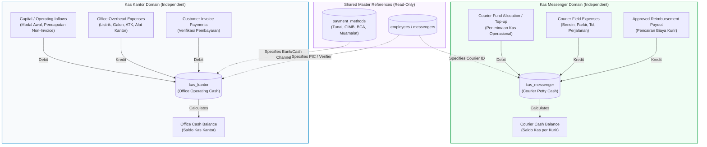
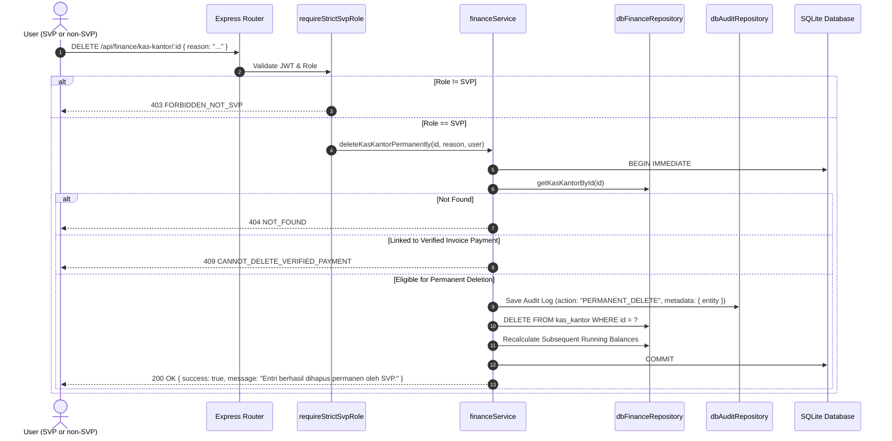

# TECHNICAL DESIGN DOCUMENT
# KAS MESSENGER & KAS KANTOR ARCHITECTURE

**Project:** SUN89 / SUNBiroJasa Admin Platform  
**Milestone:** Phase 4B Batch 2B — Kas Messenger & Kas Kantor Remediation  
**Status:** DRAFT / PENDING USER APPROVAL (STRICT READ-ONLY DESIGN)  
**Author:** Antigravity  
**Date:** 2026-11-10  

---

## 1. Executive Summary

This Technical Design Document defines the architectural overhaul, domain separation, API contracts, authorization rules, and data integrity safeguards for **Kas Messenger** and **Kas Kantor** within the SUN89 Admin Platform.

The design directly addresses the critical defects, architectural contradictions, and data risks identified during the forensic read-only audit:
1. **Domain Decoupling:** Establishing **Kas Messenger** and **Kas Kantor** as completely autonomous, standalone financial ledgers with zero balance interlocking or automatic cross-fund transfers.
2. **Reimbursement SSoT Realignment:** Aligning courier reimbursement disbursements so that operational expenses incurred by couriers (gas, parking, toll) are posted to and deducted strictly from **Kas Messenger**, eliminating the current contradiction where the frontend claims Kas Messenger disbursement while the backend debits Kas Kantor.
3. **Office Expense Governance:** Consolidating office operational costs (utilities, office supplies, tool purchases) into **Kas Kantor**, with explicit tracking of external payment methods (cash vs. commercial bank accounts) using the existing `payment_methods` master.
4. **Backend-Enforced Permanent Deletion (SVP-Only):** Retaining permanent deletion as an authorized feature strictly reserved for the `SVP` role. Direct physical deletions by any other role (`admin`, `finance`, `messenger`) will be rejected at the HTTP API layer with `403 FORBIDDEN`. Every deletion will be recorded in `audit_logs` with a mandatory reason, actor details, and a full pre-deletion entity snapshot.
5. **Frontend Bug Remediation:** Eliminating fictional hardcoded payment methods in `paymentMethodStore.ts` and correcting the inverted array indexing bug in `apiFinanceProvider.ts` that erroneously based running balances on the oldest historical transaction.

> [!IMPORTANT]
> This document represents an analysis and design phase only. **No production code, frontend components, database schemas, or tests are modified under this task.**

---

## 2. Confirmed Business Rules

The following core business rules have been confirmed and serve as absolute constraints for this design:

### 2.1 Rule 1: Kas Messenger Autonomy
- **Operational Scope:** Dedicated exclusively to messenger field operations, including fuel (bensin), parking fees, tolls, and errand travel costs.
- **Balance Impact:** All courier reimbursements and field operational expenses are recorded in and directly deduct from the **Kas Messenger** balance.
- **Standalone Invariant:** Kas Messenger operates independently. It must never draw balance from, transfer balance to, or influence the balance of Kas Kantor.

### 2.2 Rule 2: Kas Kantor Autonomy
- **Operational Scope:** Dedicated exclusively to general office overhead and administrative expenditures, including electricity, drinking water gallons, stationery, and hardware/equipment purchases.
- **Balance Impact:** Office expenditures are recorded in and directly deduct from the **Kas Kantor** balance.
- **Standalone Invariant:** Kas Kantor operates independently. It must never draw balance from, transfer balance to, or influence the balance of Kas Messenger.

### 2.3 Rule 3: Permanent Deletion Governed by SVP Role
- **Feature Preservation:** Permanent deletion remains an active, available feature. It will not be replaced by mandatory voiding or contra-entries.
- **Strict Role Boundary:** **Only the `SVP` role** is authorized to perform permanent deletions.
- **Backend Enforcement:** Authorization must be enforced at the server API layer. Requests from roles other than `SVP` (including `administrator`, `admin`, and `finance`) must be rejected with HTTP `403 Forbidden`.
- **Mandatory Audit Trail:** Every permanent deletion must generate an audit log capturing:
  - Actor identity (`userId`, `userName`, `userRole`);
  - Timestamp (ISO 8601);
  - Target data module (`Kas Kantor`, `Kas Messenger`, `Pengeluaran`, `Reimbursement`);
  - Target entity ID;
  - Mandatory justification / reason for deletion (`alasan`).

---

## 3. Current Architecture & Transaction Flows

### 3.1 Existing Database Entities
The current operational database contains the following relevant tables:
1. `kas_kantor` (Rows: 2): Office cash ledger with columns `id`, `tanggal`, `keterangan`, `status`, `debit`, `kredit`, `saldo`, `penanggung_jawab`, `order_no`, `invoice_no`, `kategori`.
2. `kas_messenger` (Rows: 0): Courier cash ledger with columns `id`, `tanggal`, `jenis`, `messenger`, `keterangan`, `debit`, `kredit`, `total`, `penanggung_jawab`, `order_no`, `reimbursement_id`, `receipt_url`, `kategori`, `messenger_id`.
3. `internal_transfers` (Rows: 0): Registry linking `kas_kantor_id` and `kas_messenger_id` with string account identifiers (`KAS_KANTOR`, `KAS_MESSENGER`).
4. `payment_methods` (Rows: 4): Master table (`pm-cash`, `pm-...-CIMB NIAGA`, `pm-...-BCA`, `pm-...-MUAMALAT`).
5. `messenger_reimbursements` (Rows: 0): Courier reimbursement requests.
6. `pengeluaran` (Rows: 0): Separate operating expense ledger with foreign key to `messenger_reimbursements(id)`.
7. `invoice_payments` (Rows: 7): Customer invoice payment records.

### 3.2 Current Flow: Reimbursement Payout (Contradictory Architecture)

```mermaid
sequenceDiagram
    autonumber
    actor Admin as Finance / Admin
    participant FE as FinanceContent (UI)
    participant Store as financeStore (Client)
    participant API as Express Router
    participant Service as messengerService
    participant DB as SQLite Database

    Admin->>FE: Click "Cairkan Reimbursement"
    Note over FE: Modal title: "Konfirmasi Pencairan Kas Messenger"<br/>Copy: "dibukukan ke Buku Kas Messenger"
    Admin->>FE: Confirm Payout
    FE->>Store: payReimbursement(id, { channel: "Kas Messenger" })
    Store->>Store: addKasMessenger({ in: 0, out: amount })
    Note over Store: Local state deducts Kas Messenger!
    Store->>API: POST /api/messenger/reimbursements/:id/pay
    API->>Service: payReimbursement(id, user, options)
    Note over Service: Service explicitly ignores Kas Messenger!<br/>Deducts from Kas Kantor instead!
    Service->>DB: addKasKantor({ status: "Kredit", kredit: amount })
    Service->>DB: updateReimbursement(status: "Dibayar")
    DB-->>Service: OK
    Service-->>API: Reimbursement Object
    API-->>Store: 200 OK
    Note over FE,Store: Desynchronization: Client thinks Kas Messenger paid;<br/>Database recorded payout in Kas Kantor!
```

---

## 4. Audit Findings & Discrepancies Summary

| Finding ID | Severity | Area | Problem Statement | Impact |
| :--- | :--- | :--- | :--- | :--- |
| **F-01** | **CRITICAL** | Reimbursement Payout | FE UI and client store deduct from `Kas Messenger`, but backend `messengerService` deducts from `Kas Kantor`. | Client-server accounting desynchronization; false reporting of courier balances. |
| **F-02** | **CRITICAL** | Data Erasure | `DELETE /api/finance/pengeluaran/:id` performs physical SQL delete without role restriction (accessible to `finance`). `deleteKasKantor` inserts reversal row under HTTP `DELETE`, causing FE optimistic splice desync. | Uncontrolled expenditure history loss; UI ghost rows on page reload. |
| **F-03** | **HIGH** | Payment Methods | Neither `kas_kantor` nor `kas_messenger` has a foreign key to `payment_methods`. Commercial bank deposits (BCA, CIMB) commingle with physical cash in a single balance. | Inability to reconcile physical cash safe vs. bank account balances. |
| **F-04** | **HIGH** | FE Saldo Calculation | `apiFinanceProvider.ts#L599` calculates optimistic running balance using `this.kasKantor[this.kasKantor.length - 1]`. Query returns `ORDER BY id DESC`, meaning index `length - 1` is the oldest row (Rp 0). | Client-side running balance displays incorrect totals. |
| **F-05** | **MEDIUM** | Frontend Store | `paymentMethodStore.ts` contains hardcoded fictional accounts (fictional BCA, BRI, Mandiri, QRIS) rather than operational database master accounts. | Display of non-existent bank accounts if network fetch lags. |
| **F-06** | **MEDIUM** | Kas Messenger Inflow | `POST /api/finance/kas-messenger` allows unconstrained manual cash entries without verified funding source. | Potential creation of unbacked courier cash balances. |
| **F-07** | **LOW** | Status Normalization | Historical status in `kas_kantor` uses mixed casing (`"DEBIT"` vs `"Debit"`). | Requires loose case-insensitive string checks in application code. |

---

## 5. Target Architecture

### 5.1 Decoupled Domain Architecture

The target architecture enforces complete domain isolation between Kas Messenger and Kas Kantor:



### 5.2 Key Architectural Tenets
1. **Zero Cross-Ledger Contamination:** Kas Messenger never credits Kas Kantor, and Kas Kantor never debits Kas Messenger. Internal transfers that artificially coupled the two ledgers are eliminated from normal operational paths.
2. **Reimbursement Source SSoT:** When an approved reimbursement is paid out, the expenditure is booked exclusively in `kas_messenger` (Kredit). Kas Kantor balance is completely unaffected.
3. **Office Expense SSoT:** All office operating expenditures (listrik, galon, perlengkapan) are booked exclusively in `kas_kantor` (Kredit). When recorded via the `pengeluaran` module, the transaction directly creates the corresponding credit in `kas_kantor`.
4. **Permanent Deletion Gatekeeper:** A dedicated authorization policy intercepts all delete operations, allowing execution only if the authenticated user has `role === "svp"` or `jabatan === "SVP"`.

---

## 6. Target Database Schema & Required Relations

### 6.1 Schema Modifications Overview
To preserve baseline data integrity and avoid breaking historical rows #1–#7:
- **No tables will be dropped or destructively recreated.**
- Schema adjustments will be executed via safe additive migrations (`ALTER TABLE ... ADD COLUMN ...`).
- All existing historical rows will gracefully accept `NULL` for newly added foreign keys.

### 6.2 Table Specifications

#### 1. `kas_kantor` (Office Cash Ledger)
```sql
-- Safe additive migration to link existing payment methods
ALTER TABLE kas_kantor ADD COLUMN payment_method_id TEXT REFERENCES payment_methods(id);
ALTER TABLE kas_kantor ADD COLUMN is_deleted INTEGER NOT NULL DEFAULT 0;
ALTER TABLE kas_kantor ADD COLUMN deleted_at TEXT;
ALTER TABLE kas_kantor ADD COLUMN deleted_by TEXT;
ALTER TABLE kas_kantor ADD COLUMN delete_reason TEXT;
```
- `payment_method_id`: References master `payment_methods(id)` (e.g., `'pm-cash'` for physical cash safe, or `'pm-...-BCA'` when overhead is paid via corporate bank transfer). Historical rows #1–#2 remain `NULL`.
- Status values normalized on write to uppercase: `'DEBIT'` (inflow) or `'KREDIT'` (outflow).

#### 2. `kas_messenger` (Courier Cash Ledger)
```sql
-- Safe additive migration to link structured reimbursement foreign key
ALTER TABLE kas_messenger ADD COLUMN is_deleted INTEGER NOT NULL DEFAULT 0;
ALTER TABLE kas_messenger ADD COLUMN deleted_at TEXT;
ALTER TABLE kas_messenger ADD COLUMN deleted_by TEXT;
ALTER TABLE kas_messenger ADD COLUMN delete_reason TEXT;
```
- `reimbursement_id`: Retains existing column, populated with the canonical `messenger_reimbursements.id` when created by a reimbursement payout.
- `messenger_id`: Strictly required on all new entries, referencing canonical `messengers(id)`.

#### 3. `pengeluaran` (Office Overhead Ledger)
```sql
ALTER TABLE pengeluaran ADD COLUMN kas_kantor_id INTEGER REFERENCES kas_kantor(id);
ALTER TABLE pengeluaran ADD COLUMN payment_method_id TEXT REFERENCES payment_methods(id);
ALTER TABLE pengeluaran ADD COLUMN is_deleted INTEGER NOT NULL DEFAULT 0;
ALTER TABLE pengeluaran ADD COLUMN deleted_at TEXT;
ALTER TABLE pengeluaran ADD COLUMN deleted_by TEXT;
ALTER TABLE pengeluaran ADD COLUMN delete_reason TEXT;
```
- `kas_kantor_id`: Foreign key linking the expense directly to its corresponding credit entry in `kas_kantor`.
- `payment_method_id`: Foreign key specifying how the expense was disbursed (Cash vs. Bank Transfer).

#### 4. `internal_transfers` (Status in Target Architecture)
- In the decoupled model, automatic or forced cross-cash transfers are deprecated.
- The table remains intact in SQLite schema to avoid destructive schema changes, but operational endpoints will no longer force inter-cash coupling.

---

## 7. Target API Contract & Authorization

### 7.1 Strict SVP Authorization Middleware
A dedicated authorization middleware `requireStrictSvpRole` will guard all permanent deletion endpoints:

```typescript
export function requireStrictSvpRole(req: AuthenticatedRequest, res: Response, next: NextFunction): void {
  if (!req.user) {
    res.status(401).json({ success: false, error: { code: "UNAUTHENTICATED", message: "Autentikasi diperlukan." } });
    return;
  }

  const role = (req.user.role || "").toLowerCase().trim();
  const jabatan = (req.user.jabatan || "").toUpperCase().trim();

  // Strictly enforce SVP role or jabatan
  if (role !== "svp" && jabatan !== "SVP") {
    res.status(403).json({
      success: false,
      error: {
        code: "FORBIDDEN_NOT_SVP",
        message: "Akses ditolak: Hanya role SVP (Supervisor) yang berwenang melakukan penghapusan data keuangan secara permanen.",
      },
      timestamp: new Date().toISOString(),
    });
    return;
  }

  next();
}
```

### 7.2 API Endpoints Matrix

| Module | Method & Path | Authorization | Purpose / Behavior |
| :--- | :--- | :--- | :--- |
| **Kas Kantor** | `GET /api/finance/kas-kantor` | `admin`, `finance`, `svp` | Read office cash ledger entries. |
| **Kas Kantor** | `POST /api/finance/kas-kantor` | `admin`, `finance`, `svp` | Record office cash transaction (requires valid `payment_method_id` for external funds). |
| **Kas Kantor** | `DELETE /api/finance/kas-kantor/:id` | **`svp` ONLY** | **Permanent deletion** of entry. Requires JSON body `{ reason: string }`. Writes audit log, purges row, recalculates running balances. |
| **Kas Messenger** | `GET /api/finance/kas-messenger` | `admin`, `finance`, `messenger`, `svp` | Read courier cash ledger entries (optionally filtered by `messengerId`). |
| **Kas Messenger** | `POST /api/finance/kas-messenger` | `admin`, `finance`, `svp` | Record courier operational fund entry (requires `messengerId`). |
| **Kas Messenger** | `DELETE /api/finance/kas-messenger/:id` | **`svp` ONLY** | **Permanent deletion** of courier cash entry. Requires `{ reason: string }`. Writes audit log, purges row, recalculates running balance. |
| **Reimbursement** | `POST /api/messenger/reimbursements/:id/pay` | `admin`, `finance`, `svp` | Disburses approved reimbursement **strictly into `kas_messenger`** (Kredit Rp X). Requires `idempotencyKey`. |
| **Pengeluaran** | `GET /api/finance/pengeluaran` | `admin`, `finance`, `svp` | Read office operating expenses. |
| **Pengeluaran** | `POST /api/finance/pengeluaran` | `admin`, `finance`, `svp` | Create office expense; atomically creates corresponding credit entry in `kas_kantor`. |
| **Pengeluaran** | `DELETE /api/finance/pengeluaran/:id` | **`svp` ONLY** | **Permanent deletion** of office expense and its linked `kas_kantor` entry. Requires `{ reason: string }`. Writes audit log. |

### 7.3 Permanent Deletion Contract Specification
- **Request Headers:**
  - `Authorization: Bearer <JWT>` (Must resolve to user with `role: "svp"`)
  - `X-Idempotency-Key: <UUID>`
- **Request Body:**
  ```json
  {
    "reason": "Salah input nominal oleh finance - disetujui SVP"
  }
  ```
- **Validation Rules:**
  - `reason` is mandatory, minimum 10 characters.
  - If caller role $\ne$ `svp`, return `403 FORBIDDEN_NOT_SVP`.
  - If entry does not exist, return `404 NOT_FOUND`.
  - If entry is linked to a verified invoice payment (`invoice_payments.kas_kantor_id`), permanent deletion is blocked with `409 CANNOT_DELETE_VERIFIED_PAYMENT` (must be unlinked or voided via payment lifecycle first).
- **Audit Log Entry (Atomic):**
  ```json
  {
    "action": "PERMANENT_DELETE",
    "module": "Kas Kantor",
    "userId": "usr-svp-01",
    "userName": "Admin Super (SVP)",
    "userRole": "svp",
    "details": "Penghapusan permanen Kas Kantor #12 (Alasan: Salah input nominal oleh finance - disetujui SVP)",
    "metadata": {
      "deletedId": 12,
      "deletedEntity": { "tanggal": "2026-11-10", "keterangan": "Beli Galon", "debit": 0, "kredit": 50000, "saldo": 513000 }
    }
  }
  ```

---

## 8. Target Frontend Behavior

### 8.1 Remediation of Running Balance Index Bug
In `src/data/api/apiFinanceProvider.ts`:
- **Current Defect:**
  ```typescript
  // Lines 599-600 & 727-728
  const lastTotal = this.kasKantor.length > 0
    ? (this.kasKantor[this.kasKantor.length - 1].total ?? ...)
    : 0;
  ```
- **Target Implementation:**
  Since the backend provides rows sorted newest-first (`ORDER BY id DESC`):
  ```typescript
  const lastTotal = this.kasKantor.length > 0
    ? Number(this.kasKantor[0].saldo ?? this.kasKantor[0].total ?? 0)
    : 0;
  ```
  Furthermore, the frontend store will refresh the full ledger from the backend response following any mutation to guarantee that running balances are governed strictly by the server.

### 8.2 Elimination of Mock Payment Methods
In `src/app/data/paymentMethodStore.ts`:
- Delete `DEFAULT_PAYMENT_METHODS` array.
- Initialize `methods: PaymentMethod[] = []`.
- Fetch active methods dynamically via `GET /api/payment-methods?activeOnly=true`.
- Display a clear loading skeleton while methods are being fetched. If offline, display a retry alert rather than falling back to fictional bank accounts.

### 8.3 Reimbursement Payout Modal Alignment
In `src/app/components/FinanceContent.tsx`:
- Update dialog title: `"Konfirmasi Realisasi Biaya Kas Messenger"`.
- Update description: `"Pencairan biaya operasional ini akan dibukukan secara langsung ke dalam Buku Kas Messenger kurir yang bersangkutan."`
- Display current courier balance and projected balance after disbursement.
- Ensure the toast notification reads: `"Pencairan reimbursement sebesar Rp X berhasil dibukukan ke Kas Messenger."`

### 8.4 Form Field Separation in `FinanceAddPage.tsx`
- Decouple internal cash funds (`Kas Kantor`, `Kas Messenger`) from external bank payment methods.
- Payment Method dropdown options will be sourced strictly from active `payment_methods` (e.g. `Tunai`, `Transfer BCA`, `Transfer CIMB NIAGA`, `Transfer MUAMALAT`).
- "Kanal Kas Internal" will be a distinct, optional field indicating which internal ledger tracks the disbursement, preventing confusion between bank accounts and internal cash boxes.

### 8.5 UI Permanent Deletion Handling
- Deletion button ("Hapus Transaksi") is rendered conditionally or disabled for non-SVP roles.
- Clicking delete prompts an AlertDialog with a required `alasan` (textarea).
- If a non-SVP attempts deletion, the frontend does **not** optimistically remove the item; it awaits the backend response. When the backend returns `403 FORBIDDEN_NOT_SVP`, a descriptive error toast is surfaced: `"Gagal menghapus: Hanya role SVP yang berwenang melakukan penghapusan permanen."`

---

## 9. Transaction Integrity & Balance Calculation

### 9.1 Server-Side Balance Authority
- The backend will **never trust client-supplied totals** (`item.total` or `item.saldo`).
- Any `total` or `saldo` sent in a request payload will be stripped or ignored.
- Running balances will be computed inside the database transaction:
  - **For `kas_kantor`:**
    ```sql
    SELECT COALESCE(SUM(debit), 0) - COALESCE(SUM(kredit), 0) AS balance FROM kas_kantor WHERE is_deleted = 0;
    ```
  - **For `kas_messenger`:**
    ```sql
    SELECT COALESCE(SUM(debit), 0) - COALESCE(SUM(kredit), 0) AS balance FROM kas_messenger WHERE messenger_id = ? AND is_deleted = 0;
    ```

### 9.2 Negative Balance Guards
- **Kas Kantor Outflow Guard:** Rejects outflows if `requestedAmount > currentOfficeBalance` with `400 INSUFFICIENT_OFFICE_BALANCE`.
- **Kas Messenger Outflow Guard:** Rejects courier outflows if `requestedAmount > currentCourierBalance` with `400 INSUFFICIENT_MESSENGER_BALANCE`.

### 9.3 Idempotency Enforcement
- All write operations (`POST /kas-kantor`, `POST /kas-messenger`, `POST /reimbursements/:id/pay`, and `DELETE`) require an `X-Idempotency-Key` header.
- Duplicate requests return the original successful response without re-executing ledger mutations.

---

## 10. Audit Logging & Permanent Deletion

### 10.1 Permanent Deletion Sequence Diagram



---

## 11. Migration Strategy & Historical Impact

### 11.1 Historical Data Protection Guarantees
- **Historical Payment Rows #1–#7:** Untouched. `payment_id = NULL` and `metode_pembayaran_id = NULL` are preserved.
- **Historical Kas Kantor Rows #1–#2:** Untouched. Baseline `saldo` and descriptions remain identical. `payment_method_id = NULL`.
- **Zero Loss of Hash Baseline:** Database operations will use backward-compatible migrations, preserving the operational integrity of existing tables.

### 11.2 Migration Script Outline (`server/src/database/migrations/2026-11-11-001-kas-domain-separation.ts`)
1. Verify foreign key constraints are enabled (`PRAGMA foreign_keys = ON`).
2. Add nullable columns `payment_method_id`, `is_deleted`, `deleted_at`, `deleted_by`, `delete_reason` to `kas_kantor`.
3. Add nullable columns `is_deleted`, `deleted_at`, `deleted_by`, `delete_reason` to `kas_messenger`.
4. Add nullable columns `kas_kantor_id`, `payment_method_id`, `is_deleted`, `deleted_at`, `deleted_by`, `delete_reason` to `pengeluaran`.
5. Run `PRAGMA foreign_key_check` to ensure 100% relational validity before commit.

---

## 12. Test Plan & Acceptance Criteria

### 12.1 Dedicated Test Suite
A dedicated test suite `tests/phase4b-batch2b-kas-messenger-kantor.test.ts` will be authored to validate:

1. **TC-KM-01 (Domain Autonomy):** Disbursing a reimbursement mutates `kas_messenger` and leaves `kas_kantor` balance 100% unchanged.
2. **TC-KM-02 (Courier Balance Isolation):** Transactions for Messenger A do not affect the balance of Messenger B.
3. **TC-KK-01 (Office Overhead Autonomy):** Recording an office expense (galon, listrik) mutates `kas_kantor` and leaves `kas_messenger` 100% unchanged.
4. **TC-KK-02 (Payment Method Linkage):** Recording an office expense with `payment_method_id: 'pm-cash'` sets the foreign key properly; invalid IDs are rejected with `400 INVALID_PAYMENT_METHOD`.
5. **TC-DEL-01 (SVP Authorization Enforcement):** Permanent deletion requested by `finance` or `admin` returns `403 FORBIDDEN_NOT_SVP`.
6. **TC-DEL-02 (SVP Permanent Deletion Execution):** Deletion requested by `svp` with valid `reason` permanently removes the row, creates an audit log with complete metadata, and correctly adjusts running balances.
7. **TC-DEL-03 (Missing Reason Rejection):** Deletion requested by `svp` without `reason` or with an empty string returns `400 VALIDATION_ERROR`.
8. **TC-FE-01 (Balance Indexing Verification):** Running balance calculation uses index 0 (newest row), not the oldest row.
9. **TC-REG-01 (Full Regression):** All 132 existing tests across 7 isolated suites remain 100% passing.

---

## 13. Risks, Trade-offs & Pending Approvals

### 13.1 Fact vs. Recommendation vs. Assumption Matrix

| Category | Item Description | Status / Source |
| :--- | :--- | :--- |
| **Audit Fact** | Backend `payReimbursement` currently credits `kas_kantor`, not `kas_messenger`. | Confirmed via source code audit (`messengerService.ts#L680`). |
| **Audit Fact** | `DELETE /pengeluaran/:id` performs a physical SQL delete accessible to `finance`. | Confirmed via source code audit (`financeRoutes.ts#L187`, `dbFinanceRepository.ts#L1120`). |
| **Audit Fact** | `payment_methods` operational table contains 4 active records (Tunai, CIMB, BCA, Muamalat). | Confirmed via SQLite query on `database.sqlite`. |
| **Audit Fact** | Frontend `apiFinanceProvider.ts` computes saldo against index `length - 1` (the oldest record). | Confirmed via source code audit (`apiFinanceProvider.ts#L599`). |
| **Confirmed Rule** | Kas Messenger and Kas Kantor must be completely standalone with zero mutual balance dependency. | Mandated by user business instructions. |
| **Confirmed Rule** | Permanent deletion must remain available, restricted strictly to SVP role with audit logging. | Mandated by user business instructions. |
| **Technical Recommendation** | Office expenses (`pengeluaran`) should automatically write an outflow to `kas_kantor` to eliminate double-entry desynchronization. | Recommended by Antigravity; pending confirmation. |
| **Technical Recommendation** | In-flight / pending historical transfers in `internal_transfers` table remain untouched as legacy records. | Recommended by Antigravity; pending confirmation. |

### 13.2 Pending Decisions for User Confirmation
1. **Office Expense Consolidation:** Does the user confirm that recording an item in `pengeluaran` should automatically record a corresponding credit in `kas_kantor` (so operators do not have to enter office expenses twice)?
2. **Permanent Deletion Scope:** Does the user confirm that permanent deletion by SVP should physically delete the database row (`DELETE FROM ...`) rather than setting a soft-delete flag, provided a complete JSON snapshot is preserved in `audit_logs`?
3. **Legacy `internal_transfers` Endpoints:** Does the user confirm that endpoints `/api/finance/transfer/office-to-messenger` and `/api/finance/transfer/messenger-to-office` should be disabled or restricted since the two cash domains are now strictly standalone?

---

## 14. Verification & Mandatory Stop

### 14.1 Integrity Baseline Verification (Pre- & Post-Design)
- **Operational Database (`server/data/database.sqlite`):**
  - SHA-256: `A8A4B1F77FCAB6EE0A9503B778DE7A7A7929100D9AD6F965EF707503609E379C` (100% Bit-for-Bit Intact)
  - Tables: 41 user tables | Total Rows: 1,314 | Integrity: `ok`
  - Historical payment rows #1–#7: All retain `payment_id = NULL`.
- **Uploads Manifest (`server/uploads/`):**
  - SHA-256: `4FD418787BCC18CBA3A55E78E02D87BDCA0372EBAA3BD8C696DB9C5B8C8242E5`
  - Files: 51 | Total Size: 1,525,984 bytes (100% Bit-for-Bit Intact)

### 14.2 Mandatory Stop Notice
Antigravity has concluded the technical analysis and design phase. **Zero source code, test files, database schemas, or runtime states were modified.** Antigravity halts operations and awaits formal review and implementation authorization from the user and ChatGPT.
