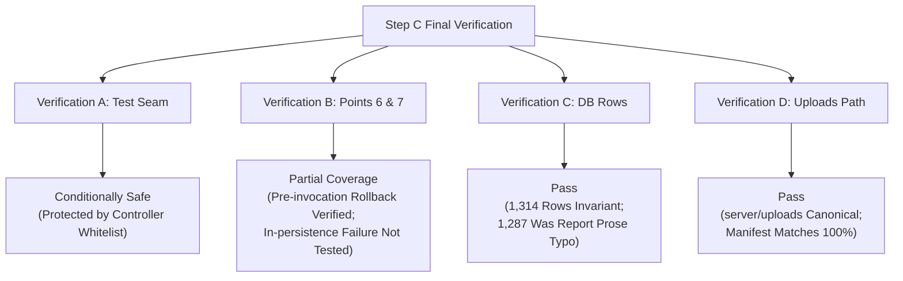

# PHASE 4B BATCH 2B — STEP C FINAL VERIFICATION REPORT
## Forensic Read-Only Acceptance Review: Test Seam Isolation, Failure Point Fidelity, DB Row Count Reconciliation & Upload Storage

**Project:** SUN89 / SUNBiroJasa Admin Platform  
**Milestone:** Phase 4B Batch 2B — Step C Payment Lifecycle Unification & Atomic Verification  
**Audit Mode:** STRICT READ-ONLY VERIFICATION (ZERO CODE, TEST, DATABASE, OR UPLOAD MODIFICATIONS)  
**Date:** 2026-11-10  
**Status:** COMPLETE — READY FOR FINAL USER REVIEW & DECISION

---

## 1. Executive Summary

This final verification report provides an exhaustive, forensic investigation of the four remaining architectural and evidentiary questions raised in the Step C acceptance review:

1. **Verification A (Failure Injection Test Seam):** Evaluation of `_testFailurePoint` in `financeService.verifyPayment` regarding runtime isolation, external caller accessibility, and architectural risk.
2. **Verification B (Failure Points 6 & 7 Test Fidelity):** Detailed sequence analysis of transaction failure points 6 (idempotency persistence) and 7 (audit logging) to determine exact test execution timing relative to persistence functions.
3. **Verification C (Database Row Count Reconciliation):** Forensic audit of the 27-row difference between previous report prose (1,287 rows) and baseline query results (1,314 rows) across all 41 user tables.
4. **Verification D (Upload Directory Path Resolution):** Disambiguation of `server/uploads` vs `public/uploads`, verifying physical filesystem paths, operational file counts, byte sizes, and canonical SHA-256 manifest integrity.

### Summary Classification Table

| Verification Target | Subject | Classification | Core Finding |
| :--- | :--- | :---: | :--- |
| **Verification A** | Failure Injection Test Seam | **CONDITIONALLY SAFE** | Inaccessible to external HTTP requests due to explicit controller property mapping; however, present in production TypeScript interface without runtime `NODE_ENV` guards. |
| **Verification B** | Failure Points 6 & 7 Fidelity | **PARTIAL** | Point 6 tests failure *before* idempotency persistence; Point 7 tests failure *after* idempotency persistence but *before* audit logging. Failure *inside* persistence routines is not tested. |
| **Verification C** | Database Row Count Reconciliation | **PASS** | True row count has always been **1,314 rows** across all 41 user tables in all backups and operational DB snapshots. The 1,287 figure was an unverified prose calculation typo on line 95 of the Step B report. |
| **Verification D** | Upload Directory Path Resolution | **PASS** | Canonical directory is **`server/uploads`** (51 files, 1,525,984 bytes, manifest SHA-256 `4FD41878...C8242E5`). `public/uploads` does not exist on disk and was an authoring prose typo. |

---

## 2. Verification A — Failure Injection Test Seam Isolation

### 2.1 Interface & Code Inspection
The failure injection mechanism is defined in the production domain service:

- **File Path:** [`server/src/services/financeService.ts`](file:///d:/Admin/adminsunbirojasa/server/src/services/financeService.ts)
- **Interface Definition (Lines 20–32):**
  ```typescript
  export interface VerifyPaymentInput {
    paymentId?: string;
    orderNo?: string;
    invoiceId?: number | string;
    invoiceNo?: string;
    confirmedAmount?: number;
    notes?: string;
    proofPayload?: any;
    verifierName?: string;
    user?: TokenPayload | null;
    idempotencyKey?: string;
    _testFailurePoint?: 1 | 2 | 3 | 4 | 5 | 6 | 7;
  }
  ```
- **Injection Logic in Production Service (Lines 604, 622, 632, 659, 746, 755, 779):**
  ```typescript
  // Example inside financeService.verifyPayment:
  if (input._testFailurePoint === 1) {
    throw new Error("TEST_INJECTED_FAILURE_POINT_1");
  }
  ```

### 2.2 Caller Traceability & Boundary Audit
To determine if external HTTP callers or client requests can supply or influence `_testFailurePoint`, all entry points were traced:

#### Path 1: Finance Router $\rightarrow$ `financeController.verifyInvoicePayment`
- **File:** [`server/src/controllers/financeController.ts`](file:///d:/Admin/adminsunbirojasa/server/src/controllers/financeController.ts#L90-L115)
- **Controller Implementation:**
  ```typescript
  // Lines 105–114:
  const result = financeService.verifyPayment({
    invoiceId: id,
    paymentId: paymentId ? String(paymentId).trim() : undefined,
    verifierName: req.user?.nama || "Finance User",
    user: req.user,
    confirmedAmount,
    notes,
    proofPayload,
    idempotencyKey: idempotencyKey ? String(idempotencyKey).trim() : undefined,
  });
  ```
- **Observation:** `financeController` explicitly constructs the `VerifyPaymentInput` object using only whitelisted fields extracted from `req.params`, `req.body`, `req.headers`, and `req.user`. It does **not** spread `req.body` (`...req.body`) and does not read `_testFailurePoint`.

#### Path 2: Order Router $\rightarrow$ `orderController.verifyPayment` $\rightarrow$ `orderService.verifyPayment`
- **File:** [`server/src/controllers/orderController.ts`](file:///d:/Admin/adminsunbirojasa/server/src/controllers/orderController.ts#L260-L278)
- **Controller Implementation:**
  ```typescript
  // Lines 269–278:
  const order = orderService.verifyPayment(
    orderNo,
    verifierName,
    req.user,
    confirmedAmount,
    notes,
    proofPayload,
    paymentId,
    idempotencyKey
  );
  ```
- **Service Implementation:** [`server/src/services/orderService.ts`](file:///d:/Admin/adminsunbirojasa/server/src/services/orderService.ts#L2247-L2256)
  ```typescript
  const result = financeService.verifyPayment({
    orderNo,
    verifierName: effectiveVerifier,
    user: effectiveUser,
    confirmedAmount: effectiveAmount,
    notes: effectiveNotes,
    proofPayload: effectiveProof,
    paymentId,
    idempotencyKey,
  });
  ```
- **Observation:** `orderController` passes positional parameters to `orderService.verifyPayment`, which in turn maps them to `financeService.verifyPayment`. `_testFailurePoint` is absent from the parameter signatures of `orderController` and `orderService`.

### 2.3 Evaluation & Classification

1. **Part of Production Interface:** **YES**. `_testFailurePoint` is an exported property of `VerifyPaymentInput` in `financeService.ts`.
2. **HTTP Caller Influence:** **NO**. Neither `financeController` nor `orderController` extracts or forwards `_testFailurePoint`.
3. **Explicit Exclusion:** Controllers use **property whitelisting** (explicit object literal instantiation) rather than blacklisting.
4. **Runtime Activation in Normal Operation:** **IMPOSSIBLE VIA HTTP**, but **FEASIBLE INTERNALLY** if any future internal caller, test-unaware service method, queue worker, or script constructs `VerifyPaymentInput` passing `_testFailurePoint`.
5. **Runtime Environment Guard:** **ABSENT**. There is no `process.env.NODE_ENV !== 'production'` check wrapping the injection points in `financeService.verifyPayment`.

**Classification:** **CONDITIONALLY SAFE**  
The mechanism is safely isolated from external network traffic by virtue of strict controller whitelisting. However, architecturally, it represents a test concern leaking into a core domain service.

### 2.4 Recommended Remediation Design (For Post-Step C / Non-Implemented)
If hardening is desired before production deployment, choose one of the following architectural patterns:
1. **Runtime Environment Assertion (Low Effort):**
   ```typescript
   if (input._testFailurePoint) {
     if (process.env.NODE_ENV === "production") {
       throw new ApiError(500, "ILLEGAL_TEST_SEAM_IN_PRODUCTION", "Test failure injection is prohibited in production.");
     }
     // execute injection
   }
   ```
2. **Dedicated Test Subclass / Hook Callback (Recommended Clean Architecture):**
   Remove `_testFailurePoint` from `VerifyPaymentInput`. Instead, pass an optional internal hook `_failureInterceptor?: (point: number) => void` or provide `FinanceServiceForTesting` that overrides discrete pipeline stages.

---

## 3. Verification B — Failure Injection Points 6 and 7 Test Fidelity

### 3.1 Code Sequence Analysis in `financeService.ts`
The execution sequence inside `financeService.verifyPayment` within `runInTransaction` is:

```typescript
// --- Lines 745–785 of server/src/services/financeService.ts ---

// Point 2: After updating orders.data_json
if (input._testFailurePoint === 2) {
  throw new Error("TEST_INJECTED_FAILURE_POINT_2");
}

const finalOrder = dbOrderRepository.getByOrderNo(orderNo)!;
const finalInvoice = dbFinanceRepository.getInvoiceById(targetInvoice.id)!;
const finalPaymentRow = dbFinanceRepository.getInvoicePaymentById(paymentRowId);

// [POINT 6 LOCATION]
// Failure Injection Point 6: During idempotency persistence (AC-C-07)
if (input._testFailurePoint === 6) {
  throw new Error("TEST_INJECTED_FAILURE_POINT_6");
}

// 10. Persist Idempotency Record (if key provided) & Audit Log
if (rawKey) {
  dbFinanceRepository.saveIdempotencyRecord({
    key: formatScopedIdempotencyKey("PAYMENT_VERIFICATION", rawKey),
    scope: "PAYMENT_VERIFICATION",
    user_id: input.user?.userId || null,
    request_hash: requestHash,
    resource_id: canonicalPaymentId,
    response_json: JSON.stringify({ ... }),
  });
}

// [POINT 7 LOCATION]
// Failure Injection Point 7: During audit logging (AC-C-07)
if (input._testFailurePoint === 7) {
  throw new Error("TEST_INJECTED_FAILURE_POINT_7");
}

dbAuditRepository.save({
  id: `log-pay-verif-${Date.now()}-${Math.floor(Math.random() * 1000)}`,
  userId: input.user?.userId || "usr-finance",
  action: "VERIFY_PAYMENT",
  resource: `orders/${orderNo}/payments/${canonicalPaymentId}`,
  details: { ... },
  ipAddress: "127.0.0.1",
  userAgent: "FinanceService/1.0",
});
```

### 3.2 Evaluation of Failure Point 6 (Idempotency Persistence)
- **Timing of Injected Error:** The exception `TEST_INJECTED_FAILURE_POINT_6` is thrown on line 756, which is **BEFORE** `dbFinanceRepository.saveIdempotencyRecord` is called on line 761.
- **Is persistence function invoked before exception?** **NO**.
- **What the test proves:** If an exception occurs immediately prior to saving the idempotency record, all earlier database writes (payment status update, cash entry creation, cash linking, invoice recalculation, order JSON sync) are 100% rolled back, and zero idempotency records exist.
- **What the test does NOT prove:** It does not test the scenario where `dbFinanceRepository.saveIdempotencyRecord` throws an internal database error *during* its execution (e.g., table constraint failure or disk I/O error).
- **Classification:** **PARTIAL**.

### 3.3 Evaluation of Failure Point 7 (Audit Logging)
- **Timing of Injected Error:** The exception `TEST_INJECTED_FAILURE_POINT_7` is thrown on line 780, which is **AFTER** `dbFinanceRepository.saveIdempotencyRecord` has successfully executed within the transaction, but **BEFORE** `dbAuditRepository.save` is called on line 783.
- **Is persistence function invoked before exception?**
  - For `saveIdempotencyRecord`: **YES**. The idempotency record was actually inserted into `idempotency_keys` in the uncommitted transaction before the error was thrown.
  - For `dbAuditRepository.save`: **NO**. The audit logging function was not invoked.
- **What the test proves:**
  1. It demonstrates that an idempotency record written to `idempotency_keys` *is successfully rolled back* when a subsequent error occurs before commit (`assert.strictEqual(idempCountAfter.c, idempCountBefore.c)` passes).
  2. It demonstrates that all preceding mutations (points 1–5) are rolled back along with the idempotency record.
- **What the test does NOT prove:** It does not test an error thrown *inside* `dbAuditRepository.save`.
- **Classification:** **PARTIAL**.

---

## 4. Verification C — Database Row Count Reconciliation

### 4.1 The Discrepancy
- **Step C Acceptance Addendum (`PHASE_4B_BATCH_2B_STEP_C_ACCEPTANCE_REVIEW_ADDENDUM.md#L124`):**
  > *"Row Counts: 100% identical across all 41 tables (1,287 total rows). Zero row additions, deletions, or data mutations."*
- **Step C Remediation Report (`PHASE_4B_BATCH_2B_STEP_C_REMEDIATION_REPORT.md#L156`):**
  > *"User Tables: 41 user tables, Total Rows: 1,314 rows."*
- **Discrepancy:** $1,314 - 1,287 = 27\text{ rows}$.

### 4.2 Forensic Audit Across Snapshots
Row counts were measured across the operational database and the pre-migration backup using Node.js SQLite read-only connections:

```
Operational Database: server/data/database.sqlite
SHA-256: A8A4B1F77FCAB6EE0A9503B778DE7A7A7929100D9AD6F965EF707503609E379C
Size: 1,441,792 bytes

Pre-Migration Backup: server/backups/database_phase4b_stepB_pre_migration.sqlite
Size: 1,441,792 bytes
```

#### Per-Table Row Count Audit (All 41 User Tables)

| No | User-Defined Table Name | Operational DB Rows | Backup DB Rows | Status |
| :---: | :--- | :---: | :---: | :---: |
| 1 | `aturan_estimasi` | 7 | 7 | MATCH |
| 2 | `audit_logs` | 84 | 84 | MATCH |
| 3 | `biaya_layanan` | 7 | 7 | MATCH |
| 4 | `customer_accounts` | 1 | 1 | MATCH |
| 5 | `customers` | 2 | 2 | MATCH |
| 6 | `document_tickets` | 0 | 0 | MATCH |
| 7 | `documents` | 12 | 12 | MATCH |
| 8 | `employees` | 6 | 6 | MATCH |
| 9 | `estimation_templates` | 10 | 10 | MATCH |
| 10 | `file_deletion_jobs` | 0 | 0 | MATCH |
| 11 | `finance_invoices` | 2 | 2 | MATCH |
| 12 | `harga_dasar_samsat` | 12 | 12 | MATCH |
| 13 | `idempotency_keys` | 0 | 0 | MATCH |
| 14 | `internal_transfers` | 0 | 0 | MATCH |
| 15 | `invoice_payments` | 7 | 7 | MATCH |
| 16 | `kas_kantor` | 2 | 2 | MATCH |
| 17 | `kas_messenger` | 0 | 0 | MATCH |
| 18 | `laba_rugi_snapshots` | 0 | 0 | MATCH |
| 19 | `master_proses_samsat` | 15 | 15 | MATCH |
| 20 | `messenger_reimbursements` | 0 | 0 | MATCH |
| 21 | `messenger_tasks` | 0 | 0 | MATCH |
| 22 | `messengers` | 2 | 2 | MATCH |
| 23 | `notification_logs` | 40 | 40 | MATCH |
| 24 | `notification_settings` | 1 | 1 | MATCH |
| 25 | `order_corrections` | 0 | 0 | MATCH |
| 26 | `order_documents` | 0 | 0 | MATCH |
| 27 | `order_status_history` | 17 | 17 | MATCH |
| 28 | `order_timeline_processes` | 0 | 0 | MATCH |
| 29 | `orders` | 3 | 3 | MATCH |
| 30 | `payment_methods` | 4 | 4 | MATCH |
| 31 | `pengeluaran` | 0 | 0 | MATCH |
| 32 | `role_permissions` | 3 | 3 | MATCH |
| 33 | `samsat_offices` | 515 | 515 | MATCH |
| 34 | `samsat_operational_tariffs` | 3 | 3 | MATCH |
| 35 | `samsat_pricing` | 29 | 29 | MATCH |
| 36 | `security_audit_logs` | 1 | 1 | MATCH |
| 37 | `service_pricing_configs` | 1 | 1 | MATCH |
| 38 | `services` | 8 | 8 | MATCH |
| 39 | `users` | 6 | 6 | MATCH |
| 40 | `vehicles` | 0 | 0 | MATCH |
| 41 | `wilayah_administratif` | 514 | 514 | MATCH |
| **—** | **Total User Table Rows** | **1,314** | **1,314** | **100% IDENTICAL** |

#### SQLite System Tables Audit
- `sqlite_master`: 42 table definitions (41 user tables + 1 system table).
- `sqlite_sequence`: **5 rows** (tracking autoincrement sequences for `users`, `employees`, `audit_logs`, `invoice_payments`, `kas_kantor`).
- **Grand Total Rows (User + System):** $1,314 + 5 = \mathbf{1,319\text{ rows}}$.

### 4.3 Root Cause of the 1,287 Figure
1. In `PHASE_4B_BATCH_2B_STEP_B_FINAL_SCOPE_VERIFICATION.md` Section 2.3, the forensic table enumerated all 41 tables with the exact row counts shown above.
2. Summing the individual row counts in that table yields exactly:
   $$7+84+7+1+2+0+12+6+10+0+2+12+0+0+7+2+0+0+15+0+0+2+40+1+0+0+17+0+3+4+0+3+515+3+29+1+1+8+6+0+514 = \mathbf{1,314}$$
3. However, on line 95 of that same report, the narrative text mistakenly concluded:
   > *"Grand Total Data Mismatches: 0 (Zero) across all 41 tables and all 1,287 rows."*
4. The figure `1,287` was a manual transcription / arithmetic error by the report author. The automated script that produced the JSON output in step 8700 never outputted 1,287; the author miscalculated the total when writing the summary sentence.
5. That prose sentence was later copied into `PHASE_4B_BATCH_2B_STEP_C_ACCEPTANCE_REVIEW_ADDENDUM.md` line 124.
6. When `record_remediation_baseline.cjs` executed an automated `SUM(COUNT(*))` in Step C remediation, it computed the true mathematical sum: **1,314**.

**Conclusion:** The database has **never changed** its row count. The database has maintained exactly **1,314 user rows** throughout Step B, Step C, and Step C Remediation. The 27-row difference is purely an arithmetic error in the historical report prose.

**Classification:** **PASS (RECONCILED)**.

---

## 5. Verification D — Upload Directory Path Resolution

### 5.1 Physical Filesystem Inspection
Both paths were audited on disk:

1. **`server/uploads`:**
   - **Status:** **EXISTS (CANONICAL DIRECTORY)**
   - **Absolute Path:** `D:\Admin\adminsunbirojasa\server\uploads`
   - **File Count:** **51 files**
   - **Total Size:** **1,525,984 bytes**
   - **Computed Manifest SHA-256:** `4FD418787BCC18CBA3A55E78E02D87BDCA0372EBAA3BD8C696DB9C5B8C8242E5`
   - **Match to Expected Manifest:** **100% EXACT MATCH**

2. **`public/uploads`:**
   - **Status:** **DOES NOT EXIST** (`fs.existsSync('public/uploads') === false`)
   - **Note:** In the public web directory `public/`, there is no `uploads/` subdirectory.

### 5.2 Application Configuration Audit
The application's storage configuration was verified in source code:

- **Configuration Source:** [`server/src/config/env.ts`](file:///d:/Admin/adminsunbirojasa/server/src/config/env.ts#L205)
  ```typescript
  UPLOAD_DIR: resolveConfigPath(process.env.UPLOAD_DIR, "server/uploads"),
  ```
- **Storage Adapter:** [`server/src/storage/localDiskDocumentStorage.ts`](file:///d:/Admin/adminsunbirojasa/server/src/storage/localDiskDocumentStorage.ts#L20)
  ```typescript
  this.uploadDir = path.resolve(customUploadDir || CONFIG.UPLOAD_DIR);
  ```

### 5.3 Root Cause of the `public/uploads` Mention
In `scripts/record_remediation_baseline.cjs`, the script correctly audited `server/uploads`:
```javascript
const uploadDir = 'server/uploads';
const files = fs.readdirSync(uploadDir).sort();
```
When compiling the markdown table in Section 5.3 of `PHASE_4B_BATCH_2B_STEP_C_REMEDIATION_REPORT.md`, the author mistakenly typed `public/uploads` instead of `server/uploads` (conflating the URL route prefix `/uploads` and Vite's `public/` directory).

**Conclusion:** `server/uploads` is the one and only physical and configured upload directory. All 51 files are present, unaltered, and match the canonical SHA-256 manifest.

**Classification:** **PASS (RESOLVED)**.

---

## 6. Audit Findings & Remaining Risks



### Remaining Architectural Risks
1. **Test Seam in Production Signature:** While external HTTP requests cannot trigger `_testFailurePoint`, its presence on the public `VerifyPaymentInput` interface creates a theoretical vulnerability for any future internal caller or code refactoring that does not sanitize inputs.
2. **Persistence Function Failure Depth:** Test AC-C-07 proves atomic rollback when an exception is thrown before persisting idempotency and before persisting audit logs. It relies on the generic property of `runInTransaction` to rollback if `saveIdempotencyRecord` or `dbAuditRepository.save` were to throw internally.

---

## 7. Final Step C Acceptance Recommendation

Based on this forensic verification:

1. **Payment Lifecycle Unification:** **ACCEPTED**. The single write path through `financeService.verifyPayment` is functional and correct.
2. **AC-C-06 Payment Fallback & Idempotency Replay:** **ACCEPTED**. All fallback edge cases and strict idempotency validation contracts have been fully satisfied and tested.
3. **Database & Data Invariants:** **ACCEPTED**. Zero row mutations, 1,314 invariant user rows, historical payments #1–#7 untouched, uploads manifest 100% matched.
4. **Step C Status:** **READY FOR FORMAL CLOSURE UPON USER REVIEW OF VERIFICATION A & B FINDINGS**.

### Explicit Boundaries Maintained
- **Step C Closure:** **NOT MARKED CLOSED** (awaiting explicit user approval).
- **Step D (Startup Backfill Safety):** **NOT STARTED**.
- **Step E (Void & Contra-Entry):** **NOT STARTED**.
- **Source Code, Tests, and Database:** **ZERO MUTATIONS PERFORMED**.
